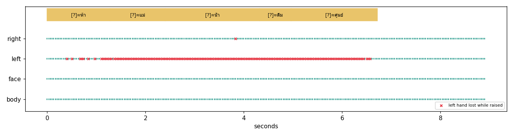

# Diagnosis — พ่อดื่มน้ำ

* intended (yours, not a verified label): **พ่อ ดื่ม น้ำ**
* heard: [?]≈ห้า · [?]≈แม่ · [?]≈น้ำ · [?]≈ดื่ม · [?]≈ศูนย์
* sentence: (withheld: not confident)
* hand tracking (raised-hand frames with all 21 points): left 0.366, right 0.996, longest gap 153 frames, 30.0 fps

| # | time (s) | status | P(correct) | top-5 | nearest reference clips |
|---|---|---|---|---|---|
| 1 | 0.00–1.28 | uncertain | 0.19 | ห้า 0.54, ศูนย์ 0.47, พ่อ 0.46, เก้า 0.40, น้องสาว 0.41 | ห้า (tslone, S_one_13, 0.44); ฉ (tslone, S_one_07, 0.43); ห้า (tslone, S_one_07, 0.42) |
| 2 | 1.28–2.40 | uncertain | 0.16 | แม่ 0.50, พ่อ 0.72, เก่ง 0.49, ดี 0.43, ทำไม 0.39 | พ่อ (tslone, S_one_17, 0.61); พ่อ (th_sl, S_thsl_04, 0.60); พ่อ (tslone, S_one_24, 0.59) |
| 3 | 2.40–4.32 | uncertain | 0.18 | น้ำ 0.43, ข้าว 0.70, น้า 0.41, แม่ 0.40, แฟน 0.51 | ส (tslone, S_one_21, 0.44); ส (tslone, S_one_03, 0.42); ส (tslone, S_one_24, 0.41) |
| 4 | 4.32–4.96 | uncertain | 0.33 | ดื่ม 0.55, พ่อ 0.40, ยาย 0.54, ย่า 0.31, ข้าว 0.50 | ดื่ม (agent, yt_person_022, 0.57); ดื่ม (th_sl, S_thsl_04, 0.52); ดื่ม (agent, yt_person_026, 0.48) |
| 5 | 4.96–6.72 | uncertain | 0.48 | ศูนย์ 0.53, ดื่ม 0.42, พ่อ 0.42, บอก 0.28, อิ่ม 0.26 | สระโอ (tslone, S_one_23, 0.54); ศูนย์ (tslone, S_one_14, 0.52); สระโอ (tslone, S_one_07, 0.49) |

| intended word | in vocabulary | diagnosis |
|---|---|---|
| พ่อ | True | landmark, segmentation, confusable |
| ดื่ม | True | landmark, segmentation, ok_despite_landmark+segmentation |
| น้ำ | True | landmark, segmentation, ok_despite_landmark+segmentation |
