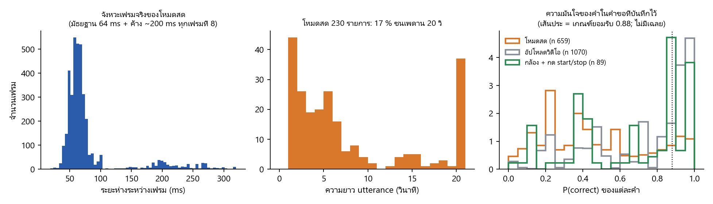
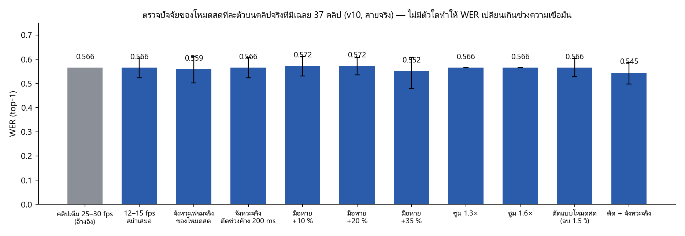
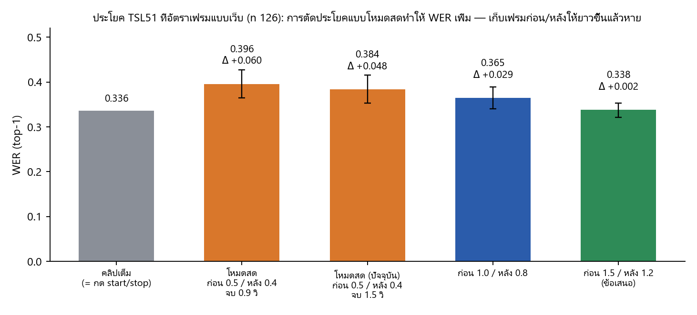
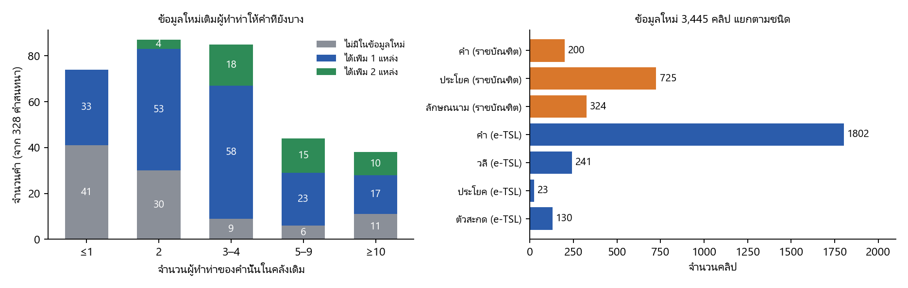
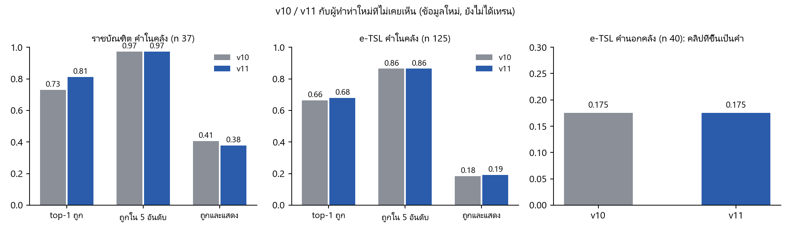

# Error Analysis สำหรับ v12 — ThaiSLM (การรู้จำภาษามือ + โหมดสด + ข้อมูลใหม่)

วันที่ 13–14 พ.ย. 2026 · ขอบเขต: sign model ทั้งสาย (ข้อมูล, ตัวอ่านคำ, segmentation, calibration) และโหมดสดบนเว็บ ·
รอบนี้เป็นการวิเคราะห์ + วางแผนเท่านั้น **ไม่มีการเทรนหรือแก้โมเดล** · ตัวเลขทุกตัววัดบนเครื่องนี้ด้วยสาย v10 จริง
(`models/model-v10`, ONNX, CPU) ยกเว้นที่ระบุว่าอ้างจากรายงาน v11 · สคริปต์และผลดิบ: `artifacts/eval/ea_v12/`

## 0. สรุป (อ่านส่วนนี้ก่อน)

1. **ตัวอ่านคำหลักไม่เคยถูกเทรนใหม่เลยตั้งแต่ v7** — `encoder.pt` (Uni-Sign ที่ fine-tune ครั้งเดียวเมื่อ 3 ต.ค., 3,000 steps, ดีที่สุดที่ step 1,500,
   ใช้ 38 นาที) v8–v11 เทรนเฉพาะ "ตัวอ่านเสริม" (landmark encoder, น้ำหนัก 0.3) จึงขยับผลรวมได้น้อย — นี่คือคันโยกหลักที่ยังไม่เคยลอง
2. **โมเดลติดเพดานเพราะข้อมูล ไม่ใช่สูตรเทรน** — v11 ลอง 9 สูตร ทุกตัวพีคที่ 6–12k steps แล้วลด ได้เพิ่มมากสุด +1.5 MRR; ความผิดพลาดขึ้นกับ
   "จำนวนคนที่ทำท่าคำนั้น" (1 คน ผิด 72 % → ≥ 10 คน ผิด 13 %) ไม่ใช่จำนวนคลิป
3. **ข้อมูลใหม่ 2 แหล่งเติมตรงจุดที่บาง** — คำสนทนา 231 จาก 328 คำได้ผู้ทำท่าใหม่อย่างน้อย 1 แหล่ง; ในคำที่มีผู้ทำ ≤ 2 คน (158 คำ) ได้เพิ่ม 90 คำ;
   และมี **ประโยคจริงพร้อมคำบรรยาย 725 + 264 คลิป** (สิ่งที่โครงการไม่เคยมี)
4. **โหมดสดแย่กว่ากด start/stop จริง และหาสาเหตุได้ 1 ข้อที่วัดได้ชัด:** การตัดประโยคด้วยกติกายกมือ/ลดมือ เก็บเฟรมก่อน–หลังสั้นเกิน (0.5 / 0.4 วิ)
   → WER ของประโยค 0.336 → **0.384** (+0.048, CI [+0.017, +0.079]); เก็บ 1.5 / 1.2 วิ แล้วกลับมา **0.338** (เท่าคลิปเต็ม) — แก้ได้ที่ฝั่งเบราว์เซอร์โดยไม่ต้องเทรน
5. **สิ่งที่ "ไม่ใช่" สาเหตุ (วัดแล้ว):** อัตราเฟรมต่ำ, จังหวะเฟรมไม่สม่ำเสมอของเบราว์เซอร์, มือหายเพิ่มถึง 35 %, ซูม 1.3–1.6× — ไม่ทำให้ WER เปลี่ยน
   → ข้อสรุปของรอบก่อนว่า "ต้องเทรนด้วย landmark แบบเว็บ" **ไม่มีหลักฐานรองรับ** ไม่ควรใช้งบเทรนกับเรื่องนี้
6. **โหมดสดมี utterance ที่ไม่ยอมจบ** — 17 % ของคำขอโหมดสดที่บันทึกไว้ชนเพดาน 20 วินาทีโดยเห็นมือเพียง 20 % ของเฟรม (กติกา "มือยังยกอยู่" นับจุดข้อมือ
   ที่ body pose เดาเอา)
7. **เรายังไม่มีข้อมูลโหมดสดที่มีเฉลย** — คำขอที่บันทึกไว้ 626 รายการไม่มี label จึงบอกไม่ได้ว่าโมเดลอ่านผิดหรือเกณฑ์เข้มเกิน → ต้องสร้าง
   "ชุดโหมดสดที่มีเฉลย" (เว็บแสดงคำให้ทำท่า แล้วบันทึกพร้อมเฉลย) เป็นงานแรกของ v12
8. **เกณฑ์ปล่อยรุ่นเดิมผ่านไม่ได้แม้โมเดลดีเท่าเดิม** — เทียบ ~60 metrics แต่ละตัวยอมได้ 0.25 SD → v11 และ dual reader "ตก 21 metrics" ทั้งที่ตัวเลขหลักเสมอหรือดีขึ้น
   → v12 ใช้ 6 ตัวชี้วัดหลักที่กำหนดล่วงหน้า

9. **v10 / v11 กับผู้ทำท่าใหม่ (ข้อ 6):** top-1 v10 0.73 (ราชบัณฑิต) / 0.66 (e-TSL), v11 0.81 / 0.68 (รวม Δ +0.031, ไม่มีนัยสำคัญ); top-5 0.97 / 0.86 แต่ถูกแสดงเพียง 0.41 / 0.18; คำที่มีผู้ทำ ≤ 1 คนในคลังถูก 0.39 เทียบ ≥ 10 คน 0.89

## 1. จุดตั้งต้น: v10 กับ v11 (BLIND-v11, อ้างจาก result_v11)

| ตัวชี้วัด | v10 | v11 | หมายเหตุ |
|---|---|---|---|
| WER ประโยค TSL51 1× / 1.5× / 2× | 0.276 / 0.217 / 0.273 | 0.280 / 0.243 / 0.280 | v11 แย่ลงที่ 1.5× |
| WER คำเดี่ยว · ประโยคต่อเนื่อง (fluent) | 0.274 · 0.354 | 0.274 · **0.329** | จุดเดียวที่ v11 ดีขึ้นอย่างมีนัยสำคัญ |
| ความแม่นคำเดี่ยวบนช่วงที่ถูกต้อง (top-1) | 0.837 | 0.837 | |
| R@1 ของผู้ใช้ที่แย่ที่สุด | 0.455 | 0.450 | |
| segmentation tax (คำที่อ่านถูกบนช่วงจริงแต่หลุดในสายจริง) | 0.117 / 0.105 / 0.175 | 0.152 / 0.164 / 0.216 | |
| คำถูกที่ถูกแสดง | 0.43–0.60 | 0.42–0.62 | เกณฑ์ 0.88 |
| ท่านอกคลังคำที่ขึ้นเป็นคำ | 17.0 % | 12.5 % | |
| เว็บจริง 148 คลิป: WER top-1 · WER ที่แสดง | 0.592 · 0.674 | 0.601 · 0.733 | recall 0.33 → 0.27 |

## 2. ทำไม v11 และรอบรวม (merge) ไม่ชนะ v10

| ข้อสังเกต | หลักฐาน | ความหมาย |
|---|---|---|
| ตัวอ่านหลักไม่ถูกแตะ | `model_card.json`: v10 = v9 recognition byte-identical; `config.json`: `encoder_run = enc-v7-europe-west4`; ประวัติเทรน: val 0.444 → 0.480 ที่ step 1,500 แล้วนิ่ง, 37.9 นาที | งานเทรน 13 ชั่วโมง GPU ของ v11 ลงที่ตัวอ่านเสริมซึ่งมีน้ำหนัก 0.3 ในการโหวต |
| ตัวอ่านหลักอ่านคนใหม่ได้ไม่ดีตั้งแต่ต้น | val ตอน fine-tune (open vocab R@1): TSL-ONE-S 0.83 แต่ th_sl 0.21, TTRS 0.19 | generalise ข้ามคน/ข้ามแหล่งยังอ่อนที่ตัวหลัก |
| สูตรเทรนไม่ใช่ข้อจำกัด | R0–R8: MRR 0.41–0.46; พีคที่ 6–12k steps ทุกตัว; seed SD 0.004 | เพิ่ม loss/สถาปัตยกรรมไม่ช่วย ต้องเพิ่ม "คน" และ "label ที่ถูก" |
| encoder ใหม่อ่านช่วงที่ decoder ตัดได้แย่กว่าช่วงจริง | tax เพิ่ม 0.105 → 0.164 | ต้องฝึก/อ่านให้ทนกับขอบที่คลาดเคลื่อน (อ่านหลาย crop, ฝึกด้วยขอบที่ decoder ตัดจริง) |
| "แสดงคำน้อยลงบนเว็บ" = สเกลความมั่นใจเลื่อน | P(correct) คำถูก 0.774 → 0.716, คำผิด 0.453 → 0.382 | ต้อง fit เกณฑ์ยอมรับในโดเมนที่ใช้งานจริง และเทียบที่ precision เท่ากันเสมอ |
| เกณฑ์ปล่อยรุ่นเข้มเกินเชิงสถิติ | ~60 metrics × tolerance 0.25 SD; v11 ตก 21, dual reader ตก 21 | ผู้สมัครที่ "ดีเท่าเดิม" ก็ตก → ไม่ได้บอกว่าแย่ลงจริง |

## 3. โหมดสด เทียบกับ กด start / stop

### 3.1 โค้ดสองโหมดต่างกันตรงไหน

ทั้งสองโหมดส่ง "ทั้ง utterance" ไปที่ endpoint เดียวกัน (`/v1/translate/stream`) และได้คำตอบสุดท้ายจากสายเดียวกัน ต่างกันเฉพาะ **การตัดว่า utterance เริ่ม–จบที่ไหน**

| | กด start / stop | โหมดสด (`useSignEngine.ts`) |
|---|---|---|
| เริ่ม | ผู้ใช้กด (มือยังอยู่ท่าพัก) | มือจริงยกถึงระดับทำท่า ≥ 250 ms; เก็บเฟรมย้อนหลัง **500 ms** |
| จบ | ผู้ใช้กด (มือลงแล้ว) | "มือไม่อยู่ระดับยก" นาน 0.9 / 1.5 / 2.5 วิ (ตั้งค่าได้); ส่งเฟรมถึง **400 ms** หลังมือลง; เพดาน 20 วิ |
| ระหว่างทำ | ไม่มีอะไรรัน | WebSocket `/v1/live` รันสายทั้งเส้นทุก 0.5 วิ เพื่อแสดงคำสด (ไม่มีผลต่อคำตอบสุดท้าย) |
| กรองสั้น | ≥ 0.6 วิ | ≥ 1.2 วิ และมือยก ≥ 0.6 วิ |

### 3.2 คำขอที่บันทึกไว้ 626 รายการ (ไม่มีเฉลย)

| กลุ่ม | n | ความยาวมัธยฐาน | fps | เห็นมือ (สัดส่วนเฟรม) | segment ที่ถูกยอมรับ | utterance ที่ไม่มีคำแสดงเลย | P มัธยฐาน |
|---|---|---|---|---|---|---|---|
| โหมดสด (กล้องจริง) | 230 | 5.6 วิ | 12.1 | 0.56 | **8.8 %** | **81 %** | 0.41 |
| กล้อง + กด start/stop | 9 | 20.5 วิ | 15.6 | 0.60 | 29 % | 0 % | 0.77 |
| อัปโหลดวิดีโอ (ส่วนใหญ่คลิปจาก dataset) | 209 | 8.2 วิ | 30.0 | 0.84 | 40 % | 27 % | 0.85 |

ข้อควรระวัง: สามกลุ่มนี้ **เนื้อหาต่างกัน** (โหมดสดมีการทดลองท่านอกคลัง / ยกมือค้าง ฯลฯ ของเจ้าของงาน) และกลุ่มกด start/stop มีแค่ 9 รายการ — ใช้บอก "ภาพที่ผู้ใช้เห็น"
(โหมดสดส่วนใหญ่ขึ้น `[?]`) ได้ แต่ใช้สรุปสาเหตุไม่ได้ จึงต้องทำการทดลองแบบควบคุมใน 3.3–3.5

สิ่งที่วัดได้ตรง ๆ จากคำขอโหมดสด:
- **จังหวะเฟรม:** มัธยฐาน 64 ms (~16 fps) แต่มี **ช่วงค้าง ~200 ms ทุกเฟรมที่ 8** (ขั้นตอน blendshape/สีหน้าที่รันบนเส้นทางเดียวกับ landmark) → เฉลี่ยเหลือ ~12 fps
- **utterance ไม่ยอมจบ:** 38 / 230 (17 %) ชนเพดาน 20 วิ โดยเห็นมือเพียง 20 % ของเฟรม และอีก 27 รายการ (12 %) ยาว 9–19 วิ เห็นมือ 35 % —
  กติกาจบใช้ `handsUp` ซึ่งนับ "จุดข้อมือของ body pose" (ที่โมเดลเดาได้แม้มืออยู่นอกภาพ) ว่ามือยังยก (บางรายการอาจเป็นการทดสอบยกมือค้างของเจ้าของงานเอง)
- **มือหาย:** ภายในช่วงทำท่า มือหาย 9.7 % ของเฟรม (วิดีโอ dataset 5.2 %); ช่วงที่มือหายยาว > 0.3 วิ มี 32 % (dataset 14 %); มือสลับเห็น/ไม่เห็น 1.43 ครั้ง/วิ (0.67)
- **ระยะกล้อง:** ขนาดมือ / ความกว้างไหล่ มัธยฐาน 0.68 (dataset 0.61) — เจ้าของงานนั่งใกล้กล้องกว่าคนใน dataset เล็กน้อย

### 3.3 ทดลองแบบควบคุม: ใส่ "ปัจจัยของโหมดสด" ทีละตัวลงบนคลิปจริงที่มีเฉลย

คลิป 37 คลิป (data_test 5 · team-drive 18 คลิป 3 คน · iPhone ของเจ้าของ 14) landmark 25–30 fps → ดัดแปลง → รันสาย v10 จริง → เทียบกับเฉลย (paired bootstrap 2,000 ครั้ง)

| เงื่อนไข | WER top-1 | Δ เทียบคลิปเต็ม [CI 95 %] | WER ที่แสดง |
|---|---|---|---|
| คลิปเต็ม (อ้างอิง) | 0.566 | — | 0.703 |
| 12–15 fps สม่ำเสมอ | 0.566 | 0.000 [−0.047, +0.042] | 0.690 |
| จังหวะเฟรมจริงของโหมดสด (สุ่มจากคำขอจริง 60 รายการ) | 0.559 | −0.007 [−0.064, +0.047] | 0.710 |
| จังหวะจริงแต่ตัดช่วงค้าง 200 ms ออก | 0.566 | 0.000 [−0.045, +0.041] | 0.690 |
| มือหายเพิ่ม 10 % / 20 % / 35 % (ความยาวช่วงหายสุ่มจากคำขอจริง) | 0.572 / 0.572 / 0.552 | +0.007 / +0.007 / −0.014 (CI คร่อม 0 ทั้งหมด) | 0.703 / 0.717 / 0.717 |
| ซูม 1.3× / 1.6× | 0.566 / 0.566 | 0.000 | 0.703 / 0.703 |
| ตัดแบบโหมดสด (จบ 0.9 / 1.5 วิ) | 0.552 / 0.566 | −0.014 / 0.000 (คร่อม 0) | 0.724 / 0.724 |
| ตัด + จังหวะจริง (จบ 0.9 / 1.5 วิ) | 0.579 / 0.545 | +0.014 / −0.021 (คร่อม 0) | 0.724 / 0.724 |

**ข้อสรุป:** สาย v10 ทนต่ออัตราเฟรม จังหวะเฟรม มือหาย และขนาดในภาพได้ดีอยู่แล้ว — ปัจจัยเหล่านี้ไม่ใช่สาเหตุที่โหมดสดแย่ และ **ไม่คุ้มที่จะใช้งบเทรนเพื่อแก้**
(ช่วงค้าง 200 ms มีผลต่อความลื่นของภาพ ไม่มีผลต่อความแม่นที่วัดได้) · ข้อจำกัด: n 37 คลิป ช่วงความเชื่อมั่น ±0.04–0.06 — ผลต่างที่เล็กกว่านี้ตรวจไม่เจอ

### 3.4 การตัดประโยคแบบโหมดสด — สาเหตุที่วัดได้

ประโยค TSL51 ของชุด TUNE ที่อัตราเฟรมแบบเว็บ (126 ประโยค, landmark MediaPipe 10 fps) ผ่านกติกาโหมดสดที่ port จาก TypeScript ทีละบรรทัด

| การตัด | WER top-1 | Δ [CI 95 %] | ประโยคที่ถูกแบ่งเป็น 2 ท่อน | เฟรมที่เหลือ |
|---|---|---|---|---|
| คลิปเต็ม (= กด start/stop) | 0.336 | — | — | 100 % |
| โหมดสด จบ 0.9 วิ (ก่อน 0.5 / หลัง 0.4 วิ) | 0.396 | **+0.060 [+0.031, +0.092]** | 18 % | 81 % |
| โหมดสด จบ 1.5 วิ (ค่าปัจจุบัน) | 0.384 | **+0.048 [+0.017, +0.079]** | 4 % | 83 % |
| ก่อน 1.0 / หลัง 0.8 วิ | 0.365 | +0.029 [+0.005, +0.052] | 4 % | 92 % |
| **ก่อน 1.5 / หลัง 1.2 วิ** | **0.338** | +0.002 [−0.012, +0.017] | 4 % | 96 % |

คำที่หายคือคำแรก/คำท้ายของประโยค (จำนวนคำที่อ่านได้ต่อคำอ้างอิง 0.95 → 0.91): tagger ถูกฝึกกับคลิปที่มีท่าพักก่อนและหลัง เมื่อคลิปเริ่ม/จบกลางการยกมือ
มันตัดสินขอบของคำแรกและคำสุดท้ายผิด · ที่ค่า 0.9 วิ ประโยค 18 % ถูกแบ่งเป็นสองท่อนเพราะหยุดกลางประโยค · บนคลิปจริงสั้น ๆ 37 คลิปไม่เห็นผลนี้ (3.3)
เพราะส่วนใหญ่เป็นคำเดี่ยว/ประโยคสั้นที่ถ่ายโดยมีท่าพักน้อยอยู่แล้ว → **แก้:** เก็บเฟรมก่อน 1.5 วิ หลัง 1.2 วิ, ค่าเริ่มต้นจบ ≥ 1.5 วิ, และถ้ามือกลับขึ้นมาภายใน ~1.2 วิ ให้ต่อ utterance เดิม
(ต้นทุน: คำขอล่วงหน้าที่ส่งตอน 0.5 วิหลังมือลงต้องรอเฟรมท้าย → ต้องวัด latency ที่เพิ่ม)

### 3.5 คำสด (stream) เทียบกับคำตอบสุดท้าย

| ชุด | WER top-1 คำตอบสุดท้าย | WER คำสดที่ยืนยันแล้ว | ความแม่นของคำที่แสดง | หน่วงก่อนยืนยัน | คำสดเปลี่ยนก่อนยืนยัน |
|---|---|---|---|---|---|
| คลิปจริง 37 คลิป | 0.566 | 0.497 | สด 0.66 · สุดท้าย (เฉพาะที่ยอมรับ) 1.00 | 2.3 วิ | 2.3 ครั้ง/utterance |
| ประโยค TSL51 แบบเว็บ 126 | 0.336 | 0.384 (+0.048 [+0.022, +0.074]) | สด 0.70 · สุดท้าย 0.99 | 1.9 วิ | 2.3 ครั้ง |

คำสดอ่านได้ใกล้เคียงคำตอบสุดท้าย แต่แสดงทุกคำโดยไม่ผ่านเกณฑ์ยอมรับ (ถูก 66–70 %) ขณะที่คำตอบสุดท้ายแสดงเฉพาะคำที่มั่นใจ (ถูก 99–100 % แต่แสดงแค่ ~1/3 ของคำ)
→ ผู้ใช้เห็นคำสดหลายคำ แล้วคำตอบสุดท้ายเหลือ `[?]` — สองรอบนี้ยังไม่ใช้หลักฐานร่วมกัน ("คำสดยืนยันคำเดียวกัน" ควรเป็นหลักฐานเพิ่มให้รอบสุดท้าย)

### 3.6 สิ่งที่ยังตอบไม่ได้

ผลของ "ตัวผู้ใช้จริงหน้ากล้องจริง" (การจัดเฟรม แสง มุมกล้อง ความเร็ว จังหวะการหยุด คำที่เลือกทำ) ยังวัดไม่ได้ เพราะไม่มีข้อมูลโหมดสดที่มีเฉลย
คำขอโหมดสดที่บันทึกไว้ได้ P มัธยฐาน 0.41 แต่ปัจจัยที่จำลองได้ทั้งหมดอธิบายไม่ได้ → ต้องมีเครื่องมือ **"บันทึกโหมดสดแบบมีโจทย์"**: หน้าเว็บแสดงคำ/ประโยคให้ทำ
บันทึก landmark ต่อเนื่องทั้ง session พร้อมเฉลย แล้วตัดซ้ำสองแบบ (ตามโจทย์ = กด start/stop, ตามกติกายกมือ = โหมดสด) → ได้การเทียบโหมดสด–กดปุ่มแบบจับคู่บนกล้องจริงเป็นครั้งแรก

## 4. "โดเมนเว็บ" จริง ๆ ต่างจาก offline ตรงไหน

วิดีโอต้นฉบับ 491 คลิป แยก landmark สองแบบ: offline 25–30 fps (ในคลังข้อมูล) กับแบบเว็บ ~10 fps (ชุด `w_*` ของรอบ merge)

| แหล่ง | n | เห็นมืออย่างน้อย 1 ข้าง (offline / เว็บ) | เห็นสองมือ | มือหายกลางท่า |
|---|---|---|---|---|
| รวม | 491 | 0.770 / 0.771 | 0.420 / 0.424 | 0.036 / 0.034 |
| ประโยค TSL51 | 204 | 0.790 / 0.790 | 0.222 / 0.228 | 0.073 / 0.070 |
| th_sl | 155 | 0.583 / 0.583 | 0.319 / 0.316 | 0.008 / 0.004 |
| TTRS | 111 | 0.996 / 0.998 | 0.947 / 0.959 | 0.004 / 0.002 |

การแยก landmark ที่อัตราเฟรมต่ำ **ไม่ทำให้มือหายเพิ่ม** — ชุด "แบบเว็บ" ของรอบก่อนจึงเท่ากับชุด offline ที่ถูกลดเฟรมเท่านั้น ไม่ได้แทนกล้องจริง
ความต่างของกล้องจริง (มือหายเป็นช่วงยาว, ระยะกล้อง) อยู่ในข้อ 3.2 และจำลองแล้วไม่กระทบสาย (3.3) → ไม่ต้องแยก landmark ทั้งคลังใหม่ที่ fps ต่ำ

## 5. ข้อมูลใหม่ 2 แหล่ง (EDA เบื้องต้น)

| | ราชบัณฑิต (`cloud_s3/sign-ราชบัณฑิต`) | e-TSL จุฬา (`cloud_s3/sign-etsl-chula`) |
|---|---|---|
| คลิป | 1,249 (คำ 200 · ประโยค 725 · ลักษณนาม 324) | 2,196 (คำ 1,802 · วลี 241 · ประโยค 23 · ตัวสะกด 130) |
| วิดีโอ | 640×480, 25/50 fps, 4–11 วิ | 1920×1080, 25 fps, 6–9 วิ, สตูดิโอพื้นฟ้า |
| ผู้ทำท่า (ดูจากภาพตัวอย่าง — ต้องยืนยันด้วย face clustering) | อย่างน้อย 2 คน (ชาย, หญิง) + คู่สนทนาหันหลังในคลิปถาม–ตอบ; ผู้ทำท่าหันเฉียง ~30–45° ในคลิปสนทนา | เห็น 1 คน (หญิง) ในตัวอย่างทั้งหมด |
| คำในคลังสนทนา 328 คำ | 54 คำ (Core 11, Extended 43) | 224 คำ (Core 26, Extended 198, thin 54) |
| คำที่มีในคลังข้อมูลเดิม (ทุกคำ) | 146 / 200 | 1,338 / 1,924 |
| concept ใหม่ | 54 | 586 |
| metadata | หมวด 29 กลุ่ม, คำบรรยายประโยค, 17 คำซ้ำกับ TSL51 (thdict) | ความหมายไทย/อังกฤษ, ชนิดคำ, หมวด, คำพ้อง, จำนวนท่าต่อคำ (278 รายการมี > 1 ท่า), 113 คำมี ≥ 2 แบบ |

**ผลต่อคลังคำสนทนา (328 คำ):** ได้ผู้ทำท่าใหม่ ≥ 1 แหล่ง **231 คำ** (2 แหล่ง 47 คำ) · คำ "thin" 55 / 106 · ไม่ครอบคลุม 97 คำ (รวมเลข 0–10 ทั้งหมด)

| ผู้ทำท่าของคำในคลังเดิม | ไม่มีในข้อมูลใหม่ | ได้ 1 แหล่ง | ได้ 2 แหล่ง |
|---|---|---|---|
| ≤ 1 คน | 41 | 33 | 0 |
| 2 คน | 30 | 53 | 4 |
| 3–4 คน | 9 | 58 | 18 |
| 5–9 คน | 6 | 23 | 15 |
| ≥ 10 คน | 11 | 17 | 10 |

**ประโยค (ราชบัณฑิต 725):** 710 ประโยคมีคำในคลัง ≥ 2 คำ, 688 มี ≥ 3 คำ; คำในคลังที่ปรากฏ 256 คำ (เช่น คุณ 480, ไป 165, กิน 57, มา 55, น้ำ 48, ลูก 45);
354 ประโยคเป็นบทถาม–ตอบ · คำบรรยายเป็น **ประโยคภาษาไทย ไม่ใช่ลำดับท่ามือ** (ลำดับคำไทย ≠ ลำดับภาษามือ และคำอย่าง "ครับ/ค่ะ/ถาม/ตอบ" ไม่ได้ทำท่า)
→ ใช้เป็น "ถุงคำที่อาจมีในประโยค" ได้ ใช้เป็นลำดับเฉลยตรง ๆ ไม่ได้ · ทุกประโยคมี "คำหัวเรื่อง" ที่ผู้ทำท่าคนเดียวกันทำแบบคำเดี่ยวไว้ด้วย = จุดยึดสำหรับหาตำแหน่งคำในประโยค

**คำ focus:** กิน คุณ ยาย ไป (2 แบบ) อะไร เหงา น้า ข้าว อา ย่า ดู ส่ง ปลา น้ำ มีใน e-TSL · น้อง ญาติ ลูก แฟน สวัสดี มีในราชบัณฑิต (+ ประโยคละ 4) ·
**ไม่มี:** เที่ยว กลับ ฉัน มา ต้อง

**ความเสี่ยงของข้อมูลใหม่ที่ต้องจัดการตอนเตรียมข้อมูล:** (1) ท่าในพจนานุกรมอาจเป็น "อีกแบบ (form)" ของคำเดียวกัน — ต้องแยก form ไม่เฉลี่ยรวม
(2) คลิปถาม–ตอบมี 2 คนในภาพ ต้องล็อกผู้ทำท่า (3) รายการที่มี > 1 ท่าเป็นคำประสม ไม่ใช่คำเดี่ยว (4) ลักษณนามไม่ใช่ตัวอย่างของคำหัวเรื่อง
(5) ผู้ทำท่าใหม่มีน้อยคน (ประมาณ 3–4 คน) — ต้องกันไว้ทดสอบอย่างน้อย 1 คนเต็ม ๆ (6) ลิขสิทธิ์: เป็นสื่อของหน่วยงาน ใช้เพื่อวิจัย ไม่เผยแพร่วิดีโอต่อ

## 6. v10 / v11 กับผู้ทำท่าใหม่ที่ไม่เคยเห็น

คลิปคำเดี่ยวของผู้ทำท่าใหม่ที่โมเดลไม่เคยเห็น 202 คลิป (ราชบัณฑิต 37 + e-TSL 125 คำในคลัง, e-TSL 40 คำนอกคลัง) ผ่านสายจริงของ v10 และ v11

| ชุด | n | top-1 ถูก v10 → v11 | ถูกใน 5 อันดับ | ถูกและแสดง | แสดงคำผิด | เห็นมือ (สัดส่วนเฟรม) |
|---|---|---|---|---|---|---|
| ราชบัณฑิต — คำในคลัง | 37 | 0.730 → 0.811 | 0.973 → 0.973 | 0.405 → 0.378 | 0.000 → 0.000 | 0.42 |
| e-TSL — คำในคลัง | 125 | 0.664 → 0.680 | 0.864 → 0.864 | 0.184 → 0.192 | 0.024 → 0.032 | 1.00 |
| e-TSL — คำนอกคลัง | 40 | — | — | — | 0.175 → 0.175 (ขึ้นเป็นคำ) | 1.00 |

รวม 162 คลิป: top-1 v10 0.679 → v11 0.710 (Δ +0.031, CI 95 % [-0.012, +0.074]) · ถูกและแสดง 0.235 → 0.235 (Δ +0.000, CI [-0.031, +0.037]) → **v11 กับ v10 ต่างกันไม่มีนัยสำคัญบนผู้ทำท่าใหม่**

| ผู้ทำท่าของคำนั้นในคลังเดิม | n | top-1 v10 → v11 | top-5 v10 → v11 | ถูกและแสดง v10 → v11 |
|---|---|---|---|---|
| ≤ 1 คน | 28 | 0.393 → 0.429 | 0.643 → 0.643 | 0.000 → 0.000 |
| 2 คน | 44 | 0.545 → 0.636 | 0.864 → 0.909 | 0.136 → 0.136 |
| 3–4 คน | 45 | 0.800 → 0.778 | 0.978 → 0.933 | 0.178 → 0.222 |
| 5–9 คน | 19 | 0.842 → 0.895 | 0.947 → 0.947 | 0.526 → 0.526 |
| ≥ 10 คน | 26 | 0.885 → 0.885 | 1.000 → 1.000 | 0.538 → 0.462 |

Core 0.885 → 0.885 / Extended 0.640 → 0.676 (top-1) · **อ่านได้:** (1) กับคนใหม่ ความแม่นขึ้นกับจำนวนผู้ทำท่าในคลังอย่างชัดเจน (0.39 → 0.89) ทั้งสองรุ่น — ยืนยันว่าต้องเพิ่ม "คน"
(2) คำตอบถูกอยู่ใน 5 อันดับแรก 86–97 % แต่ถูกแสดงเพียง 18–41 % → เกณฑ์ยอมรับเข้มเกินสำหรับคนใหม่ (งาน calibration) (3) ท่านอกคลังขึ้นเป็นคำ 17.5 % เท่ากันทั้งสองรุ่น
(4) คลิปราชบัณฑิตเห็นมือเพียง 42 % ของเฟรม (640×480, มีช่วงพักยาว) แต่ยังอ่านได้ดี · label พจนานุกรมอาจเป็นคนละแบบท่ากับในคลัง ตัวเลขจึงเป็นขอบล่าง

## 7. ภาพรวมข้อมูลเดิม และปัญหาคุณภาพข้อมูลที่ยังค้าง

| แหล่ง | คลิป | ผู้ทำท่า | concept | บทบาทหลัก |
|---|---|---|---|---|
| th_sl | 15,432 | 8 | 6,760 | คำกว้าง, คนน้อย (1 คนต่อ form เป็นส่วนใหญ่) |
| TTRS | 10,084 | 9 | 4,537 | คำกว้าง, เห็นมือ 99.6 % |
| TSL-ONE-S | 4,147 | 29 | 184 | คนมาก, คำน้อย (มีแต่ landmark ไม่มีวิดีโอ) |
| TSL51 | 2,648 | 25 | 113 | คำสนทนา + ประโยค 252 คลิปของผู้ทำ 1 คน |
| YouTube / agent | 525 + | 23 + | 441 | คนหลากหลาย, label จากชื่อคลิป |

- **ความลึกของผู้ทำท่า (ตัวแปรที่อธิบายความผิดพลาดได้ดีที่สุด):** จาก 328 คำสนทนา มี 158 คำที่มีผู้ทำ ≤ 2 คน; Core (≥ 5 effective signers) มีเพียง 38 คำ
- **คำดูด (attractor):** คำที่มี 1–4 คลิปดูดคำอื่น เช่น "กลับ" (1 คน 2 คลิป) ดูด "ไป" 42 / 47, "ดู" (4 คน 6 คลิป) ดูด "กิน" 64 ครั้ง (EA-v11) — ข้อมูลใหม่ไม่มี "กลับ" จึงต้องแก้ด้วยการตรวจ label/แบบท่า และกติกาคลัง
- **หลายแบบท่า:** 87 คำมี ≥ 2 form; ข้อมูลใหม่จะเพิ่ม form อีก
- **ประโยคธรรมชาติ:** เดิมมีเฉพาะประโยค TSL51 แบบ template ของผู้ทำคนเดียว + ประโยคสังเคราะห์จากการต่อคำ → ราชบัณฑิตเป็นแหล่งแรกที่มีประโยคจริงหลายร้อยประโยค
- **label จากหลายแหล่งยังไม่เคยถูกตรวจแบบข้ามคน** (มีเฉพาะการตรวจคลิป auto-aligned 24 คลิป) → ควรตรวจด้วยการทำนายแบบกันผู้ทำท่าออก แล้วดูด้วยตาเฉพาะคลิปที่น่าสงสัย

## 8. สาเหตุ → สิ่งที่ v12 ควรทำ

| # | สาเหตุ (หลักฐาน) | สิ่งที่ทำใน v12 | คาดหวัง / วิธีตัดสิน |
|---|---|---|---|
| 1 | คนต่อคำน้อย (ข้อ 2, 7) | นำข้อมูลใหม่เข้า Standard Schema อย่างระวัง; ใส่ผู้ทำท่าใหม่เข้า "คลัง" ก่อน (ไม่ต้องเทรน) | ความแม่นตามจำนวนผู้ทำในคลัง; วัดบนผู้ทำท่าใหม่ที่กันไว้ |
| 2 | ตัวอ่านหลักไม่เคยเทรนใหม่ (ข้อ 2) | fine-tune ตัวอ่านหลักต่อจาก enc-v7 ด้วยผู้ทำท่าใหม่ + การสุ่มแบบข้ามคน + ตัวควบคุม P0 | ถ้าไม่ชนะตัวควบคุมเกิน 2 SD = "อิ่มตัว" เก็บ enc-v7 |
| 3 | ขอบคำคลาดเคลื่อน (tax 0.10–0.18) | อ่านแต่ละช่วงหลาย crop (ขยับขอบ ±2/±4 เฟรม) + ฝึกด้วยขอบที่ decoder ตัดจริง; ไม่เปลี่ยน segmentation | tax ลดโดย WER ไม่แย่ |
| 4 | ไม่มีประโยคธรรมชาติ (ข้อ 5) | หาตำแหน่งคำในประโยคราชบัณฑิตโดยใช้คำหัวเรื่องของผู้ทำคนเดียวกันเป็นจุดยึด และจำกัด label ไว้ที่คำในคำบรรยาย | ตรวจด้วยตา ≥ 85 % ถูก; ได้ชุดทดสอบประโยคจริง |
| 5 | เกณฑ์ยอมรับตั้งจากข้อมูล offline (ข้อ 2, 3.2) | fit ความมั่นใจด้วยข้อมูลโดเมนใช้งานจริง + ตัวแปรคุณภาพภาพ (fps, สัดส่วนเห็นมือ, ขนาดมือ) + "คำสดยืนยันคำเดียวกัน" | recall ที่ precision เท่า v10 |
| 6 | โหมดสดตัดประโยคสั้นไป (3.4) | เก็บเฟรมก่อน 1.5 วิ / หลัง 1.2 วิ, ต่อ utterance เมื่อมือกลับขึ้นเร็ว | WER ประโยคในโหมดสด = คลิปเต็ม |
| 7 | utterance ไม่ยอมจบ (3.2) | จุดข้อมือที่เดาได้ยื้อ utterance ได้ไม่เกิน 0.8 วิหลังมือจริงหาย | สัดส่วนที่ชนเพดาน 20 วิ |
| 8 | ไม่มีข้อมูลโหมดสดที่มีเฉลย (3.6) | เครื่องมือบันทึกแบบมีโจทย์ + เจ้าของงานบันทึก ~15 นาที | ตัวชี้วัดโหมดสดตัวแรกที่เชื่อถือได้ |
| 9 | เกณฑ์ปล่อยรุ่นผ่านไม่ได้ (ข้อ 2) | 6 ตัวชี้วัดหลักกำหนดล่วงหน้า + บันได (ladder) ที่ปล่อย "ขั้นที่ผ่าน" ได้ | จบภายใน v12 |
| — | **ไม่ทำ** (วัดแล้วไม่คุ้ม): เทรนด้วย landmark แบบเว็บ/ลด fps, แยก landmark ใหม่ทั้งคลัง, segmentation ใหม่, CTC, hand detector, loss แบบ phonology, encoder ใหญ่ขึ้น | | |

## 9. ข้อจำกัดของการวิเคราะห์นี้

- การทดลองโหมดสดทั้งหมดเป็น **การจำลองบนคลิปที่มีเฉลย** (ไม่ใช่คนทำท่าหน้ากล้องสด) — ชุดคลิปจริงมี 37 คลิป, ชุดประโยคเป็นผู้ทำท่า TSL51 คนเดียว
- คำขอที่บันทึกไว้ไม่มีเฉลยและเป็นของเจ้าของงานคนเดียว — ใช้ได้กับสถิติของ "ภาพที่กล้องเห็น" เท่านั้น
- จำนวน/ตัวตนของผู้ทำท่าในข้อมูลใหม่ดูจากภาพตัวอย่าง 13 เฟรม ยังไม่ได้ทำ face clustering
- การจับคู่คำในคำบรรยายกับคลังคำใช้การเทียบข้อความแบบง่าย (ยังไม่ได้ตัดคำด้วย pythainlp) — ตัวเลข 256 คำ / 710 ประโยคเป็นค่าประมาณด้านสูง
- ผล v10 / v11 บนผู้ทำท่าใหม่ (ข้อ 6) วัดบนตัวอย่าง 202 คลิป; label ของพจนานุกรมอาจเป็นคนละแบบท่ากับในคลัง จึงเป็น "ขอบล่าง" ของความสามารถจริง
