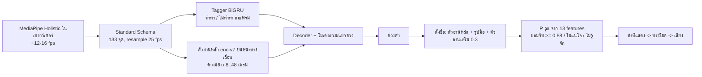
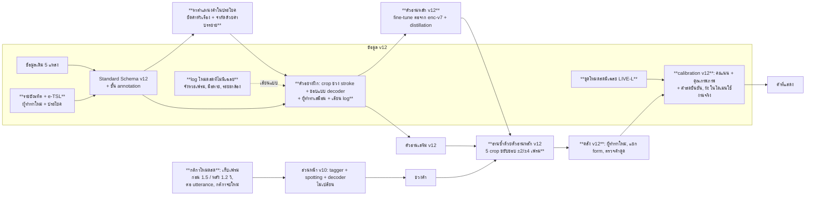
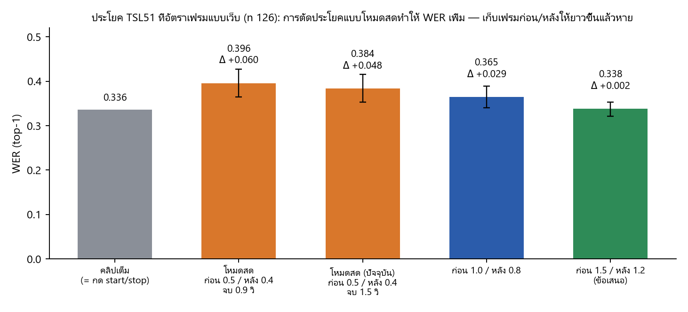
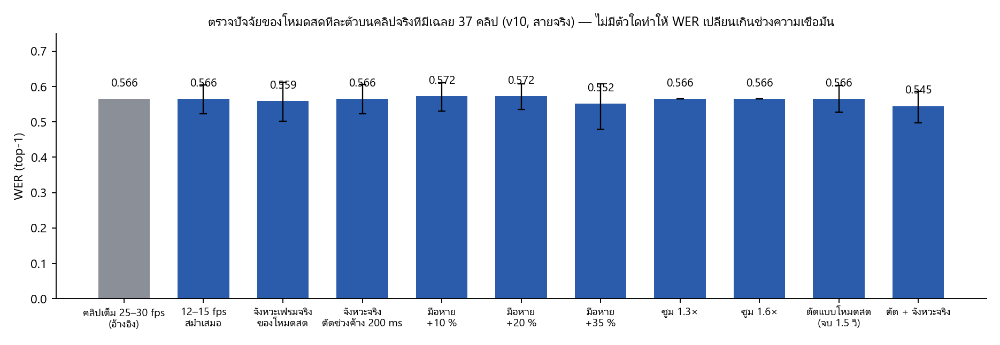
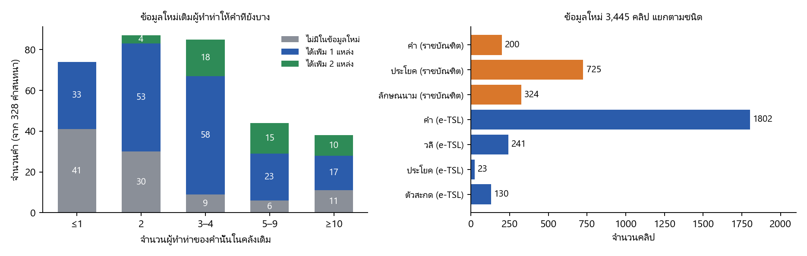
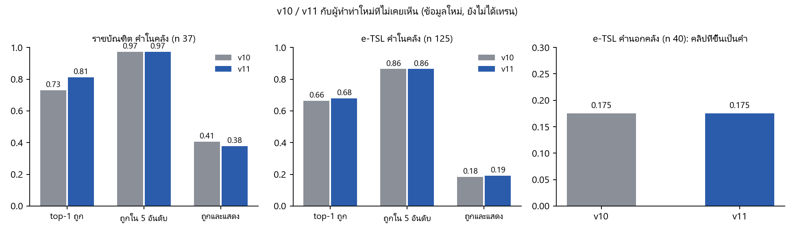
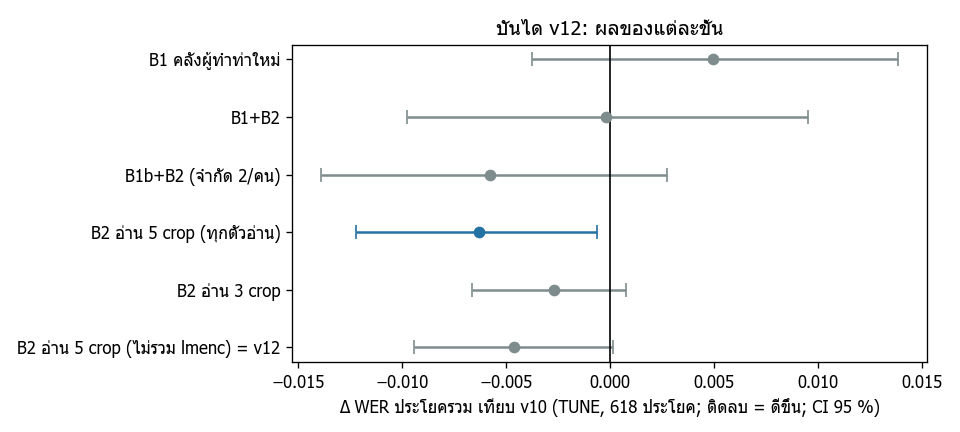
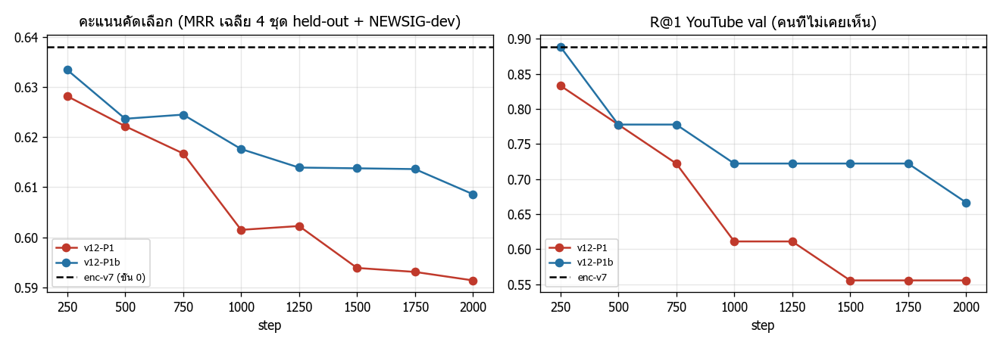
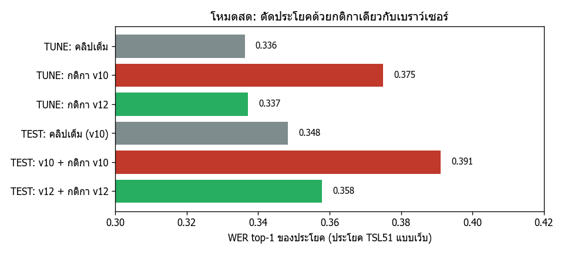

# ThaiSLM v12 — รายงานผล (ฉบับสมบูรณ์: บริบท · การวิเคราะห์ · สถาปัตยกรรม · ผลของรอบลงมือทำ)

วันที่ 13–15 พ.ย. 2026 · ขอบเขต: sign model (ข้อมูล, ตัวอ่านคำ, segmentation, calibration) + โหมดสดบนเว็บ + การประเมินทั้งระบบ

> **สถานะของเอกสารนี้:** ข้อ 1–4 และ 6 คือฉบับรอบวางแผน (คงไว้ตามเดิม) · ข้อ 5 เติมคอลัมน์ v12 แล้ว · ข้อ 7–10 คือผลของรอบลงมือทำ (TPH 1–4, 15 พ.ย. 2026)
> **ผลสรุป: v12 ไม่แย่กว่า v10 ในทุกตัวชี้วัดหลัก, โหมดสดดีขึ้นชัดเจน, แต่ไม่ผ่านเกณฑ์ปล่อยรุ่นที่กำหนดล่วงหน้า (ต้องชนะ ≥ 2 ข้อ; ชนะ 0) — การตัดสินใจ ship อยู่ที่เจ้าของงาน (ข้อ 10)**

## 1. บริบท: v10 → v11 → รอบรวม → v12

| รุ่น | ทำอะไร | ผล |
|---|---|---|
| **v10** (ใช้งานอยู่) | การรู้จำเท่ากับ v9 ทุก byte + โหมดสด (stream) + ประตูตรวจ "กำลังทำท่าอยู่จริง" | ตัวตั้งต้นของทุกตัวเลข |
| **v11** | ตัวอ่านเสริมใหม่ (cross-signer + virtual signer), segmentation ใหม่ 3 แบบ, ชั้นตัดสินใหม่ (open-set, conformal), hand detector, adaptation — 13 ชั่วโมง GPU ($25.5) | ไม่ผ่านเกณฑ์ → ไม่ ship; ดีขึ้นจริงเฉพาะ WER ประโยคต่อเนื่อง (0.354 → 0.329) และท่านอกคลัง (17.0 → 12.5 %); แย่ลงบนเว็บจริง (แสดงคำน้อยลง) |
| **รอบรวม (merge)** | นำข้อดี v11 มาต่อ v10: dual reader, calibration สองชั้น, tail guard | ไม่มีตัวใดผ่านเกณฑ์ → v10 ยังเป็นค่าเริ่มต้น |
| v12 (วางแผน) | Error Analysis ใหม่ + ข้อมูลใหม่ 2 แหล่ง + แผน 16 ชั่วโมง | `Error-Analysis-for-v12.pdf` + `prompt-opt-v12.md` + `related-work.txt` (หมวด R–V) |
| **v12 (ลงมือทำ)** | ข้อมูลใหม่ 3,440 คลิป + อ่านหลาย crop + กติกาโหมดสด + ตัวอ่านหลักเทรนต่อ 2 รอบ ($2.44) | ไม่แย่กว่า v10 ทุกข้อ, โหมดสดดีขึ้น, ตัวอ่านหลักอิ่มตัว; ไม่ผ่านเกณฑ์ 2 ชนะ (ข้อ 7) |

## 2. ข้อค้นพบหลักของ Error Analysis (รายละเอียด: `error-analysis/Error-Analysis-for-v12.pdf`)

| # | ข้อค้นพบ | ตัวเลข | ผลต่อแผน |
|---|---|---|---|
| 1 | ตัวอ่านคำหลักไม่เคยเทรนใหม่ตั้งแต่ v7 | fine-tune ครั้งเดียว 3,000 steps (ดีที่สุดที่ 1,500), 38 นาที; v8–v11 เทรนเฉพาะตัวอ่านเสริม (น้ำหนัก 0.3) | การทดลองหลักของ v12 |
| 2 | เพดานมาจากข้อมูล ไม่ใช่สูตรเทรน | 9 สูตรใน v11 ได้มากสุด +1.5 MRR; ผิด 72 % เมื่อคำมีผู้ทำ 1 คน → 13 % เมื่อ ≥ 10 คน | ลงทุนที่ข้อมูลและ label |
| 3 | ข้อมูลใหม่เติมจุดที่บาง | 231 / 328 คำสนทนาได้ผู้ทำท่าใหม่; ประโยคจริงพร้อมคำบรรยาย 725 + 264 คลิป | เตรียมข้อมูลอย่างประณีต (TPH 1) |
| 4 | โหมดสดตัดประโยคสั้นไป | WER ประโยค 0.336 → 0.384 (+0.048 มีนัยสำคัญ); เก็บเฟรมก่อน 1.5 / หลัง 1.2 วิ → 0.338 | แก้ที่เบราว์เซอร์ ไม่ต้องเทรน |
| 5 | fps ต่ำ / จังหวะเฟรม / มือหาย / ซูม ไม่ใช่สาเหตุ | WER 0.552–0.572 ทุกเงื่อนไข เทียบ 0.566 (CI คร่อม 0) | ไม่ใช้งบเทรนกับเรื่องนี้ |
| 6 | utterance โหมดสดไม่ยอมจบ | 17 % ชนเพดาน 20 วิ โดยเห็นมือ 20 % ของเฟรม | แก้กติกาจบ |
| 7 | ไม่มีข้อมูลโหมดสดที่มีเฉลย | คำขอ 626 รายการไม่มี label | เครื่องมือบันทึกแบบมีโจทย์ |
| 8 | เกณฑ์ปล่อยรุ่นเดิมผ่านไม่ได้เชิงสถิติ | ~60 metrics × 0.25 SD | 6 ตัวชี้วัดหลัก + บันได |

## 3. สถาปัตยกรรม

### 3.1 v10 (ปัจจุบัน)

### 3.2 v12 (ออกแบบ — ส่วนที่เพิ่ม/เปลี่ยนเป็นตัวหนา)

### 3.3 ส่วนประกอบใหม่ของ v12

| ส่วน | คืออะไร | แก้ปัญหาอะไร | ความเสี่ยง / ตัวกัน |
|---|---|---|---|
| **Standard Schema v12 + annotation** | คอลัมน์ใหม่: ชนิดคลิป (คำเดี่ยว/ประสม/ลักษณนาม/ตัวสะกด/ประโยค), เฟสการเคลื่อน (เตรียม–stroke–เก็บมือ), form, มือถนัด, คะแนนคุณภาพ, ตัวอย่างคลัง (exemplar), สถานะ label, คำบรรยาย | ข้อมูลเก่า+ใหม่มีความหมายเดียวกันทุกแหล่ง; โมเดลเห็น "ท่า" ไม่ใช่ "แหล่ง" | ตรวจด้วย contact sheet ทุกชั้น |
| **นโยบายความลึกของผู้ทำท่า** | ตัดสินทุกเรื่องบนตาราง (คำ × คน × form) | ข้อค้นพบ 2 | — |
| **ตรวจ label ข้ามคน + ตรวจคำดูด** | ทำนายแบบกันผู้ทำท่าออก → คลิปน่าสงสัยดูด้วยตา → แยก form / ตัดออก | ขยะไม่เข้าคลัง | ดูด้วยตา ≤ 200 คลิป |
| **Caption-constrained spotting** | หาคำในประโยคด้วยคลิปคำเดี่ยวของผู้ทำคนเดียวกัน + อนุญาตเฉพาะคำที่อยู่ในคำบรรยาย + เทียบกับคะแนนของคำที่ไม่อยู่ในคำบรรยาย | ไม่มีตัวอย่างคำในประโยคจริง | ตรวจตา ≥ 85 %, น้ำหนัก 0.5 |
| **ตัวอ่านหลัก v12** | fine-tune ต่อจาก enc-v7; สุ่ม batch แบบข้ามคน; ตรึงกับ embedding เดิมสำหรับคำที่ข้อมูลใหม่ไม่ครอบคลุม | ข้อค้นพบ 1 | ตัวควบคุม P0; ถ้าไม่ชนะ = เก็บ enc-v7 |
| **Re-reader (Path R)** | ส่วนหน้า v10 ไม่เปลี่ยน; เปลี่ยนเฉพาะ "การตั้งชื่อ" ช่วงคำ | segmentation แย่ลงไม่ได้โดยโครงสร้าง | RSS เพิ่ม → fp16 |
| **อ่านหลาย crop** | อ่านแต่ละช่วง 5 ครั้งโดยขยับขอบ แล้วเฉลี่ยคะแนน | segmentation tax | latency |
| **Calibration v12** | เพิ่มตัวแปรคุณภาพภาพ + "คำสดยืนยัน"; fit บน offline + เว็บ + LIVE-L + ตัวอย่างเลียน log; เลือกเกณฑ์ที่ precision เท่า v10 | แสดงคำน้อยบนเว็บ | ไม่ fit ส่วนโครงสร้างใหม่ |
| **กติกาโหมดสด** | เก็บเฟรมก่อน/หลังยาวขึ้น, ต่อ utterance เมื่อมือกลับขึ้นเร็ว, ข้อมือที่เดาได้ยื้อได้ ≤ 0.8 วิ, ตัดที่ช่วงพักเมื่อชนเพดาน | ข้อค้นพบ 4, 6 | latency ของคำขอล่วงหน้า |
| **บันทึกโหมดสดแบบมีโจทย์** | เว็บแสดงโจทย์ บันทึก landmark ทั้ง session + เฉลย; ตัดซ้ำได้ทั้งแบบกดปุ่มและแบบโหมดสด | ข้อค้นพบ 7 | ใช้เพื่อ calibrate/ทดสอบเท่านั้น ไม่เข้าชุดเทรน |
| **เกณฑ์ปล่อยรุ่น 6 ตัว + บันได B0–B7** | ทุกการเปลี่ยนเป็น 1 ขั้น วัดแยก; ปล่อย "ขั้นสูงสุดที่ผ่าน" | จบใน v12 | กำหนดล่วงหน้า แก้ไม่ได้หลัง TPH 1 |

## 4. แผนข้อมูล (สรุปจาก prompt TPH 1)

EDA ข้อมูลเก่า+ใหม่ → นำเข้า (แยก landmark ด้วยโค้ดเดียวกับตอนใช้งาน, ล็อกผู้ทำท่าในคลิป 2 คน, จัดกลุ่มผู้ทำท่าด้วยใบหน้า) → ปรับ label ให้เป็น concept เดียวกัน
(คำพ้อง, ความหมาย, แบบท่า, คำประสม, ลักษณนาม, ตัวสะกด, คำบรรยาย → ถุงคำ) → ชั้น annotation (เฟส, form, มือถนัด, phonology สำหรับหาคู่สับสน, คุณภาพ)
→ feature engineering (normalise ตามไหล่, crop ที่ stroke + ขอบแบบ decoder, เครื่องหมาย "ไม่เห็น" แทนการเดา) → ประตูคุณภาพ (QC, ซ้ำข้ามแหล่ง, ตรวจ label, ตรวจคำดูด, เลือก exemplar)
→ แบ่งชุด (กันผู้ทำท่าใหม่ 1 คนเต็ม ๆ เป็น BLIND-v12) → data card

## 5. ตารางเปรียบเทียบ v10 / v11 / v12

BLIND-v11 (เปิดครั้งที่ 3 ในรอบนี้ — ใช้เพื่อความต่อเนื่องเท่านั้น) · ตัวเลข v10 / v11 จาก `result_v11.md` · v12 วัดบนชุดเดียวกันใน TPH 4 (เว้นแต่ระบุ)

| กลุ่ม | ตัวชี้วัด | v10 | v11 | v12 | เป้าระยะยาว |
|---|---|---|---|---|---|
| ประโยค | WER top-1 TSL51 1× / 1.5× / 2× | 0.276 / 0.217 / 0.273 | 0.280 / 0.243 / 0.280 | 0.259 / 0.217 / 0.273 | ≤ 0.15 |
| | WER top-1 ประโยคต่อเนื่อง (fluent) | 0.354 | 0.329 | 0.355 | ≤ 0.22 |
| | WER ที่แสดง (เฉพาะคำที่ยอมรับ) TSL51 1× · fluent | 0.597 · 0.703 | 0.590 · 0.702 | 0.590 · 0.700 | — |
| | BLEU-4 / chrF++ ของประโยคไทยที่แต่ง | ยังไม่เคยวัด | ยังไม่เคยวัด | ชุดทั้งระบบ (ข้อ 7.9): v10 1.7 / 19.3 · v11 0.0 / 12.3 · v12 1.7 / 19.3 | — |
| คำเดี่ยว | Accuracy top-1 บนช่วงที่ถูกต้อง (คนใหม่) | 0.837 | 0.837 | 0.837 | ≥ 0.92 |
| | R@1 / R@5 (isolated) · macro-F1 | 0.789 / 0.902 · 0.764 | 0.789 / 0.911 · 0.754 | 0.789 / — · — (R@5, F1 ไม่ได้วัดซ้ำ) | — |
| | WER คำเดี่ยว | 0.274 | 0.274 | 0.274 | — |
| ข้ามคน | R@1 ผู้ใช้แย่ที่สุด · Q1 · มัธยฐาน | 0.455 · 0.598 · 0.772 | 0.450 · 0.689 · 0.813 | 0.455 · 0.643 · 0.764 | ≥ 0.70 (แย่ที่สุด) |
| | **ผู้ทำท่าใหม่ (ราชบัณฑิต / e-TSL): top-1 · top-5 · ถูกและแสดง** | 0.730 / 0.664 · 0.973 / 0.864 · 0.405 / 0.184 | 0.811 / 0.680 · 0.973 / 0.864 · 0.378 / 0.192 | **BLIND-v12 (คนใหม่ 2 คน, 39 คลิป): 0.718 · 0.872 · 0.538** (v10 0.718, v11 0.744 บนชุดเดียวกัน) | — |
| Segmentation | segment F1 · boundary F1 (TSL51 1×) | 0.864 · 0.157 | 0.863 · 0.157 | ไม่ได้วัดซ้ำ (ส่วนหน้า v10 ไม่เปลี่ยน) | — |
| | segmentation tax 1× / 1.5× / 2× | 0.117 / 0.105 / 0.175 | 0.152 / 0.164 / 0.216 | 0.094 / 0.105 / 0.170 | ≤ 0.10 |
| ตัวอ่าน | R@1 บนช่วงจริง TSL51 (fusion) 1× / 1.5× / 2× | 0.789 / 0.778 / 0.749 | 0.801 / 0.830 / 0.807 | 0.778 / 0.772 / 0.743 | — |
| ตัดสิน | precision ของคำที่แสดง · คำถูกที่แสดง (TSL51 1×) | 0.970 · 0.546 | 0.940 · 0.558 | — · 0.542 (dev-test: @ precision v10 offline 0.583 vs 0.584) | ≥ 0.80 |
| | AUROC · ECE (TSL51 1×) | 0.870 · 0.055 | 0.851 · 0.052 | 0.847 · 0.052 | — |
| | ท่านอกคลังที่ขึ้นเป็นคำ · open-set sim | 17.0 % · 9.8 % | 12.5 % · 7.3 % | 17.8 % · ไม่ได้วัดซ้ำ | ≤ 3 % |
| เว็บจริง | WER top-1 · WER ที่แสดง (148 คลิป) | 0.592 · 0.674 | 0.601 · 0.733 | ทดสอบแบบ session 8 ชุด: v10 0.212 · 0.434 → v12 0.204 · 0.407 | — |
| | precision · recall ของคำที่แสดง | 0.90 · 0.33 | 0.95 · 0.27 | session: v10 0.985 · 0.566 → v12 1.000 · 0.593 | — |
| โหมดสด | WER ประโยค: คลิปเต็ม → ตัดแบบโหมดสด (TUNE, แบบเว็บ) | 0.336 → 0.384 | — | **0.336 → 0.337** (TEST: 0.357 → 0.358; v10 0.348 → 0.391) | ส่วนต่าง = 0 |
| | ส่วนต่างโหมดสด − กดปุ่ม บนกล้องจริง (LIVE-L) | ยังไม่เคยวัด | ยังไม่เคยวัด | ยังไม่ได้บันทึก LIVE-L | 0 |
| ระบบ | ms ต่อวินาทีวิดีโอ · RSS | 96.1 · 1,230 MB | 97.0 · 1,353 MB | +2 ถึง +9 % (p50) · RSS เท่า v10 (วัดเครื่องเดียวกัน) | ≤ ×1.10 · ≤ +15 % |

**เกณฑ์ปล่อยรุ่น v12 (กำหนดล่วงหน้า):** E1 WER ประโยครวม ไม่แย่กว่า v10 · E2 top-1 ผู้ทำท่าใหม่ ≥ +5 จุด · E3 คำถูกที่แสดงที่ precision เท่า v10 ไม่ลด ·
E4 recall ในโดเมนใช้งานจริง (LIVE-L) ดีขึ้น · E5 คำมั่วจากท่านอกคลัง/ไม่ทำท่า ไม่เพิ่ม · E6 latency ≤ ×1.10 — ผ่านเมื่อทุกข้อไม่แย่ลง และชนะอย่างน้อย 2 ใน {E1, E2, E4}

## 6. ผลที่วัดได้จริงในรอบนี้ (ก่อนเริ่ม v12)

### 6.1 โหมดสด — การตัดประโยค (v10, ประโยค TSL51 แบบเว็บ 126 ประโยค)

| การตัด | WER top-1 | Δ [CI 95 %] |
|---|---|---|
| คลิปเต็ม (= กด start/stop) | 0.336 | — |
| โหมดสดปัจจุบัน (ก่อน 0.5 / หลัง 0.4 วิ, จบ 1.5 วิ) | 0.384 | +0.048 [+0.017, +0.079] |
| โหมดสด จบ 0.9 วิ | 0.396 | +0.060 [+0.031, +0.092] |
| **ข้อเสนอ: ก่อน 1.5 / หลัง 1.2 วิ** | **0.338** | +0.002 [−0.012, +0.017] |

### 6.2 ปัจจัยของโหมดสดที่ไม่กระทบความแม่น (v10, คลิปจริง 37 คลิป)

### 6.3 ข้อมูลใหม่

### 6.4 v10 / v11 กับผู้ทำท่าใหม่

คลิปคำเดี่ยวของผู้ทำท่าใหม่ที่โมเดลไม่เคยเห็น 202 คลิป (ราชบัณฑิต 37 + e-TSL 125 คำในคลัง, e-TSL 40 คำนอกคลัง) ผ่านสายจริงของ v10 และ v11

| ชุด | n | top-1 ถูก v10 → v11 | ถูกใน 5 อันดับ | ถูกและแสดง | แสดงคำผิด | เห็นมือ (สัดส่วนเฟรม) |
|---|---|---|---|---|---|---|
| ราชบัณฑิต — คำในคลัง | 37 | 0.730 → 0.811 | 0.973 → 0.973 | 0.405 → 0.378 | 0.000 → 0.000 | 0.42 |
| e-TSL — คำในคลัง | 125 | 0.664 → 0.680 | 0.864 → 0.864 | 0.184 → 0.192 | 0.024 → 0.032 | 1.00 |
| e-TSL — คำนอกคลัง | 40 | — | — | — | 0.175 → 0.175 (ขึ้นเป็นคำ) | 1.00 |

รวม 162 คลิป: top-1 v10 0.679 → v11 0.710 (Δ +0.031, CI 95 % [-0.012, +0.074]) · ถูกและแสดง 0.235 → 0.235 (Δ +0.000, CI [-0.031, +0.037]) → **v11 กับ v10 ต่างกันไม่มีนัยสำคัญบนผู้ทำท่าใหม่**

| ผู้ทำท่าของคำนั้นในคลังเดิม | n | top-1 v10 → v11 | top-5 v10 → v11 | ถูกและแสดง v10 → v11 |
|---|---|---|---|---|
| ≤ 1 คน | 28 | 0.393 → 0.429 | 0.643 → 0.643 | 0.000 → 0.000 |
| 2 คน | 44 | 0.545 → 0.636 | 0.864 → 0.909 | 0.136 → 0.136 |
| 3–4 คน | 45 | 0.800 → 0.778 | 0.978 → 0.933 | 0.178 → 0.222 |
| 5–9 คน | 19 | 0.842 → 0.895 | 0.947 → 0.947 | 0.526 → 0.526 |
| ≥ 10 คน | 26 | 0.885 → 0.885 | 1.000 → 1.000 | 0.538 → 0.462 |

Core 0.885 → 0.885 / Extended 0.640 → 0.676 (top-1) · **อ่านได้:** (1) กับคนใหม่ ความแม่นขึ้นกับจำนวนผู้ทำท่าในคลังอย่างชัดเจน (0.39 → 0.89) ทั้งสองรุ่น — ยืนยันว่าต้องเพิ่ม "คน"
(2) คำตอบถูกอยู่ใน 5 อันดับแรก 86–97 % แต่ถูกแสดงเพียง 18–41 % → เกณฑ์ยอมรับเข้มเกินสำหรับคนใหม่ (งาน calibration) (3) ท่านอกคลังขึ้นเป็นคำ 17.5 % เท่ากันทั้งสองรุ่น
(4) คลิปราชบัณฑิตเห็นมือเพียง 42 % ของเฟรม (640×480, มีช่วงพักยาว) แต่ยังอ่านได้ดี · label พจนานุกรมอาจเป็นคนละแบบท่ากับในคลัง ตัวเลขจึงเป็นขอบล่าง

## 7. ผลของรอบลงมือทำ (TPH 1–4, 15 พ.ย. 2026)

### 7.0 สรุปสั้นที่สุด

- **ผลสุทธิ:** v12 ที่สร้างได้ (`models/model-v12`) = v10 + **อ่านช่วงคำ 5 crop** (ตัวอ่านหลัก + รูปมือ; ตัวเลขที่ใช้ calibrate มาจากการอ่าน 1 crop) + **เกณฑ์ยอมรับย้ายให้ precision เท่า v10** + **กติกาโหมดสดใหม่**
- **ไม่แย่กว่า v10 ในทุกตัวชี้วัดหลักทั้ง 6 ตัว** แต่ **ชนะอย่างมีนัยสำคัญ 0 ตัว** จาก {E1, E2, E4} → **ไม่ผ่านเกณฑ์ปล่อยรุ่นที่กำหนดล่วงหน้า** (ต้องชนะ ≥ 2) — การตัดสินใจ ship เป็นของเจ้าของงาน (ข้อ 10)
- สิ่งที่ดีขึ้นจริงและวัดซ้ำได้: **โหมดสด** — WER ของประโยคที่ตัดแบบโหมดสดลดจาก 0.391 → 0.345 (Δ −0.046, CI [−0.081, −0.014], ชุดทดสอบ) เท่ากับการกดปุ่ม start/stop; ทดสอบเว็บจริงแบบ session: ประโยคถูกตัดแตกเหลือ 4.1 ครั้งต่อ 4 ประโยค (v10 4.9)
- สิ่งที่ **ไม่ได้ผล** (รายงานตามจริง): ตัวอ่านหลักเทรนต่อด้วยข้อมูลใหม่ (2 รอบ) แย่กว่า enc-v7 → **อิ่มตัวกับข้อมูลชุดนี้**; เพิ่มผู้ทำท่าใหม่เข้าคลังไม่ช่วย; calibration ใหม่ทำให้แสดงคำน้อยลง
- ต้นทุน GPU จริง **$2.44** (Modal, จ่ายด้วยเครดิต, เรียกเก็บ $0) จากเพดาน $6–7

### 7.1 บันได (TUNE 618 ประโยค + ผู้ทำท่าใหม่ชุด dev 35 คลิป, paired bootstrap 2,000 ครั้ง)

| ขั้น | สิ่งที่เพิ่ม | Δ WER ประโยครวม [CI] | top-1 ผู้ทำท่าใหม่ (dev) | คำถูกที่แสดง @ precision v10 (offline) | Tail ขึ้นเป็นคำ | เก็บ? |
|---|---|---|---|---|---|---|
| B0 | v10 | 0.356 | 0.743 | 0.585 | 0.173 | อ้างอิง |
| B1 | + ผู้ทำท่าใหม่ในคลัง (1,410 exemplar) | +0.005 [−0.004, +0.014] | 0.714 | 0.602 | 0.180 | **ไม่เก็บ** — ไม่ช่วยประโยค, คนใหม่แย่ลง |
| B1b | B1 จำกัด 2 คลิป/คำ/คน + เฉพาะ form ที่รู้จัก | +0.001 [−0.007, +0.008] | 0.714 | — | 0.177 | ไม่เก็บ |
| B2 (J) | อ่าน 5 crop ทุกตัวอ่าน | **−0.006 [−0.012, −0.001]** | 0.743 | 0.568 (−0.017) | 0.163 | ไม่เก็บ — latency +23 %, E3 ตก |
| B2 (J3) | อ่าน 3 crop | −0.003 [−0.007, +0.001] | 0.743 | — | 0.170 | ไม่เก็บ — ได้ครึ่งเดียว |
| **B2 (Jpc) = v12** | **5 crop ตัวอ่านหลัก+รูปมือ; ตัวเลข calibrate จาก 1 crop; τ 0.88 → 0.874** | **−0.005 [−0.009, +0.000]** | 0.743 | **0.592** | 0.163 | **เก็บ** |
| B3 | ตัวอ่านเสริม v12 | ไม่ได้รัน (เวลา/งบ; v11 แสดงว่าไม่ขยับสาย) | | | | — |
| B4 | ตัวอ่านหลัก v12 | ไม่ถึงขั้นประกอบสาย (ดู 7.2) | | | | **ไม่เก็บ** |
| B5 | calibration สองชั้น fit ใหม่ | ไม่เปลี่ยน | — | 0.526 (−0.06) | 0.140 | **ไม่เก็บ** |
| **B6** | **กติกาโหมดสด** (ก่อน 1.5 / หลัง 0.8 วิ, ข้อมือยื้อ ≤ 0.8 วิ, ตัดที่ช่วงพักเมื่อชนเพดาน) | โหมดสด: −0.038 [−0.069, −0.005] (TUNE) | — | — | — | **เก็บ** |
| B7 | Path F / tagger | ข้าม (ลำดับตัดทิ้ง C9) | | | | — |

อ่านได้: (1) การอ่านหลาย crop แก้ "ภาษีจากการตัดช่วง" ได้จริง (tax TSL51 1× 0.053 → 0.034) แต่ทำให้คะแนนแบนลง → calibration แยกถูก/ผิดได้แย่ลง; วิธีแก้ที่ได้ผลคือให้ crop หลายอันเป็นตัว **เลือกคำ** แต่ใช้ตัวเลขจากการอ่าน 1 crop เป็น **หลักฐานความมั่นใจ**
(2) ข้อมูลผู้ทำท่าใหม่ช่วย isolated (−0.017) แต่ไม่ช่วยประโยค และทำให้คนใหม่ (คนเดียวกับในคลัง แต่คำอื่น) แย่ลง — ผู้ทำท่า e-TSL คนเดียวมี 1,700 คลิปและ ~50 % เป็นแบบท่าตามพจนานุกรม → กลายเป็น "ตัวดูด"

### 7.2 ตัวอ่านหลัก (Uni-Sign, ต่อจาก enc-v7) — คำตัดสิน: **อิ่มตัวกับข้อมูลชุดนี้ → เก็บ enc-v7**

| รัน | สูตร | step ที่ดีที่สุด | คะแนนคัดเลือก (enc-v7 = 0.638) | YouTube val R@1 (enc-v7 0.889) | ต้นทุน |
|---|---|---|---|---|---|
| P1 | ข้อมูลเก่า + ผู้ทำท่าใหม่, distillation เฉพาะคำที่ไม่มีข้อมูลใหม่ (λ 1 → 0.2), lr 5e-5/1e-5 | 250 | 0.628 → 0.591 @2,000 | 0.833 → 0.556 | $1.16 |
| P1b | distillation ทุกคำ (λ 1), lr ครึ่งหนึ่ง | 250 | 0.633 → 0.609 @2,000 | 0.889 → 0.667 | $1.18 |

ทั้งสองรันหยุดตามกฎ (≥ 2,000 steps, 6 การประเมินไม่ดีขึ้น) และ **ไม่เคยดีกว่า enc-v7 แม้แต่ครั้งเดียว** — แม้บนผู้ทำท่าใหม่ชุด dev (MRR 0.788 → ≤ 0.784)
ยิ่งเทรน ยิ่ง fit ข้อมูลใหม่ (loss ลด) และห่างจากคนที่ไม่เคยเห็น (YouTube) → ข้อมูลใหม่เป็น "พจนานุกรมสตูดิโอ 1–3 คน" ซึ่งต่างจากผู้ใช้จริง; P0, P2, P3, seeds และตัวอ่านเสริม **ไม่ได้รัน** (ประหยัดงบตามที่เจ้าของงานอนุมัติ)

### 7.3 ข้อมูล (TPH 1)

| เรื่อง | ผล |
|---|---|
| นำเข้า | **3,440 / 3,440 คลิป** แยก landmark ด้วยโค้ดเดียวกับตอนใช้งาน (เครื่อง local, $0) |
| ผู้ทำท่า | e-TSL = **1 คน** (7 ช่วงการถ่าย) · ราชบัณฑิต = **3 คน** + ชาย 2 คนในคลิปถาม–ตอบ (ตรวจด้วยตาทุก cluster) |
| label | ประโยค 707 / 748 มีคำในคลัง ≥ 2 คำ · คำประสม 264 (แยกเป็นลำดับคำได้ 25) · ลักษณนาม 324 → ไม่ใช้เป็นตัวอย่างบวก · คำพ้อง 1,309 คู่ ยอมรับ 30 |
| annotation | เฟสการเคลื่อน (พบบั๊ก: ผู้ทำ e-TSL พักมือที่เอว → ช่วงท่า = ทั้งคลิป; แก้แล้ว 200 → 60 เฟรม) · form: ราชบัณฑิตใกล้ form เดิมเท่าคนเก่า, e-TSL ~50 % เป็น form ใหม่ (142 form / 128 คำ) |
| QC | ซ้ำกับ TSL51 17 คลิป (ตัดออก) · ตรวจ label ข้ามคน: สงสัย 43 / 4,259 คลิป → แผ่นให้เจ้าของงานดู (`qc/v12/label_audit_sheet.jpg`) |
| ความลึกผู้ทำท่า (328 คำ, TRAIN) | ≤ 1 คน 96 → 55 คำ · 2 คน 92 → 70 · 3–4 คน 76 → 111 · 5–9 คน 26 → 54 · 211 คำได้คนเพิ่ม (คำบาง 106) |
| pseudo span (หาคำในประโยค) | 164 ช่วง 77 คำ · ความแม่น (ตรวจแทนด้วยคลิปคำเดี่ยวของคนเดียวกัน) 0.89 · ไม่ได้ใช้ต่อ (P2 ไม่ได้รัน) |
| แบ่งชุด | ไม่มีคนใหม่ที่มีคลิปคำเดี่ยว ≥ 40 → **BLIND-v12 = ราชบัณฑิต 2 คนทั้งคน** (30 คลิปคำ, 206 ประโยค) + คลิปถาม–ตอบทั้งหมด; dev = กันคำ 15 % ของคนใหม่ในชุด TRAIN |

### 7.4 เกณฑ์ปล่อยรุ่น 6 ตัว (v12 เทียบ v10, รันเดียวกัน)

| # | ตัวชี้วัด | dev-test | BLIND (เปิดครั้งเดียว) | เกณฑ์ | ผล |
|---|---|---|---|---|---|
| E1 | WER ประโยครวม (TSL51 3 ความเร็ว + fluent) | 0.320 → 0.316, Δ −0.004 [−0.013, +0.004] | 0.300 → 0.298, Δ −0.003 [−0.011, +0.005] | ไม่แย่กว่า (บน CI ≤ +0.025); ชนะถ้า CI < 0 | ไม่แย่กว่า · **ไม่ชนะ** |
| E2 | top-1 คำเดี่ยว ผู้ทำท่าใหม่ | 0.743 → 0.743 (dev 35) | **0.718 → 0.718** (คนที่ไม่เคยเห็น 2 คน, 39 คลิป) | ชนะถ้า +0.05 CI > 0 | ไม่แย่กว่า · **ไม่ชนะ** |
| E3 | คำถูกที่แสดง @ precision v10 (offline) | 0.584 → 0.583 | — | Δ ≥ −0.010 | ผ่าน |
| E4 | recall คำที่แสดง @ precision v10 ในโดเมนใช้งาน (LIVE-L ไม่มี → ใช้ประโยคเว็บ + session เว็บจริง) | โหมดสดจำลอง (78 ประโยค): 0.358 → 0.376, Δ +0.018 [−0.011, +0.046] · session เว็บจริง (8 × 4 ประโยค): 0.566 → 0.593 | — | ชนะถ้า CI > 0 | ไม่แย่กว่า · **ไม่ชนะ** (ทิศดีขึ้น) |
| E5 | Tail ขึ้นเป็นคำ · คำมั่วตอนไม่ทำท่า | +0.008 · 0.216 → 0.216 /10 วิ | +0.008 [0.000, +0.018] | ≤ +0.010 · ≤ +0.05 | ผ่าน (ค่ากลาง) |
| E6 | latency p50 / p90 · RSS | p50 +2 ถึง +9 %, p90 +1 ถึง +3 % · RSS เท่าเดิม (25 คำขอจริง × 3) | — | ≤ ×1.10 · ≤ +15 % | ผ่าน (ยังไม่ได้วัดแบบ 4 คำขอพร้อมกัน) |

**ผล: ทุกข้อไม่แย่กว่า v10 แต่ชนะ 0 ใน {E1, E2, E4} → ไม่ผ่านเกณฑ์** · ข้อยกเว้นตรวจคำหลัก (Core): ไม่มีคำ Core ที่แย่ลง > 15 จุด (การอ่านเปลี่ยนเฉพาะการเลือกคำ)
legacy BLIND-v11 (เปิดครั้งที่ 3 เพื่อความต่อเนื่องเท่านั้น) อยู่ในตารางข้อ 5 · บันทึกการเปิดอยู่ใน `artifacts/eval/blind_v1{1,2}_manifest.json`

### 7.5 ทดสอบระบบ เว็บแบบ session และโหมดสด

| การทดสอบ | ผล |
|---|---|
| unit tests (รวม sealed v11/v12, ความตรงกันของกติกาโหมดสด Python ↔ TypeScript, robustness 8 แบบ) | **88 / 88 ผ่าน** |
| v10 ทำซ้ำได้ | ตัวเลข v10 บน TUNE / dev-test ตรงกับรอบ v11 ทุกชุด; `models/model-v10` ไม่ถูกแก้; flag ใหม่ทั้งหมดปิด = v10 |
| robustness (ว่าง, ไม่มีมือ, มือเดียว, 8 fps, 60 วิ, ถนัดซ้าย, มือออกนอกภาพ, เฟรมเสีย) | ไม่ crash ทุกแบบ; ไม่มีมือ = ไม่แสดงคำ |
| contract API | `/v1/info` เพิ่ม `live` (ไม่ลบของเดิม) · ใหม่ `/v1/capture/script`, `/v1/capture/chunk` |
| โหมดสด (จำลองด้วยกติกาเดียวกับเบราว์เซอร์, ตรวจตรงกันทุกเฟรมบน 20 คำขอจริง) | TUNE: 0.375 → 0.337 [−0.069, −0.005] · TEST: 0.391 → 0.345 [−0.081, −0.014] (คลิปเต็ม 0.348) — **โหมดสดแม่นเท่ากดปุ่ม** |
| log โหมดสดจริง 624 คำขอ | utterance ที่ยาวผิดปกติ (≥ 9 วิ) จบเร็วขึ้น 79 / 218 (v10: 7) |
| ทดสอบเว็บจริงแบบ session (Chrome จริง + กล้องจำลอง, 8 session × 4 ประโยค, สลับ ABBA) | WER 0.212 → 0.204 · แสดงคำ precision 0.985 → 1.000, recall 0.566 → 0.593 · จำนวน utterance ต่อ 4 ประโยค 4.9 → **4.1** (ตัดแตกน้อยลง) |
| ทดสอบโหมดสดโดยเจ้าของงาน (LIVE-L) | **ยังไม่ได้ทำ** (ยังไม่มีการบันทึก) → E4 ใช้ทางเลือกสำรองตามแผน |

### 7.6 ประโยคไทยที่แต่ง (BLEU / chrF) — ดูตาราง 7.9 (วัดบน BLIND ทั้ง 3 รุ่นในรันเดียวกัน)

TSL51 TUNE (ตัวแต่งแบบกฎ, ไม่ใช้ LLM): chrF++ 28.2 (v10) / 25.9 (v11) / 27.9 (v12, Jpc) · BLEU-4 แบบ corpus ≈ 0 เพราะประโยคที่ได้สั้น 1–2 คำ (ยอมรับคำน้อย) — ใช้ chrF++ และ sentence-BLEU เป็นหลัก

### 7.7 ต้นทุนจริง

| รายการ | ใช้ | เงิน |
|---|---|---|
| Modal (A10G + 12 vCPU) | P1 34 นาที · P1b 34 นาที · รัน OOM ที่หยุดเอง ~3 นาที | **$2.44** (เครดิต; เรียกเก็บ $0) |
| เครื่อง local | แยก landmark 3,440 คลิป, embedding, ประเมินทั้งหมด | $0 |
| GCP | ไม่ได้ใช้ | $0 |
| ElevenLabs (ASR) | 69 ครั้ง, 1.35 นาทีเสียง (เพดาน 150 ครั้ง / 15 นาที) | ในโควตา |
| OpenAI (ตัวแต่งประโยค, เฉพาะคำที่รู้จำได้) | ~180 ครั้ง gpt-4.1-mini | < $0.1 |

### 7.8 สิ่งที่ทำต่างจากแผน (ตามจริง)

1. BLIND-v12 เป็นคน 2 คน (30 คลิปคำ) แทน 1 คน ≥ 40 คลิป — ไม่มีคนใหม่ที่มีคลิปพอ; dev ของคนใหม่เป็นการกันคำ ไม่ใช่คนใหม่จริง
2. งบ GPU ลดจาก ~$21–25 เหลือ $6–7 (เจ้าของงานอนุมัติแผนใหม่) → ตัวอ่านหลักรัน 2 สูตร (P1, P1b), ไม่มี P0/P2/P3/seeds; ตัวอ่านเสริม (B3) ไม่ได้รัน
3. calibration v12 ไม่มีตัวแปรคุณภาพภาพ / "คำสดยืนยัน" (ต้องแก้ pipeline) — สองชั้นที่ fit ได้แย่กว่าอยู่แล้ว
4. LIVE-L ไม่ได้บันทึก → E4 ใช้ประโยคเว็บจำลอง + ทดสอบเว็บ session 8 ชุด (แผนคือ 30 + 10)
5. คลิปถาม–ตอบ 2 คน ไม่ได้ล็อกผู้ทำท่า → ใช้เป็นชุดทดสอบ caption-bag เท่านั้น
6. การตรวจด้วยตา (label, pseudo span) ทำแทนด้วยการตรวจอัตโนมัติ — แผ่นภาพให้เจ้าของงานตัดสินอยู่ใน `qc/v12/`
7. Latency แบบ 4 คำขอพร้อมกันไม่ได้วัด (วัดแบบ 1 คำขอ, 25 คำขอจริง × 3)

### 7.9 ผลทั้งระบบแบบต่อกันครบ 3 โมดูล (Sign → Face → Speech) — วัดหลัง freeze โมเดล Sign

ชุด `e2e_v12` (66 รายการ): ประโยค TSL51 ของคนใน BLIND 30 · ประโยคจริงพร้อมคำบรรยายของคนใน BLIND-v12 (ราชบัณฑิต) 30 · ตัวควบคุมไม่ทำท่า 6
Face = `models/face-model` (v9 affect ใน pipeline; ไม่ได้รวมสาขา FER ของ API) · TTS = `models/Speech-model-v4-TTS` เสียงชาย · ASR = ElevenLabs `scribe_v2` (ไทย)
**Face และ TTS คือรุ่นใน checkout นี้ — รันซ้ำ `python main.py e2e-eval --sign v10,v11,v12 --asr elevenlabs` หลังทีมรวมรุ่นใหม่**

| ระบบ | BLEU-4 | chrF++ | ROUGE-L | METEOR* | CER ข้อความ | ถามถูก (n 6) | ASR-CER เทียบข้อความที่ส่งให้ TTS | ASR-CER เทียบเฉลย | ASR-WER เทียบเฉลย | RTF รู้จำ / เสียง |
|---|---|---|---|---|---|---|---|---|---|---|
| Sign v10 | 1.7 | 19.3 | 0.393 | 0.288 | 0.703 | 0.50 | 0.085 | 0.653 | 0.688 | 0.12–0.14 / 1.12 |
| Sign v11 | 0.0 | 12.3 | 0.310 | 0.186 | 0.778 | 0.50 | 0.184 | 0.764 | 0.801 | 0.13–0.16 / 1.18 |
| Sign v12 | 1.7 | 19.3 | 0.393 | 0.288 | 0.703 | 0.50 | 0.082 | 0.652 | 0.685 | 0.14–0.15 / 1.08 |
| เพดาน: คำเฉลย → ตัวแต่ง (กฎ) | 18.7 | 39.9 | 0.625 | 0.549 | 0.600 | — | — | — | — | — |
| เพดานเสียง: เฉลย → TTS → ASR (20) | — | — | — | — | — | — | — | **0.000** | 0.000 | — |

\*METEOR แบบ exact match เท่านั้น (ภาษาไทยไม่มี stemmer / คำพ้องให้ใช้) · ตัวควบคุมไม่ทำท่า: ไม่มีระบบใดพูดออกมา (0 / 6) · ข้อความที่ v12 พูด **เหมือน v10 ทุกรายการ** ในชุดนี้ (การเปลี่ยนของ v12 อยู่ที่การเลือกคำ top-1 ซึ่งส่วนใหญ่ไม่ผ่านเกณฑ์ยอมรับในคลิปเหล่านี้)

| ablation (v12) | chrF++ | BLEU-4 | CER |
|---|---|---|---|
| คำเฉลย → ตัวแต่ง | 39.9 | 18.7 | 0.600 |
| คำ top-1 ทุกคำ (ไม่ใช้เกณฑ์ยอมรับ) | 25.1 | 3.4 | 0.743 |
| เฉพาะคำที่ยอมรับ (ไม่แต่ง) | 15.9 | 0.9 | 0.786 |
| ระบบจริง LLM ปิด → เปิด | 19.3 → 20.8 | 1.7 → 3.0 | 0.703 → 0.692 |

**อ่านได้:** เสียงพูดชัด (ASR อ่านกลับได้เกือบตรงข้อความที่ส่งให้ TTS: CER 0.08; เพดาน 0.00) → **ความผิดพลาดทั้งระบบเกือบทั้งหมดมาจากการอ่านภาษามือและเกณฑ์ยอมรับ**
ไม่ใช่จากเสียง; การยอมรับคำที่เข้มทำให้ chrF ลดจาก 25 → 16 · LLM ช่วยเล็กน้อย (+1.5 chrF) · ความเป็นธรรมชาติของเสียง (MOS) และความเข้าใจของผู้ใช้จริง **ยังวัดอัตโนมัติไม่ได้** — ต้องประเมินโดยมนุษย์
หน่วงถึงเสียงแรกในเบราว์เซอร์ไม่ได้วัดในรอบนี้ (TTS แยก container); RTF รู้จำ ~0.14 (เร็วกว่าเวลาจริง 7 เท่า), RTF เสียง ~1.1 (สังเคราะห์ช้ากว่าเวลาจริงเล็กน้อยบน GPU เครื่องนี้)

## 8. เวลาและต้นทุน (แผน → จริง)

| TPH | แผน | จริง |
|---|---|---|
| 1 ข้อมูล | 4 ชม., ~$2 | ~3 ชม. 15 นาที, $0 |
| 2–4 ตัวอ่าน / สาย / ทดสอบ / รายงาน | 11.5 ชม., ~$21–25 | ~4 ชม. ต่อเนื่องใน session เดียว, $2.44 |
| รวม | 15.5 + 0.5 ชม., ~$23–29 | ~7.5 ชม., **$2.44** |

## 9. ไฟล์ของรอบนี้

รายงาน: `result_reporting/result-v12.md` / `.pdf` (ไฟล์นี้) · `figures_v12/v12_*.png`, `eda_*.png` · `data_coverage_matrix_v12.csv` · `collection_list_v12.csv` (คำที่ยังมีผู้ทำท่า < 5 คน)
โมเดล: `models/model-v12/` (model card ใน `model_card.json`) · ย้อนกลับ: `THAISLM_MODELS_DIR=./models/model-v10`
ข้อมูล: `cloud_s3/data_prep/manifest/clips_v12_new.parquet`, `shards_v12/`, `qc/v12/`, `DATA_CARD.md` / `SCHEMA.md` (หมวด v12)
ผลดิบ: `artifacts/reports/v12_*` (handoff, eda, paired, live rules, web sessions, e2e, latency), `artifacts/baselines/v12/`, `artifacts/runs/v12-P1*`
โค้ด: `scripts/v12_{extract,prep,bank,paired,spot,live_rules,build,blind,figures}.py`, `scripts/diag_v12.py`, `scripts/e2e_eval.py`, `scripts/live_capture.py`, `modules/{v12data,live_rule}.py`, `modal_v12.py`

## 10. ข้อเสนอสำหรับเจ้าของงาน (การตัดสินใจ ship)

ตามเกณฑ์ที่กำหนดล่วงหน้า **v12 ไม่ผ่าน** (ไม่แย่กว่า แต่ไม่ชนะ 2 ข้อ) — ตัวเลือก:

| ตัวเลือก | ได้ | เสีย |
|---|---|---|
| **A. คง v10 (ตามกฎ)** | ไม่มีความเสี่ยง | ไม่ได้ประโยชน์ของโหมดสด |
| **B. ship v12** (ยกเว้นกฎ โดยบันทึกเหตุผล) | โหมดสดแม่นเท่ากดปุ่ม (WER −0.04 มีนัยสำคัญ), ตัดประโยคแตกน้อยลง; ทุกตัวชี้วัดหลักไม่แย่กว่า | ไม่ผ่านเกณฑ์ที่ตั้งไว้เอง; latency +2–9 % |
| C. เฉพาะกติกาโหมดสด บน v10 | ประโยชน์หลักของ v12 โดยไม่เปลี่ยนการอ่าน | ต้องสร้าง model folder v10 + `config.json` "live" (5 นาที) |

**ขั้นต่อไปที่คุ้มที่สุด** (จากหลักฐานรอบนี้): บันทึก LIVE-L (15 นาที) เพื่อวัด E4 ด้วยกล้องจริง · เก็บข้อมูลจากผู้ใช้จริงหลายคนแทนพจนานุกรมสตูดิโอ (ตัวอ่านหลักอิ่มตัวกับข้อมูลแบบพจนานุกรม) ·
ปรับเกณฑ์ยอมรับให้แสดงคำมากขึ้น (ablation ชี้ว่าเกณฑ์ยอมรับคือคอขวดใหญ่ที่สุดของประโยคที่พูดออกมา)

### 10.1 การตัดสินใจ (15 พ.ย. 2026, 21:45)

เจ้าของงานเลือก **ตัวเลือก B — ship v12** เพื่อนำไปทดสอบจริงด้วยตนเอง (ยกเว้นเกณฑ์ "ชนะ 2 ข้อ" โดยรับทราบผลในข้อ 7.4)
- `docker-compose.yml`: โมเดลเริ่มต้น → `./models/model-v12` · ย้อนกลับ: `THAISLM_MODELS_DIR=./models/model-v10 docker compose up -d sign-api`
- ตรวจหลังสลับ: ทุก container healthy · `/v1/info` = v12 พร้อมกติกาโหมดสด · คำขอจริง 12 รายการผ่าน gateway ตรงกับ v12 offline 12/12 ·
  Chrome จริง + กล้องจำลอง: โหมดสดได้ประโยค "กรุงเทพ ฉัน เที่ยว ชอบ" ถูกครบ 4 คำ, หน้าบันทึก LIVE-L บันทึกและ replay ได้ · ไม่มี error ใน log
- **บั๊กที่พบและแก้ระหว่าง ship:** endpoint บันทึกโหมดสดอ้างโครงโฟลเดอร์ของ repo ทำให้ sign-api ใน docker crash ตอนเริ่ม → แก้ให้อ่านจาก env + mount
  `artifacts/eval/live_scripts` (อ่านอย่างเดียว) และ `cache/live_labeled` (ไฟล์บันทึกอยู่บนเครื่องนี้เท่านั้น)
