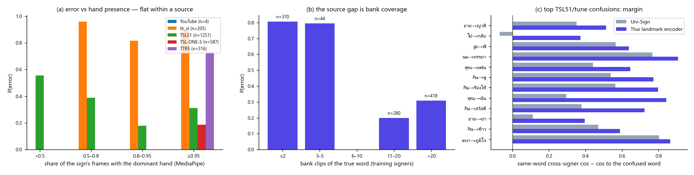
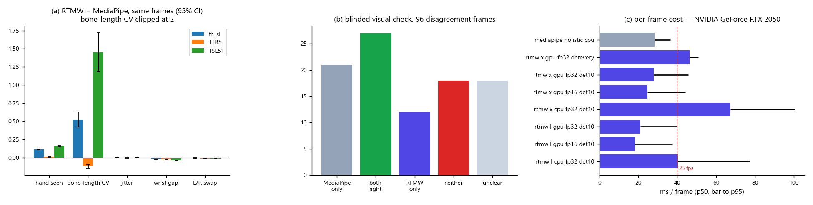
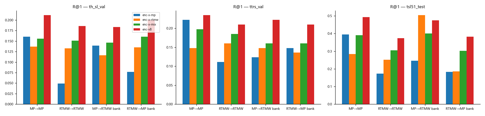
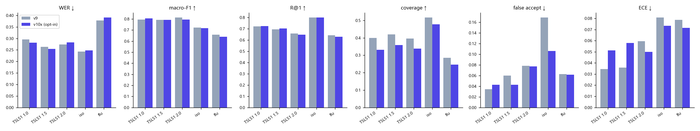
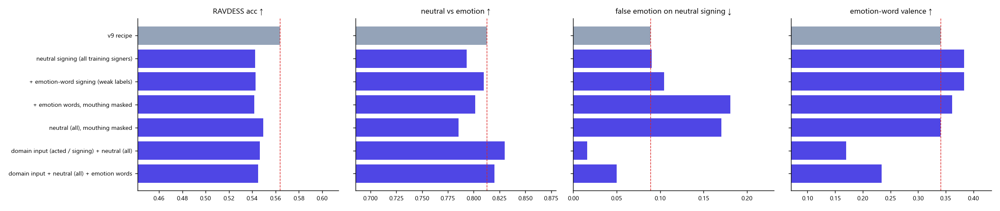
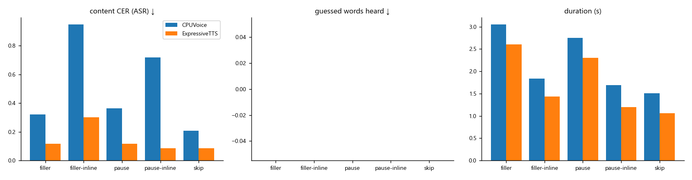
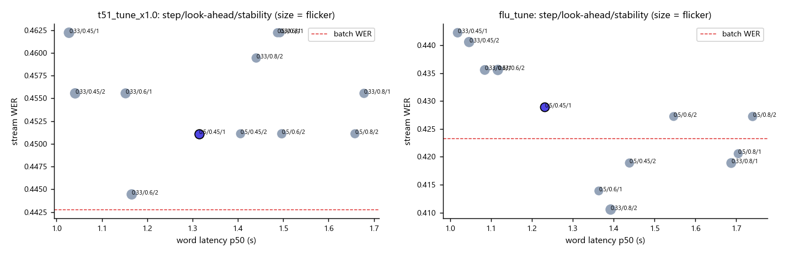

# ThaiSLM — Result Report v10 (High Accuracy + Real-time Recognition)

> **สรุปสั้น (ตรงๆ)** — prompt_14 · 2026-10-30/31 · ทั้งหมดบน RTX 2050 ในเครื่อง · **cloud $0** · ทุกค่าเลือกบน tune, test ดูครั้งเดียวต่อรอบ

| ส่วน | ผล v10 | สถานะ |
|---|---|---|
| **Forward (sign → text)** | ตัวเลือก v10x (bank เฉลี่ย MediaPipe + RTMW-X + decision layer จูนใหม่) ดีกว่า v9 บน tune ทุกชุด แต่ **ไม่ผ่าน release gate บน test 2 รอบ** (31 / 34 metric: coverage, ECE, TSL51 2×, ประโยคลื่น) | **ไม่ ship** → `models/model-v10` อ่านภาษามือ **เท่า v9 ทุก byte** (gate PASS, 0 metric แย่ลง) · v10x เป็น opt-in |
| Diagnosis | มือหาย/สั่นอธิบาย error ได้ ≤ 3% (AUC 0.52) · ตัวขับจริงคือ **จำนวนตัวอย่างต่อคำใน bank** (≤ 2 คลิป → ผิด 74%) และช่องว่างระหว่างคน | ✅ `diagnosis_v10.json` |
| **Extractor: RTMW-X vs MediaPipe** | สมมติฐาน "RTMW-X ดีกว่า" **ไม่จริงบนข้อมูลเรา**: นิ้วผิดรูปกว่า (bone CV +0.5 ถึง +1.5), ตรวจด้วยตาแบบ blind MediaPipe ถูก 50% vs 41%, encoder ที่เทรนต่อ extractor แบบควบคุม MediaPipe ชนะ 4/5 ชุด | MediaPipe = ค่าเริ่มต้น (tier B) · RTMW-X fp16 + tracking 35 fps บน GPU = tier A ทางเลือก |
| **Real-time** | ค่า streaming ใหม่ (เลือกบน tune): วิดีโอจริง latency ต่อคำ p50 / p95 **1.54 / 2.51 → 1.22 / 2.18 s**, flicker 4.7 → 4.0, WER stream 0.606 → 0.591 (ระดับ noise), คำซ้ำ 0 · WebSocket `/v1/live` (partial → confirmed) ใน Docker **และหน้าเว็บโหมดสด** · `real-time-lab.ipynb` (Sign / Face / Speech / Overall + ปุ่มเล่นเสียง) | ✅ |
| **Speech v2** | ท่าที่อ่านไม่ได้ → ลังเลแบบคน ("ฉัน… อืม… พ่อ") **ไม่เดาคำ 0/48** · ราคา: CER เนื้อหา +0.03 (F5) · `/tts/v1/speak_plan` · CPU voice fallback | ✅ `models/speech-model-v2` |
| Face | ตัวเลือก v2 (signer-level CV) ไม่มีตัวไหนดีกว่า v1 ทุกตัวชี้วัด | คงเดิม (`models/face-model` v1) |
| Production | Docker v10 default · rollback ตัวแปรเดียว `THAISLM_MODELS_DIR=./models/model-v9` · ทดสอบจริงผ่าน (หน้าเว็บ, วิดีโอ → คำ + อารมณ์ + เสียง, WebSocket สด, reverse) · `lab4.ipynb` คำนวณสด | ✅ (tts-gpu profile ยังไม่ build) |

**"metrics ต้องดีขึ้นเท่านั้น" — ทำได้ไม่ครบ และรายงานตรงๆ:** ส่วนที่ ship ไม่มี metric ใดแย่ลง (gate PASS) แต่ **ความแม่นการรู้จำไม่ได้ดีขึ้น** —
การปรับที่ดีขึ้นบน tune 0.2–2.3 pt ไม่ข้ามไปคนชุด test (CI คร่อม 0 ทุกชุด) และแลก coverage/calibration. ตัวต่อไปที่จะขยับ accuracy ได้จริงคือ **ข้อมูลต่อคำ**
(คน/คลิปต่อคำ, §1.3 + protocol §9.x) ไม่ใช่ extractor หรือการจูน decision layer เพิ่ม.

---

## 1. Diagnosis — ทำซ้ำ v9 แล้ววิเคราะห์ลึกก่อนแก้ (stage 1)

**Baseline ซ้ำได้ (W0):** ตรึงค่าตั้ง v9 ที่ `artifacts/baselines/v9/` (spotting · calibration · vocab · class prior · face-model) แล้วรัน
`python main.py decision report --versions v9` ใหม่ → **ทุกตัวเลขของ §3.1 ใน prompt ตรงกับ `decision_v9.json` เดิมทุกหลัก** (|Δ| สูงสุด 3×10⁻¹⁶).
ต่างเฉพาะเวลาจริงของเครื่อง: โมเดล 765 ms/คลิป (เดิม 850; 89 vs 99 ms ต่อวินาทีวิดีโอ) — ภาระเครื่องต่างกัน ไม่ใช่โมเดล → **latency v9 กับ v10 ต้องวัดในรอบเดียวกันเสมอ**
(ทำแบบนั้นในรายงานนี้). Gate อัตโนมัติ (`python main.py decision gate`): tolerance ต่อ metric ต่อชุด = 0.25 × SD จาก bootstrap ของ v9 เอง
(ตรึงก่อนแก้อะไร: `artifacts/baselines/v9/gate_tolerance.json`, เช่น WER TSL51 1× ±0.006) · `tests/test_gate.py` 7 กรณี (รายงานที่แย่ลงต้อง fail) ผ่านหมด.

**สิ่งที่ prompt ต่างจาก repo (ตามที่ขอให้บอก):** ทุกตัวเลข §3.1 ตรง · E4 "มือหาย ~63%" เป็นค่าของ **ทั้งคลิป** (รวมช่วงพักมือ) — วัดใหม่เฉพาะช่วงทำท่าได้ ≥ 96% (ข้างล่าง) ·
latency 850 ms เป็นค่าของรอบ v9 (เครื่องเดียวกันวันนี้ได้ 765 ms).

### 1.1 Error ledger (A) — tune ทุกชุด + ต่อแหล่ง

| ชุด (v9) | WER | ถูก | ผิด (คำถูกใน top-5) | ผิด (ไม่อยู่ top-5) | merged | split | missed | **perfect-segmentation WER** (R@1) | **perfect-naming WER** |
|---|---|---|---|---|---|---|---|---|---|
| TSL51 1× tune | 0.264 | 0.715 | 0.163 | 0.048 | 0.029 | 0.002 | 0.043 | 0.263 (0.736) | 0.057 |
| TSL51 2× tune | 0.304 | 0.667 | 0.144 | 0.043 | 0.055 | – | 0.091 | 0.274 (0.727) | 0.118 |
| คำเดี่ยว tune | 0.442 | 0.645 | 0.081 | 0.145 | – | 0.128 | – | 0.262 (0.789) | 0.163 |
| ประโยคลื่น tune | 0.460 | 0.514 | 0.085 | 0.177 | 0.159 | 0.057 | 0.009 | 0.401 (0.633) | 0.130 |

**ข้อสรุป A:** recognition ยังเป็นคอขวดทุกชุด (ตั้งชื่อถูกทุก segment → WER 0.06–0.16; ตัดถูกเป๊ะแต่อ่านแบบเดิม → 0.26–0.40).

**ต่อแหล่ง (คำเฉลยของคนที่ไม่เคยเห็น):** tune: TSL-ONE-S ถูก 0.82 · TSL51 0.69 · TTRS **0.27** · th_sl **0.13** — test: TSL-ONE-S 0.76 · YouTube 0.57 · th_sl 0.35 · TTRS 0.21.
ช่องว่างระหว่างแหล่ง (E3) ใหญ่มาก → ข้อ B/บทเรียนข้างล่างบอกว่าเกิดจากอะไร.

### 1.2 Pose-level diagnosis (B) — **error ไม่ได้กระจุกที่มือหาย**

`modules/posequality.py` (ใหม่) วัดต่อ **ช่วงของคำเฉลย** (ไม่ใช่ทั้งคลิป): สัดส่วนเฟรมที่เห็นมือหลัก · ช่วงมือหายยาวสุด · jitter (เทียบกับ One-Euro) ·
CV ของความยาวกระดูกนิ้ว · ระยะข้อมือ hand-model ↔ body-model · การสลับซ้าย-ขวา.

| | ค่า |
|---|---|
| มือหลักที่เห็นในช่วงทำท่า (median) | th_sl 0.985 · TTRS 1.0 · TSL51 1.0 · TSL-ONE-S 1.0 · YouTube 0.957 — **E4 "63%" คือเฟรมพักมือ** |
| P(error) ตามมือที่เห็น (tune, n) | < 0.5: 0.58 (19) · 0.5–0.8: 0.47 (171) · 0.8–0.95: 0.40 (237) · ≥ 0.95: 0.37 (1,936) — **ภายในแหล่งเดียวกันเกือบแบน** (th_sl 0.96/0.82/0.89, TTRS ทุกคำ ≥ 0.95) |
| สัดส่วน error ที่ "อธิบายได้" ด้วยมือเห็นน้อย* | **tune 2.9% · test 2.2%** (ต่อแหล่ง 0–4%) |
| AUC ทำนาย error (out-of-fold, แยกตามคน) | คุณภาพ landmark อย่างเดียว **0.515** (≈ สุ่ม) · แหล่ง + จำนวนคนต่อคำ 0.651 · รวม 0.678 |

\* Σ (error rate ของ bin − error rate ของ bin ที่มือเห็นดีที่สุด)⁺ × n ÷ จำนวน error — เป็น **ขอบบน** ของสิ่งที่ extractor ที่เห็นมือดีขึ้นจะแก้ได้.

**ข้อสรุป B (ตาม decision tree §4.7):** error ที่อธิบายได้ด้วยคุณภาพมือ **≤ 10%** (2–4%) → extractor ไม่ใช่คอขวดของ v9.
ยังทำ Pose Gate + Recognition Gate ต่อครบ (§2) เพราะ ledger วัด "มือหาย" ได้ แต่วัด "มือผิดรูป" ไม่ได้ และนี่คือสมมติฐานหลักของ v10.



### 1.3 สิ่งที่อธิบาย error ได้จริง — ข้อมูลใน bank (E3 = E7)

| คำของคนที่ไม่เคยเห็น (ไม่รวม TSL51) | P(error) | n |
|---|---|---|
| คำเฉลยมีคลิปใน bank (คน train) ≤ 2 คลิป | **0.74** | 420 |
| 3–5 คลิป | 0.69 | 72 |
| 11–20 คลิป | 0.23 | 508 |
| > 20 คลิป | 0.29 | 680 |

* th_sl tune: 146/205 คำมี ≤ 2 คลิปใน bank และ **ไม่เคยมีคลิปจากพจนานุกรมเดียวกัน** (พจนานุกรมทำคำละ 1 คน) → ทุกคำต้องอ่านข้ามพจนานุกรม (ท่าคนละแบบได้).
  TTRS: ถ้ามีตัวอย่างจาก TTRS ใน bank error 0.53 · ไม่มี 0.86.
* คู่สับสนบนสุดของ tune หลายคู่คือคำที่ bank มี 1–2 คลิป: ร้องไห้→หมู 26 (ร้องไห้ 1 คลิป), ไป→กลับ 24 (กลับ 1), สูง→พี่ 24 (สูง 2), นม→ภรรยา 19 (นม 2), ผอม→เหงา 18 (ผอม 1).
* **E3 จึงไม่ใช่ "คุณภาพวิดีโอ/มือ" แต่เป็นจำนวนคน (และแบบของท่า) ต่อคำใน bank** — สอดคล้องกับ calibration: คำที่มีคนเดียว ECE 0.26 (tune) / 0.40 (test).

### 1.4 Confusion structure (C) + embedding geometry (D)

* พารามิเตอร์ทางสัทวิทยาที่ต่าง (คำนวณจาก landmark ของคลิป bank คน train: handshape / location / movement / orientation / สองมือ; percentile เทียบคู่คำสุ่ม)
  — ถ่วงด้วยจำนวนครั้งที่สับสน: **handshape 98 · orientation 40 · location 24 · movement 16 · สองมือ 12**.
  ยาย/ญาติ/ย่า: **ไม่มีพารามิเตอร์ใดที่วัดได้แยกออก** (percentile < 25 ทุกตัว) — ต่างกันที่รายละเอียดที่ landmark 2D/ท่าพจนานุกรมไม่เก็บ.
* **Margin ของคู่สับสน (cos ของคำเดียวกันข้ามคน − cos ไปหาคำที่สับสน):** Uni-Sign 0.44 vs Thai landmark encoder **0.68**.
  ไป→กลับ: Uni-Sign **ติดลบ** (คลิปไปกับกลับคล้ายกันมากกว่าไปข้ามคน) แต่ landmark encoder แยกได้ (0.77 vs 0.39) — ทิศการเคลื่อนที่ที่ Uni-Sign (ASL/CSL prior) ไม่สนใจ.
* Hubness: skew ของ k-occurrence 4.5 (Uni-Sign) / 5.3 (landmark encoder) — คำแม่เหล็ก: แฟนสาว, ปู่, ไม่ชอบ, อา …
* **Isolated → continuous gap เล็กกว่า signer gap:** cos(ท่าในประโยค, ท่าเดี่ยวของคนเดียวกัน) 0.53 · cos(ท่าเดี่ยวของเขา, ท่าเดี่ยวคนอื่น) 0.41 ·
  cos(ท่าในประโยค, ท่าเดี่ยวคนอื่น) 0.40 → ปัญหาหลักคือ "คนละคน" ไม่ใช่ "ในประโยค vs เดี่ยว" (ตรงกับที่ enrolled ได้ 0.119).

### 1.5 Calibration ต่อกลุ่ม (E)

false-accept / ECE กระจุก: แหล่ง TTRS (tune: accepted precision **0.45**, ECE 0.26) และ th_sl (0.75, 0.27) · คำที่มี 1 คน (ECE 0.26–0.40) · segment สั้น < 12 เฟรม (0.17–0.23) ·
มือเห็นบางส่วน 0.8–0.95 (false-accept 0.11–0.16 vs 0.04–0.05 เมื่อเห็นเต็ม).

### 1.6 วิดีโอจริง (F) + live utterances (G)

* **E10 (data_test 0.684 → 0.724) = noise ของคลิปเดียว:** "ไปทานข้าวด้วยกันมั้ย" v8.1 "คุณ กิน ไป" → v9 "คุณ **ฉัน** กิน ไป" — คำที่ถูกเท่าเดิม แทรกเพิ่ม 1 คำ
  (คลิปอื่นเท่าเดิมทุกคลิป) ไม่ใช่ recognition ถดถอย.
* **team-drive framing:** พื้นที่ใต้ไหล่ในภาพ 0.53–0.97 ความกว้างไหล่ (Boom 0.53–0.62) — วิดีโอที่ใช้เทรน 1.2–1.8 → มือหลุดล่างจอ (E-ใหม่ ต่อจากบทเรียน v8).
* **live_requests (182 utterance ที่เว็บเก็บ):** fps จริง median **12.3** (p10 10.9) · พื้นที่ใต้ไหล่ median 0.82 (77% < 1.0) · คำที่ยืนยันได้ 4.4% · `[?]` 16.7%
  (ส่วนใหญ่เป็นรุ่น v7/v8 — ใช้เป็น regression ของกล้องจริงได้ แต่ไม่มีเฉลย).

### 1.7 ตาราง error class → root cause → workstream

| error class | สัดส่วน (tune) | root cause (หลักฐาน) | workstream v10 | ตัวชี้วัด |
|---|---|---|---|---|
| ผิด แต่คำถูกใน top-5 | 8–16% | คู่คำคล้าย, Uni-Sign margin ต่ำ (D) | W3: landmark encoder ใหม่ (ensemble) เป็นความเห็นที่ 2 | R@1, macro-F1, WER TSL51 |
| ผิด ไม่อยู่ top-5 | 5–18% | คำมีคลิปใน bank ≤ 2 / ข้ามพจนานุกรม (§1.3) | W1/W3: ข้อมูลต่อคำ, มุมมองที่ 2 ของคลิปเดิม | WER คำเดี่ยว/ประโยคลื่น |
| merged / split | 3–22% | ท่าลื่น (ประโยคลื่น), ท่า 2 จังหวะ (คำเดี่ยว) | W4 (merge/split re-tune) | Seg F1, count err |
| false-accept | 2–11% | กลุ่มคำ 1 คน, แหล่ง TTRS/th_sl (§1.5) | W5 calibration | false-accept, ECE |
| มือหาย/คุณภาพ landmark | ≤ 3% ของ error | (§1.2) | W2 — ไม่ใช่คอขวด | Pose Gate |
| latency live | — | ส่งทีละ utterance, รอวางมือ 1.5 s | W6 streaming | p50/p95 ต่อคำ |

---

## 2. Extractor study — RTMW-X vs MediaPipe (Pose Quality Gate + Recognition Quality Gate)

**คำถาม:** RTMW-X ให้ landmark ที่ทำให้ SLM แม่นกว่า MediaPipe หรือไม่ (โดยเฉพาะมือ) ภายใต้ latency ที่ใช้ได้ — ตัดสินด้วย 2 gate (§4 ของ prompt), ไม่ใช้ตัวเลขที่ confounded (v6).
**ข้อมูลที่ใช้:** คลิป **คู่** ที่มีอยู่แล้วใน `shards/pose_store.npz` (วิดีโอเดียวกัน, 25 fps เดียวกัน, ทั้ง MediaPipe และ RTMW-X): th_sl 7,716 · TTRS 5,042 · TSL51 ผู้วิจัย 799 →
ไม่ต้องสกัดใหม่ / ไม่ต้องใช้ GPU cloud. Runtime ใหม่ของ tier A: `modules/wholebody.py` (กู้จาก git `86098cb^` แล้วเขียนใหม่สำหรับกล้องสด: YOLOX-tiny signer lock
+ **box tracking** ข้าม detector, RTMW บนกล่องครึ่งตัว, FP16, ไม่ต้องพึ่ง rtmlib) — **parity กับ corpus:** จุดต่างจากการสกัดเดิม 0.03–0.05 px (th_sl) / < 1 px (TTRS) ที่ความละเอียดของโมเดล, FP16 = FP32.

### 2.1 Pose Quality Gate

**G-P3 (proxy ไม่ต้องมี GT, 1,816 คลิปคู่, เฉพาะช่วงทำท่า)** — RTMW − MediaPipe บนเฟรมเดียวกัน (95% CI แบบ bootstrap ตามคลิป):

| แหล่ง | มือหลักที่ "เห็น" | มือรองที่เห็น | **CV ความยาวกระดูกนิ้ว** ↓ | jitter ↓ | ข้อมือ hand↔body ↓ | สลับซ้าย-ขวา ↓ |
|---|---|---|---|---|---|---|
| th_sl 600×600 | 0.884 → 0.994 | 0.54 → 0.88 | 0.38 → **0.91** (แย่ลง) | 0.197 → 0.199 | 0.070 → 0.049 | 0.010 → 0.001 |
| TSL51 640×480 | 0.842 → 0.999 | 0.34 → 0.93 | 0.43 → **1.88** (แย่ลงมาก) | 0.154 → 0.147 | 0.082 → 0.045 | 0.012 → 0.001 |
| TTRS 854×480 | 0.990 → 1.000 | 0.98 → 1.00 | 0.45 → **0.34** (ดีขึ้น) | 0.204 → 0.188 | 0.080 → 0.055 | 0.015 → 0.003 |

RTMW "เห็น" มือบ่อยกว่าเพราะมัน **ไม่เคยตอบว่าไม่พบ** (ทำนายจุดเสมอพร้อม score) และข้อมือสอดคล้องกับตัวมากกว่า (โมเดลเดียวทั้งตัว) แต่ **นิ้วผิดรูปมากกว่า**
ในภาพเล็ก (มือได้ ~20 px ในกล่อง 256×192 ของทั้งตัว ขณะที่ MediaPipe รันโมเดลมือเฉพาะ 224² บน crop ของมือ).

**G-P2 (ตรวจด้วยตา แบบ blind):** 96 เฟรมในช่วงทำท่าที่สองตัว **ไม่ตรงกันมากที่สุด** (ระยะ ≥ 0.35 ขนาดมือ หรือตัวหนึ่งเห็นอีกตัวไม่เห็น; th_sl / TTRS / TSL51 อย่างละ 32)
วาดโครงกระดูกแยกภาพ สลับซ้าย-ขวาแบบสุ่ม (ผู้ตัดสินไม่รู้ว่าข้างไหนคือตัวไหน) → `result_reporting/figures_v10/handjudge_*.jpg` + key ใน `cache/v10/extractor/`:

| ผล (96 เฟรม) | MediaPipe ถูกอย่างเดียว | ถูกทั้งคู่ | RTMW ถูกอย่างเดียว | ผิดทั้งคู่ | ตัดสินไม่ได้ |
|---|---|---|---|---|---|
| ทั้งหมด | **21** | 27 | 12 | 18 | 18 |
| — กรณีตัวหนึ่งเห็นมือ อีกตัวไม่เห็น (46) | **15** (ส่วนใหญ่ RTMW วาดมือนอกกรอบภาพ) | – | 8 | 18 | 5 |
| — กรณีเห็นทั้งคู่แต่ตำแหน่ง/รูปต่าง (50) | 6 | **27** | 4 | – | 13 |

**MediaPipe ถูก 50% · RTMW 41%** ของเฟรมที่ขัดแย้ง; เมื่อเห็นมือทั้งคู่ส่วนใหญ่ "ถูกทั้งคู่". ข้อจำกัด: ผู้ตัดสินคือ agent (ไม่ใช่นักภาษามือ), 1 คน — ภาพทั้งหมดเก็บไว้ให้ทีมตรวจซ้ำได้;
G-P2 แบบเต็ม (GT จุดมือ 300–500 เฟรม) ยังไม่ได้ทำ — เสนอ protocol ใน §9.

**ความละเอียดสูงขึ้นช่วยไหม?** RTMW-X 384×288 (โหลดจาก OpenMMLab, 30 คลิป th_sl + 30 TSL51 ผู้วิจัย, เฟรมเดียวกัน):
CV กระดูกนิ้ว (median) th_sl MediaPipe 0.29 · RTMW 256 0.72 · **RTMW 384 0.60** · TSL51 0.22 / 0.38 / **0.33** — ดีขึ้นจาก 256 แต่ยังแย่กว่า MediaPipe และใช้ ~105 ms/เฟรมบน RTX 2050 (ไม่ real-time).

**G-P1 (benchmark สาธารณะที่มี GT มือ):** ไม่ได้ทำ — COCO-WholeBody เป็นข้อมูลเทรนของ RTMW (ได้เปรียบ), FreiHAND เป็นภาพมือ crop (ไม่ใช่การใช้งานของ RTMW ทั้งตัว) → ไม่ตอบคำถามของเรา และกิน cost ดาวน์โหลด.

**Pose Gate (G-P4): RTMW-X ไม่ผ่าน** — ไม่ดีกว่า MediaPipe ทุกแหล่ง (แย่กว่าชัดเจนบน th_sl / TSL51) และไม่ดีขึ้นอย่างมีนัยสำคัญในสภาพที่ E4 ชี้ (ภาพเล็ก: แย่ลง).



### 2.2 Latency ต่อเฟรม (RTX 2050 4 GB, 451 เฟรมจากวิดีโอจริง 360p–540p)

| extractor | ms/เฟรม p50 / p95 | fps ต่อเนื่อง |
|---|---|---|
| **MediaPipe Holistic (CPU)** — tier B | 28.4 / 36.5 | 34 |
| RTMW-X GPU FP32, detector ทุกเฟรม | 46.3 / 50.8 | 22 |
| RTMW-X GPU FP32 + tracking (detector ทุก 10 เฟรม) | 28.0 / 45.6 | 35 |
| **RTMW-X GPU FP16 + tracking** — tier A | 24.7 / 44.3 | 35 |
| RTMW-L GPU FP16 + tracking | 18.3 / 37.6 | 47 |
| RTMW-X CPU (+ tracking) | 98.8 (67.4) | 10 (15) |
| RTMW-X 384×288 GPU FP32 | ~105 | < 10 |

Tracking ลดเวลา ~40% (detector 18 ms/ครั้ง), FP16 ลด ~15% ของส่วน pose (การ์ดนี้ tensor core น้อย); TensorRT EP ใช้ไม่ได้ (ไม่มี TensorRT libraries — ORT ตกไป **CPU** เงียบๆ ไม่ใช่ CUDA).
RTMW-X บน GPU **ทำ ≥ 25 fps ได้** (เป้า §6.4) แต่ไม่เร็วกว่า MediaPipe บน CPU และต้องส่งภาพขึ้น server.

### 2.3 Recognition Quality Gate (ควบคุมตัวแปร)

ตามกติกา §4.5: **เทรน encoder ใหม่ต่อ extractor แบบควบคุมทุกอย่างอื่นให้เท่ากัน** (Thai landmark encoder 3.4 M params, สูตร v8, seed 0, 10,000 steps,
RTX 2050 ~35 นาที/ตัว, `python main.py train-encoder --run enc-x-<view> --views mp|rtmw|mix`) — เทรนบน MediaPipe อย่างเดียว / RTMW อย่างเดียว (แหล่งที่มีวิดีโอ) / ผสม
(v8: view ของ RTMW เป็น positive + สลับ p 0.25). วัดบนคลิปคู่ของคนที่ไม่เคยเห็น — query และ bank จาก extractor เดียวกัน (`--xview`, `artifacts/reports/xview_v10.json`):

| R@1 (open vocabulary) | เทรน MP → อ่าน MP | เทรน RTMW → อ่าน RTMW | ผสม → MP | ผสม → RTMW |
|---|---|---|---|---|
| th_sl val (1,203) | **0.160** | 0.133 | 0.156 | 0.151 |
| TTRS val (97) | **0.222** | 0.160 | 0.198 | 0.185 |
| th_sl test (1,338) | 0.098 | 0.056 | **0.112** | 0.066 |
| TTRS test (95) | 0.095 | 0.143 | 0.119 | **0.155** |
| TSL51 ผู้วิจัย (524) | **0.395** | 0.252 | 0.391 | 0.305 |
| best val MRR ระหว่างเทรน | 0.399 | 0.382 | **0.409** | |

* **RTMW ไม่ผ่าน Recognition Gate:** แม้ encoder เทรนมาเพื่อ RTMW เอง ก็อ่านได้น้อยกว่าเมื่อป้อน MediaPipe ใน 4/5 ชุด (ชนะเฉพาะ TTRS test n = 95).
* **Extractor-invariant (R2):** เทรนผสมทำให้ช่องว่าง MP ↔ RTMW แคบลงมาก (TSL51: แยกเทรน 0.395 vs 0.252 → ผสม 0.391 vs 0.305) โดยฝั่ง MP แทบไม่เสีย —
  โมเดลเดียวรับได้ทั้งสอง tier แต่ tier RTMW ยังด้อยกว่า tier MediaPipe.
* encoder ผสมตัวเดียวดีที่สุดบน val (0.409) แต่เมื่อเป็นสมาชิกเพิ่มใน ensemble ของ v8 (ความเห็นที่ 2 ของ reader) **ไม่ช่วย** บน tune (4 สมาชิก obj 0.3392–0.3439 vs ensemble v8 0.3373)
  → v10 ใช้ weights ของ landmark encoder เดิม.



**RTMW มีประโยชน์ตรงไหน (ผลบวกที่ไม่คาด):** ใช้ RTMW เป็น **มุมมองที่ 2 ตอนสร้าง bank (offline)** ไม่ใช่ตอนใช้งานจริง —
embedding ของแต่ละคลิป bank = ค่าเฉลี่ย (normalised) ของ MediaPipe view กับ RTMW view ของวิดีโอเดียวกัน (`python main.py decision views`):

| tune WER (v9 settings) | TSL51 1× | 1.5× | 2× | คำเดี่ยว | ประโยคลื่น | mean |
|---|---|---|---|---|---|---|
| v9 bank (MediaPipe) | 0.264 | 0.274 | 0.304 | 0.442 | 0.460 | 0.3487 |
| + RTMW view เป็น entry แยก | 0.257 | 0.264 | 0.287 | 0.424 | **0.469** ✗ | 0.3402 |
| + RTMW view เฉพาะคำที่มี ≤ 2 คลิป | 0.272 ✗ | 0.280 ✗ | 0.302 | 0.430 | 0.457 | 0.3482 |
| **entry เดียว = เฉลี่ย 2 view (เลือก)** | **0.258** | **0.264** | **0.292** | 0.442 | 0.460 | **0.3434** |
| + ทำแบบเดียวกันกับ bank ของ landmark encoder | 0.265 | 0.266 | 0.286 | 0.424 | 0.461 | 0.3404 (vs 0.3379 ไม่ทำ) → ไม่ใช้ |

ตีความ: ตัวอย่างใน bank มีทั้ง noise ของ extractor (นิ้วของ MediaPipe หลุด / RTMW เบี้ยว) การเฉลี่ยสองมุมมองของ **ท่าเดียวกัน** ลด noise นั้นโดยไม่เพิ่ม entry
(entry แยกทำให้คำที่มีวิดีโอได้เปรียบจำนวน → ประโยคลื่นแย่ลง). query ยังเป็น MediaPipe (tier B) ทั้งหมด.
**แต่บน test:** bank นี้ + decision layer ที่จูนใหม่ให้มัน (v10x) **ไม่ผ่าน release gate** → ไม่ ship, เป็น opt-in (§3).

### 2.4 ข้อสรุป extractor (ตอบสมมติฐาน)

| สมมติฐาน (prompt §0) | ผล |
|---|---|
| RTMW-X ให้ landmark มือแม่นกว่า MediaPipe | **ไม่จริงบนข้อมูลของเรา** — นิ้วผิดรูปกว่าในภาพเล็ก (CV กระดูก +0.5 ถึง +1.5), ตรวจด้วยตา MediaPipe ถูก 50% vs 41%, ความละเอียด 384×288 ช่วยได้บางส่วนแต่ยังแพ้และช้า |
| landmark ที่ดีกว่า → accuracy สูงขึ้น | error อธิบายได้ด้วยคุณภาพมือ ≤ 3% · encoder ที่เทรนให้ RTMW ก็ยังแพ้ใน 4/5 ชุด |
| RTMW + optimized inference + tracking real-time ได้ | **ได้บน GPU** (35 fps, FP16 + tracking ลด 46 → 25 ms/เฟรม) แต่ไม่เร็วกว่า MediaPipe บน CPU และต้องส่งภาพขึ้น server |

**ตัดสินตาม decision tree §4.7:** error ไม่กระจุกที่มือ → Pose Gate: RTMW ไม่ชนะมือ → **ปิดประเด็น RTMW เป็น main extractor พร้อมหลักฐาน**.
**v10 deployment:** tier B = MediaPipe (ทุกเครื่อง/เบราว์เซอร์, ค่าเริ่มต้น) · tier A = RTMW-X GPU (`modules/wholebody.py`) มีให้ทดลองใน `real-time-lab.ipynb`
แต่ **ไม่เป็นค่าเริ่มต้น** (accuracy ต่ำกว่า, ไม่มี blendshape ของหน้า) · RTMW ช่วยได้ **offline** ใน bank แบบเฉลี่ยมุมมองบน tune (ผลบวกเดียวของ RTMW)
แต่ผลนั้นไม่ข้ามไป test เมื่อรวมกับ decision layer ใหม่ → opt-in v10x (§3).
X5 (cascade เรียก RTMW เฉพาะ segment ที่ไม่มั่นใจ) **ไม่ทำ**: เงื่อนไขของมันคือ RTMW อ่านได้ดีกว่าในจุดที่ MediaPipe อ่อน ซึ่งทั้ง 2 gate ไม่สนับสนุน.

---

## 3. Forward v10 — ตัวเลือกที่จูนบน tune ไม่ผ่าน release gate บน test → v10 ใช้การรู้จำของ v9

**ผลตรงๆ: ตัวรู้จำของ v10 ที่ ship = v9 ทุก byte.** ตัวเลือกที่จูนบน tune (เรียกว่า **v10x**) ดีกว่า v9 บน tune ทุกชุด แต่ **ไม่ผ่าน release gate บน test ทั้ง 2 รอบ**
(31 และ 34 metric แย่ลงเกิน tolerance) — ตามกติกา prompt "metric แย่ลงจริงและแก้ไม่ได้ (โดยไม่จูนดู test) → ไม่ ship, เก็บเป็น opt-in" จึงเก็บไว้ที่
`artifacts/v10_experimental/` (`python main.py decision report --versions v9,v10x`). v10 ที่ ship ผ่าน gate: `artifacts/reports/gate_v10.json` **PASS — 0 metric แย่ลง** (ทุกตัวเลขบน test เท่า v9 ทุกหลัก).

### 3.1 ตัวเลือก v10x — เปลี่ยนอะไร (เลือกบน tune เท่านั้น)

| ส่วน | v9 | v10x |
|---|---|---|
| bank | MediaPipe | **เฉลี่ย 2 มุมมอง** MediaPipe + RTMW-X ต่อคลิป (13,282 / 19,656 entries, §2.3) |
| น้ำหนัก landmark encoder (ความเห็นที่ 2) · hand cue | 0.3 · 1.0 | 0.4 · 1.2 |
| merge / split | 0.4 / 0.6 | 0.4 / 0.6 (เท่าเดิม) |
| calibration | LR + re-ranker + isotonic, τ 0.88 | LR fit ใหม่ + re-ranker ของ v9, **ไม่มี isotonic**, τ 0.88 |
| class prior | v9 bank | fit ใหม่บน bank เฉลี่ย |

รอบ 1 ใช้กติกา tune เดิม (เลือกค่าที่ obj ดีขึ้น ≥ 0.002). พอ gate ไม่ผ่าน (31 metric) รอบ 2 เปลี่ยน **กติกาการเลือกบน tune** ให้ตรงกับ gate
(ไม่ได้ดู test เพื่อเลือกค่า): ทุกขั้นต้องดีขึ้นอย่างมีนัยสำคัญ (paired bootstrap ข้าม utterance ของ tune, ขอบบน 97.5% < 0), re-ranker เลือกจาก
ปิด / ของ v9 / fit ใหม่, isotonic ใช้เมื่อ ECE บน tune ลด, และ τ ต้องทำให้ **false-accept ≤ v9 + 0.005 และ precision ≥ v9 − 0.005 บน tune ทุกชุด**.

| tune (WER · coverage · false-accept) | TSL51 1× | 1.5× | 2× | คำเดี่ยว | ประโยคลื่น |
|---|---|---|---|---|---|
| v9 ตามที่ ship | 0.264 · 0.408 · 0.019 | 0.274 · 0.396 · 0.032 | 0.304 · 0.400 · 0.031 | 0.442 · 0.494 · 0.108 | 0.460 · 0.294 · 0.058 |
| v10x รอบ 2 | **0.257** · 0.341 · 0.019 | **0.264** · 0.333 · **0.021** | **0.296** · 0.331 · **0.021** | **0.419** · 0.453 · **0.101** | **0.458** · 0.232 · **0.048** |

### 3.2 Test — v9 → v10x รอบ 2 (ดู test ครั้งเดียวต่อรอบ; ✓/✗ = ดีขึ้น/แย่ลงเกิน tolerance ของ gate)

| ชุด | WER ↓ | R@1 ↑ | R@5 ↑ | macro-F1 ↑ | Seg F1 ↑ | Count err ↓ | Acc. prec ↑ | Coverage ↑ | False-accept ↓ | ECE ↓ |
|---|---|---|---|---|---|---|---|---|---|---|
| TSL51 1× (126) | 0.296 → **0.282** ✓ | 0.720 → **0.722** ✓ | 0.856 → 0.844 ✗ | 0.795 → **0.806** ✓ | 0.873 → **0.874** ✓ | 0.389 → **0.373** ✓ | 0.973 → 0.961 ✗ | 0.400 → 0.331 ✗ | 0.034 → 0.043 ✗ | 0.034 → 0.051 ✗ |
| TSL51 1.5× | 0.263 → **0.255** ✓ | 0.693 → **0.702** ✓ | 0.809 → **0.813** ✓ | 0.793 → **0.794** ✓ | 0.867 → **0.869** ✓ | 0.325 → **0.286** ✓ | 0.964 → **0.970** ✓ | 0.420 → 0.358 ✗ | 0.060 → **0.042** ✓ | 0.036 → 0.058 ✗ |
| TSL51 2× | 0.274 → 0.283 ✗ | 0.658 → 0.647 ✗ | 0.747 → 0.740 ✗ | 0.815 → 0.796 ✗ | 0.823 → **0.826** ✓ | 0.492 → 0.516 ✗ | 0.957 → 0.950 ✗ | 0.396 → 0.338 ✗ | 0.078 → **0.077** ✓ | 0.060 → **0.050** ✓ |
| คำเดี่ยว คนใหม่ (226) | 0.243 → 0.248 | 0.800 → 0.800 | 0.920 → 0.920 | 0.724 → 0.718 | 0.943 → 0.941 | 0.093 → 0.097 | 0.914 → **0.939** ✓ | 0.518 → 0.478 ✗ | 0.169 → **0.106** ✓ | 0.081 → **0.073** ✓ |
| ประโยคลื่น (120) | 0.378 → 0.392 ✗ | 0.642 → 0.627 ✗ | 0.807 → 0.805 | 0.658 → 0.640 ✗ | 0.928 → **0.930** ✓ | 0.433 → 0.433 | 0.932 → 0.922 ✗ | 0.285 → 0.246 ✗ | 0.062 → **0.061** ✓ | 0.079 → **0.071** ✓ |

รอบ 1 (กติกา tune เดิม) บน test: WER TSL51 1× / 1.5× / คำเดี่ยว ดีขึ้น (0.296 → 0.284, 0.263 → 0.256, 0.243 → 0.239) แต่ 2× 0.274 → 0.283,
ประโยคลื่น 0.378 → 0.394, false-accept แย่ลงทุกชุด TSL51 (1× 0.034 → 0.055, 2× 0.078 → 0.115) — **gate FAIL 31 metric**
(`artifacts/reports/decision_v10_run1.json`, `gate_v10_run1.json`). รอบ 2 แก้ false-accept ได้ (1.5× 0.060 → 0.042, คำเดี่ยว 0.169 → 0.106) แต่เสีย coverage.

ΔWER แบบจับคู่ (bootstrap 10,000 ครั้งข้าม utterance) — **CI คร่อม 0 ทุกชุด**; enrolled signer (คลิปคำของตัวเองอยู่ใน bank) แทบไม่เปลี่ยน:

| ΔWER v10x − v9 (10,000 bootstrap) | Δ | 95% CI | ดีขึ้น / แย่ลง (utterance) |
|---|---|---|---|
| t51_test_x1.0 | -0.014 | [-0.036, +0.009] | 15 / 10 |
| t51_test_x1.0|enrolled | +0.002 | [-0.021, +0.023] | 9 / 13 |
| t51_test_x1.5 | -0.009 | [-0.026, +0.009] | 10 / 6 |
| t51_test_x1.5|enrolled | +0.000 | [-0.016, +0.016] | 7 / 8 |
| t51_test_x2.0 | +0.009 | [-0.009, +0.028] | 7 / 10 |
| t51_test_x2.0|enrolled | +0.001 | [-0.019, +0.019] | 6 / 9 |
| iso_test | +0.004 | [+0.000, +0.013] | 0 / 1 |
| flu_test | +0.013 | [-0.009, +0.036] | 5 / 11 |
| data_test | -0.040 | [-0.120, +0.000] | 1 / 0 |
| team | -0.017 | [-0.058, +0.022] | 2 / 1 |

| enrolled (TSL51) | v9 | v10x |
|---|---|---|
| TSL51 1× (126) | 0.119 | 0.121 |
| TSL51 1.5× | 0.109 | 0.109 |
| TSL51 2× | 0.137 | 0.138 |



### 3.3 ทำไมไม่ผ่าน (อธิบายจาก tune ได้ทั้งหมด — ไม่ต้องดู test)

1. **ส่วนต่าง WER บน tune เล็กกว่า noise ของ test:** tune ดีขึ้น 0.2–2.3 pt แต่ CI 95% ของ ΔWER บน test **คร่อม 0 ทุกชุด** (TSL51 1× −0.014 [−0.036, +0.009]);
   ชุดที่ tune ดีขึ้นมาก (2× −0.8, คำเดี่ยว −2.3) กลับแย่ลงบน test (+0.9, +0.4). tune กับ test เป็นคนละคน — การเลือกค่าละเอียดระดับนี้ไม่ข้ามคน.
2. **coverage:** กติการอบ 2 คุม false-accept และ precision แต่ **ไม่คุม coverage** — และ coverage ที่หายไปเห็นได้ตั้งแต่บน tune (TSL51 1× 0.408 → 0.341,
   ประโยคลื่น 0.294 → 0.232). gate นับ coverage → ไม่มีทางผ่าน. (ทั้งสองรอบเป็นการแลก: รอบ 1 coverage ↑ false-accept ↑, รอบ 2 กลับกัน.)
3. **ECE:** v9 ใช้ isotonic; รอบ 2 ปิด isotonic เพราะบน tune ไม่ลด ECE อย่างมีนัยสำคัญ → ECE บน test แย่ลง 0.034 → 0.051 (TSL51 1×).
4. **latency** — **ไม่ใช่ต้นทุนจริง:** รอบ 2 วัดได้ +10% (88.4 → 97.3 ms ต่อวินาทีวิดีโอ, gate ✗) แต่รอบตรวจซ้ำที่วัด v9 · v10 (ไฟล์เดียวกับ v9 ทุก byte) · v10x ในรอบเดียวกันได้ 140.3 · 138.0 · 140.3 — ไฟล์ที่เหมือนกันยังต่าง 1.7% และทั้งเครื่องช้าลง 60% จากภาระเครื่อง → latency ต่อรอบมี noise ของลำดับ/ภาระ ระดับ 10%; ในรอบนี้ gate ของ v10x ไม่นับ latency (34 metric ไม่ผ่าน). บทเรียน: วัด latency สลับลำดับหลายรอบ ไม่ใช่รอบเดียว.

**ทำไมไม่จูนรอบ 3:** test ถูกดูไปแล้ว 2 ครั้ง — รอบที่ 3 ที่ออกแบบจากสิ่งที่เห็นบน test (เช่นเพิ่มกติกา coverage, เลือก τ ใหม่) คือการจูนบน test ทางอ้อม
(ขัดกับ "ห้ามกลับไปจูนดู test") และ WER ของ 2× / ประโยคลื่นที่แย่ลงไม่ได้มาจาก calibration จึงแก้ด้วยกติกาไม่ได้อยู่ดี.
**ถ้าจะลองใหม่:** (ก) ใส่ coverage ≥ v9 − tol ในกติกา tune ตั้งแต่ต้น (ตรงกับ gate ที่ตรึงไว้ก่อน) (ข) วัดบน held-out ชุดใหม่ (คนใหม่ — protocol ง §9.x)
เพราะชุด test นี้ถูกใช้ตัดสินมาแล้ว 2 ครั้ง.

---

## 4. วิดีโอจริง (ดูอย่างเดียว)

วิดีโอจริงไม่เคยใช้เลือกค่า (ดูอย่างเดียว) · bank production · v10 ที่ ship อ่านได้เท่า v9 ทุกคลิป (ไฟล์เดียวกัน) — ตารางนี้จึงเทียบ v9 กับตัวเลือก v10x:

| วิดีโอจริง | WER v9 → v10x | ต่อรอบการทำท่า | in-vocab | R@1 | Count err | Accept ถูก/ทั้งหมด v9 → v10x |
|---|---|---|---|---|---|---|
| data_test (5) | 0.724 → 0.684 | 0.842 → 0.802 | 0.724 → 0.674 | 0.571 → 0.571 | 0.800 → 1.000 | 4/4 → 2/2 |
| iPhone คำ (9) | 0.222 → 0.222 | 0.222 → 0.222 | 0.222 → 0.222 | 1.000 → 1.000 | 0.222 → 0.222 | 4/4 → 2/2 |
| iPhone ประโยค (5) | 0.097 → 0.097 | 0.097 → 0.097 | 0.233 → 0.233 | 0.885 → 0.885 | 0.000 → 0.200 | 13/13 → 9/9 |
| team-drive (18) | 0.774 → 0.758 | 0.508 → 0.487 | 1.435 → 1.435 | 0.686 → 0.686 | 1.722 → 1.833 | 22/23 → 16/17 |

* v10x แก้ได้ 1 คลิปของ data_test (คำ "ฉัน" ที่แทรกเกิน, §1.6) และ team-drive ดีขึ้น 2 / แย่ลง 1 คลิป แต่ **นับจำนวนคำผิดมากขึ้น** (iPhone ประโยค 0 → 0.2,
  team-drive 1.72 → 1.83) และยืนยันคำได้น้อยลงเกือบครึ่ง (iPhone ประโยค 13 → 9 คำ, team-drive 22 → 16) — คำที่ยืนยันยังถูก แต่ผู้ใช้ได้ยิน/เห็นน้อยลง.
* วิดีโอจริงมีแค่ 37 คลิป — CI ของ ΔWER คร่อม 0 ทุกชุด (ตาราง bootstrap §3.2) จึงไม่ใช้ตัดสินเดี่ยวๆ; gate ใช้ทุกชุดพร้อมกัน.
* latency ส่วนโมเดล (37 วิดีโอ, รอบเดียวกัน): v9 1,201 ms/คลิป (140.3 ms ต่อวินาทีวิดีโอ) · v10 1,181 (138.0) · v10x 1,201 (140.3) · RSS 835–851 MB · MediaPipe 37 ms/เฟรม — เครื่องช้ากว่ารอบ W0 (765 ms/คลิป) เพราะภาระเครื่องตอนวัด; เทียบกันได้เฉพาะในรอบเดียวกัน

---

## 5. Face (W7) — ลองแล้ว ไม่มีตัวเลือกที่ดีกว่า v9 ทุกตัวชี้วัด → `models/face-model` คงเดิม

**วิธีเลือก (แก้จากรอบแรก):** รอบแรกใช้คน val (2–4 คน) เป็น tune — พบว่าไม่น่าเชื่อถือ (false alarm โมเดลเดียวกัน: คน val 0.02 แต่คน test 0.39; คำอารมณ์ของคน val มีแค่ 4 คลิป).
จึงเปลี่ยนเป็น **leave-signers-out CV บนคน train ทั้งหมด** (16 คนสำหรับหน้าเป็นกลาง, 7 คน / 47 คลิปสำหรับคำอารมณ์) + RAVDESS leave-actors-out; ตัวเลือกต้อง
**ไม่แย่กว่าสูตร v9 ทุกตัวชี้วัด** ภายใต้ CV เดียวกัน (`python main.py face-model v2`, `artifacts/reports/face_model_v2.json`).

| ตัวเลือก (multinomial LR อธิบายได้ทุกตัว) | RAVDESS acc ↑ | neutral vs emotion ↑ | อารมณ์ปลอมบนท่าเป็นกลาง ↓ | valence คำอารมณ์ ↑ | valence gap ↑ |
|---|---|---|---|---|---|
| **สูตร v9** (RAVDESS + หน้าเป็นกลาง 720) | **0.564** | 0.812 | 0.089 | 0.340 | 0.236 |
| + หน้าเป็นกลางจากคน train ทุกคน (5,040) | 0.542 | 0.793 | 0.090 | 0.383 | 0.222 |
| + คำอารมณ์ (ป้ายอ่อน) น้ำหนัก 3 | 0.533 | 0.808 | 0.133 | **0.447** | 0.278 |
| + คำอารมณ์ น้ำหนัก 1 | 0.543 | 0.810 | 0.105 | 0.383 | 0.245 |
| ตัดฟีเจอร์ปาก/คาง (mouthing = ไวยากรณ์) | 0.519–0.549 | 0.785–0.810 | 0.170–0.220 | 0.340–0.404 | 0.12–0.15 |
| **input บอกโดเมน (นักแสดง / ภาษามือ)** + หน้าเป็นกลาง | 0.547 | **0.830** | **0.016** | 0.170 | 0.143 |
| input บอกโดเมน + หน้าเป็นกลาง + คำอารมณ์ | 0.545 | 0.820 | 0.050 | 0.234 | **0.251** |

**อ่านผล (ตรงๆ):**
* ทุกการเพิ่มข้อมูลในโดเมนภาษามือ **แลก** RAVDESS acc กับ valence/อารมณ์ปลอม — ไม่มีตัวไหนชนะทุกช่อง → ตามกติกา "ห้าม ship ส่วนที่แย่ลง" **v10 ใช้ face-model เดิม** (ทดสอบ test signers: false alarm v9 = 0.217).
* **R6 (แยกสีหน้าไวยากรณ์ออกจากอารมณ์):** ตัดฟีเจอร์การขยับปาก **แย่ลง** (อารมณ์ปลอม 0.09 → 0.17–0.22) — โมเดลใช้ "การขยับปากแบบพูดคำ" เป็นหลักฐานว่าหน้ากำลังเป็นกลาง; เอาออกแล้วแยกไม่ได้ (negative result).
* **ทางที่ได้ผลบางส่วน = input บอกโดเมน:** ข้อมูลภาษามือไปปรับ prior ของโดเมนแทนที่จะดัดน้ำหนักของสีหน้า → อารมณ์ปลอมบนท่าเป็นกลาง **0.089 → 0.016** และ neutral-vs-emotion 0.81 → 0.83
  แต่ conservative เกิน (คำอารมณ์ในพจนานุกรมถูกอ่านเป็นกลางมากขึ้น: valence agreement นับ "เป็นกลาง" เป็นผิด) — **เก็บเป็นทางเลือก ไม่ ship**.
* **ข้อจำกัดหลัก:** ไม่มีข้อมูลภาษามือไทยที่ติดป้ายอารมณ์ (proxy = คำอารมณ์ในพจนานุกรม 47 คลิป 7 คน ซึ่งผู้ทำท่ามักไม่แสดงอารมณ์) — ข้อมูลเปิดอื่น (CREMA-D, MEAD, Aff-Wild2)
  เป็นนักแสดง/คนพูด เพิ่มแล้วจะยิ่งดึงไปทาง RAVDESS ซึ่งทุกตัวเลือกข้างบนชี้ว่าไม่ใช่คอขวด; ElevenLabs/ดาวน์โหลดใหญ่ไม่จำเป็น → เสนอชุดอารมณ์ภาษามือไทย (§9).
* latency: 0.04 ms/ช่วง (LR) + ฟีเจอร์ ~15 ms/คลิป (เท่าเดิม) · คำอธิบายภาษาไทยเหมือนเดิม.



---

## 6. Speech v2 (`models/speech-model-v2/`) — เสียงลังเลแบบมนุษย์เมื่อเจอท่าที่อ่านไม่ได้ (R7)

**ปัญหา (E14):** v9 ข้ามท่าที่อ่านไม่ได้ทั้งหมด — "ฉัน ___ พ่อ" ออกเสียง "ฉัน พ่อ" ติดกันเหมือนหุ่นยนต์ และผู้ฟังไม่รู้ว่ามีท่าที่ไม่แน่ใจ.

**ออกแบบ (`modules/speech.plan_speech`, `disfluency="filler"` ค่าเริ่มต้น):** แผนการพูดตามลำดับท่า = หน่วย `say` (คำที่ยืนยัน) และ `hesitate` (คำลังเล + เว้นจังหวะ) แทนท่าที่อ่านไม่ได้ —
`[?]`/unknown หรือ "อาจหมายถึง" ที่ผู้ใช้ไม่ได้เปิดให้พูด:
* **ไม่เดาคำ:** filler = "อืม / เอ่อ / เอ่อ… / แบบว่า…" (ไม่ใช่คำเนื้อหา) · คำ nearest ของ `[?]` ไม่ถูกพูดเด็ดขาด (unit test)
* ท่าที่อ่านไม่ได้ติดกัน = ลังเล **ครั้งเดียว** · อยู่ท้ายประโยค = **เงียบ** · ขึ้นต้นประโยค = "เอ่อ" · ช่วงเปลี่ยนท่า (transition) ไม่นับ
* ความยาวเว้นจังหวะตามเวลาที่ทำท่านั้นจริง: 0.25 + 0.6 × วินาทีของท่า (0.35–1.4 s) · สั้นกว่า 0.5 s = เว้นเฉยๆ · filler หมุนเวียนไม่ซ้ำติดกัน
* โหมด: `filler` (v10) · `pause` (เว้นอย่างเดียว) · `skip` (แบบ v9) — ตั้งได้ใน `real-time-lab.ipynb` / API (`/v1/speak_plan` field `disfluency`) · `tests/test_speech_plan.py` 10 กรณี

**เสียง filler:** ElevenLabs (ครู) **โควตาฟรีหมด** (0/10,000) → สร้างด้วย **F5 โคลนเสียงของตัวเอง** (reference เป็นกลางของแต่ละเสียง → timbre เดียวกับประโยค),
กำหนดความยาว (F5 ให้ข้อความ 3 ตัวอักษรแค่ ~0.3 s), 4 takes ต่อคำ แล้ว **ให้ ASR อิสระคัด:** take ที่ถูกได้ยินเป็นคำเนื้อหาถูกทิ้ง (เช่น "มุม", "อุโมง", "โอ้โห") —
ผ่าน 24/32 takes, เก็บ 2 takes ต่อ filler ต่อเสียง (ผู้ชาย "อืม" 1). ต่อกับประโยคด้วย fade 15 ms (spliced rendering).

**ผลวัด (8 ประโยคทดสอบที่มีท่าอ่านไม่ได้ เช่น "ฉัน ? พ่อ", "แม่ ? ชอบ ? ขนมปัง", "วันนี้ ? เพื่อน ? ? ร้องไห้" — ASR อิสระ Qwen3-ASR base ถอดเสียง):**

| เสียง · โหมด | คำเนื้อหาถูกถอด (CER ↓) | **คำเดาที่ได้ยิน** | ความยาว | หมายเหตุ |
|---|---|---|---|---|
| F5 · skip (v9) | 0.085 | 0 | 1.06 s | ไม่มีจังหวะของท่าที่หายไป |
| F5 · pause | 0.117 | 0 | 2.30 s | |
| **F5 · filler (v10)** | **0.117** | **0** | 2.60 s | ASR ได้ยิน "ฉัน**อืม**พ่อ", "พรุ่งนี้ฉัน**เออ**ไปโรงเรียน" |
| F5 · filler แบบ inline (ข้อความเดียว) | 0.301 | 0 | 1.44 s | ไม่ใช้ — F5 อ่าน filler ผิดรูป |
| CPU (MMS) · skip | 0.209 | 0 | 1.51 s | |
| CPU (MMS) · filler | 0.323 | 0 | 3.05 s | MMS อ่านคำเดี่ยวที่ถูกแยกพูดได้แย่ ("รัก"→"ฮัก") |

* **ไม่มีคำเดาในทุกโหมดทุกเสียง** (ท่าที่อ่านไม่ได้ถูกตั้ง nearest = "รถไฟ" ไว้ทดสอบ — ไม่เคยได้ยิน).
* ราคาของการแบ่งพูดเป็นช่วง: CER เนื้อหา +0.03 บน F5 (ส่วนใหญ่ 1 คำ "ขนมปัง"→"ขนม" ที่เกิดใน pause ด้วย) — ประโยคที่ไม่มีท่าอ่านไม่ได้ใช้เส้นทางเดิมของ v1 ทุกอย่าง
  (ความชัด CER 0.06%, pitch ตามอารมณ์ r 0.78 คงเดิม).
* ความเป็นธรรมชาติ **ยังไม่ได้วัดด้วยคนฟัง** — protocol A/B ใน §9 (ไฟล์เสียงคู่ skip/filler อยู่ใน `result_reporting/speech_samples_v2/`).

**Voice runtime:** `load_voice()` = F5 บน GPU (CUDA/MPS) · เสียง CPU (MMS + filler เดียวกัน) เมื่อไม่มี GPU. Docker: `tts` (CPU, ค่าเริ่มต้น) + `tts-gpu` (`--profile gpu`);
sign-api เรียก `/v1/speak_plan` ของ GPU ก่อน แล้ว fallback CPU อัตโนมัติ (TTS_URL list).

**ASR (หูของฝั่งคนได้ยิน) — เลือกบนเสียงคนจริงเท่านั้น** (`python main.py speech asr-compare`):

| CER ↓ | วลีสั้นในชีวิตประจำวัน (96, คนจริง) | FLEURS-th (100, คนจริงอ่าน) | test-A (สังเคราะห์, อ้างอิง) | s/utt (RTX 2050) |
|---|---|---|---|---|
| **Qwen3-ASR-0.6B base (v9 = ใช้ต่อ)** | **21.5%** | **6.7%** | 2.0% | 0.4–1.4 |
| Thonburian Whisper medium (transformers, กันวนซ้ำ) | 33.5% | 12.0% | 3.0% | 0.5–1.3 |
| Thonburian Whisper medium (ไม่กันวนซ้ำ — รอบแรก) | 772% (ถอดวนซ้ำไม่จบ) | – | 2.3% | 12.6 |

**ผล: ASR ไม่ดีขึ้นจาก v9** (เป้า §8.4 ไม่ถึง) — Whisper ภาษาไทยที่ fine-tune แล้วแพ้ Qwen3-ASR ทั้งสองชุดคนจริงในการตั้งค่านี้; ตัวเลข 14.1% ของ Whisper-medium
ในฝั่ง reverse (faster-whisper / CTranslate2) ไม่ได้ทำซ้ำในรอบนี้. ไม่ได้ fine-tune ใหม่: ข้อมูลเสียงคนจริงที่ license ชัด (Common Voice th ฯลฯ) ต้องดาวน์โหลดหลาย GB
และบทเรียน v9 คือ fine-tune บนเสียงสังเคราะห์ทำให้เสียงคนจริงแย่ลง → เสนอเป็นงานถัดไป (§9).



---

## 7. Real-time (W6) — streaming เข้าเว็บ API + real-time-lab

**ทำงานอย่างไร (`modules/stream.py`):** `StreamingTranslator` รัน pipeline ทุก *step* บนหน้าต่างจำกัด, คำจะ **ยืนยัน** เมื่อจบไปแล้ว ≥ *look-ahead*
และอ่านได้คำเดิมที่ตำแหน่งเดิมต่อกัน *stable_n* + 1 รอบ (หรือมือพัก = จบ utterance); ที่เหลือเป็น partial. ใหม่ใน v10: `LiveStream` — กล้อง/ผู้ส่งเฟรม **ไม่ต้องรอ** การคำนวณ
(thread แยก + lock, `tests/test_stream.py`: ได้คำเดียวกับ replay ทีละเฟรม), รับ landmark ทั้งแบบ MediaPipe และ Standard Schema (tier A),
WebSocket `/v1/live` ใน sign-api (ทดสอบใน Docker §8), ค่าตั้งอ่านจาก `models/model-v10/spotting.json` → `"stream"`.

**เลือกค่าบน tune เท่านั้น** (`python main.py decision stream --write`): replay ตามเวลาจริง (นับเวลาคำนวณจริง) 30 ประโยค TSL51 1× + 30 ประโยคลื่นจากชุด tune,
grid step {0.5, 0.33} s × look-ahead {0.8, 0.6, 0.45} s × stable_n {1, 2}. กติกา: latency p50 ต่ำสุดที่ WER ของ stream ≤ WER แบบ batch + 0.01 ทุกชุด และ flicker ไม่เกินค่าของ v9.

| tune (WER stream · latency p50 / p95 s · flicker ต่อคลิป) | TSL51 1× (batch 0.443) | ประโยคลื่น (batch 0.423) |
|---|---|---|
| v9: step 0.5 · look-ahead 0.8 · stable 1 | 0.462 ✗ · 1.49 / 2.63 · 2.2 | 0.421 · 1.70 / 3.15 · 2.1 |
| **v10: step 0.5 · look-ahead 0.45 · stable 1 (เลือก)** | **0.451** · **1.31** / 2.74 · 2.2 | 0.429 · **1.23 / 2.49** · **1.9** |
| step 0.33 (เร็วสุด 1.03 s) | 0.456–0.462 · 1.03–1.68 · 2.3–3.3 | flicker 2.5–3.2 > v9 → ตก |
| stable_n = 2 (R8) | latency +0.1–0.2 s, flicker ไม่ลด (2.2–2.3) | flicker 2.0–3.2 → ไม่ใช้ |

(ค่าของ v9 เองไม่ผ่านกติกา WER บน TSL51 — look-ahead 0.8 s ทำให้ท่าสุดท้ายรอการยืนยันจนหน้าต่างเลื่อน.)

**วิดีโอจริง 28 คลิป (iPhone ประโยค 5 · data_test 5 · team-drive 18) — ไม่เคยใช้เลือกค่า, CPU laptop, เวลาคำนวณจริง:**

| | v9 settings | **v10** |
|---|---|---|
| latency ต่อคำ (คำยืนยัน − ท่านั้นจบ) p50 / p95 | 1.54 s / 2.51 s | **1.22 s / 2.18 s** (−21% / −13%) |
| WER streaming (batch 0.644 ทั้งคู่) | 0.606 | **0.591** |
| partial ที่เปลี่ยนก่อนยืนยัน (flicker) ต่อคลิป | 4.7 | **4.0** |
| คำซ้ำจากการ stream | 0 | 0 |
| compute ต่อรอบ p50 | 308 ms | 284 ms (< step 500 ms → ตามทันเวลาจริง) |

ทุกตัวชี้วัดของ streaming ดีขึ้นบนวิดีโอจริง (`artifacts/reports/stream_v10.json`, รูป `figures_v10/stream_tradeoff.png`) — การรู้จำเหมือน v9 ทุก byte;
ส่วนที่เปลี่ยนคือ **เวลาที่ยอมยืนยันคำ** เท่านั้น. ผลที่มั่นคงคือ latency (เร็วขึ้นแทบทุกคำ); WER ต่างกันน้อย (−0.015) — 11 / 28 คลิปอ่านต่างจากค่า v9:
ดีขึ้น 6 · แย่ลง 4 · เท่าเดิม 1 เช่น iPhone "สวัสดี ฉัน ชื่อ **J** …" → "ชื่อ **ศูนย์** …" (ตัวสะกดนิ้วถูกยืนยันก่อนจบท่า) แต่ "พ่อดื่มน้ำ" ตัด "ศูนย์" ที่แทรกเกินออก —
28 คลิปเล็กเกินจะบอกว่า WER ดีขึ้นจริง จึงนับเป็น "ไม่แย่ลง". MediaPipe (ไม่รวมข้างบน) 28–37 ms/เฟรม CPU; บนเว็บรันในเบราว์เซอร์.



---

## 8. Production — Docker · API · notebooks

`docker compose up --no-build` (images build ใหม่: `sign-api`, `tts`, `web`) — ทดสอบจริง 2026-10-30 และ **ตรวจซ้ำ 2026-10-31 กับ `models/model-v10` ฉบับสุดท้าย** (การรู้จำ = v9 + `"stream"`):

| ตรวจ | ผล |
|---|---|
| ทุก service | gateway · web · sign-api (healthy) · tts (healthy) · reverse-api (healthy) · reverse-speech (healthy) |
| `GET /api/v1/info` | `version: v10`, extractor MediaPipe Holistic 1.0.1 |
| ทุกหน้าเว็บ | `/` `/sign` `/sign/live` `/text` `/chat` `/my-signs` `/vocab` `/classic` → 200 |
| วิดีโอ → คำ + อารมณ์ + เสียง | `data_test/test1.mp4` → "สบายดี ชอบ แมว" (ยืนยัน 3 คำ) + เสียง 138 KB · `ฉันรักเพื่อน.mp4` → ฉัน? รัก? (ไม่มั่นใจ → ไม่พูด) + "สีหน้าดีใจ … เพราะมุมปากยก ; คำที่ทำ 'รัก'" |
| `POST /tts/v1/speak_plan` (ใหม่) | "ฉัน [?] พ่อ" → `filler`: พูด ฉัน → "อืม" 0.37 s → พ่อ · `skip`: "ฉัน พ่อ" (แบบ v9) |
| **WebSocket `/v1/live` (ใหม่)** | ส่ง utterance iPhone ทีละเฟรมตามเวลาจริง → partial 11 ครั้ง, ยืนยัน **พรุ่งนี้ → ฉัน → ไป → เที่ยว → ประเทศ → จีน** ระหว่างทำท่า (ค่า stream ของ v10: latency 1.1–1.8 s ต่อคำ ยกเว้น 2 คำแรก 2.0–3.3 s ตอน container เพิ่งเริ่ม) |
| bug ที่การตรวจซ้ำเจอ (แก้แล้ว) | พอ `spotting.json` มี `"stream"` จริง `/v1/live` ปิดการเชื่อมต่อ (`dict() got multiple values for keyword argument 'step_s'`) → แก้ `webapp/api/app.py` ให้ค่าของโมเดลทับค่า v9, rebuild `sign-api`, ทดสอบผ่าน |
| text → sign (reverse) | `POST /t2s/translate` "วันนี้คุณไปไหน" → 200 (IR + motion) |
| rollback | `THAISLM_MODELS_DIR=./models/model-v9 docker compose up` (ตัวแปรเดียว) |
| `tts-gpu` (`--profile gpu`, F5) | เขียน `webapp/tts/Dockerfile.gpu` + compose profile แล้ว **ยังไม่ได้ build/ทดสอบ** (image CUDA ~8 GB; F5 ทดสอบผ่าน speech env + `real-time-lab`) |

**หน้าเว็บใช้ v10 แล้ว (2026-10-31):** โหมดสด (`/sign/live` และโหมดสดใน `/sign`) ส่งแต่ละ utterance เข้า WebSocket `/api/v1/live` ทีละเฟรมระหว่างทำท่า → คำขึ้นบนจอระหว่างทำท่า (`components/sign/LiveWords.tsx`: ยืนยันแล้ว = ขาว, ไม่แน่ใจ = **[?]** สีอำพัน — ไม่แสดงคำที่เดา, ยังอาจเปลี่ยน = จาง / "…"); พอลดมือ ผลเต็ม (ประโยค + อารมณ์ + เสียง) มาจาก request เดิมแล้วแทนที่คำสด. ปิดได้ด้วย `?stream=0`. gateway มี location WebSocket ของ `/api/v1/live` (nginx Upgrade), API ส่ง status ของทุกคำ (`partial` / `confirmed`).
ทดสอบใน Docker + browser pane ด้วยกล้องปลอม (วิดีโอ iPhone เงียบ, ปิดเสียงพูด, ไม่เรียก LLM): ข้อความ WebSocket ผ่าน gateway ครบ (partial → confirmed → final), caption แสดง "ฉัน [?] [?] …" ระหว่างทำท่าแล้วถูกแทนด้วยการ์ดผลเต็ม, ไม่มี error ใน API/console. **ความแม่นยำบนเว็บยังไม่ได้วัด:** browser pane ถูกซ่อน/บัง หน้าเว็บเลยได้แค่ ~1.5 เฟรม/วิ (ต้องการ ≥ 12) — ต้องลองด้วยกล้องจริงบน Chrome ที่เปิดอยู่หน้าจอ.

**ตัวกรองคำบนเว็บ (filter, 2026-10-31):** ตั้งค่า → filter: *ไม่มี threshold* (แสดงทุกคำที่อ่านได้) · *threshold 0.50* · *threshold 0.80* (ค่าเริ่มต้น) — คำที่ P(ถูก) ต่ำกว่าเกณฑ์เป็น [?], คำที่ระบบยืนยันแล้วแสดงเสมอ; ใช้กับทั้งโหมดสด (คำระหว่างทำท่า + ผลเต็ม) และวิดีโออัปโหลด, เปลี่ยนแล้วผลเดิมเปลี่ยนตามทันที. ตัวอย่าง `data_test/test1.mp4` (ภาพจากเบราว์เซอร์): 0.80 → สบายดี แมว + [?]×5 · 0.50 → + สวัสดี ชอบ (ถูกทั้งคู่) · ไม่มี threshold → 7 คำ (ถูก 5).

**ตรวจ: โมเดลบนเว็บ vs ใน notebook (sign อย่างเดียว):** (1) face / speech **ไม่เปลี่ยนคำ** — 37 วิดีโอจริง เปิด/ปิด face ได้ segment เหมือนกันทุกคำ ทุกค่า P (face + ประโยคคำนวณหลังเลือกคำแล้ว) · (2) **ภาพจากเบราว์เซอร์** อ่านต่างจาก Python: 6 คลิปเดียวกัน WER 0.60 (Python MediaPipe) → 0.74 (เบราว์เซอร์) จากคำแทรกเกิน 2 คลิป, P ของคำที่ถูกพอๆ กัน (0.63 / 0.62) · (3) **fps กล้องสด**: request จริงบนเว็บ median 14.6 fps — จำลอง 12 fps บน 37 วิดีโอ WER 0.542 → 0.564 · (4) อ่านแบบ streaming (notebook §4, คำสดบนเว็บ) WER 0.591 vs อ่านทั้งประโยค 0.644 บน 28 วิดีโอจริง.

**ตรวจ "ฉัน" spam:** ไม่ใช่ spam — TSL51 test ทาย ฉัน 58 ครั้ง vs มีจริง 51 (precision 0.84 สูงกว่าคำเฉลี่ย 0.74), ที่ผิดส่วนใหญ่คือท่า **กิน → ฉัน** (5/7); วิดีโอจริง 26 vs 24 (precision 0.77 vs เฉลี่ย 0.54); request จริงบนเว็บ 202 ครั้ง (อ่านใหม่ด้วยโมเดลปัจจุบัน): ฉัน = 19.5% ของคำ (คำที่พบบ่อยสุดในประโยคทดสอบ), อยู่กลางประโยค 100/160, ไม่เคยซ้ำติดกัน, P สูงกว่าคำอื่น (median 0.61 vs 0.37). ที่ดูเป็น "คำแทรก" จริงกว่าคือ **ศูนย์** ตอนเริ่ม/จบท่า (มือพักเป็นกำมือ) ใน `พ่อดื่มน้ำ`.

**`real-time-lab.ipynb` (v10)** — ส่วน 4 Sign (streaming partial → confirmed ใน thread แยก, latency/fps/flicker; แสดง **เป็นรอบ**: ยกมือ = รอบใหม่บรรทัดว่าง, วางมือ ≥ 1.5 วิ = จบรอบ คำค้าง 3 วิแล้วล้าง; คำเทาแสดงเฉพาะท่าใหม่ ไม่ซ้ำหางของคำที่ยืนยันแล้ว — `LiveStream.partial` ใช้กฎเดียวกันกับเว็บ) · 5 Face (สดทุก ~1 วิ + เหตุผล) ·
6 Speech (ประโยคทดสอบ `?` + เทียบ skip/pause/filler + เปิด speech server F5) · 7 Overall (ยกมือ → ทำท่า → วางมือ → คำ + ประโยค + อารมณ์ + ▶ ปุ่มเล่นเสียง) ·
เลือก tier A/B. **ทดสอบรันทุก cell อัตโนมัติ** (kernel 490-sign, วิดีโอแทนกล้องตามเวลาจริง, ไม่เปิดหน้าต่าง/เสียง): ผ่านทุก cell.
`lab4.ipynb` — ทุกชุด test คำนวณสด + extractor study + face + speech + streaming + Docker API.

---

## 9. ข้อจำกัด · สิ่งที่ควรทำต่อ (เรียงตามผลกระทบ)

1. **ข้อมูลต่อคำคือคอขวดของ recognition** (§1.3): คำที่มี ≤ 2 คลิปผิด 74% — 68 คำสนทนามีคนทำคนเดียว; คำ OOV ของ team-drive. ต้องการคน (ท่า) ต่อคำมากขึ้น ไม่ใช่ extractor.
2. **Framing ของกล้องจริง:** team-drive / live ใต้ไหล่มีแค่ 0.5–0.9 ความกว้างไหล่ (เทรน 1.2–1.8) — framing guide มีแล้ว แต่ควรบังคับก่อนเริ่มโหมดสด.
3. **Enrollment** ยังเป็นทางที่ใกล้ TSL51 ≤ 0.10 ที่สุด (enrolled 0.11–0.14).
4. Face: ไม่มีชุดอารมณ์ภาษามือไทย (protocol ค) · ASR: เสียงคนจริงวลีสั้น (Common Voice th) สำหรับ fine-tune ที่ไม่ทำให้เสียงคนจริงแย่ลง.
5. Web: วัดความแม่นยำของโหมดสด (คำระหว่างทำท่า) ด้วยกล้องจริง ≥ 12 fps · tier A (RTMW) แบบ server opt-in.

### 9.x Protocols ที่เสนอให้ทีม (ใช้แรงคนน้อยที่สุด)

**(ก) Hand GT สำหรับ Pose Gate (G-P2 แบบเต็ม) — ~2 ชม. คนเดียว**
1. `python main.py extractor sheets --n 300` สร้างเฟรมยาก (สองตัวไม่ตรงกัน) 300 เฟรม จากทุกแหล่ง + ไฟล์ key (ไม่บอกว่าข้างไหนเป็น extractor ไหน)
2. คนดูภาพ (ภาษามือเป็น) ตอบต่อเฟรม: ซ้ายถูก / ขวาถูก / ถูกทั้งคู่ / ผิดทั้งคู่ / ดูไม่ออก ลงไฟล์ `cache/v10/extractor/handjudge_answers.json` (มี 96 ข้อของ agent เป็นตัวอย่าง)
3. 50 เฟรมสุ่มในนั้น: คลิกจุดปลายนิ้ว 5 + ข้อมือ + MCP กลาง (7 จุด) ด้วย CVAT / labelme → PCK@0.2 ต่อ extractor ต่อแหล่ง
4. `python main.py extractor sheets --score` → `pose_gate_v10.json` · เก็บที่ `cloud_s3/data_prep/qc/hand_gt/`

**(ข) A/B การฟังเสียงลังเล (R7) — 10 นาทีต่อคน, ≥ 5 คนที่ได้ยิน**
* 16 คู่: ประโยคเดียวกัน 2 แบบ (`skip` = v9 ข้ามท่าที่อ่านไม่ได้ · `filler` = v10) จาก `result_reporting/speech_samples_v2/` ลำดับสุ่ม ไม่บอกว่าแบบไหนใหม่
* ถาม 3 ข้อต่อคู่: (1) แบบไหนฟังเป็นธรรมชาติกว่า (2) แบบไหนบอกได้ว่า "มีท่าที่ไม่แน่ใจ" (3) ได้ยินคำที่ไม่ได้อยู่ในประโยคไหม (เขียนคำนั้น)
* ผ่านเมื่อ filler ชนะ ≥ 60% ใน (1) และไม่มีใครได้ยินคำเนื้อหาที่ไม่มีในประโยคใน (3)

**(ค) ชุดอารมณ์ภาษามือไทย (face) — 100–200 คลิป**
* ผู้ทำท่าหูหนวก/ล่าม 4–6 คน × 6 อารมณ์ (เป็นกลาง ดีใจ เศร้า โกรธ กลัว ประหลาดใจ) × ประโยคสั้นเดียวกัน 5 ประโยค (เช่น "วันนี้ ฉัน ไป โรงเรียน") — ให้ประโยคเดียวกันทุกอารมณ์ เพื่อแยกสีหน้าไวยากรณ์ออกจากอารมณ์
* ติดป้าย 2 ชั้น: อารมณ์ที่ตั้งใจ + ความเข้ม (1–3) โดยผู้ทำท่าเอง, คนที่ 2 ตรวจ
* แบ่งตามคน (train / test) — ใช้วัด valence ได้จริงแทน proxy คำอารมณ์ในพจนานุกรม (ซึ่งมีแค่ 47 คลิป 7 คน)

**(ง) ประโยคธรรมชาติหลายคนพร้อมขอบเขตคำ (segmentation / ท่าลื่น)**
* 10 คน × 30 ประโยคสนทนา (จาก vocab สนทนา) ทำแบบ "พูดปกติ" ไม่หยุดระหว่างคำ, กล้องเว็บแคมจริง (ให้เห็นถึงเอว: ใต้ไหล่ ≥ 1.2 ความกว้างไหล่)
* ติดป้ายเวลาเริ่ม-จบของแต่ละคำด้วย ELAN หรือ web tool ง่ายๆ (ดูเฟรมทีละ 0.1 วิ) — ~3 นาที/ประโยค

---

## 10. Research contributions (§7 ของ prompt) — ทำ / ไม่ทำ / ผล

| | หัวข้อ | สถานะ | ผล (วัดบนข้อมูลเรา) |
|---|---|---|---|
| R1 | Two-gate extractor selection | ✅ ทำครบ (G-P2 visual, G-P3 proxies, latency, Recognition Gate แบบควบคุม) | landmark "เห็นมือบ่อยกว่า" ≠ ดีกว่า: RTMW ผ่าน presence แต่ตก bone-CV, visual, recognition — ตัวอย่างที่ benchmark ทั่วไปจะเลือกผิด |
| R2 | Extractor-invariant representation + tier | ✅ (encoder เทรนผสม) + ◐ **extractor-averaged exemplars** (ใหม่) | เทรนผสม: ช่องว่าง MP↔RTMW ลดจาก 0.14 → 0.09 R@1 (TSL51); bank เฉลี่ย 2 มุมมอง: tune TSL51 −0.6 ถึง −1.2 pt แต่บน test (รวม decision layer ใหม่) ไม่ผ่าน gate → opt-in v10x, ไม่ ship |
| R3 | Uncertainty-triggered re-extraction (X5) | ✖ ไม่ทำ | เงื่อนไขของมัน (RTMW อ่านได้ดีกว่าจุดที่ MP อ่อน) ถูกหักล้างโดย R1 |
| R4 | Phonology-aware supervision | ◐ ใช้วิเคราะห์ (§1.4), ไม่ได้เทรน head | คู่สับสนต่างที่ handshape 98 · orientation 40 · location 24 · movement 16; ยาย/ญาติ/ย่า ไม่ต่างในพารามิเตอร์ที่วัดได้ |
| R5 | Pose-quality-aware calibration | ✅ ทดลอง → negative | log-loss ดีขึ้นจาก "มือรองเห็นไหม" = ลายนิ้วมือของ dataset, ECE แย่ลง, false-accept ไม่ลด |
| R6 | Grammar-vs-affect face | ✅ ทดลอง → negative + partial | ตัดปาก: แย่ลง; input บอกโดเมน: อารมณ์ปลอม 0.089 → 0.016 แต่ valence ลด → ไม่ ship |
| R7 | Sign-to-speech natural disfluency | ✅ ship | ไม่มีคำเดา 0/48, filler ถูกได้ยินเป็นคำลังเล, ราคา CER เนื้อหา +0.03 (F5) — การฟังจริงยังต้องทำ (protocol ข) |
| R8 | Streaming stability-aware commit | ✅ ทดลอง → negative + ✅ look-ahead | stable_n = 2 (ต้องอ่านตรงกันเพิ่มอีกรอบ) **ไม่ช่วย**: flicker ไม่ลด, latency +0.1–0.2 s → ใช้ 1; สิ่งที่ช่วยคือ look-ahead สั้นลง 0.8 → 0.45 s: วิดีโอจริง latency p50 1.54 → 1.22 s, flicker 4.7 → 4.0, WER 0.606 → 0.591, คำซ้ำ 0 |

---

## 11. สิ่งที่เจอระหว่างทาง (และแก้แล้ว)

* **prompt §3.1 ตรงกับ repo** ทุกตัวเลข; E4 "63%" เป็นทั้งคลิป (แก้ความเข้าใจ: เฉพาะช่วงทำท่า ≥ 96%).
* `scripts/train_encoder.py` และส่วน v8 ของ `ClipDataset` (`prep_fn`, context, framing) **หายไปตอน merge** → กู้จาก git `dfb7496` เข้าไฟล์เดิม (ไม่สร้างไฟล์ใหม่).
* TensorRT EP ของ onnxruntime "มีในรายการ" แต่ไม่มี TensorRT libraries → ORT ตกไป **CPU** เงียบๆ (ไม่ใช่ CUDA) — วัด latency ด้วย CUDA EP + FP16 แทน.
* MediaPipe VIDEO mode ใช้กับภาพหลายขนาดไม่ได้ (segmentation smoothing) → landmarker ต่อขนาดภาพ.
* proxy jitter แบบ causal One-Euro นับ "การหน่วงตามการเคลื่อนไหว" เป็น jitter → เปลี่ยนเป็น zero-phase (กรองหน้า-หลังแล้วเฉลี่ย) + test.
* Face v2 รอบแรกเลือกบนคน val 2–4 คน → false alarm แกว่ง 0.02 (val) vs 0.39 (test) → เปลี่ยนเป็น leave-signers-out CV.
* ElevenLabs โควตาฟรีหมด → filler จาก F5 + ASR คัด take ที่ถูกได้ยินเป็นคำ (มุม, อุโมง, โอ้โห).
* Whisper (transformers) ถอดวลีสั้นวนซ้ำไม่จบ (CER 772%) → จำกัด token + กัน n-gram ซ้ำ.
* ขั้น re-ranker ของ `decision tune` เทียบตัวที่ fit ใหม่กับ "ไม่มี" เท่านั้น ไม่เทียบกับตัวของเวอร์ชันเดิม → แก้เป็นเลือกจาก off / เดิม / ใหม่.
* **รอบ tune แรกของ v10 ไม่ผ่าน release gate** (§3) → กติกา tune ที่ตรงกับ gate (ต้องดีขึ้นอย่างมีนัยสำคัญ, false-accept/precision ไม่แย่กว่า v9 ทุกชุด tune, isotonic เมื่อ ECE ลด)
  → **รอบ 2 ก็ไม่ผ่าน** (coverage ที่กติกาไม่ได้คุม) → การรู้จำไม่ ship (v10 = v9), ตัวเลือกเก็บเป็น v10x — รายงานทั้ง 2 รอบ.
* Docker: `/v1/live` ล่มเมื่อโมเดลมี `"stream"` (kwargs ซ้ำ) — เจอตอนตรวจซ้ำกับโมเดลสุดท้าย, แก้แล้ว · `.dockerignore` และ web Dockerfile ชี้ `model-v9/mediapipe` → แก้เป็น v10; client WebSocket ทดสอบใน container (ไม่ติดตั้ง package เพิ่มใน env ของผู้ใช้).
* `real-time-lab.ipynb` ใน VS Code ล่มที่ cell เสียง (`Invalid device string: 'auto   # auto | cuda | cpu'`): VS Code โหลด `.env` เข้า kernel **พร้อม comment ท้ายบรรทัด** (DEVICE, HF_TOKEN, TTS_PROVIDER …) — การทดสอบอัตโนมัติไม่เจอเพราะบังคับเสียง CPU และไม่ได้โหลด `.env` → `modules/utils.py` ตัด ` # …` ออกจากค่าของทุก key ที่ `.env` กำหนด (ไม่แสดงค่า), ข้อความเหตุผลของเสียง CPU บอกสาเหตุจริง (env นี้ไม่มี F5 / ไม่มี GPU) · ทดสอบซ้ำทุก cell แบบ VS Code (`.env` ดิบ + `SPEECH_ENGINE = "auto"`) ผ่าน.
* laptop RAM เหลือ ~0.5–2 GB ระหว่างงานขนาน → จัดลำดับงาน GPU/CPU, ไม่รัน Docker ระหว่างวัด latency.

---

## 12. Reproduce · ไฟล์ · Rollback · Cost

```
python main.py decision report --versions v9 --tag v9_repro      # W0: v9 ซ้ำได้
python main.py decision gate --freeze                            # tolerance จาก bootstrap ของ v9 (ครั้งเดียว ก่อนแก้)
python main.py diagnose ledger --tag v9 && python main.py diagnose deep --tag v9 && python main.py diagnose labels
python main.py extractor parity | latency | proxies | sheets [--score] | hires          # extractor study (GPU local)
python main.py train-encoder --run enc-x-<mp|rtmw|mix> --views <mp|rtmw|mix> --steps 10000 && python main.py train-encoder --xview enc-x-mp,enc-x-rtmw,enc-x-mix,enc-v8
python main.py decision views                                                           # extractor-averaged bank → artifacts/v10_experimental (v10x)
python main.py decision tune --start v9 --significant --write                          # v10x decision layer (round 2) → artifacts/v10_experimental
python main.py decision report --versions v9,v10,v10x --tag v10                         # test, once
python main.py decision gate --new v10 && python main.py decision gate --new v10x       # release gate (v10 = shipped, v10x = candidate)
python main.py decision stream --write                                                  # streaming settings (tune) → model-v10 spotting.json "stream"
python main.py face-model v2 · python main.py speech build | fillers | disfluency | asr-compare   # speech env
python scripts/report_figures.py · python scripts/md_to_pdf.py result_reporting/result_v10.md
```

| โฟลเดอร์ / ไฟล์ | อะไร |
|---|---|
| `models/model-v10/` | forward v10 = การรู้จำของ v9 (byte-identical) + `"stream"` — Docker default · README |
| `artifacts/v10_experimental/` | **v10x** (opt-in, ไม่ ship): bank เฉลี่ย 2 มุมมอง + decision layer รอบ 2 · README |
| `models/model-v9/` | rollback (`THAISLM_MODELS_DIR=./models/model-v9`) |
| `models/face-model/` | face (คงเดิมจาก v9 — ไม่มีตัวเลือกที่ดีกว่าทุกตัวชี้วัด) |
| `models/speech-model-v2/` | refs + **fillers** + `speech_config.json` (disfluency) + README |
| `artifacts/baselines/v9/` | ค่าตั้ง v9 + face-model v9 + gate tolerance |
| `artifacts/reports/` | `diagnosis_v10.json`, `decision_v10.json` (v9 · v10 · v10x), `gate_v10.json`, `gate_v10x.json`, `*_run1.json`, `pose_gate_v10.json`, `xview_v10.json`, `stream_v10.json`, `face_model_v2.json`, `speech_v2.json` |
| `modules/` | ใหม่: `posequality.py`, `wholebody.py` (tier A) · แก้: `stream.py` (LiveStream, stable_n), `speech.py` (disfluency, CPU voice), `pipeline.py`, `schema.py`, `mediapipe_pose.py`, `encoder.py`, `face_model.py` |
| `scripts/` | ใหม่: `extractor.py`, `train_encoder.py` (กู้) · แก้: `decision.py` (gate, views, stream, v10 tune), `diagnose.py` (deep, labels), `face_model.py` (v2), `speech.py` (v2), `report_figures.py` |
| `tests/` | `test_gate.py`, `test_speech_plan.py`, `test_posequality.py`, `test_wholebody.py`, `test_stream.py` |
| `webapp/` | sign-api `/v1/live` WebSocket + speech v2 call; tts v2 (`/v1/speak_plan`) + `Dockerfile.gpu`; compose v10 + profile `gpu`; gateway WebSocket `/api/v1/live`; web: `lib/api.ts` `openLive`, `lib/useSignEngine.ts` (stream ต่อ utterance), `components/sign/LiveWords.tsx`, `/sign/live` + `/sign` |
| `cloud_s3/data_prep/DATA_CARD.md`, `qc/label_noise_candidates.csv` | data card + label-noise candidates (ไม่ตัด — ablation ไม่ช่วย) |

| Cost | |
|---|---|
| GCP (Vertex / Cloud Storage / Compute) | **$0** — ไม่ได้ใช้เลย (ตรวจหลังจบ §13) · ทุกการเทรนบน RTX 2050 local |
| ElevenLabs | ไม่ได้ใช้ (โควตาฟรีหมดจากรอบก่อน) |
| AWS S3 | อ่าน mirror ในเครื่อง, ไม่ได้ push |
| ดาวน์โหลด | RTMW-X 384×288 (OpenMMLab, ~230 MB) · wheel `onnxconverter-common` (env hugging) · `fastapi`/`uvicorn` (speech venv) |

---

## 13. Cleanup

| ตรวจ | สถานะ (2026-10-31) |
|---|---|
| GCP (Vertex jobs / Cloud Storage / VM) | **ไม่ได้ใช้ใน v10 เลย** — ตรวจแล้ว: 0 jobs, bucket `temp-gpu-bucket-job` 0 objects (เก็บ bucket ไว้), ไม่มี VM/disk/IP/endpoint |
| Docker | `docker compose down` แล้ว — ไม่มี container ค้าง · image `sign-api` rebuild ใหม่ (แก้ `/v1/live`) · image เก่าที่ไม่ใช้ (dangling) ~2.5 GB: ลบเองได้ด้วย `docker image prune` |
| process ค้าง | ไม่มี python / tail / docker ของงานนี้ค้าง (kernel 490-sign ใน VS Code ของผู้ใช้ไม่แตะ) · browser pane ปิด |
| ไฟล์ชั่วคราว | ย้ายไป `D:\SLM-labs\_thaislm_v10_cleanup\` (~580 MB, ลบเองได้): `cache_v10/` (log, notes, diag parquet, lmenc candidates, raw fillers, cache ของ views), `runs/lmcand-*`, `eval/bank_eval_rtmwviews.npz` (prototype entry แยก), รายงานซ้ำของรอบ 2, `real-time-lab.before-v10.ipynb` · ที่เก็บไว้: `cache/v10/extractor/` (key + คำตอบการตรวจด้วยตา — ใช้กับ protocol ก) |
| git | ไม่ได้ commit / push (ตามที่สั่ง) — ไฟล์ใหม่/แก้ทั้งหมดอยู่ใน working tree ของ `main` |
| S3 | ไม่ได้ push. ข้อมูลใหม่ใน `cloud_s3/` มี 2 ไฟล์ — ถ้าต้องการ push: `aws s3 cp cloud_s3/data_prep/DATA_CARD.md s3://dsi490-lake-signdata/data_prep/DATA_CARD.md --profile $AWS_PROFILE` และ `aws s3 cp cloud_s3/data_prep/qc/label_noise_candidates.csv s3://dsi490-lake-signdata/data_prep/qc/label_noise_candidates.csv --profile $AWS_PROFILE` |
| ดาวน์โหลดใหญ่ | RTMW-X 384×288 (229 MB) + สำเนา fp16 ของ RTMW-X/L อยู่ใน `~/.cache/rtmlib/hub/checkpoints` (ที่เก็บ RTMW เดิมของเครื่อง, ตั้งใหม่ได้ด้วย `RTMW_DIR`) — ไม่ใช่ `D:/SLM-labs/hf_cache` ตามที่กำหนด (ไฟล์ OpenMMLab ไม่ใช่ HF); ย้ายได้ถ้า C: เต็ม |
