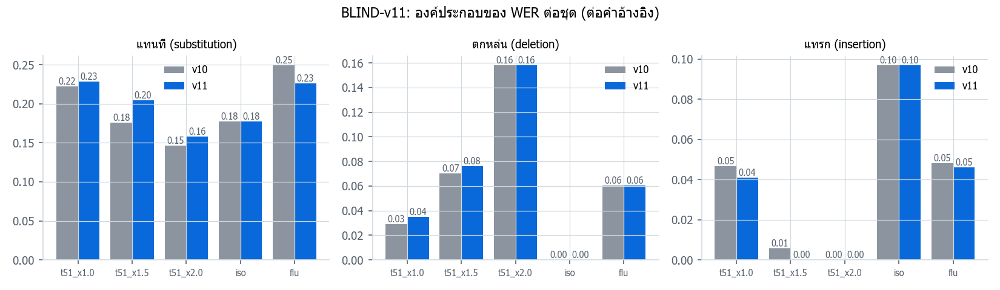
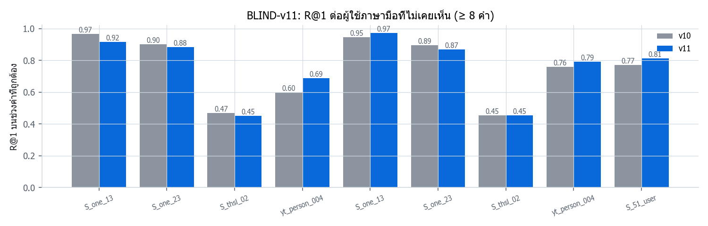
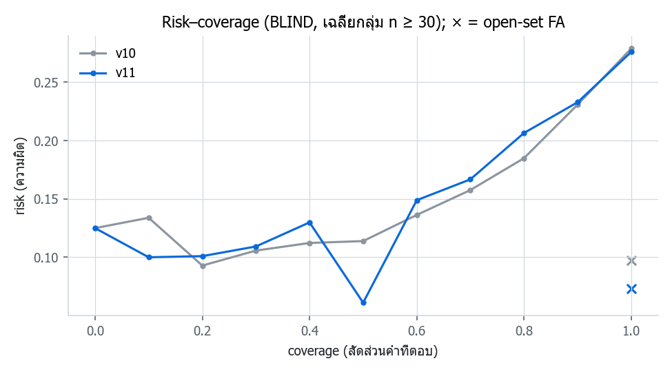
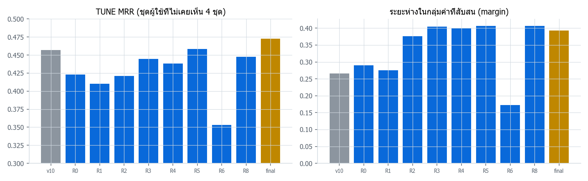
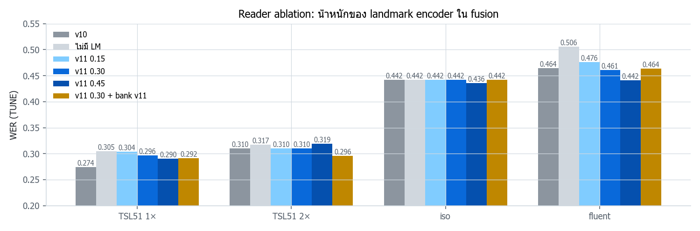
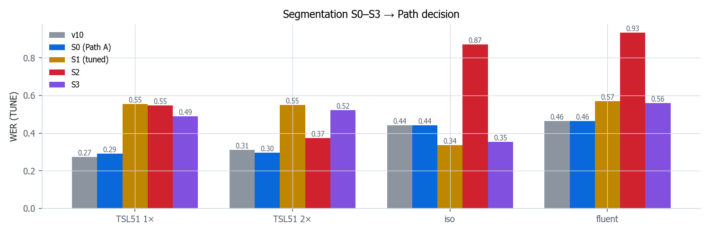
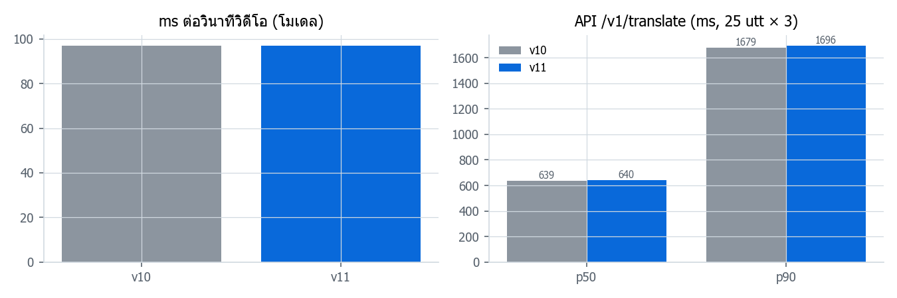

# ThaiSLM v11 — รายงานผล (prompt-opt-v11, TPH 1–4)

วันที่ 13 พ.ย. 2026 · ขอบเขต: การรู้จำภาษามือ (encoder, segmentation, bank, decision layer, extractor ฝั่ง server, adaptation, evaluation)
· ไม่แตะ face / speech / LLM / UI

## 0. สรุปสั้น (อ่านส่วนนี้ก่อน)

- **ผลตัดสิน: v11 ไม่ผ่าน ship gate บน BLIND-v11 → ไม่ ship, v10 ยังเป็นค่าเริ่มต้น**; `models/model-v11/` เป็น candidate
  (เปิดใช้ได้ด้วย `THAISLM_MODELS_DIR=./models/model-v11`; `THAISLM_V11=0` = v10 ทุกประการ — ตรวจแล้ว 39/39 utterance เหมือนเดิม)
  การจะ ship หรือไม่เป็นการตัดสินใจของเจ้าของงาน
- **ที่ดีขึ้นจริงบน BLIND (คนที่ไม่เคยเห็น, เปิดครั้งเดียว):** WER ประโยคต่อเนื่อง (fluent) **0.354 → 0.329** (paired, CI ทั้งระดับ
  utterance [−0.043, −0.008] และระดับ signer [−0.051, −0.003] ไม่คร่อม 0) · ท่านอกคลังคำที่ถูกยอมรับเป็นคำ **17.0 % → 12.5 %** ·
  open-set simulation **9.8 % → 7.3 %** · การอ่านคำบนช่วงที่ถูกต้อง (gold span) ของ TSL51 **0.789/0.778/0.749 → 0.801/0.830/0.807**
  · R@1 ต่อผู้ใช้ (Q1 / median) **0.598/0.772 → 0.689/0.813**
- **ที่แย่ลง:** WER TSL51 1.5× 0.217 → 0.243 (มีนัยสำคัญระดับ utterance) เพราะ segmentation tax สูงขึ้น (คำที่อ่านถูกบนช่วงจริงแต่หลุด
  ในสายจริงเพิ่ม: 0.105 → 0.164) · dev-test gate ไม่ผ่าน (TSL51 1×, ECE, coverage บนวิดีโอจริง)
- **Encoder ใหม่ (3-seed ensemble ของ R3, ไทยล้วน, 3.4 M × 3):** TUNE MRR 0.472 (v10 lmenc 0.457) · ผู้ใช้ที่แย่ที่สุด 0.184 (0.148)
  · margin ในกลุ่มคำสับสน 0.393 (0.266) — ดีกว่าในตัวมันเอง แต่ในสายเต็มได้ผลใกล้ v10 (reader ablation §5)
- **Real web test (§4D, Chrome จริง + กล้องจำลอง, 148 คลิป 26 คน, 394 รัน):** top-1 WER เสมอ (0.592 → 0.601), displayed WER
  **แย่ลง 0.674 → 0.733** (v11 ยอมรับคำน้อยลง: recall 0.33 → 0.27, precision 0.90 → 0.95) · ท่านอกคลังคำ / ยกมือไม่ทำท่า ที่ขึ้นเป็นคำ
  16.7 % → 5.6 % · ไม่มี error / crash · rollback ด้วย `docker compose` ให้ผลเหมือน v10 เดิมทุกประการ (70/70) → G9 ไม่ผ่าน ยืนยันผล "ไม่ ship"
- **รอบรวมข้อดี v11 + v10 (§12):** ลองแยกต้นเหตุ, calibration สองชั้น, อ่านคู่ (encoder v10 + v11), Tail guard บน TUNE offline + ชุดแบบเว็บใหม่
  → ตัวที่ดีที่สุด (อ่านคู่) ดีขึ้นบน TUNE / dev-test บางด้าน (fluent top-1 0.397 → 0.362) แต่ **ไม่ผ่าน dev-test gate (21 metrics)** → v10 ยังเป็นค่าเริ่มต้น
- **Path B (segmentation ด้วย encoder ใหม่) แพ้ Path A** → ship Path A (segmentation ของ v10) ตามกติกา §3A.4 (ตัวเลข §6)
- งบ GPU: Modal $25.5 จาก $30 (เครดิตทั้งหมด, billed $0) · ไม่ได้ใช้ GCP (สร้าง bucket ถูก auto-mode safety check บล็อก) ·
  local RTX 2050: detector, boundary head, prototype-CTC, การประเมินทั้งหมด

## 1. Ship gate บน BLIND-v11 (C3) — v10 กับ v11 ในรันเดียวกัน

BLIND-v11 = TSL-ONE-S S_one_13, S_one_23 · th_sl S_thsl_02 · TTRS S_ttrs_u00 · YouTube yt_person_004/030/040 · 14/34 template ของ
TSL51 sentence_test (48 ประโยค) — ปิดผนึกก่อนเทรน (`artifacts/eval/blind_v11_manifest.json`), เปิด 1 ครั้งสำหรับตารางนี้ (4E) + ครั้งที่ 2 สำหรับ web test §8.1 หลัง freeze (บันทึกใน `openings`)

| # | เป้า (MUST) | v10 | v11 | ผล |
|---|---|---|---|---|
| G1 | isolated top-1 บน gold segment (คนใหม่) ≥ v10 + 6 pts | 0.837 | 0.837 | ✗ (+0.0) |
| G2 | R@1 ของผู้ใช้ที่แย่ที่สุด (≥ 8 คำ) ≥ v10 + 10 pts | 0.455 | 0.450 | ✗ |
| G3 | WER TSL51 1× ≤ v10 − 0.05 และ fluent ≤ v10 − 0.05 (paired) | 0.276 · 0.354 | 0.280 · 0.329 | ✗ (fluent −0.025 มีนัยสำคัญแต่ไม่ถึง −0.05) |
| G4 | focus words error ≤ 55 % ของ v10 · confusion group ≤ 60 % | 0.488 · 0.067 | 0.497 · 0.067 | ✗ |
| G5 | Path A: segmentation ไม่แย่กว่า v10 | tax 0.117 / 0.105 / 0.175 | 0.152 / 0.164 / 0.216 | ✗ |
| G6 | คำถูกที่ถูกยอมรับ ≥ 72 % โดย error ≤ 5 % ทุกกลุ่ม | 0.43–0.60 | 0.42–0.62 | ✗ |
| G7 | ท่าที่ไม่รู้จักถูกยอมรับ ≤ 5 % · idle ≤ v10 | Tail 17.0 % · sim 9.8 % | **12.5 % · 7.3 %** | ✗ (ดีขึ้นแต่ไม่ถึง) |
| G8 | dev-test gate + per-word guard · latency ≤ v10 + 5 % | — | gate FAIL · latency +0.1 % | ✗ |
| G9 | real web test: top-1 WER และ displayed WER ดีกว่า v10 · ไม่มีหมวดใดแย่ลง (paired) | 0.592 · 0.674 | 0.601 · **0.733** | ✗ (top-1 เสมอ; displayed แย่ลงมีนัยสำคัญ §8.1) |

Paired bootstrap (2,000 ครั้ง, ทั้งระดับ utterance และระดับ signer):

| ชุด BLIND | n | v10 WER | v11 WER | ΔWER | CI (utterance) | CI (signer) |
|---|---|---|---|---|---|---|
| TSL51 1× | 48 | 0.276 | 0.280 | +0.003 | [−0.033, +0.038] | 1 signer |
| TSL51 1.5× | 48 | 0.217 | 0.243 | +0.026 | [+0.003, +0.050] | 1 signer |
| TSL51 2× | 48 | 0.273 | 0.280 | +0.007 | [−0.028, +0.042] | 1 signer |
| isolated | 124 | 0.274 | 0.274 | 0.000 | [−0.024, +0.024] | [−0.021, +0.020] (7) |
| fluent | 120 | 0.354 | **0.329** | **−0.025** | **[−0.043, −0.008]** | **[−0.051, −0.003]** (4) |

## 2. Metric catalogue บน BLIND (C6) — v10 → v11

| ชุด | displayed WER | sub / del / ins | seg F1 | boundary F1 | seg tax | short-sign recall | R@1 / R@5 | macro-F1 | accepted precision | correct accepted | AUROC | ECE |
|---|---|---|---|---|---|---|---|---|---|---|---|---|
| TSL51 1× | 0.597 → 0.590 | .222/.029/.047 → .228/.035/.041 | 0.864 → 0.863 | 0.157 → 0.157 | 0.117 → 0.152 | 0.25 → 0.00 (n 4) | .696/.830 → .661/.819 | .813 → .722 | .970 → .940 | .546 → .558 | .870 → .851 | .055 → .052 |
| TSL51 1.5× | 0.587 → 0.568 | .175/.070/.006 → .205/.076/.000 | 0.852 → 0.851 | 0.193 → 0.195 | 0.105 → 0.164 | 0.25 → 0.25 (n 8) | .684/.766 → .649/.772 | .831 → .750 | .941 → .929 | .547 → .586 | .848 → .829 | .064 → .067 |
| TSL51 2× | 0.632 → 0.609 | .146/.158/.000 → .158/.158/.000 | 0.813 → 0.813 | 0.216 → 0.216 | 0.175 → 0.216 | 0.49 → 0.48 (n 114) | .608/.713 → .585/.708 | .800 → .764 | .918 → .891 | .538 → .570 | .830 → .806 | .076 → .072 |
| isolated | 0.524 → 0.508 | .177/.000/.097 → same | 0.946 → 0.946 | 0.531 → 0.531 | 0.089 → 0.089 | — | .789/.902 → .789/.911 | .764 → .754 | .892 → .882 | .598 → .619 | .780 → .765 | .117 → .108 |
| fluent | 0.703 → 0.702 | .249/.061/.048 → .226/.061/.046 | 0.939 → 0.940 | 0.505 → 0.504 | 0.120 → 0.110 | 0.54 → 0.54 (n 24) | .684/.828 → .697/.832 | .713 → .733 | .938 → .925 | .428 → .420 | .734 → .715 | .119 → .126 |

**Reader บน gold span (BLIND):** Uni-Sign TSL51 0.667→0.731 (ผ่าน bank v11) · landmark encoder iso 0.772→**0.813**, fluent 0.619→**0.649** ·
fusion TSL51 1× 0.789→0.801, 1.5× 0.778→0.830, 2× 0.749→0.807 · any-of-three fluent 0.763→0.806

**Signer generalisation (BLIND, gold-span R@1 ของ fusion):** min 0.455 → 0.450 (S_thsl_02 ทั้งสองรุ่น — ผู้ใช้ th_sl ที่ยากที่สุด) ·
Q1 0.598 → 0.689 · median 0.772 → 0.813 · yt_person_004 fluent 0.598 → 0.689 · in-sentence gap 0.022 → 0.041

**Focus words (BLIND, error บน gold span, v10 → v11):** กิน 0.53 → **0.44** (n 68) · คุณ 0.85 → **0.56** (27) · น้อง 0.83 → **0.67** (18) ·
ข้าว 0.32 → **0.21** (19) · ไป 1.00 → 1.00 (18) · ยาย 0.20 → 0.40 (10) · เที่ยว 0.29 → 0.64 (14) · น้า 0.80 → 1.00 (5) · ย่า 0.56 → 0.56 (9) ·
อา / เหงา 0 → 0 · อะไร: ไม่มีใน BLIND · ค่าเฉลี่ย 0.488 → 0.497
**Confusion groups:** {คุณ, ฉัน, แฟน, ต้อง} within-error 0.148 → **0.074** (n 108) · {กิน, ดู, ฉัน, ข้าว, สวัสดี} 0.22 → **0.19** (150) ·
{น้อง, ลูก, ปลา, น้องชาย} 0.29 → **0.20** (45) · {ยาย, ญาติ, ย่า, …} 0.20 → 0.26 (51) · {น้า, อา, น้ำ} 0.25 → 0.31 (16) · {ไป, กลับ, ส่ง, มา} 1.0 → 1.0 (18)

**Decision (BLIND):** Tail signs ที่ถูกยอมรับ 0.170 → **0.125** · open-set simulation 0.098 → **0.073** · max group accepted error 0.20 → 0.33

## 3. Data roles, forms และ BLIND (TPH 1)

- **Tiers** (`cloud_s3/data_prep/manifest/tiers.json`): Core 38 คำ (≥ 5 effective signers) · Extended 290 (ในนี้ 106 คำ < 2 effective
  signers → ติดธง "thin") · Tail 9,214 concepts (เป็น negative / known unknowns เท่านั้น) · ไม่ได้ลบข้อมูลใด (YouTube hub 2 ตัว: ไม่ได้ลบ —
  ยังไม่มีการทดสอบบน TUNE ที่ยืนยันประโยชน์)
- **Forms** (`forms.json`): 327 คำ, 87 คำมี ≥ 2 forms (EA นับได้ 79) — label ของแหล่งเดียวกันไม่รวมกัน; ข้ามแหล่งรวมเมื่อ cos ≥ median 0.656
  (กฎแรกที่ percentile 10 รวม form ที่เอกสารแยกไว้ — แก้แล้ว); ตรวจด้วยตาบน contact sheet ของคำ focus
- **BLIND**: ผู้ใช้ TTRS ทุกคนใน test role มี TRAIN clip 671–2,359 คลิป (role แยกตามคำ) จึงเลือก S_ttrs_u00 (footprint เล็กสุด, 98 คลิป)
  เพื่อให้เป็นคนที่ไม่เคยเห็นจริง; loader ทุกตัว raise / drop บน sealed id (tests/test_v11_sealed.py 5 ข้อผ่าน)
- **Phonology pseudo-labels** (`phonology_labels.npz`): handshape 100 · orientation 36 · location 10 · movement 36; audit บน sheet
  พบ location ผิด (สะโพก/ข้างลำตัวเป็น "chest") และ movement เสื่อม (88 % ตกคลาสเดียว) → แก้ทั้งสองก่อนใช้
- **Hard-case extractor set**: 160 คลิป 8 หมวด (สัมผัสมือ, ไขว้, บังหน้า, มือเอียงข้าง, เร็ว 12 fps, ใกล้กล้อง [ซูม 1.8× เพราะไม่มีฟุตเทจจริง],
  ขอบล่าง, มือหาย) ติด label ด้วยตา (`artifacts/eval/hardcase_v11/`)

## 4. Encoder (TPH 1–2): R0–R8 + 3 seeds

Modal A10G, 16 cores; loader เก็บ pose store ใน RAM (เร็วขึ้น 3.7×) → 5.7 it/s ≈ 3,300 clips/s (batch 583 = 128 คำ × 2 คน × 2 view + null + tail).
ทุก run ใช้ค่า C8 (AdamW β 0.9/0.98, lr 1e-3, EMA 0.999, CosFace s30 m0.25 ramp, SupCon 0.5) · ทุก run พีคที่ 6–12 k steps แล้วลด
→ wave 2 ใช้ early stop หลัง ≥ 6 M clips

| run | สิ่งที่เพิ่ม | clips | TUNE MRR | ต่ำสุดต่อคน | margin | in-sentence R@1 | ผล |
|---|---|---|---|---|---|---|---|
| v10 lmenc (ensemble / ดีที่สุด 1 ตัว) | — | — | 0.457 / 0.447 | 0.148 / 0.111 | 0.266 / 0.250 | 0.480 / 0.398 | อ้างอิง |
| R0 | สูตรเดิม + C8 | 10.8 M | 0.423 | 0.125 | 0.290 | 0.386 | baseline |
| R1 | tiered labels | 8.6 M (time-cap) | 0.410 | 0.140 | 0.275 | 0.369 | — |
| R2 | cross-signer sampler | 11.4 M | 0.421 | 0.125 | 0.376 | 0.360 | — |
| **R3** | augmentation + co-articulation | 11.4 M | **0.445** | 0.135 | **0.404** | **0.425** | ชนะ wave 1 |
| R4 | form sub-centres + group loss | 11.5 M | 0.438 | 0.083 | 0.400 | 0.372 | ไม่รับ |
| R5 | + input v11 | 9.3 M | 0.459 | 0.083 | 0.407 | 0.403 | +1.4 vs R3 (< 1.5) และแย่กว่าด้าน min/in-sentence → ไม่รับ |
| R6 | phonology sub-spaces | 8.2 M (หยุด: นิ่ง) | 0.353 | 0.083 | 0.172 | 0.448 | ไม่รับ |
| R7 | R6 ขนาด M | 2.0 M (หยุด) | 0.201 @2k | — | — | — | นับเฉพาะเมื่อ R6 > R5 → ไม่นับ |
| R8 | R5 + adversary | 8.1 M | 0.447 | 0.083 | 0.407 | 0.331 | probe ลด 0.287→0.204 แต่ R@1 คนใหม่ไม่ขึ้น → ไม่รับ |
| R3 seed 1 / 2 | — | ~5.9 M (1 h box) | 0.451 / 0.443 | 0.042 / 0.151 | 0.370 / 0.387 | 0.460 / 0.444 | — |
| **v11-final** = R3 × 3 seeds | ensemble | — | **0.472** | **0.184** | **0.393** | 0.480 | **encoder สุดท้าย** |

Seed noise ของ MRR: 0.446 ± 0.004 SD → การตัดสิน R5 vs R3 (+1.4) มากกว่า 2 SD แต่ต่ำกว่าเกณฑ์ 1.5 pts ของ prompt (บันทึกไว้)

## 5. Reader และ bank (TUNE)

| reader (S0, segmentation v10) | TSL51 1× | TSL51 1.5× | TSL51 2× | iso | fluent |
|---|---|---|---|---|---|
| v10 (v10 lmenc lm_w 0.3) | 0.274 | 0.279 | 0.310 | 0.442 | 0.464 |
| ไม่มี landmark encoder (lm_w 0) | 0.305 | 0.303 | 0.317 | 0.442 | 0.506 |
| v11 encoder lm_w 0.15 / 0.30 / 0.45 | 0.304 / 0.296 / 0.290 | 0.286 / 0.298 / 0.299 | 0.310 / 0.310 / 0.319 | 0.442 / 0.442 / 0.436 | 0.476 / 0.461 / 0.442 |
| v11 encoder เป็น primary reader (หลายน้ำหนัก) | 0.32–0.45 | — | — | 0.41 | 0.45–0.52 |
| **v11 lm_w 0.30 + bank v11 (reader, λ 0.08)** = S0 | 0.292 | 0.280 | 0.296 | 0.442 | 0.464 |

**Bank scoring v11** (`modules/runtime.FormBank`): บน embedding ของ v10 ลด within-group error 0.40 → 0.29 ทุก λ แต่ถ้าใช้กับ decoder
bank จะเพิ่ม insertion (scale เปลี่ยน) → ใช้เฉพาะตอน "ตั้งชื่อ" segment (reader-only), λ 0.08 เลือกบน TUNE

## 6. Segmentation — S0–S3 และการตัดสิน Path (TPH 3)

- Boundary head (MS-TCN 4×10, frozen encoder, local 60 นาที): TUNE-signer sentences segment F1 **0.898 / 0.901** (25 / 12 fps),
  boundary F1 0.608 / 0.570, short-sign recall **0.944 / 0.900**
- Prototype-CTC: drift > 0.5 pt ที่ step 300 → แช่ encoder; val CTC ต่ำสุดที่ step 300 (3.86) แล้วขึ้น (train → 0.2) = overfit คนที่เทรน; หยุดที่ 5,960 steps

| TUNE WER | TSL51 1× | 1.5× | 2× | iso | fluent |
|---|---|---|---|---|---|
| v10 | 0.274 | 0.279 | 0.310 | 0.442 | 0.464 |
| **S0 = Path A** | 0.292 | 0.280 | 0.296 | 0.442 | 0.464 |
| S1 boundary head + semi-Markov (decoder จูนใหม่) | 0.542 | 0.537 | 0.560 | **0.337** | 0.569 |
| S2 prototype-CTC | 0.548 | 0.444 | 0.374 | 0.872 | 0.933 |
| S3 CTC ∪ boundary head | 0.489 | 0.491 | 0.521 | 0.355 | 0.561 |

**ตัดสิน: Path A** — Path B ชนะเฉพาะคำเดี่ยว แพ้ TSL51 และ fluent มาก เพราะ Path B ตั้งชื่อ segment ด้วย encoder ใหม่ล้วน ซึ่งอ่าน
ช่วงคำของผู้ใช้ TSL51 ได้ R@1 0.48 เทียบกับ Uni-Sign 0.66+

## 7. Decision layer v11, verifier, extractor, adaptation (TPH 2–3)

- **Decision layer** (`modules/openset.py`): open-set head (Tail signs + idle เป็น outlier, เพิ่ม feature "Tail-bank margin": AUROC 0.76 → 0.79),
  conformal set (LAC) ต่อกลุ่ม, three-way KNOWN-SURE / AMBIGUOUS / UNKNOWN (+ `decision`, `alternatives`, `p_known` ใน API แบบ additive)
  - วัดแล้ว: กฎ "conformal singleton" ของ prompt ได้คำถูกที่ถูกยอมรับเพียง 12–14 % ที่ error ≤ 5 %; threshold ต่อกลุ่มแบบ risk-controlled
    (ประเมินแบบ hold-out ผู้ใช้) ได้ 27 % → ขัดกฎ C5 (coverage ห้ามลด) → ship แบบ "v10-acceptance": ยอมรับตาม calibration ของ v10
  - §4G: open-set veto ทำให้ segment บางส่วนของโหมดสดกลายเป็น UNKNOWN (stream ยืนยันคำแทบไม่ได้) → ปิด veto (`known_bound` 0;
    ค่าที่ fit ไว้ 0.743 เก็บใน `known_bound_fitted`)
- **Verifier** (GBT ต่อกลุ่ม, ONNX + NumPy ใน production, parity 2.7e-6): เก็บไว้ 9/36 กลุ่ม (เช่น ไป/กลับ/ส่ง/มา in-group R@1 0.22 → 0.56,
  น้อง/ลูก/ปลา 0.37 → 1.00 บน TUNE) แต่ในโหมด v10-acceptance ไม่เปลี่ยนคำตัดสินใดบน TUNE
- **Extractor (Pose Gate บน hard-case 160 คลิป):**

| arm | hand found | both | truly-visible found | phantom | flicker /10 s | bone CV | wrist gap | ms/frame |
|---|---|---|---|---|---|---|---|---|
| X0 (v10 Holistic + ROI) | 0.673 | 0.431 | 0.908 | 0.050 | 0.479 | 0.265 | 0.114 | 56.8 |
| X1 detector (YOLOv8n HaGRID, test mAP50 0.995 / mAP50-95 0.878) | 0.674 | 0.433 | 0.908 | 0.050 | 0.479 | 0.265 | 0.114 | 83.5 |
| X2 full-frame re-acquisition | 0.677 | 0.438 | 0.908 | 0.050 | 0.481 | 0.265 | 0.114 | 61.6 |

  บน 16 คลิปที่ยากที่สุด (526 เฟรม): Holistic 554 มือ, X0 กู้ +108, X2 +7, X1 +5 → มือที่เหลือหายจริงหรือถูกกฎความปลอดภัยตัด →
  **X0 คงเดิม** (ไม่ผ่าน Pose Gate จึงไม่ถึง Recognition Gate); X1/X2 เป็น opt-in (`THAISLM_HAND_DETECTOR`, `THAISLM_HAND_REACQUIRE`;
  Ultralytics AGPL → research/server เท่านั้น)
- **Adaptation (TUNE simulation):** session normaliser th_sl +3 pts แต่ TTRS −28 pts ที่ 30 วินาที; pseudo-enrolment ≈ 0;
  explicit enrolment (TSL51) 0.475 → 0.544 / 0.621 / 0.662 ที่ 30 / 60 / 120 วินาที → zero-enrolment **ปิด** (ไม่ปลอดภัย)

## 8. System testing (§4C)

| test | ผล |
|---|---|
| Unit tests | `tests/` 77 passed, 1 skipped (+ test_v11_components 10, test_v11_sealed 5) |
| Golden regression (v11 + `THAISLM_V11=0` vs v10) | **39/39 เหมือนกัน** (คำ + status) บน data_test, iPhone, 20 คำขอเว็บที่บันทึกไว้ |
| Contract `/v1/health`, `/v1/info`, `/v1/vocab`, `/v1/translate`, `/v1/translate/video`, `/v1/live` | PASS — field เดิมครบ, ฟิลด์ใหม่ additive |
| Replay คำขอจริงของเจ้าของ 77 รายการ (อ่านอย่างเดียว) | เปลี่ยน 13 รายการ; คำที่แสดง (accepted) 45 → 35, `[?]` 162 → 160 |
| Streaming (live vs final word F1, flicker, delay) | v10 0.257 / 0 / 3.06 s → v11 (หลัง §4G) **0.330 / 0 / 2.97 s** — PASS (ก่อน §4G: 0.04 FAIL) |
| Latency + load (25 utt × 3, 4 concurrent) | สถานะสุดท้าย (CPU ว่าง): p50 ×0.99, p90 ×1.00 ของ v10 (≈ 635 / 1,690 ms); 0 error — PASS (รันระหว่างที่ report อื่นทำงานได้ ×1.05: ไม่นับ) |
| Robustness (ว่าง, ไม่มีมือ, มือเดียว, 8 fps, 60 วิ, ถนัดซ้าย, มือนอกเฟรม, เฟรมเสีย) | ไม่ crash (ว่าง → 400) |
| Rollback `THAISLM_MODELS_DIR=./models/model-v10 docker compose up` | **PASS** — stack จริง (gateway + web + sign-api) บน model-v10 เทียบกับ sign-api ที่ build จากโค้ด commit HEAD (ก่อน v11): **70/70 utterance เหมือนกัน** (คำ + status + p) · `artifacts/reports/webtest_v11_rollback.json` |
| Replay คำขอของเจ้าของผ่าน gateway จริง (docker, 77 รายการ × 2 รอบต่อรุ่น, สลับลำดับ) | คำที่แสดง 45 → 35, `[?]` 162 → 160, เปลี่ยน 19 รายการ, deterministic 77/77 ทั้งสองรุ่น, p50 1,426 → 1,423 ms · ไม่มีการเขียน `cache/live_requests` (622 ไฟล์เท่าเดิม) |
| Real browser (§4D) | **G9 FAIL** — ดู §8.1 |
| Owner check (webcam ของเจ้าของ) | ต้องให้เจ้าของทำเอง — สคริปต์ 10 นาทีอยู่ใน §11 |

### 8.1 Real web test (§4D)

`docker compose up` (gateway + web + sign-api; speech ปิด, `THAISLM_SAVE_REQUESTS=` ว่าง) · Chrome จริง (หน้าต่างมองเห็น) +
`--use-file-for-fake-video-capture` ต่อคลิป · MediaPipe ในเบราว์เซอร์ ~13 fps (เครื่องนี้) · A/B ด้วย `THAISLM_MODELS_DIR` บนคลิปชุดเดียวกัน
สลับลำดับเป็น block (v11→v10→v10→v11 …) · อ่านผลจาก response ที่หน้าเว็บใช้จริง + คำสด (WebSocket `/v1/live`) + `[lat]` ของหน้า

**Pool 148 คลิป, 26 คน** (`artifacts/reports/webtest_v11_pool.json`): คน BLIND (th_sl S_thsl_02, TTRS S_ttrs_u00, YouTube 3 คน; isolated 25,
ประโยค TSL51 ที่ปิดผนึก 10, ประโยคต่อคำจริงของคนเดียวกัน 7) · ท่านอกคลังคำ 8 · data_test 50 (iPhone ของเจ้าของ 14, team-drive 18 คลิป 3 คน,
test1 ฯลฯ 5, word_ref/อะไร 8, คลิปครู 5) · hard-case 10 · stress 30 (10 คลิป × ซูม 1.7× / 12 fps / กลับซ้ายขวา) · ยกมือไม่ทำท่า 8 —
ใช้วิดีโอของคน BLIND = **การเปิด BLIND ครั้งที่ 2** (บันทึกใน `openings`; หลัง freeze โมเดล ไม่มีการ tune ใด ๆ)
TSL-ONE-S (S_one_13/23) มีแต่ pose ไม่มีวิดีโอ จึงเข้าเบราว์เซอร์ไม่ได้ · `data_test/jack_test` เป็นสำเนาคลิปจาก dataset ที่ใช้เทรน จึงไม่ใช้

`/sign/live` — ทั้ง pool (148 × 2):

| หมวด | n | top-1 WER v10 → v11 | displayed WER v10 → v11 | หมายเหตุ (paired, CI 95 % ระดับคลิป / ระดับคน) |
|---|---|---|---|---|
| **ทั้งหมด** | 148 | 0.592 → 0.601 | 0.674 → **0.733** | top-1 Δ +0.009 [−0.042, +0.061] เสมอ · displayed Δ **+0.059 [+0.027, +0.090] / [+0.020, +0.093] แย่ลง** |
| BLIND isolated | 25 | 0.320 → **0.440** | 0.600 → 0.640 | top-1 แย่ลง (CI ระดับคน [+0.046, +0.286]) |
| BLIND TSL51 ประโยค | 10 | 0.147 → 0.176 | 0.500 → **0.676** | displayed แย่ลง [+0.091, +0.265] (1 คน) |
| BLIND ประโยคต่อคำ | 7 | 0.261 → 0.261 | 0.696 → 0.652 | n น้อย |
| data_test | 50 | 0.658 → 0.665 | 0.715 → **0.791** | displayed แย่ลง [+0.023, +0.126] |
| stress | 30 | 0.817 → 0.796 | 0.710 → 0.731 | ไม่ต่าง |
| hard-case | 10 | 0.375 → 0.375 | 0.375 → 0.375 | คลิปที่ไม่มี label: ขึ้นคำ 50 % → 0 % |
| ท่านอกคลังคำ | 8 | — | — | คลิปที่ขึ้นเป็นคำ 25 % → **12.5 %** |
| ยกมือไม่ทำท่า | 8 | — | — | ขึ้นเป็นคำ 0 % → 0 % (ทั้งสองรุ่น) |

ทั้ง pool: insertion ต่อคำอ้างอิง 0.185 → 0.191 · accepted precision 0.897 → **0.948** · accepted recall 0.331 → **0.267** · คลิปลบ (นอกคลัง /
idle / hard-case ไม่มี label) ที่ขึ้นเป็นคำ 16.7 % → **5.6 %** · latency หลังมือลง p50 1,571 → 1,584 ms, p90 2,701 → 2,979 ms (+10 %) ·
fps 13.1 → 12.7 · คำสดตรงกับคำสุดท้าย (word F1) 0.889 → 0.870, flicker 2.64 → 2.34 · error 0, exception ของหน้าเว็บ 0 ทั้งสองรุ่น

`/sign` — หนึ่งในสามของ pool แบบแบ่งชั้น (49 × 2): top-1 0.737 → 0.705, displayed 0.684 → 0.747 (Δ +0.063 [−0.022, +0.141] ไม่มีนัยสำคัญ),
คลิปลบที่ขึ้นเป็นคำ 12.5 % → 0 %, error 0

**สรุป G9: ไม่ผ่าน** — v11 บนเว็บจริงอ่านคำได้เท่า v10 (top-1) แต่ "แสดง" คำน้อยลง (เข้มกว่า → ผิดน้อยลง แต่ตกหล่นมากขึ้น) และอ่านคำเดี่ยวของคน BLIND
แย่ลง; ข้อดีที่เห็นชัดคือไม่ขึ้นคำมั่วกับท่านอกคลังคำ / ท่าไม่ใช่ภาษามือ · เครื่องมือ: `D:\SLM-labs\_thaislm_v11_cleanup\browser_test\webtest\`
(`build_pool.py`, `webtest.py`, `driver.py`, `analyze.py`, `replay_gateway.py`) · ตัวเลข: `artifacts/reports/webtest_v11.json`, `webtest_v11_rows.json`

dev-test gate: ดู §9

## 9. Dev-test gate (§4B) และ §4G

`decision report --versions v10,v11` + `decision gate --old v10 --new v11` บน dev-test (ชุดทดสอบเดิม ตัดคน BLIND ออก) ·
tolerance = 0.25 × SD ของ bootstrap v10 (frozen ใน TPH 1, `artifacts/baselines/v10/gate_tolerance.json`)

| dev-test WER | v10 | v11 |
|---|---|---|
| TSL51 1× / 1.5× / 2× (78 utt) | 0.302 / 0.300 / 0.291 | 0.329 / 0.298 / **0.278** |
| isolated (107) · fluent (68) | 0.243 · 0.397 | 0.243 · 0.397 (R@5 fluent 0.829 → 0.847) |
| enrolled TSL51 | 0.132 / 0.121 / 0.150 | เท่ากัน |
| model ms ต่อวินาทีวิดีโอ · RSS | 96.1 · 1,230 MB | 97.0 (+1 %) · 1,353 MB (+10 %) |

**Gate (ครั้งแรก): FAIL 21 metrics** — TSL51 1× (WER, R@1, R@5, macro-F1, seg F1), ECE เกือบทุกชุด (calibration ของ v10 กับ feature
ของ reader ใหม่), coverage-at-90 % precision ของ TSL51, acc_cover บนวิดีโอ iPhone / team (จาก open-set veto), R@1 data_test / team

**§4G (1 รอบ):** (1) วินิจฉัย: system test พบ streaming ยืนยันคำได้ ~0 และ coverage ลดบนวิดีโอจริง; ครั้งแรกสันนิษฐานผิด (คิดว่าเป็นการแปลง
"uncertain" → UNKNOWN; ทดสอบแล้วไม่มีผล) สาเหตุจริง = open-set veto กับ segment บางส่วนของโหมดสด (2) แก้ที่ถูกที่สุด: ปิด veto ด้วย flag
(3) รันซ้ำ: streaming **PASS** (live/final F1 0.04 → 0.33 เทียบ v10 0.26), `[?]` กลับเป็น 160 (v10 162), **gate ยัง FAIL 20 metrics**
(TSL51 1× และ ECE ไม่เปลี่ยน — ต้องแก้ที่ reader/calibration ซึ่งเกินขอบเขต 1 รอบ) → หยุดตาม §4G: **ไม่ ship**, ไม่เปิด BLIND ครั้งที่ 2

สาเหตุและงานที่ปิดช่องว่าง: (ก) TSL51 1×: encoder ใหม่อ่านช่วงคำที่ decoder ตัด (ไม่ตรง gold) ได้แย่กว่า v10 lmenc → เทรน encoder ด้วยช่วงคำที่ตัด
จาก decoder จริง (hard-negative boundaries) หรือเก็บ lmenc ของ v10 คู่กัน · (ข) ECE: fit calibration ใหม่ที่ไม่เปลี่ยนการตัดสิน "transition"
(แยก P(correct) ออกจากกฎ postprocess) · (ค) G1/G2/G6: ต้องการผู้ทำท่าเพิ่ม (§11)

## 10. สิ่งที่ยังไม่ได้ทำ / ทำต่างจาก prompt (ตรงไปตรงมา)

1. Real web test (§4D) และ rollback ผ่าน docker compose: รันหลังเจ้าของเปิด Docker Desktop ให้ (ครั้งแรก engine ไม่ขึ้น) — ผลใน §8 / §8.1 ·
   `/sign` รันบนหนึ่งในสามของ pool (หน้าเดียวกันใช้ engine โหมดสดตัวเดียวกับ `/sign/live` ซึ่งรันครบทั้ง pool) · owner check ด้วย webcam ต้องให้เจ้าของทำเอง
2. **GCP ไม่ได้ใช้**: การสร้าง bucket ถูก auto-mode safety check บล็อก จึงย้าย wave 3 ไป Modal (2 seed ใหม่ + R3 เป็น seed 0, box 1 ชม.)
3. wave 2 หยุดก่อนครบ 12 M clips ตามกฎ early stop / กฎของ prompt (R6, R7, R8, R4, R5 — ตัวเลขใน §4); R7 ไม่นับเพราะ R6 < R5
4. Prototype-CTC หยุดที่ 5,960 / ~11,000 steps (val แย่ลงต่อเนื่อง); X1 time-capped 3 ชม. (20 epochs)
5. Decision layer: กฎ conformal-singleton และ per-group ≤ 5 % ถูกวัดและรายงาน แต่ไม่ ship (ขัด C5); open-set veto ปิดใน §4G
6. Hard-case หมวด "ใกล้กล้อง" เป็นภาพซูม (ไม่มีวิดีโอจริงของเจ้าของที่ใกล้กล้อง); คำขอเว็บที่บันทึกไว้ไม่มีภาพ จึงติด label ด้วยตาไม่ได้
7. web test pool ใช้วิดีโอของคน BLIND ตามที่ prompt กำหนด = การเปิด BLIND ครั้งที่ 2 (หลัง freeze, ไม่มีการ tune; บันทึกใน manifest `openings`)

## 11. ช่องว่างถึงเป้าเต็ม และสิ่งที่ต้องเก็บเพิ่ม

| เป้าเต็ม | ตอนนี้ (BLIND v11) | อะไรขวาง |
|---|---|---|
| isolated top-1 ≥ 0.92 | 0.837 (gold) | 290 / 328 คำ < 5 effective signers |
| TSL51 WER ≤ 0.15 | 0.280 | encoder ใหม่อ่าน TSL51 ในประโยคยังด้อยกว่า Uni-Sign; seg tax |
| fluent ≤ 0.22 | 0.329 | ไม่มีประโยคธรรมชาติจากหลายคน |
| min per signer ≥ 0.70 | 0.450 (th_sl S_thsl_02) | th_sl มีผู้ทำ 1 คนต่อ form ส่วนใหญ่ |
| correct accepted ≥ 80 % | 0.42–0.62 | calibration ข้ามผู้ใช้ |
| open-set ≤ 3 % | 7.3–12.5 % | Tail มี 1–2 คลิปต่อคำ |

**Collection list** (`result_reporting/collection_list_v11.csv`): 290 คำต้องการผู้ทำเพิ่ม รวม **917 คน-คำ** เพื่อให้ทุกคำถึง Core (≥ 5 effective
signers) — เรียงจากขาดมากที่สุด พร้อมจำนวน form และ form ที่มีผู้ทำคนเดียว · ลำดับแรก: คำ focus (ไป/กลับ, ยาย/ญาติ/ย่า, น้า/อา, อะไร ทุก form)

**สคริปต์ทดสอบเว็บแคมของเจ้าของ (10 นาที):** (1) คำ focus ทีละคำ ×3: กิน คุณ ยาย ไป อะไร เหงา น้อง น้า เที่ยว ข้าว อา ย่า · (2) คู่สับสน:
ไป/กลับ, ยาย/ย่า, น้า/อา, กิน/ดู, คุณ/ฉัน · (3) ประโยค 3–5 คำ 5 ประโยค ความเร็วปกติและเร็ว · (4) ยกมือค้างไม่ทำท่า 20 วินาที · (5) ท่านอกคลังคำ 5 ท่า
— เทียบ v10 / v11 ด้วย `THAISLM_MODELS_DIR`

## 12. รอบเพิ่มเติม: รวมข้อดีของ v11 เข้ากับ v10 ("v12 merge", 13–14 พ.ย. 2026)

**คำถาม:** เอาจุดที่ v11 ทำได้ดีกว่า (ไม่ขึ้นคำมั่วกับท่านอกคลังคำ / ท่าไม่ใช่ภาษามือ, อ่านประโยคต่อเนื่องของคนใหม่) มาต่อกับ v10 โดยไม่เอาจุดที่แย่ลง
(แสดงคำถูกน้อยลง, TSL51) ได้หรือไม่ · **กติกา:** เลือกบน TUNE เท่านั้น (BLIND ใช้ไปแล้ว 2 ครั้ง ไม่ใช้อีก), ตรวจบน dev-test, ผ่าน dev-test gate ของ v10
ก่อนจึงจะทดสอบเว็บจริง · ทำบนเครื่องทั้งหมด ไม่ใช้ GPU cloud · สคริปต์ `scripts/v12_merge.py`, ตัวเลข `artifacts/reports/v12_merge_*.json`

**1. หาต้นเหตุ (ablation บน TUNE):** v11 เต็มรูป = v10 + encoder v11 + bank v11 ทุกประการ (open-set head / conformal / verifier ในโหมด
v10-acceptance ไม่เปลี่ยนผลเลย) และบน TUNE ใกล้ v10 (WER 0.352 → 0.354) — **การ "แสดงคำน้อยลง" ที่เห็นบนเว็บจริงไม่เกิดบน TUNE** เพราะเป็นเรื่อง
**domain:** บนเว็บจริง P(correct) ของ v11 ต่ำลงทั้งคำถูก (เฉลี่ย 0.774 → 0.716) และคำผิด (0.453 → 0.382) — แยกถูก/ผิดได้พอ ๆ เดิม แต่สเกลเลื่อน
เกณฑ์ 0.88 ที่ตั้งจาก landmark แบบ offline จึงตัดคำถูกทิ้ง

**2. ชุดข้อมูลแบบเว็บ (ใหม่, ไม่แตะ BLIND / data_test):** วิดีโอต้นฉบับของคน TUNE และคน dev-test แยก landmark ใหม่ด้วย MediaPipe Holistic
(ไฟล์โมเดลเดียวกับเบราว์เซอร์) ที่ 13 fps (เท่าเบราว์เซอร์จริง) → `w_t51` (TSL51 126 tune / 78 test), `w_iso` (59 / 11), `w_tail` (120 / 82),
`w_idle` (8 / 7) — `cache/decision/w_*.pkl`, `cache/v12_web/` (ใช้ calibrate โดเมนเว็บได้ในอนาคต)

**3. ผู้สมัคร (TUNE offline + TUNE เว็บ):**

| ผู้สมัคร | ผลบน TUNE | สถานะ |
|---|---|---|
| encoder v11 แทน encoder v10 (ไม่มี bank v11) | เว็บ: WER 0.553 → 0.523, คำตอนยกมือไม่ทำท่า 0.63 → 0 ต่อ 10 วิ · offline: TSL51 แย่ลง (0.272 → 0.294) | ✗ TSL51 |
| calibration สองชั้น (ตัวเดิมทำโครงสร้าง/transition, ตัวใหม่ fit ให้ reader ใหม่ตัดสินการยอมรับ) | กติกา "precision ไม่แย่ลงทุกชุด" บังคับ τ ขึ้น 0.89–0.92 → แสดงคำถูกน้อยลง (ทั้งกับ v11 และ v10 เอง) | ✗ |
| **อ่านคู่ (dual reader): encoder v10 + encoder v11 โหวตร่วมกัน** (น้ำหนัก 0.3 : 0.15) | ที่ coverage เท่ากัน ดีกว่า v10 เล็กน้อย: Tail ที่ขึ้นเป็นคำ 21.7 → 19.3 % (offline) · 15.0 → 12.5 % (เว็บ) · top-1 WER 0.352 → 0.348 / 0.553 → 0.535 | เลือก |
| Tail guard (ลดคำที่ใกล้ท่านอกคลังคำ) | ตัดคำถูกพอ ๆ กับคำผิด (precision ไม่ขยับ) | ✗ |

τ ของ dual reader เลือกด้วยกติกาที่ตั้งไว้ก่อน (TUNE ทั้งสองโดเมน: แสดงคำถูกมากที่สุด โดย pooled precision ≥ v10 − 0.005 และ Tail ≤ v10 + 0.005)
→ **τ 0.89**: offline คำถูกที่แสดง 0.364 → 0.381, top-1 0.352 → 0.347, displayed 0.593 → 0.576 · เว็บ 0.353 → 0.366, 0.553 → 0.535, 0.753 → 0.746

**4. dev-test (ไม่ได้ใช้เลือก):** displayed WER ดีขึ้นทุกชุด offline (−0.013 ถึง −0.019), fluent top-1 0.397 → **0.362** (มีนัยสำคัญ) · เว็บ-TSL51
ไม่ต่าง · ท่านอกคลังคำที่ขึ้นเป็นคำ 15.6 → 16.7 % (offline), 8.5 → 11.0 % (เว็บ)

**5. dev-test gate ของ v10 (ตัวเดียวกับที่ v11 ไม่ผ่าน): FAIL 21 metrics** — การอ่านแย่ลงบางชุด (TSL51 1× R@1 0.735 → 0.728, R@5 0.867 → 0.860,
team R@1 0.700 → 0.686), คำผิดที่ถูกยอมรับเพิ่ม (TSL51 2× 4.7 → 6.6 %, fluent 6.4 → 7.9 %, data_test +1 คำ), ECE แย่ลงหลายชุด, เวลาโมเดล +5.6 %
(`gate_v11-m-d89.json`, `decision_v12cand.json`) → **หยุดตามกติกา:** ไม่ทดสอบเว็บจริงกับผู้สมัครที่ไม่ผ่าน gate (เสียเวลา ~2 ชม. โดยไม่เปลี่ยนผลตัดสิน)

**ข้อสรุป:** ไม่มีวิธีรวมใดที่ดีกว่า v10 ทุกด้าน — ข้อดีของ v11 (อ่านประโยคต่อเนื่องของคนใหม่, ไม่ขึ้นคำตอนไม่ทำท่า) มาจาก encoder ตัวเดียวกับข้อเสีย
(TSL51, R@1 ของบางชุด) และส่วนใหญ่ของ "แสดงคำมากขึ้น" เป็นการเลื่อนเกณฑ์ ไม่ใช่การอ่านดีขึ้น → **v10 ยังเป็นตัวที่ดีที่สุดที่ผ่านเกณฑ์** · โค้ดที่เพิ่ม
(`modules/pipeline.py`: `read.lm2_w` dual reader, `cal.accept` สองชั้น, `cal.tail_guard`) ปิดเป็นค่าเริ่มต้น — ตรวจแล้ว v10 ให้ผลเดิม 77/77 คำขอ
· **ทางที่คุ้มต่อจากนี้:** (1) เทรน encoder ด้วยข้อมูลแบบเว็บ (13 fps, MediaPipe เบราว์เซอร์) และช่วงคำที่ decoder ตัดจริง แทนการแก้ที่ชั้นตัดสิน
(2) calibration โดเมนเว็บจากชุด `w_*` เมื่อมีข้อมูลเว็บที่ติด label มากขึ้น (ตอนนี้ w_iso test มีแค่ 11 คลิป) (3) เก็บผู้ทำท่าเพิ่มตาม collection list

## 13. ไฟล์ส่งมอบ

`models/model-v11/` (+ README) · `artifacts/reports/{v11_experiments.csv, v11_handoff.md, diag_v11_*.json, paired_v10_v11_blind.json,
decision_v11*.json, gate_v11*.json, v11_system_*.json, pose_gate_v11.json, hand_detector_v11.json, v11_encoder_tune.json, webtest_v11*.json}` ·
`artifacts/runs/{v11-R0…R8, v11-R3-s1/s2, v11-final, v11-bnd, v11-ctc, v11-hand-detector}` ·
`cloud_s3/data_prep/manifest/{tiers.json, forms.json, phonology_labels.npz, confusion_groups_tune.json}` · `artifacts/eval/blind_v11_manifest.json`
· `result_reporting/collection_list_v11.csv` · `research-paper/related-work.txt` (สถานะ OUR IDEA K–Q)
