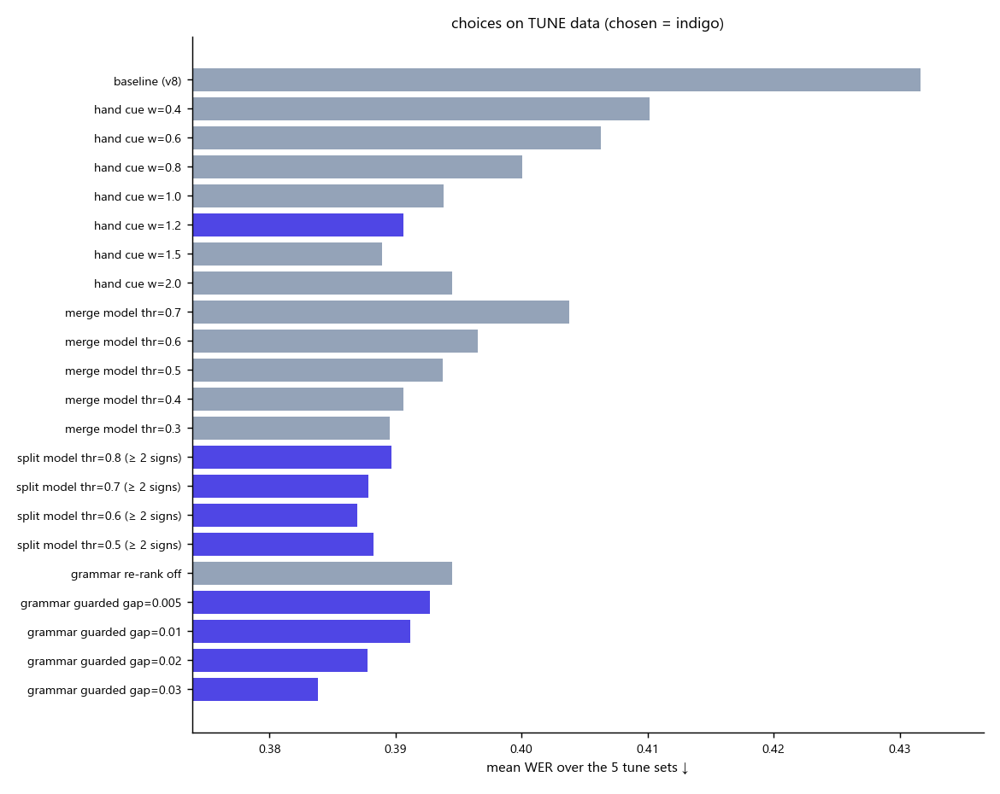
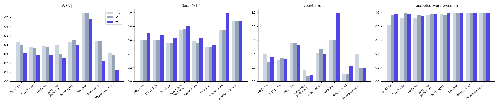
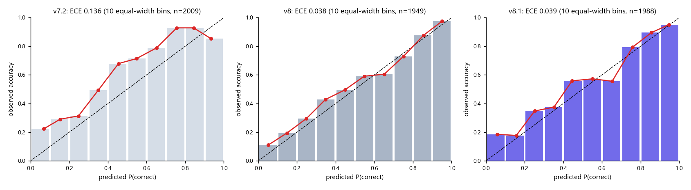

# ThaiSLM — Result Report v8.1 (Forward: Sign → Text)

**Scope (prompt_12):** ปิด GAP ที่เหลือจาก v8 โดยโฟกัส **recognize + generalize** (ไม่โฟกัส grammar/เว็บ/reverse) — (1) ทายผิดคำที่คล้ายกัน (ฉัน/ชอบ, ชื่อ/เพื่อน),
(2) grammar ทับคำที่ท่าบอกถูก, (3) ท่าลื่นต่อเนื่องตัดไม่ได้, (4) คำถูกแต่ P ต่ำ, (5) guard คำซ้ำ, (7) จีน / ประเทศ "OOV" + สะกดนิ้วต้องกดเปิดเอง.
ฐานเริ่มต้น = v8 (prompt_11). Encoder / tagger / span head / bank **ไม่ได้เทรนใหม่** — ทุกอย่างเป็น CPU บนเครื่อง (**$0**).
ทุกค่าเลือกบนชุด **tune** เท่านั้น; ชุด test, data_test/ และ iphone_test/ **ไม่ถูกใช้เลือกอะไรเลย** (iPhone = ชุดดูอย่างเดียว ตามที่ตกลง).
Lab: `lab2.ipynb` → **2. After Tuning** · โค้ด: `modules/handshape.py` (ใหม่), `modules/pipeline.py`, `modules/decode.py`, `scripts/decision.py`.

---

## 0. TL;DR

| คำถาม | คำตอบ |
|---|---|
| ทายคำถูกมากขึ้นจริงไหม (GAP 1)? | **ใช่ ชัดเจน ทุกชุด test** — TSL51 test Recall@1 1× **0.609 → 0.700**, 2× 0.560 → **0.638**; คำเดี่ยวของคนที่ระบบไม่เคยเห็น 0.766 → **0.801**; macro-F1 TSL51 0.66 → **0.79** |
| WER (ไม่เคยใช้เลือกค่า) | TSL51 1× / 1.5× / 2×: 0.394 / 0.364 / 0.376 → **0.309 / 0.284 / 0.292** (ผลต่าง −0.08, 95% CI ไม่คร่อม 0 ทุกความเร็ว) · คำเดี่ยว 0.295 → **0.253** · ประโยคลื่น 0.448 → **0.397** (regression ของ v8 หายไป และดีกว่า v7.2 ด้วย) |
| วิดีโอจริง (ดูอย่างเดียว) | iPhone ประโยค WER 0.283 → **0.126** · iPhone คำ 0.444 → **0.222** (Recall@1 0.75 → **1.00**: ชื่อ ✔ ชอบ ✔) · data_test 0.752 → **0.684** |
| "พรุ่งนี้ฉันไปเที่ยวประเทศจีน" | v8: ถูก 2/6 (ประเทศ→กรุงเทพ, จีน→แต่งงาน) → **v8.1: ถูก 6/6 จำนวนท่าถูกพอดี** |
| จีน / ประเทศ "OOV"? | **ไม่ใช่ OOV** — มีใน bank 24 คน/คำ (TSL-ONE-S) แต่ vocab สนทนา 326 คำไม่ได้ใส่ไว้ → เพิ่มแล้ว (ต้นทุนบน tune = 0) |
| สะกดนิ้วต้องกดเปิด? | **ไม่ต้องแล้ว** — ตัวอักษรอังกฤษอ่านทุก utterance อัตโนมัติ (`"alphabet": "en"`). iPhone "…ภาษามือ **A I**" → A (P 1.00), I (0.99). บน tune: แทรกตัวอักษรผิด **0** ครั้งใน 783 utterance |
| ความมั่นใจ (Accept) ยังแม่นไหม | accepted precision ทุกชุด test ≥ **0.953** (เป้า 0.90); คำถูกที่ถูก Reject ลดลงมาก (TSL51 2×: 77 → **9** segment ที่ Reject) |
| แย่ลงตรงไหน (ตรงๆ) | ECE แย่กว่า v8 เล็กน้อย (TSL51 1× 0.042 → 0.060; ยังดีกว่า v7.2 0.107) · คำที่ Accept ได้ถูกบน TSL51 1.5×/2× ลดลง (135→125, 130→122) · count error TSL51 1× 0.286→0.349, คำเดี่ยว 0.083→0.088, data_test 0.6→1.0 · J ตัวเดียวกลางประโยคยังไม่ขึ้น · latency +75 ms/คลิป — §6 |
| Cost | **$0** — ไม่ใช้ GPU/Vertex/Cloud Storage เลย (ตรวจแล้ว: 0 job ทั้ง 3 region, bucket ว่าง, ไม่มี VM/disk) |

---

## ตารางสรุปเทียบกับทีม — v7.2 · v8 · v8.1 (Forward, conversation vocabulary)

ทุกค่ามาจาก run เดียวกัน (`python main.py decision report` → `artifacts/reports/decision_v8.1.json`): โค้ดและ cache เดียวกัน ต่างแค่การตั้งค่าที่แต่ละเวอร์ชัน ship
(v7.2 = git `f08a56d`, v8 = `artifacts/baselines/v8/`, v8.1 = `models/`). ชุด test ไม่เคยใช้เลือกค่า · วิดีโอจริง (data_test, iPhone) = ดูอย่างเดียว.
**ตัวหนา** = ดีที่สุดของชุดนั้น.

| ชุด (n) | model | WER ↓ | Segment F1 ↑ | Recall@1 ↑ | Recall@5 ↑ | Accepted words correct | Accepted precision ↑ | Count error ↓ | Latency (model, ms/clip) ↓ |
|---|---|---|---|---|---|---|---|---|---|
| TSL51 test 1× (126) | v7.2 | 0.432 | 0.854 | 0.600 | 0.791 | 64 / 78 | 0.821 | 0.405 | – |
| | v8 | 0.394 | 0.874 | 0.609 | 0.793 | 92 / 95 | 0.968 | **0.286** | – |
| | **v8.1** | **0.309** | **0.880** | **0.700** | **0.847** | **97 / 99** | **0.980** | 0.349 | – |
| TSL51 test 1.5× (126) | v7.2 | 0.374 | 0.863 | 0.600 | 0.771 | 74 / 81 | 0.914 | **0.317** | – |
| | v8 | 0.364 | **0.868** | 0.600 | 0.769 | **135 / 136** | **0.993** | 0.341 | – |
| | **v8.1** | **0.284** | 0.866 | **0.676** | **0.804** | 125 / 128 | 0.977 | 0.325 | – |
| TSL51 test 2× (126) | v7.2 | 0.386 | 0.805 | 0.560 | 0.698 | 72 / 78 | 0.923 | 0.556 | – |
| | v8 | 0.376 | 0.805 | 0.560 | 0.696 | **130 / 134** | **0.970** | 0.563 | – |
| | **v8.1** | **0.292** | **0.818** | **0.638** | **0.733** | 122 / 128 | 0.953 | **0.524** | – |
| คำเดี่ยว คนที่ไม่เคยเห็น (217) | v7.2 | 0.392 | 0.913 | 0.743 | **0.925** | 50 / 52 | 0.962 | 0.171 | – |
| | v8 | 0.295 | **0.951** | 0.766 | **0.925** | 72 / 74 | 0.973 | **0.083** | – |
| | **v8.1** | **0.253** | 0.949 | **0.801** | 0.917 | **77 / 78** | **0.987** | 0.088 | – |
| ประโยคลื่นสังเคราะห์ (120) | v7.2 | 0.435 | **0.943** | 0.589 | 0.810 | 64 / 65 | 0.985 | 0.417 | – |
| | v8 | 0.448 | 0.936 | 0.562 | 0.793 | 101 / 105 | 0.962 | 0.467 | – |
| | **v8.1** | **0.397** | **0.943** | **0.628** | **0.839** | **102 / 103** | **0.990** | **0.392** | – |
| data_test (5) | v7.2 | 0.752 | – | 0.500 | **0.850** | 2 / 2 | 1.000 | **0.600** | **530** |
| | v8 | 0.752 | – | 0.500 | **0.850** | 2 / 2 | 1.000 | **0.600** | 546 |
| | **v8.1** | **0.684** | – | **0.524** | 0.762 | 2 / 2 | 1.000 | 1.000 | 621 |
| iPhone คำ (9) | v7.2 | 0.444 | – | 0.750 | **1.000** | 2 / 2 | 1.000 | **0.111** | (รวมในแถว data_test) |
| | v8 | 0.444 | – | 0.750 | **1.000** | **3 / 3** | 1.000 | **0.111** | |
| | **v8.1** | **0.222** | – | **1.000** | **1.000** | 2 / 2 | 1.000 | 0.222 | |
| iPhone ประโยค (5) | v7.2 | 0.311 | – | 0.875 | **0.958** | 3 / 3 | 1.000 | 0.400 | |
| | v8 | 0.283 | – | 0.875 | **0.958** | 4 / 4 | 1.000 | **0.200** | |
| | **v8.1** | **0.126** | – | **0.885** | 0.923 | **6 / 6** | 1.000 | **0.200** | |

**Latency** (CPU laptop, ONNX Runtime, วัดบนวิดีโอจริงทั้ง 19 คลิป ความยาวเฉลี่ย 7.3 s, ไม่รวม MediaPipe):

| model | ms ต่อคลิป ↓ | ms ต่อวินาทีวิดีโอ ↓ | Memory (RSS) | MediaPipe Holistic |
|---|---|---|---|---|
| v7.2 | **530** | **72** | 719 MB | 28 ms/เฟรม (ทุกเวอร์ชันเท่ากัน; ฝั่งเว็บรันในเบราว์เซอร์) |
| v8 | 546 | 74 | 725 MB | |
| v8.1 | 621 (+14% จาก v8: hand cue + สะกดนิ้วอัตโนมัติ) | 85 | 726 MB | |

**นิยามตัววัด** (เหมือน result_v8 §1.2 — เทียบกับรายงานเดิมได้ตรงๆ)
* **WER** = (แทน + หาย + เกิน) / จำนวนคำเฉลย บน top-1 ของทุก sign segment (ไม่นับ transition; ตัวอักษรสะกดนิ้วนับเป็นคำ) — เหมือน `pitty/scripts/sentence_eval.py`
* **Segment F1** = จับคู่ segment กับขอบเขตเฉลยที่ IoU ≥ 0.3 (TSL51 = forced alignment, คำเดี่ยว = span ของคลิป, ประโยคลื่น = ขอบเขตที่ต่อเอง) — วิดีโอจริงไม่มีขอบเขต → "–"
* **Recall@1 / @5** = คำเฉลย (ที่อยู่ใน vocabulary ของเวอร์ชันนั้น) ที่ segment ที่จับคู่ได้มี top-1 / top-5 ถูก · วิดีโอจริง = มีคำนั้นใน top-1 / top-5 ของ segment ใดก็ได้
* **Accepted words correct** = คำสถานะ Accept ที่ถูก / Accept ทั้งหมด (คำที่ระบบ "ยืนยัน") · **Accepted precision** = อัตราส่วนเดียวกันเป็นทศนิยม
* **Count error** = |จำนวน segment − จำนวนคำเฉลย| เฉลี่ยต่อประโยค/คลิป
* วิดีโอจริงมีตัวอย่างน้อย (5 / 9 / 5 คลิป) — ต่างกัน 1 คลิปเปลี่ยนตัวเลขมาก ใช้ดูแนวโน้ม ไม่ใช้สรุปทั่วไป; ช่วงความเชื่อมั่นของผลต่างอยู่ใน §3.2

---

## 1. Diagnosis — ทำไมยังทายผิด (ก่อนแก้)

ตรวจจาก bank (`models/bank.npz`), embedding ของ clip คนที่ไม่เคยเห็น (val/test role) และวิดีโอ iPhone:

| สาเหตุ | หลักฐาน | ผล |
|---|---|---|
| **Bank coverage** (สาเหตุใหญ่ของคำที่ผิดทุกครั้ง) | 82 / 326 คำสนทนามี **คนทำท่าแค่ 1 คน**; อยาก, นำเสนอ, งาน, ถูก มี **1 คลิป** | แก้ด้วยข้อมูลเท่านั้น → รายการเก็บเพิ่ม §7 |
| **Embedding แยกคำคล้ายกันไม่ออก** (ฉัน/ชอบ, ชื่อ/เพื่อน) | encoder ให้คำถูกใน top-5 (R@5 0.79) แต่ไม่ขึ้นที่ 1; การให้คะแนนแบบอื่นบน embedding เดิม (top-1, centroid, signer-max, WCCN, NAP, Z-norm) **ไม่ช่วย** (±1 pt) | ต้องมี **หลักฐานใหม่** ที่ encoder ไม่มี → hand-shape cue §2.1 |
| **Vocabulary ตัดคำที่มีข้อมูลดีทิ้ง** | จีน / ประเทศ 24 คน/คำ แต่ไม่อยู่ใน 326 คำ; ท่าแบบอื่นของคำเดียวกัน (สวัสดี "อายุเท่ากันหรือน้อยกว่า", ภาษามือโรงเรียนเศรษฐเสถียร / ราชสุดา) ถูกเก็บเป็นคนละคำ 61 แบบ | เพิ่มคำ + รวมท่าแบบอื่นเข้าคำเดิม §2.3 |
| **Grammar re-rank ทับคำ** | หลัง ranking ใหม่ กฎเดิมวัด "ระยะห่างทางภาพ" ด้วย `score` ไม่ใช่ค่าที่ใช้จัดอันดับ → เปลี่ยนคำได้แทบฟรี; และทำงานกับคลิปท่าเดียวด้วย | guard §2.4 |
| **Segmentation ท่าลื่น** | ประโยคเร็ว/ลื่น segment น้อยกว่าคำจริง (TSL51 2× 385 vs 450 คำ, ประโยคลื่น −7%) = 2 ท่ากลายเป็น 1 | split test §2.2 |
| Domain shift / segmentation error | คำถูกบางคำยังได้ P ต่ำ (ไป) เพราะท่าของผู้ทดสอบต่างจาก reference | calibration ใหม่ + ข้อมูล |

---

## 2. ทำอะไร (เลือกบน tune ทุกข้อ; เกณฑ์ v8: ไม่มีชุด tune ไหนแย่ลงเกิน 0.003 WER และต้องดีขึ้น > 0.002)

### 2.1 Hand-shape cue — หลักฐานอิสระจากรูปมือ (`modules/handshape.py`)

ทุก segment ถูกอธิบายตรงจาก landmark: มุมงอของแต่ละข้อนิ้ว (15), ระยะปลายนิ้ว–ข้อมือ / ปลายนิ้วโป้ง–นิ้วอื่น, ทิศฝ่ามือ,
ตำแหน่งมือเทียบไหล่และจมูก, การเคลื่อนที่ใน 3 ช่วงเวลาของท่า, ความสัมพันธ์สองมือ → เทียบกับคำอธิบายเดียวกันของทุกคลิปใน bank
ผ่าน metric (standardise + shrinkage LDA) ที่ฟิตจาก **คนใน train เท่านั้น** (`python main.py decision hands`). แล้วรวมกับการอ่านของ encoder
บน **ทั้ง segment** (span head, ทุกคำใน vocabulary): `fused = z(encoder) + w·z(hand)`.

| หลักฐาน | ผล |
|---|---|
| Probe (คลิปคนที่ไม่เคยเห็น vs bank คน train) | hand cue อย่างเดียว R@1 0.66; รวมกับ encoder: test 0.735 → 0.772 (คน TSL51 0.687 → 0.771, YouTube +6 pt) |
| Tune (ทั้ง chain) — สแกน w | WER เฉลี่ย 5 ชุด tune 0.432 (v8) → 0.410 (w 0.4) → 0.400 (0.8) → **0.391 (w = 1.2 เลือก)** · 1.5 ดีกว่าแค่ 0.0016 (< 0.002) · 2.0 แย่ลง |
| ผลที่ตั้งใจแก้ | iPhone คำ: ชื่อ (v8 = เพื่อน) ✔, ชอบ (v8 = ฉัน) ✔ |

### 2.2 Segmentation

| สิ่งที่ทำ | ผลบน tune | สถานะ |
|---|---|---|
| **Split test** (`decode.split_long`, กลับด้านของ merge ของ v8): segment ยาวลองตัด 3 จุดที่มีหลักฐานรอยต่อมากที่สุด (tagger begin/rest, ความเร็วมือ) → อ่านสองครึ่ง vs ทั้งก้อน → logistic P(สองท่า) (11 feature, 3,735 จุดตัด, CV AUC **0.81**) | ไม่มี guard: ช่วยท่าเร็ว แต่ตัดคำเดี่ยวผิด (iso +0.012) → ไม่ผ่าน · **ใช้เฉพาะ utterance ที่มี ≥ 2 ท่า**: TSL51 2× 0.320 → 0.315, ประโยคลื่น R@1 0.470 → 0.485, คำเดี่ยวไม่เปลี่ยน | ✅ thr 0.7 |
| Merge model (v8) ฟิตใหม่บน readings ใหม่ | thr 0.4 เดิมยังดีที่สุด (0.3 ดีกว่าแค่ 0.001) | คงเดิม |

### 2.3 Vocabulary + bank

| สิ่งที่ทำ | ผล |
|---|---|
| **+ จีน, ประเทศ** (`vocab/daily_conversation.json` หมวด `travel`) | ต้นทุนบน tune = 0.000 ทุกชุด |
| ทดลองเพิ่มคำที่มีคนทำ ≥ 6 คน 108 คำ (TSL-ONE-S: กีฬา สถานที่ ประเทศ) | **ไม่ใช้** — R@1 TSL51 tune −9 pt: บางคำเป็น "แม่เหล็ก" ในประโยคจริง (แฟนสาว 55 ครั้ง, อิสราเอล 40, กะเทย 37 …); กรองเหลือ 29–53 คำก็ยังเสีย +0.004–0.006 → รอข้อมูลมากขึ้น |
| **รวมท่าแบบอื่นของคำเดียวกัน** (61 แบบ: ภาษามือโรงเรียน/วิทยาลัย, สวัสดี/ขอบคุณ/ขอโทษ แบบ "อายุเท่ากันหรือน้อยกว่า") → `vocab_conversation.json` `variants`, รวมตอนโหลด bank (ไฟล์ bank ไม่เปลี่ยน) | WER tune เฉลี่ย 0.443 → 0.432 · 13 คำที่มี 1 คน (จำ, รู้, สอน, ใคร, ใช่, ใหม่ …) ได้ตัวอย่างที่ 2 |

### 2.4 Decision layer

| สิ่งที่ทำ | ผลบน tune | สถานะ |
|---|---|---|
| **Grammar re-rank มี guard**: ไม่ใช้กับคลิป 1 ท่า, วัดระยะด้วยค่าที่ใช้จัดอันดับจริง (`support`), จำกัดระยะ (0.005–0.03) | ปิด grammar: 0.3945 · guard gap 0.03: **0.3839** (ดีกว่าปิด 0.011 > 0.005 ตามกฎ v7) · ดีกว่า grammar เดิมไม่มี guard (TSL51 1× 0.303 → 0.284) | ✅ (หมายเหตุ: tune เป็นประโยค TSL51 จึงได้เปรียบเรื่องลำดับคำ — guard ทำให้ไม่ทับคำที่ท่าบอกชัด) |
| Re-ranker top-5 ของ v8 (ไม่ผ่านใน v8: +0.6 pt) | CV top-1 0.768 → **0.782** (+1.4 pt ≥ เกณฑ์ 1 pt) | ✅ ใช้ |
| **Repeat guard**: occurrence ที่ P ≥ 0.8 ไม่ถูกลดสถานะ (คำซ้ำในประโยคเป็นเรื่องปกติ) | WER เท่าเดิมทุกชุด; 0.6/0.5 ทำให้ประโยคลื่น +0.004 → เลือก 0.8 | ✅ ("ฉัน" ตัวที่ 2 ใน 3302 ไม่ถูก Reject แล้ว) |
| Calibration: temperature + logistic P(correct) ฟิตใหม่บน readings ใหม่; เทียบ feature set | v8 features CV log-loss **0.4584** (เลือก) · + hand cue 0.4592 · + dec-agree/split/rerank flags 0.4567 (ต่างน้อยกว่า noise → ไม่ใช้) | T = 0.086 |
| Threshold (accepted precision ≥ 0.90 ทุกชุด tune) | τ_accept **0.92** (global = +margin = +ความยาว ได้ค่าเท่ากัน), τ_reject **0.15** (กลุ่ม Reject ผิดจริง ≥ 85%) | ✅ |
| **สะกดนิ้วอัตโนมัติ** (`"alphabet": "en"`): เลือก thr / single_min / run_min โดยห้ามมีตัวอักษรแทรกในทุก utterance ของ tune (783) แล้วอ่านตัวอักษรใน lesson ได้มากสุด | false letters **0** · อ่านตัวอักษร: lesson train 0.605, **channel ที่ไม่เคยเห็น 0.643** · ตัวอักษรเดี่ยวต้อง P ≥ 0.98 | ✅ · ภาษาไทย ก–ฮ **ไม่เปิดอัตโนมัติ**: แทรกผิด 5–14% ของคำบนคลิปคำ (ท่ามือตัวอักษรไทยคล้ายท่าคำ) |



---

## 3. ผลบน test (ไม่เคยใช้เลือกค่า) + วิดีโอจริง

Bank สำหรับ test = คน train เท่านั้น (`artifacts/eval/bank_eval.npz` + `hand_bank_eval.npz`); วิดีโอจริงใช้ `models/`. ทั้ง 3 เวอร์ชันรันด้วยโค้ดและ cache เดียวกัน
ต่างแค่การตั้งค่าที่ ship (`python main.py decision report`): v7.2 = git `f08a56d`, v8 = `artifacts/baselines/v8/`, v8.1 = `models/` — แต่ละเวอร์ชันใช้ vocabulary ของตัวเอง.

### 3.1 ตารางหลัก

| ชุด (n) | version | WER ↓ | Recall@1 ↑ | Recall@5 ↑ | macro-F1 ↑ | Seg F1 ↑ | Count err ↓ | Accepted ถูก/ทั้งหมด | Acc. prec ↑ |
|---|---|---|---|---|---|---|---|---|---|
| TSL51 1× (126) | v7.2 | 0.432 | 0.600 | 0.791 | 0.661 | 0.854 | 0.405 | 64/78 | 0.821 |
| | v8 | 0.394 | 0.609 | 0.793 | 0.663 | 0.874 | **0.286** | 92/95 | 0.968 |
| | **v8.1** | **0.309** | **0.700** | **0.847** | **0.787** | **0.880** | 0.349 | **97/99** | **0.980** |
| TSL51 1.5× | v7.2 | 0.374 | 0.600 | 0.771 | 0.707 | 0.863 | **0.317** | 74/81 | 0.914 |
| | v8 | 0.364 | 0.600 | 0.769 | 0.708 | **0.868** | 0.341 | **135/136** | **0.993** |
| | **v8.1** | **0.284** | **0.676** | **0.804** | **0.788** | 0.866 | 0.325 | 125/128 | 0.977 |
| TSL51 2× | v7.2 | 0.386 | 0.560 | 0.698 | 0.695 | 0.805 | 0.556 | 72/78 | 0.923 |
| | v8 | 0.376 | 0.560 | 0.696 | 0.695 | 0.805 | 0.563 | **130/134** | **0.970** |
| | **v8.1** | **0.292** | **0.638** | **0.733** | **0.799** | **0.818** | **0.524** | 122/128 | 0.953 |
| คำเดี่ยว คนที่ไม่เคยเห็น (217) | v7.2 | 0.392 | 0.743 | **0.925** | 0.626 | 0.913 | 0.171 | 50/52 | 0.962 |
| | v8 | 0.295 | 0.766 | **0.925** | 0.636 | **0.951** | **0.083** | 72/74 | 0.973 |
| | **v8.1** | **0.253** | **0.801** | 0.917 | **0.710** | 0.949 | 0.088 | **77/78** | **0.987** |
| ประโยคลื่นสังเคราะห์ (120) | v7.2 | 0.435 | 0.589 | 0.810 | 0.508 | **0.943** | 0.417 | 64/65 | 0.985 |
| | v8 | 0.448 | 0.562 | 0.793 | 0.499 | 0.936 | 0.467 | 101/105 | 0.962 |
| | **v8.1** | **0.397** | **0.628** | **0.839** | **0.596** | **0.943** | **0.392** | **102/103** | **0.990** |
| data_test (5) | v7.2 / v8 | 0.752 | 0.500 | 0.850 | – | – | **0.600** | 2/2 | 1.000 |
| | **v8.1** | **0.684** | **0.524** | 0.762 | – | – | 1.000 | 2/2 | 1.000 |
| iPhone คำ (9) | v7.2 / v8 | 0.444 | 0.750 | 1.000 | – | – | **0.111** | 2/2 · 3/3 | 1.000 |
| | **v8.1** | **0.222** | **1.000** | 1.000 | – | – | 0.222 | 2/2 | 1.000 |
| iPhone ประโยค (5) | v7.2 | 0.311 | 0.875 | **0.958** | – | – | 0.400 | 3/3 | 1.000 |
| | v8 | 0.283 | 0.875 | **0.958** | – | – | **0.200** | 4/4 | 1.000 |
| | **v8.1** | **0.126** | **0.885** | 0.923 | – | – | **0.200** | **6/6** | 1.000 |

### 3.2 Paired bootstrap (10,000 resamples, ตัวอย่างเดียวกัน) — ΔWER

| ชุด | v8.1 − v8 [95% CI] | ดีขึ้น / แย่ลง (utterance) | v8.1 − v7.2 [95% CI] |
|---|---|---|---|
| TSL51 1× | **−0.085** [−0.118, −0.051] | 42 / 10 | −0.123 [−0.161, −0.086] |
| TSL51 1.5× | **−0.079** [−0.112, −0.048] | 40 / 8 | −0.089 [−0.122, −0.058] |
| TSL51 2× | **−0.084** [−0.116, −0.054] | 38 / 6 | −0.094 [−0.126, −0.063] |
| คำเดี่ยว | −0.041 [−0.083, 0.000] | 14 / 5 | −0.138 [−0.198, −0.083] |
| ประโยคลื่น | **−0.051** [−0.085, −0.018] | 36 / 15 | −0.038 [−0.070, −0.005] |
| data_test / iPhone คำ / iPhone ประโยค | −0.069 / −0.222 / −0.157 | 2/0 · 2/0 · 2/0 | n เล็กเกินกว่าจะสรุปทั่วไปได้ |

**ต่อคน:** คำเดี่ยว (13 คน) ดีขึ้น 6 คน, **แย่ลง 0**, เท่าเดิม 7 · ประโยคลื่น (8 คน) ดีขึ้น 5, แย่ลง 3 (S_one_02 0.32 → 0.37, S_one_17 0.35 → 0.36, S_one_23 0.28 → 0.28).



### 3.3 ความมั่นใจ (Accept / Uncertain / Reject)

| ชุด | ECE v7.2 / v8 / **v8.1** | Brier v8 / **v8.1** | False-accept rate v8 / **v8.1** | คำถูกที่ถูก Reject v8 / **v8.1** | P เฉลี่ยของคำถูก v8 / **v8.1** |
|---|---|---|---|---|---|
| TSL51 1× | 0.107 / **0.042** / 0.060 | **0.138** / 0.148 | 0.016 / **0.013** | 7.7% / **0.6%** | 0.74 / **0.76** |
| TSL51 1.5× | 0.147 / **0.043** / 0.070 | **0.121** / 0.134 | **0.007** / 0.025 | 6.3% / **0.0%** | 0.78 / **0.79** |
| TSL51 2× | 0.141 / 0.051 / **0.030** | **0.134** / 0.142 | **0.030** / 0.056 | 5.2% / **0.3%** | 0.79 / 0.79 |
| คำเดี่ยว | 0.116 / **0.047** / 0.061 | **0.151** / 0.164 | 0.028 / **0.016** | 6.1% / **2.3%** | 0.77 / **0.79** |
| ประโยคลื่น | 0.178 / **0.028** / 0.048 | 0.160 / **0.157** | 0.022 / **0.006** | 6.7% / **2.0%** | 0.72 / **0.74** |
| iPhone คำ / ประโยค | – | 0.178 / **0.111** · 0.130 / 0.131 | 0 / 0 | 16.7% / **0%** · 19.0% / **4.0%** | 0.69 / **0.73** · 0.67 / **0.73** |

ECE = 10 ช่วงกว้างเท่ากัน (equal-width bins) ของ P(correct) รวมทุก segment ที่ไม่ใช่ transition ของชุดนั้น (n ≈ 230–470 ต่อชุด).



---

## 4. iPhone (data_test/iphone_test) — ก่อน/หลัง (ดูอย่างเดียว ไม่ได้ใช้จูน)

`คำ` = Accept · `คำ?` = Uncertain ("อาจหมายถึง") · `✗` = Reject · (P(correct))

| คลิป | เฉลย | v8 | **v8.1** |
|---|---|---|---|
| คำ 3293 / 3295 | สวัสดี | สวัสดี? (0.39) / สวัสดี? (0.72) | สวัสดี? (**0.53**) / สวัสดี? (**0.81**) |
| คำ 3296 | ฉัน | ฉัน (0.95) | ฉัน (0.94) |
| คำ 3297 | ชื่อ | **เพื่อน?** (0.49) ยาย✗ | **ชื่อ?** (0.62) ย่า✗ |
| คำ 3298 | ชอบ | **ฉัน?** (0.67) | **ชอบ?** (0.81) |
| คำ 3299 | แมว | แมว (0.97) | แมว (0.98) |
| คำ 3308 | พรุ่งนี้ | พรุ่งนี้ (0.90) | พรุ่งนี้? (0.90 < τ 0.92) |
| คำ 3309 | ไป | ไป✗ (0.22) | ไป? (0.19) |
| คำ 3311 | จีน | กรุงเทพ✗ | กรุงเทพ? (0.27) **จีน?** (0.81) — เจอจีนแล้ว แต่มี segment เกินหน้าท่า |
| ประโยค 3302 | สวัสดี ฉัน ชื่อ J ฉัน ชอบ แมว | สวัสดี ฉัน ชื่อ? ถูก✗ **ฉัน✗** ชอบ แมว? | สวัสดี ฉัน? ชื่อ? ถูก✗ **ฉัน?** ชอบ **แมว** |
| ประโยค 3303 | ฉัน สบายดี คุณ สบายดี | ฉัน? สบายดี✗ คุณ✗ สบายดี? | ฉัน? **สบายดี? คุณ?** สบายดี? (ถูก 4/4) |
| ประโยค 3304 | วันนี้ ฉัน นำเสนอ งาน ภาษามือ A I | วันนี้? ฉัน? ห้า✗ ทำงาน✗ ภาษามือ? ยาย✗ ถูก? | วันนี้? ฉัน? ห้า? ทำงาน? ภาษามือ? **A I** (ตัวอักษร, Accept) |
| ประโยค 3305 | วันนี้ ฉัน อยาก เรียน ภาษามือ | วันนี้? ฉัน? เกิด? เรียน ภาษามือ? | วันนี้? ฉัน? เรียน ภาษามือ? (อยาก = 1 คลิปใน bank) |
| ประโยค 3307 | พรุ่งนี้ ฉัน ไป เที่ยว ประเทศ จีน | พรุ่งนี้? ฉัน? ไป✗ เที่ยว? กรุงเทพ✗ แต่งงาน✗ เกิด✗ | **พรุ่งนี้? ฉัน? ไป✗ เที่ยว? ประเทศ? จีน?** (ถูก 6/6) |

สิ่งที่ยังพลาด (pattern จากวิดีโอจริง): **คำที่มี 1 คลิปใน bank** (นำเสนอ → ห้า, งาน → ทำงาน, อยาก หาย) · **J ตัวเดียว** กลางประโยค (ตัวอักษรเดี่ยวต้อง P ≥ 0.98 เพื่อกันตัวอักษรแทรกในประโยคคำ; J ได้ 0.96) ·
คำถูกส่วนใหญ่อยู่ระดับ "อาจหมายถึง" (P 0.6–0.9) เพราะ τ_accept 0.92 ล็อกที่ precision ≥ 0.90 — ประโยคที่เว็บพูดจึงสั้น (ใช้เฉพาะคำ Accept).
ภาพทุกคลิป (เฟรม + กล่องคำ + P ของ v7.2 / v8 / v8.1): `lab2.ipynb` → 2-4.

---

## 5. Release gates (ก่อนแนะนำให้ใช้ v8.1)

| # | Gate | ผล |
|---|---|---|
| 1 | Recognition ดีขึ้นบน held-out หลัก | ✅ ทุกชุด test (CI ไม่คร่อม 0 บน TSL51 ทุกความเร็ว + ประโยคลื่น) |
| 2 | Accepted precision ≥ เป้า 0.90 (กำหนดก่อนทดลอง) | ✅ ต่ำสุด 0.953 (TSL51 2×) |
| 3 | Calibration น่าเชื่อถือบนข้อมูลอิสระ | ⚠️ ผ่านแบบมีเงื่อนไข — ECE 0.03–0.07 (v7.2 0.11–0.18) แต่สูงกว่า v8 (0.03–0.05) บน 4/5 ชุด |
| 4 | False merge ไม่กินผล segmentation | ⚠️ Seg F1 เท่าเดิม (±0.002) หรือดีขึ้น (TSL51 2× 0.805 → 0.818); count error ดีขึ้น 3/5 ชุด test, แย่ลง TSL51 1× (0.286 → 0.349) และคำเดี่ยว (0.083 → 0.088) |
| 5 | Guard คำซ้ำไม่กดคำซ้ำจริง | ✅ คำถูกที่ถูก Reject 5–8% → 0–2%; "ฉัน" ซ้ำใน 3302 ไม่ถูก Reject |
| 6 | OOV / ตัวอักษรไม่กลายเป็นคำมั่นใจ | ✅ false-accept ≤ 0.056; ตัวอักษรแทรกผิด 0 บน tune; วิดีโอจริง accepted precision 1.0 |
| 7 | API เดิมใช้ได้ | ✅ `docker compose build sign-api` + `/v1/translate/video` ด้วยคลิป iPhone: ผลตรงกับ Python ทุกคำ, field เดิมครบ |
| 8 | Runtime / memory | ✅ 621 ms ต่อคลิป 7.3 s (v8 546 ms, +14%) = 85 ms ต่อวินาทีวิดีโอ · RSS 726 MB (เท่า v8) · MediaPipe 28 ms/เฟรม (เท่าเดิม) |

**Go** — แนะนำ v8.1 เป็น forward หลัก: ทายคำถูกขึ้นชัดและมีนัยสำคัญทุกชุด, ไม่มี WER ชุดไหนแย่ลง, ความแม่นของคำที่ Accept ยังเกินเป้า.
ข้อแลกที่ต้องรู้: §6.

---

## 6. แย่ลง / ยังไม่ได้ (ตรงๆ)

* **Calibration (ECE) แย่กว่า v8 เล็กน้อย** บน TSL51 1×/1.5×, คำเดี่ยว, ประโยคลื่น (0.04 → 0.06 โดยประมาณ) — คำที่ยังผิดตอนนี้เป็นคำที่ "เกือบถูก" (P เฉลี่ยของคำผิด 0.29 → 0.42) จึงแยกยากขึ้น.
  ลอง feature ใหม่ 3 ชุด (hand cue, decoder-agree, split/rerank flag) บน tune CV แล้ว **ไม่ดีขึ้นเกิน noise** → ไม่ปรับต่อโดยดู test (จะกลายเป็นจูนบน test)
* **คำที่ Accept ได้ถูกบน TSL51 1.5× / 2× ลดลง** 135 → 125 / 130 → 122 (τ_accept 0.90 → 0.92 จากเกณฑ์ precision ≥ 0.90 ทุกชุด tune) — คำถูกเหล่านั้นยังแสดงเป็น "อาจหมายถึง" ไม่หายไป; รวมทุกชุด test: 530 → 523
* **Count error**: TSL51 1× 0.286 → 0.349 · คำเดี่ยว 0.083 → 0.088 · data_test 0.6 → 1.0 (ประโยค "ฉันปลอบเพื่อนร้องไห้" / "ไปทานข้าวด้วยกันมั้ย" ได้ segment น้อยลง 1–2 · test1 ถูก split เพิ่ม 1) · iPhone คำ 0.111 → 0.222 (จีน มี segment เกินหน้าท่า)
* Recall@5 คำเดี่ยว 0.925 → 0.917, data_test 0.85 → 0.76 (top-1 ดีขึ้น แต่ top-5 ของบางคลิปเปลี่ยน)
* **J ตัวเดียว** ยังไม่ขึ้น · ตัวอักษรไทยไม่เปิดอัตโนมัติ (แทรกผิดเยอะ)
* data_test ยังสูง (WER 0.684): 3/5 คลิปทำท่าลื่นมาก — split test ช่วยได้เฉพาะเมื่อ tagger เห็นอย่างน้อย 2 ท่าแล้ว
* Latency +75 ms ต่อคลิป (hand cue + สะกดนิ้วทุก utterance)

---

## 7. ข้อมูลที่ควรเก็บเพิ่ม (เรียงตามผลกระทบ)

คอขวดใหญ่ที่สุดที่เหลือ = **คนทำท่าต่อคำ**. คำสนทนา (หลังรวมท่าแบบอื่นแล้ว) ที่มี **1 คน = 68 คำ**, **2 คน = 79 คำ**.
เรียงตามความถี่ภาษาไทย (TNC) — คำที่พบบ่อยมากแต่มีคนทำท่าคนเดียว:

1. **1 คน, ใช้บ่อยที่สุด:** เป็น มี และ ไม่ ได้ ให้ แต่ ต้อง ด้วย ใช้ อีก เธอ ถ้า ถูก เอา **งาน** กลับ คิด เคย **อยาก** กำลัง เงิน ควร …
2. **2 คน, ใช้บ่อย:** มา คน อยู่ เขา มาก เรา ยัง เห็น ก่อน รู้ ชีวิต ปัญหา ใคร ใช่ …
3. **คำที่ผิดบน iPhone เพราะข้อมูล:** อยาก, นำเสนอ, งาน (1 คลิป), ไป (ท่าของผู้ทดสอบต่างจาก reference)
4. **ชุดวัดผลจริง**: ประโยคจริง 30–50 ประโยค หลายคน (ใช้วัดผลอย่างเดียว) — ชุด iPhone ปัจจุบันเป็นคนเดียว 14 คลิป ต่างกัน 1 คลิป = สรุปไม่ได้
5. วิดีโอทำท่าลื่น/เร็วจริงหลายคน (มี boundary) — สำหรับเทรน tagger รอยต่อที่ไม่มีการพักมือ

รายการเต็ม: `python main.py decision report` → `artifacts/reports/decision_v8.1.json` · ลิสต์คำ 1–2 คนคำนวณจาก `models/bank.npz` + `vocab_conversation.json` (variants).

---

## 8. Reproduce · ไฟล์ · Rollback

```
python main.py decision cache                 # front pass ของทุกชุด (CPU ~12 นาที, cache/decision ~0.6 GB — ลบได้)
python main.py decision hands                 # hand-shape descriptor ของทุกคลิปใน bank + metric (คน train) ~1 นาที
python main.py decision tune --write          # เลือกทุกค่าบน tune (CPU ~70 นาที) → models/
python main.py decision report                # v7.2 / v8 / v8.1 บน test + วิดีโอจริง → artifacts/reports/decision_v8.1.json
python main.py decision figures               # result_reporting/figures_v8.1/
```

| ไฟล์ | เปลี่ยนอะไร |
|---|---|
| `models/hand_bank.npz` (ใหม่, 2.7 MB) · `artifacts/eval/hand_bank_eval.npz` | descriptor ของ bank (projected 64 มิติ) + metric |
| `models/spotting.json` | `hand_w` 1.2, `split` (thr 0.7, ≥ 2 ท่า), `grammar` guard, `post.repeat_keep_p` 0.8, `spell` ใหม่, `"alphabet": "en"` |
| `models/segment_calibration.json` | temperature 0.086, P(correct), re-ranker, τ 0.92 / 0.15 |
| `models/vocab_conversation.json` · `vocab/daily_conversation.json` | + จีน ประเทศ (328 คำ), `variants` 61 แบบ |
| `models/class_prior.npz`, `models/config.json` | ความน่าเชื่อถือของคำ (รวม variants) · version v8.1 |
| `artifacts/baselines/v8/` | การตั้งค่า v8 ทั้งชุด (baseline + rollback) |

**Rollback → v8:** `copy artifacts\baselines\v8\* models\` (spotting, segment_calibration, class_prior, vocab_conversation) — โค้ดใหม่อ่านไฟล์ v8 ได้ (ไม่มี `hand_w` = ไม่ใช้ hand cue, ไม่มี `split`/`grammar`/`variants` = พฤติกรรม v8).
**Rollback → v7.2:** `git checkout f08a56d -- models/spotting.json models/segment_calibration.json models/vocab_conversation.json` + ลบ `models/class_prior.npz`.
Docker: `docker compose build sign-api` (โค้ดอยู่ใน image, `models/` mount) — ไม่ต้องเพิ่ม dependency (hand cue ใช้ NumPy อย่างเดียวตอน inference).

---

## 9. Cost & cleanup

| รายการ | ค่าใช้จ่าย |
|---|---|
| Vertex AI / GPU | **$0** — ไม่ได้ใช้ (งานรอบนี้ไม่ต้องเทรน encoder; ทุกขั้น CPU บนเครื่อง: hand descriptor 1 นาที, tune ~70 นาที, report ~25 นาที) |
| Cloud Storage | $0 — ไม่ได้อัปโหลด; bucket `temp-gpu-bucket-job` ว่าง (0 object) |
| AWS S3 | ไม่ได้ push (อ่าน mirror ในเครื่องเท่านั้น) |

ตรวจหลังจบ: Vertex custom jobs = 0 ทั้ง asia-southeast1 / us-central1 / europe-west4 · bucket 0 object (คง bucket ไว้) · Compute Engine VM / disk = 0 ·
container ทดสอบ Docker ถูกหยุด/ลบ · ไม่มี background process ของงานนี้ค้าง.
