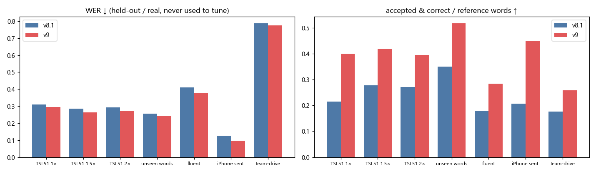
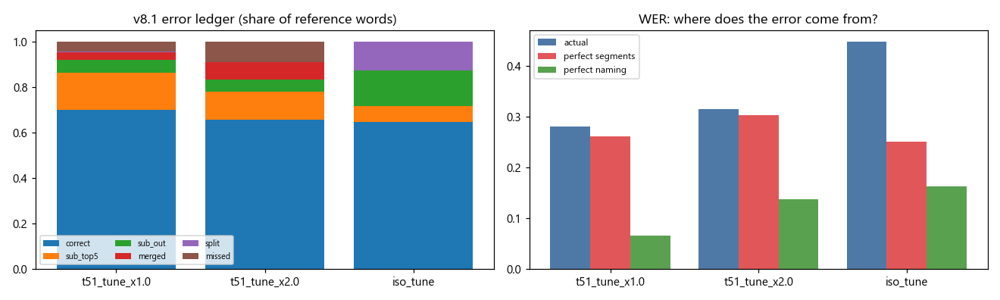
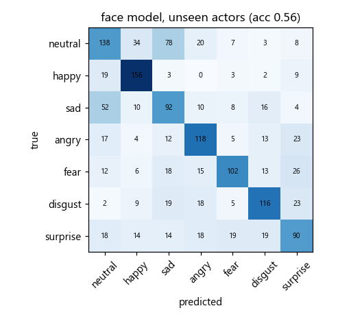
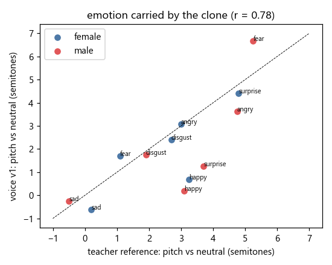

# ThaiSLM — Result Report v9 (Forward Sign → Text · Face emotion · Speech)

**Scope (prompt_13):** พัฒนา v9 จาก v8.1 (Jack-model) — วิเคราะห์ root cause ก่อนแก้ แล้วปรับ **Recognition · Segmentation · Calibration** (สำคัญเท่ากัน),
เพิ่ม **Face emotion model** (อธิบายได้, `models/face-model/`), เริ่ม **Speech v1** (เสียงเป็นธรรมชาติ มีอารมณ์ + ASR, `models/speech-model-v1/`),
streaming runtime, ทดสอบจริงบน TSL51 / data_test / **team-drive** (จุด compare หลัก) / iPhone, Docker และ `lab3.ipynb`.
กติกาเดิม: ทุกค่าเลือกบน **tune** เท่านั้น; test / data_test / iPhone / team-drive **ไม่ถูกใช้เลือกอะไร**. Grammar แบบ rule-based **ปิด** (ตามที่ขอ: recognition ก่อน, grammar = LLM layer ภายหลัง).
โมเดล: `models/model-v9/` (forward) · `models/face-model/` · `models/speech-model-v1/` · lab: `lab3.ipynb` · **Cloud cost: $0** (ทุกอย่างรันบน laptop RTX 2050).

---

## 0. TL;DR

| คำถาม | คำตอบ (ตรงๆ) |
|---|---|
| ต้นเหตุจริงของ error (TSL51)? | **Recognition ไม่ใช่ segmentation** — ถ้าตั้งชื่อคำถูกทุก segment ที่ตัดอยู่แล้ว WER = 0.065; ถ้าตัดคำถูกเป๊ะแต่อ่านแบบเดิม WER ยัง 0.26 (§1) |
| v9 ดีขึ้นไหม (held-out, ไม่เคยใช้จูน) | ดีขึ้น **ทุกชุด**: TSL51 1×/1.5×/2× 0.309/0.284/0.292 → **0.296/0.263/0.274** · คำเดี่ยวคนใหม่ 0.257 → **0.243** · ประโยคลื่น 0.411 → **0.378** (95% CI ไม่คร่อม 0) · iPhone ประโยค 0.126 → **0.097** (จำนวนท่าถูก 5/5) · team-drive ต่อรอบการทำท่า 0.550 → **0.508** |
| คำที่ระบบ "ยืนยัน" (Accept) | มากขึ้น **~1.5–2×** ทุกชุด โดย precision ≥ 0.91 (เป้า 0.90): TSL51 1× 97 → **180** คำ (precision 0.973) — ประโยคที่เว็บพูดยาวขึ้น (G5) |
| TSL51 WER ≤ 0.10? | **ไม่ถึงแบบ signer-independent** (0.296; เพดานของ encoder ปัจจุบัน ≈ 0.26 แม้ตัดคำถูกเป๊ะ). **ใกล้เป้าเมื่อผู้ใช้ลงทะเบียนท่าของตัวเอง** (enrolled): 1× / 1.5× / 2× = **0.119 / 0.109 / 0.137** (§3.3) |
| data_test / team-drive 0.2–0.3? | **ไม่ถึง** — data_test 0.72 (5 คลิป, ต่างกัน 1 คลิป), team-drive 0.77 (raw) / 0.51 (ต่อรอบ). คลิป Jack/Pitty ส่วนใหญ่ถูก; Boom ทำประโยคซ้ำ 2–3 รอบ + 15/85 คำ **ไม่อยู่ใน vocabulary** (§4) |
| Face emotion | โมเดลใหม่ (learned, อธิบายได้): คนที่ไม่เคยเห็น 7 อารมณ์ acc **0.56** (chance 0.20), neutral-vs-emotion **0.81**; บนวิดีโอภาษามือของคนที่ไม่เคยเห็น "อารมณ์ปลอม" **12%** (rule v7: 26%) (§5) |
| Speech | เสียงใหม่ (F5-TTS-THAI + reference อารมณ์จาก ElevenLabs): ฟังออก CER **0.06%** (เสียงเดิม MMS 8.2%), pitch ตามอารมณ์ r = **0.78**; ต้องใช้ GPU. ASR Qwen3-ASR-0.6B: fine-tune ช่วยประโยคสังเคราะห์ แต่ **ทำให้เสียงคนจริงแย่ลง → ไม่ ship เป็น default** (§6) |
| Streaming | ทำงานจริง (partial → confirmed), คำถูกเท่า batch, ซ้ำ 0 — latency/คำ ดู §7 |
| Cost | **$0 cloud** (ไม่ได้ใช้ Vertex / GCS เลย) · ElevenLabs free tier ~5.6k ตัวอักษร |



---

## 1. Diagnosis — Root cause ก่อนแก้ (stage 1)

**Error ledger** (`python main.py diagnose ledger`, v8.1, tune sets): ทุกคำเฉลยถูกจัดเป็น correct / sub_top5 (คำถูกอยู่อันดับ 2–5) / sub_out (ไม่อยู่ top-5) /
merged / split / missed + **oracle bounds**: (ก) อ่านด้วย reader เดิมบน **ขอบเขตเฉลย** (perfect segmentation) (ข) ตัดแบบเดิมแต่ **ตั้งชื่อถูกทุก segment** (perfect naming).

| ชุด (tune) | WER | correct | sub top-5 | sub out | merged | split | missed | perfect-seg WER (R@1) | perfect-naming WER |
|---|---|---|---|---|---|---|---|---|---|
| TSL51 1× | 0.281 | 0.700 | **0.163** | 0.058 | 0.034 | 0.002 | 0.043 | **0.261** (0.741) | **0.065** |
| TSL51 2× | 0.314 | 0.657 | 0.122 | 0.055 | 0.074 | – | 0.091 | 0.303 (0.695) | 0.137 |
| คำเดี่ยว (val signers) | 0.448 | 0.645 | 0.070 | 0.157 | – | **0.128** | – | 0.250 (0.801) | 0.163 |



**ข้อสรุป**
1. **TSL51 = ปัญหา recognition** — ความสับสนเป็นคู่ซ้ำๆ ของคนเดียว: กิน→หลาน (10), ยาย→ญาติ (9), คุณ→ฉัน (8), เกิด→ร้อน (5), ไป→กลับ (4). คำถูกอยู่ใน top-5 ถึง 94%.
2. **อ่านแบบอื่นบน embedding เดิมได้แค่ ~+1 pt** (multi-crop, exact encoder: R@1 0.751 → 0.761) — ยืนยันข้อสรุป v8.1; **classifier บน embedding คำเดี่ยว แพ้ bank** (R@1 0.61 vs 0.75) — ช่องว่างอยู่ที่ "ท่าในประโยค vs ท่าเดี่ยว" ไม่ใช่ metric.
3. **หลักฐานอิสระชุดใหม่ช่วยได้** — Thai-only landmark encoder (v8, ไม่เคยเห็น ASL/CSL) อ่อนกว่าเมื่อใช้เดี่ยว แต่ error ไม่ซ้อนกับ Uni-Sign → fusion +3–4 pt บนประโยคลื่น/คำเดี่ยว.
4. **คำเดี่ยว:** 13% ของคลิปถูกตัดเป็น 2 ท่า (ท่าที่มี 2 จังหวะ) — ย่อย.
5. **"3 โมเดล" (Boom/Pitty/Jack) = weights เดียวกันทุกไฟล์** (encoder / tagger / bank / span head hash ตรงกัน) ต่างกันแค่ค่าตั้ง → "รวมความสามารถ" = รวมค่าตั้งที่ดี: J ตัวเดียวที่ Boom อ่านได้มาจาก threshold ตัวอักษรเดี่ยว 0.9 (Jack 0.98) → v9 เลือกใหม่บน tune (§2.4).
6. **Enrollment:** ถ้า bank มีคลิปคำเดี่ยวของ **ผู้ใช้คนนั้นเอง** (ไม่ใช่ประโยคทดสอบ) TSL51 test WER 0.309 → **0.119** — เส้นทางสู่ ≤ 0.10 คือ few-shot enrollment (มีอยู่แล้วในเว็บ "ท่าของฉัน").
7. **team-drive:** ทุกคลิปของ Boom **ทำประโยคซ้ำ 2–3 รอบ** (มีพักมือคั่น, ตรวจด้วยตา) และ 15/85 คำเฉลยอยู่นอก vocabulary (ยัง/ลืม…บางคำมี, แอบ/ไหม/จะ/กัน/ตลอดไป/เกม ไม่มี) → ต้องรายงาน WER แบบต่อรอบ + in-vocab ด้วย.

---

## 2. Blueprint + สิ่งที่ทำ (stage 2–3) — เลือกบน tune ทุกข้อ

กติกา (เหมือน v8.1): ค่าใหม่ต้องดีกว่าเดิม > 0.002 WER เฉลี่ย 5 ชุด tune และ **ไม่มีชุด tune ไหนแย่ลง > 0.003**; ตั้งต้นจาก v8.1 ที่ตรึงไว้ใน `artifacts/baselines/v8.1/` (release baseline / rollback).

| GAP | สิ่งที่ทำใน v9 | สถานะ |
|---|---|---|
| G2 คำคล้าย / recognition | **Reader ใหม่**: span head + hand cue + **landmark encoder (ONNX 43 MB) เป็นความเห็นที่ 2** (`read.lm_w` 0.3, hand_w 1.2 → 1.0) | ✅ tune mean WER 0.371 → 0.344 |
| G2 | learned top-5 re-ranker ฟิตใหม่ + **guard ใหม่: ต้องไม่แย่ลงชุดไหน** | ✅ ผ่าน guard (ทุกชุดดีขึ้น) |
| G1 enrollment | **Enrolled reader**: เมื่อมี personal bank → ปิด landmark encoder (ไม่มีตัวอย่างส่วนตัวในพื้นที่นั้น), hand_w 0.6 (เลือกบน tune ที่ลงทะเบียน: 0.135 → 0.114) | ✅ |
| G3/G9 segmentation | merge model ฟิตใหม่ (CV AUC 0.89) ไม่ชนะ v8.1 → คงเดิม; split model ฟิตใหม่ (AUC 0.83) thr 0.7 → **0.6** | ✅ |
| G4/G5 calibration | features v9 (+ landmark encoder agrees) + **isotonic** (CV ECE 0.026 → 0.017, log-loss ไม่แย่ลง) → **τ_accept 0.92 → 0.88** (precision ≥ 0.90 ทุกชุด tune), τ_reject 0.15 → 0.19 | ✅ |
| G6 สะกดนิ้ว | วัด **ตัวอักษรเดี่ยว** ด้วย (v8.1 ไม่เคยวัด): single_min 0.98 → **0.95**, และหลังท่า "ชื่อ" ≥ **0.7** — ตัวอักษรแทรกผิด **0** ใน 1,000+ tune utterances; อ่านตัวเดี่ยวของช่องที่ไม่เคยเห็น 56% | ✅ "สวัสดี ฉัน ชื่อ **J**" อ่านได้ |
| G7 tune เอนเอียง | **ปิด grammar re-rank** (rule ที่จูนบนประโยค TSL51) · รายงานแยกต่อ domain/คน · team-drive แบบต่อรอบ + in-vocab | ✅ |
| G8 latency | วัด end-to-end ใหม่ + streaming (§7) | ✅ วัดแล้ว (+3%) |
| Streaming (GPT #3) | `modules/stream.py`: partial → confirmed, คิด compute จริง, กันคำซ้ำ | ✅ |
| Face (โจทย์ผู้ใช้) | `models/face-model` + fusion กับคำ/พลังท่า + คำอธิบายไทย | ✅ (§5) |
| Speech (โจทย์ผู้ใช้) | `models/speech-model-v1` voice + ASR | ✅ (§6) |
| ไม่ทำซ้ำ (ลองแล้วไม่ได้ผล) | เพิ่มคำ ≥ 6 คน, ตัวอักษรไทยอัตโนมัติ, WCCN/NAP/Z-norm, feature calibration เพิ่ม, จูนดู test | ไม่ทำ |

**Reader scan บน tune (ส่วนหนึ่ง)** — WER: TSL51 1× / iso / flu

| setting | mean | TSL51 1× | คำเดี่ยว | ประโยคลื่น |
|---|---|---|---|---|
| v8.1 (span + hand 1.2) | 0.371 | 0.281 | 0.448 | 0.516 |
| + multi-crop อย่างเดียว | 0.371 | 0.279 | 0.453 | 0.522 |
| + landmark encoder 0.3, hand 1.0 (**เลือก**) | **0.344** | 0.253 | 0.413 | 0.486 |
| + landmark encoder 0.4, hand 1.0, crops | 0.344 | 0.251 | 0.407 | 0.486 (ต่าง < 0.002 → ไม่เลือก ช้ากว่า) |

**ลองแล้วไม่ได้ (บันทึกไว้)**: multi-crop span reading (±0), exact-encoder re-read (+1 pt, ช้า), softmax/MLP classifier บน bank embeddings (แพ้ kNN bank −14 pt R@1),
merge model ฟิตใหม่ (ไม่ชนะ v8.1), ASR LoRA (§6), face MLP (+1.6 pt แต่เสียคำอธิบาย → ไม่ใช้).

---

## 3. ผล Forward บน test (ไม่เคยใช้เลือกค่า)

Bank สำหรับชุด test = คน train เท่านั้น; วิดีโอจริงใช้ bank production. v8.1 = `artifacts/baselines/v8.1` (= Jack-model) รันด้วยโค้ดและ cache เดียวกัน (`python main.py decision report --versions v8.1,v9`).

### 3.1 ตารางหลัก

| ชุด (n) | ver | WER ↓ | R@1 ↑ | R@5 ↑ | macro-F1 ↑ | Seg F1 ↑ | Count err ↓ | Accept ถูก/ทั้งหมด | Acc. prec ↑ | Coverage ↑ | ECE ↓ |
|---|---|---|---|---|---|---|---|---|---|---|---|
| TSL51 1× (126) | v8.1 | 0.309 | 0.700 | 0.847 | 0.787 | **0.880** | **0.349** | 97/99 | **0.980** | 0.216 | 0.060 |
| | **v9** | **0.296** | **0.720** | **0.856** | **0.795** | 0.873 | 0.389 | **180/185** | 0.973 | **0.400** | **0.034** |
| TSL51 1.5× | v8.1 | 0.284 | 0.676 | 0.804 | 0.788 | 0.866 | 0.325 | 125/128 | **0.977** | 0.278 | 0.070 |
| | **v9** | **0.263** | **0.693** | **0.809** | **0.793** | **0.867** | 0.325 | **189/196** | 0.964 | **0.420** | **0.036** |
| TSL51 2× | v8.1 | 0.292 | 0.638 | 0.733 | 0.799 | 0.818 | 0.524 | 122/128 | 0.953 | 0.271 | **0.030** |
| | **v9** | **0.274** | **0.658** | **0.747** | **0.815** | **0.823** | **0.492** | **178/186** | **0.957** | **0.396** | 0.060 |
| คำเดี่ยว คนใหม่ (226) | v8.1 | 0.257 | 0.791 | 0.902 | 0.713 | 0.943 | 0.093 | 79/82 | **0.963** | 0.350 | **0.065** |
| | **v9** | **0.243** | **0.800** | **0.920** | **0.724** | 0.943 | 0.093 | **117/128** | 0.914 | **0.518** | 0.081 |
| ประโยคลื่น (120) | v8.1 | 0.411 | 0.593 | 0.799 | 0.614 | **0.933** | **0.408** | 86/91 | **0.945** | 0.178 | 0.086 |
| | **v9** | **0.378** | **0.642** | **0.807** | **0.658** | 0.928 | 0.433 | **138/148** | 0.932 | **0.285** | **0.079** |

**Paired bootstrap ΔWER (v9 − v8.1, 10,000 resamples):** TSL51 1× −0.013 [−0.040, +0.013] · 1.5× −0.021 [−0.050, +0.008] · 2× −0.018 [−0.038, +0.001] ·
คำเดี่ยว −0.013 [−0.044, +0.013] · **ประโยคลื่น −0.033 [−0.061, −0.004]** · team-drive ต่อรอบ −0.042 [−0.088, 0.000].
ทิศทางดีขึ้นทุกชุด แต่มีเพียงประโยคลื่นที่ CI ไม่คร่อม 0 — **v9 เป็นการปรับเพิ่ม ไม่ใช่ step change ของ recognition** (เพดาน encoder §1).

### 3.2 Calibration / การยืนยันคำ

* **Coverage ของคำที่ยืนยัน (Accept) เพิ่ม 1.5–2×** ทุกชุด — คำถูกที่เคยค้างอยู่ "อาจหมายถึง" ถูกยืนยันแล้ว (G5).
* Accepted precision ≥ **0.914** ทุกชุด (เป้า 0.90) — แต่ **false-accept สูงขึ้น** (คำเดี่ยว 0.045 → 0.169, ประโยคลื่น 0.029 → 0.062): ราคาของ τ ที่ลดลง (เลือกบน tune ตามกติกา precision ≥ 0.90).
* ECE ดีขึ้น TSL51 1× / 1.5× (0.06 → 0.035) และประโยคลื่น; แย่ลง TSL51 2× (0.03 → 0.06) และคำเดี่ยว (0.065 → 0.081).
* คำถูกที่ถูก Reject: 0–0.6% บน TSL51.

### 3.3 Enrolled user (ผู้ใช้ลงทะเบียนท่าของตัวเอง) — เส้นทางสู่ TSL51 ≤ 0.10

ประโยคทดสอบเดิม; bank มี **คลิปคำเดี่ยวของผู้ใช้คนเดียวกัน** (t51u, ไม่ใช่ประโยค test) — เหมือนผู้ใช้ยืนยันท่าในเว็บ ("ท่าของฉัน"). เป็นสภาพการใช้งานต่างหาก ไม่ใช่ตัวเลข signer-independent.

| TSL51 test | signer-independent v8.1 | signer-independent **v9** | **enrolled** (v9 = v8.1) | enrolled R@1 | enrolled Accept ถูก/ทั้งหมด (precision) |
|---|---|---|---|---|---|
| 1× | 0.309 | 0.296 | **0.119** | 0.840 | 171/180 (0.950) |
| 1.5× | 0.284 | 0.263 | **0.109** | 0.816 | 185/192 (0.964) |
| 2× | 0.292 | 0.274 | **0.137** | 0.764 | 196/206 (0.951) |

**สิ่งที่เจอระหว่างทาง (และแก้แล้ว):** ครั้งแรก v9 ในโหมด enrolled **แย่กว่า** v8.1 (0.166 vs 0.119) — สาเหตุ: ตัวอย่างส่วนตัวของผู้ใช้อยู่ในพื้นที่ Uni-Sign เท่านั้น
(เว็บเก็บ embedding 768 มิติ) ความเห็นของ landmark encoder จึงเจือจางมัน และ split model ที่ไวขึ้นตัดท่าที่ตรงกับตัวอย่างตัวเองมากเกินไป.
บน **tune ที่ลงทะเบียนแล้ว** v9 ไม่ชนะ v8.1 (0.1138 vs 0.1116) → ตามกติกา "ต้องชนะบน tune" โหมด enrolled จึงใช้ค่าตั้ง v8.1 (`spotting.json` / `segment_calibration.json` → `"enrolled"`),
สลับให้อัตโนมัติเมื่อมี personal bank (`SignPipeline.back`). ผล: เท่ากับ v8.1 ทุกความเร็ว (ไม่มี regression).
**สรุปเป้า ≤ 0.10:** 1.5× = 0.109, 1× = 0.119 — ใกล้แต่ยังไม่ถึง; signer-independent ห่างมาก (0.26–0.30).

---

## 4. วิดีโอจริง (ดูอย่างเดียว ไม่เคยใช้เลือกค่า)

| ชุด | ver | WER (เฉลยตามที่ให้) | WER ต่อรอบการทำท่า | R@1 | Count err | Accept ถูก/ทั้งหมด | shown precision |
|---|---|---|---|---|---|---|---|
| data_test (5) | v8.1 | **0.684** | **0.802** | 0.524 | 1.000 | 2/2 | **0.688** |
| | v9 | 0.724 | 0.842 | **0.571** | **0.800** | **4/4** | 0.632 |
| iPhone คำ (9) | v8.1 | 0.222 | 0.222 | 1.000 | 0.222 | 2/2 | 0.818 |
| | v9 | 0.222 | 0.222 | 1.000 | 0.222 | **4/4** | 0.818 |
| iPhone ประโยค (5) | v8.1 | 0.126 | 0.126 | 0.885 | 0.200 | 6/6 | **0.923** |
| | **v9** | **0.097** | **0.097** | 0.885 | **0.000** | **13/13** | 0.897 |
| **team-drive (18)** | v8.1 | 0.787 | 0.550 | 0.614 | **1.667** | 15/16 | **0.536** |
| | **v9** | **0.774** | **0.508** | **0.686** | 1.722 | **22/23** | 0.527 |

*WER ต่อรอบ* = เทียบกับเฉลยที่ซ้ำตามจำนวนรอบที่คลิปทำประโยค (Boom 2–3 รอบ, คนอื่น 1; นับจากช่วงพักมือ ≥ 1 s แล้วตรวจด้วยตา) · *shown precision* = คำที่แสดง (Accept + อาจหมายถึง) ที่อยู่ในเฉลย.

**team-drive รายคลิป (v8.1 → v9)** — `lab3.ipynb` §4 มีครบทุกคลิป

| คลิป | เฉลย | v8.1 | v9 |
|---|---|---|---|
| Jack (5 คลิป) | — | WER เฉลี่ย 0.10 | WER เฉลี่ย 0.10 ("J" ตัวเดียวอ่านได้, อยาก → ชอบ ผิด) |
| Pitty/พรุ่งนี้ฉันไปโรงเรียน | พรุ่งนี้ ฉัน ไป โรงเรียน | แฟน สวัสดี ฉัน ยาย โรงเรียน น้อง | แฟน **พรุ่งนี้ ฉัน** ยาย **โรงเรียน** น้อง |
| Pitty/พรุ่งนี้ฉันไปเที่ยว | พรุ่งนี้ ฉัน ไป เที่ยว | น้องชาย เที่ยว ที่ไหน | **พรุ่งนี้** เที่ยว ที่ไหน |
| Pitty/วันหยุดพ่อชอบไปตลาด | วันหยุด พ่อ ชอบ ไป ตลาด | วัน ไป กิน ชอบ เพื่อน แม่ ขนมปัง | วัน **ไป** เที่ยว **ชอบ** เพื่อน แม่ **ตลาด** |
| Boom/ฉันยังลืมคุณไม่ได้ (×2) | ฉัน ยัง ลืม คุณ ไม่ได้ | ยาย โกรธ อย่า ชอบ ญาติ ไป อย่า | แฟน ทำไม **ฉัน** ชอบ ญาติ **ลืม** อย่า |
| Boom/มีอะไรให้ฉันช่วยไหม (×2) | มี อะไร ให้ ฉัน ช่วย ไหม | ฉัน กิน อ้วน ฉัน แต่งงาน I … | **ฉัน** ข้าว **อะไร ฉัน** แต่งงาน I **อะไร** … |

**ทำไม team-drive ยังสูง (สาเหตุ ไม่ใช่ข้ออ้าง):** (1) Boom ทำซ้ำ 2–3 รอบ → raw WER > 1 แม้อ่านถูก; (2) 15/85 คำ (18%) **ไม่อยู่ใน vocabulary** — ท่านั้นได้ดีที่สุดแค่ `[?]`;
(3) ท่าธรรมชาติ/เร็วของคนใหม่ — tagger ไม่เคยเห็นการทำท่าแบบไม่พักมือ (count error 1.7 ต่อคลิป); (4) คนละสไตล์กับ bank (คำที่มีคนทำ 1–2 คน).
v9 ดีขึ้นที่ (4) บางส่วน (Boom: ลืม / อะไร ×2 / ฉัน ถูกครั้งแรก) แต่ (2)–(3) ต้องการ **ข้อมูล** (คำ + ประโยคธรรมชาติหลายคน) ไม่ใช่การจูน.

---

## 5. Face emotion model (`models/face-model/`) — "รู้สึกอย่างไร" + อธิบายได้

**สถาปัตยกรรม** — MediaPipe face (52 blendshapes + 68 จุด, extractor เดียวกับท่ามือ ทั้ง browser และ server) → features ต่อช่วงเวลา (mean / p90 / การยกจากหน้าพักของคนนั้น / spread + การขยับศีรษะ, 209 มิติ) →
**multinomial logistic regression** 7 อารมณ์ + temperature → valence / arousal / intensity. ทุกการตัดสินแตกเป็น contribution ต่อ feature → **คำอธิบายภาษาไทย** ("มุมปากยกขึ้น (ยิ้ม) · แก้มยก").
**Fusion** (`fuse_affect`): หน้า (หลักฐานหลัก) + คำที่มีอารมณ์ซึ่งอ่านได้มั่นใจ (รัก / เสียใจ / โกรธ / ร้องไห้ …) + พลังของท่ามือ (ความเร็ว/ขนาด → arousal);
สัญญาณ **ไวยากรณ์บนหน้า** (คิ้วคำถาม, ส่ายหน้าปฏิเสธ — `modules/face.py`) ถูกแยกออก ไม่ถูกตีเป็นอารมณ์. ผลอยู่ใน `result["face"]["affect"]` และ API `/v1/translate*` → `face.affect`.

**ข้อมูล:** RAVDESS (24 นักแสดง × 60 คลิป, 8 อารมณ์ × 2 ระดับ, CC BY-NC-SA 4.0 — วิจัย) ผ่าน extractor เดียวกัน (เก็บเฉพาะ features ใน `cloud_s3/face-data/`, ลบวิดีโอแล้ว)
\+ หน้าตอนทำท่าภาษามือแบบเป็นกลาง 720 ตัวอย่าง (คน train ของ TTRS/th_sl, ไม่มีคำอารมณ์) — **domain adaptation** เพราะโมเดลที่เรียนจากนักแสดงอย่างเดียวอ่านการขยับปาก/สีหน้าไวยากรณ์ของคนทำภาษามือเป็นอารมณ์ **60%** ของเวลา.

| ประเมิน | v7 (rule) | face-model (RAVDESS อย่างเดียว) | **face-model v1 (ship)** |
|---|---|---|---|
| นักแสดงที่ไม่เคยเห็น: 7 อารมณ์ acc (chance 0.20) | – | 0.592 | **0.564** |
| — neutral vs มีอารมณ์ | – | 0.853 | 0.813 |
| — ระดับเข้ม (strong) | – | 0.664 | 0.62 |
| วิดีโอภาษามือ คนที่ไม่เคยเห็น: อารมณ์ปลอมบนท่าเป็นกลาง ↓ | 0.261 | 0.597 | **0.124** |
| ท่าคำอารมณ์ในพจนานุกรม (52 คลิป): valence ตรงกับคำ ↑ | 0.269 | 0.615 | **0.308** |
| — valence เฉลี่ย คำบวก / คำลบ | – | −0.29 / −0.46 | −0.15 / −0.31 (เรียงถูก แต่อ่อน) |
| เวลา | – | – | ~15 ms / คลิป |



**ตัวอย่างจริง** — "ฉันปลอบเพื่อนร้องไห้" (data_test) → **เศร้า/เสียใจ (46%) เพราะมองลง · ยกริมฝีปากบน ; ท่ามือช้า/เบา** · Boom "ฉันแอบชอบคุณ" → เป็นกลาง (v7 rule: ประหลาดใจ) ·
iPhone "สวัสดี ฉันชื่อ J…" → เป็นกลาง ; ท่ามือเร็ว/แรง. รายคลิปทั้งหมด: `lab3.ipynb` §7.
**ข้อจำกัด (ตรงๆ):** อารมณ์ของคนทำภาษามือในพจนานุกรมยังแยกได้อ่อน (คำบวกยังได้ valence ติดลบ); ไม่มีชุดภาษามือไทยที่ติดป้ายอารมณ์จริง — ควรเก็บ (§9).

---

## 6. Speech v1 (`models/speech-model-v1/`) — เสียงของผู้ทำท่า ที่เป็นธรรมชาติและมีอารมณ์

**ออกแบบ (ไม่ใช่แค่ "audio display")**: forward result → `plan_speech` (พูดอะไร: ประโยคที่ผ่าน evidence guard / คำที่ Accept, ไม่พูดคำที่ Reject; พูดอย่างไร: อารมณ์ + ความเข้มจาก face fusion,
ความเร็วจาก tempo การทำท่า + arousal) → **F5-TTS-THAI** (flow matching, zero-shot clone, CC-BY-4.0) โคลน **reference อารมณ์** 7 อารมณ์ × 2 เสียง
ที่สร้างครั้งเดียวด้วย ElevenLabs v3 audio tags (เป็น "เฉลย/ครู") → prosody ของอารมณ์ถูกส่งต่อโดยไม่ต้องเทรน. ตัวอย่างเสียง: `result_reporting/speech_samples_v1/` (+ `demo_*.wav` = วิดีโอจริง → คำ → อารมณ์ → เสียง, `demo.json`).
กติกา no-guessing ของเสียง: พูดเฉพาะคำ Accept (+ "อาจหมายถึง" ที่ P ≥ 0.5 เมื่อผู้ใช้เปิด "พูดผลที่ไม่แน่ใจ") ตาม **ลำดับที่ทำท่า**; ไม่พูดประโยคที่ rule composer เรียงใหม่
(ทดสอบจริงพบว่ามันเรียง "สวัสดี ฉัน ชื่อ J ฉัน ชอบ แมว" เป็น "สวัสดีฉันชื่อชอบฉันแมว"). ตัวอย่าง: data_test "ฉันรักเพื่อน" → พูด "ฉัน รัก" **เสียงดีใจ (0.78)** เพราะยิ้ม + คำว่า รัก;
Boom "ฉันแอบชอบคุณ" (คำ P < 0.5 ทั้งหมด) → **ไม่พูดอะไร** แทนที่จะพูดคำเดา.

| เสียง (12 ประโยค × 7 อารมณ์ × 2 เสียง = 168) | ค่า |
|---|---|
| ฟังออก: CER ที่ ASR อิสระ (Qwen3-ASR base) ถอดได้ ↓ | **0.06%** (เสียงเดิม MMS-TTS **8.2%**) — ทุกอารมณ์ ~0 |
| อารมณ์ถูกส่งต่อ: pitch (เทียบเสียงกลางของตัวเอง) สอดคล้องกับ reference | **r = 0.78** (โกรธ +3–4 st, ตกใจ +4 st, กลัว +2–7 st, เศร้า −0.3–0.6 st) |
| — ช่วง pitch / ความดัง | r ≈ 0.0 / 0.22 — **ยังไม่ถูกส่งต่อ** |
| ความเร็ว: real-time factor | RTX 2050: **1.5** (32 steps) · CPU: ใช้ไม่ได้ (≫ 10) → ต้องมี GPU |



**ASR (เสียงคนได้ยิน → ข้อความ; และเป็น "หู" ตรวจเสียงสังเคราะห์)** — Qwen3-ASR-0.6B:

| CER ↓ | base | LoRA lr 2e-4 ×1 epoch | **LoRA lr 3e-5 ×1 (opt-in)** |
|---|---|---|---|
| ประโยคสังเคราะห์ที่ไม่เคยเห็น (เสียงที่ไม่เคยเห็น) | 4.2% | 2.5% | **1.3%** |
| test-A (73 ประโยค held-out, VachanaTTS ชาย) | 2.0% | 3.3% | **1.8%** |
| วลีสั้นในชีวิตประจำวัน (asr_th, 96) | 21.5% | 22.5% | 21.4% |
| **FLEURS (เสียงคนจริง 100)** | **6.7%** | 11.9% | 8.4% |

ข้อมูล fine-tune (เฉลยถูกโดยโครงสร้าง): 418 วลีสั้น (แยก train/test ตามวลี, ตัดทุกข้อความที่อยู่ในชุด test ออก) → ElevenLabs 160 + held-out voice 62 + F5 clone 1,068 = 1,228 train (`cloud_s3/speech-data/asr/`).
**ผล: เรียนเสียงสังเคราะห์ ไม่ใช่ภาษาไทย** — เสียงคนจริงแย่ลง → **ไม่ ship เป็น default** (adapter อยู่ใน `asr_lora/` แบบ opt-in). Qwen3-ASR base ก็ยังแย่กว่า Whisper-medium ของ reverse part บนวลีสั้น (21.5% vs 14.1%).
สิ่งที่ต้องทำต่อ: ข้อมูลเสียงคนจริงพูดวลีสั้น (Common Voice th / อัดเอง) แทนเสียงสังเคราะห์.

---

## 7. Streaming + latency (`modules/stream.py`)

**ทำไม:** ค่าความเร็วต่อคลิปไม่ใช่ latency ของกล้องสด (GPT GAP 5). v9 มี runtime แบบ stateful: เฟรมเข้า buffer, pipeline รันทุก 0.5 s บนหน้าต่างจำกัด
(≤ 8 s ย้อนหลังจากจุดที่ยืนยันแล้ว — งานต่อรอบมีขอบเขตไม่ว่าทำท่านานแค่ไหน), คำจะ **ยืนยัน** เมื่อจบไปแล้ว ≥ 0.8 s และอ่านได้คำเดิมที่ตำแหน่งเดิม 2 รอบติด
(หรือมือพัก ≥ 0.8 s = จบ utterance); ที่เหลือเป็น **partial** (เทา, อาจเปลี่ยน). คำยืนยันแล้วไม่ถูกแก้ย้อนหลัง; กันคำซ้ำจากรอยตัดระหว่างรอบ.
**วัดแบบซื่อสัตย์:** replay วิดีโอจริงตามเวลาจริง — รอบถัดไปเริ่มได้เมื่อรอบก่อนคำนวณเสร็จ และคำจะมีอยู่หลังเวลาคำนวณเท่านั้น.

| 28 วิดีโอจริง (iPhone ประโยค 5 · data_test 5 · team-drive 18), CPU laptop | ค่า |
|---|---|
| latency ต่อคำ (คำยืนยัน − ท่านั้นจบ) p50 / p95 | **1.53 s / 2.40 s** |
| compute ต่อรอบ p50 / p95 | 304 / 486 ms (< 500 ms step → ตามทันเวลาจริง) |
| WER streaming vs batch (คลิปเดียวกัน) | **0.610** vs 0.645 (stream ไม่แย่กว่า batch) |
| คำซ้ำจากการ stream | **0** |
| partial ที่เปลี่ยนก่อนยืนยัน (flicker) | 4.9 ครั้ง/คลิป (เฉลี่ย; Jack/iPhone 0–4, Boom 7–13) |
| MediaPipe (ไม่รวมข้างบน) | 31 ms/เฟรม CPU server; บนเว็บรันในเบราว์เซอร์ |

ยังไม่ได้ต่อเข้าเว็บ (เว็บยังส่งทีละ utterance เมื่อพักมือ) — `StreamingTranslator` พร้อมสำหรับ websocket endpoint ในรอบถัดไป.

---

## 8. Production — Docker + API + lab3

`docker compose up --build` (gateway · web · sign-api · tts) — `sign-api` mount `models/model-v9` + `models/face-model` (ONNX Runtime + NumPy, ไม่มี PyTorch; landmark encoder เป็น ONNX).
`/v1/info` → `version v9`. ส่งวิดีโอจริงเข้า API แล้วเทียบกับ Python (`SignPipeline(model_dir="models/model-v9")`):

| วิดีโอ | ผลจาก API (Docker) | ตรงกับ Python | เวลา API (รวม MediaPipe) | โมเดล (tagger + spotting + face) | face affect (API) |
|---|---|---|---|---|---|
| Jack/พรุ่งนี้ผมจะไปเที่ยวประเทศจีน | พรุ่งนี้? ฉัน? ไป? เที่ยว? ประเทศ? จีน? | ✅ | 21.5 s (MediaPipe 15.2 s) | 1.5 s | เป็นกลาง ; ท่ามือเร็ว/แรง |
| Jack/สวัสดี ฉันชื่อ J ฉันชอบแมว | สวัสดี ฉัน ชื่อ **J?** ฉัน ชอบ แมว | ✅ | 15.9 s | 1.4 s | เป็นกลาง |
| Pitty/ฉันคิดถึงแม่ | ฉัน? แม่ | ✅ | 6.7 s | 0.6 s | เป็นกลาง |
| data_test/ฉันปลอบเพื่อนร้องไห้ | เพื่อน ดู? สงสาร? | ✅ | 11.7 s | 1.3 s | **เศร้า (66%) เพราะมองลง · ยกริมฝีปากบน ; คำที่ทำ 'สงสาร' ; ท่ามือช้า/เบา** |

* เสียง: `speak=true` → `audio_wav_b64` จาก service `tts` (MMS, CPU) ทำงาน. **เสียง v1 (F5) ยังไม่อยู่ใน Docker** — ต้องใช้ GPU (CPU ช้าเกิน); ใช้ผ่าน `modules/speech.py` บนเครื่องที่มี GPU.
* เวลาส่วนใหญ่คือ MediaPipe ฝั่ง server (อัปโหลดวิดีโอ); บนเว็บ MediaPipe รันในเบราว์เซอร์ → API ใช้เฉพาะส่วนโมเดล (~0.6–1.5 s ต่อคลิป 4–10 s).
* Latency ส่วนโมเดลบน 37 วิดีโอจริง (Python, CPU): v8.1 843 ms/คลิป (98 ms ต่อวินาทีวิดีโอ) → v9 **872 ms** (102 ms/s, **+3%**); RSS 835 MB (เท่าเดิม); MediaPipe 31 ms/เฟรม.
* `lab3.ipynb` §9 เรียก API ที่รันอยู่จริงและเทียบผลกับ Python ในเซลล์เดียวกัน.
* **Docker Desktop บนเครื่องนี้เปิดไม่ขึ้น** ในตอนแรก (socket ค้าง `%LOCALAPPDATA%\Docker\run\userAnalyticsOtlpHttp.sock` "cannot be accessed") → ย้ายโฟลเดอร์ `run` ไปเป็น `run.stale-20261028` แล้วเปิดใหม่ได้ (ลบโฟลเดอร์นั้นได้ภายหลัง).

---

## 9. ข้อจำกัด · สิ่งที่ควรทำต่อ (เรียงตามผลกระทบ)

1. **Recognition เพดานจาก encoder** (§1): ต้องการ encoder ที่เรียน "ท่าในประโยค" — hard-negative contrastive บนคู่ที่สับสน (กิน/หลาน, ยาย/ญาติ, คุณ/ฉัน) ด้วยประโยคต่อเนื่องสังเคราะห์จาก **คน train** (ห้ามใช้ TSL51 test signer). คาดว่าต้อง GPU job เดียว (~1 ชม. Spot A100 ≈ $1–1.5) — ไม่ได้ทำในรอบนี้เพราะงบ/ความเสี่ยง (v8 เคยถดถอยทั้ง chain เมื่อเปลี่ยน encoder).
2. **ข้อมูล:** คำสนทนาที่มีคน 1 คน 68 คำ (อยาก นำเสนอ งาน …); ประโยคธรรมชาติหลายคน + ขอบเขตคำ (เพื่อเทรน tagger ที่ไม่พักมือ); คำนอก vocab ของ team-drive (แอบ ไหม จะ กัน ตลอดไป เกม).
3. **Enrollment ในเว็บ** คือทางที่ใกล้เป้า TSL51 ≤ 0.10 ที่สุด — ทำให้ผู้ใช้ลงทะเบียน 1–2 ตัวอย่าง/คำได้ง่าย.
4. Face: ชุดภาษามือไทยที่ติดป้ายอารมณ์ (แม้ 100–200 คลิป) เพื่อประเมินและปรับโดยตรง.
5. Speech: เสียงคนจริงสำหรับ ASR; ส่งต่อช่วง pitch/ความดังให้ดีขึ้น (reference หลายอันต่ออารมณ์ / intensity blend); service GPU ใน Docker.
6. Calibration: false-accept สูงขึ้นบนคำเดี่ยว (0.17) — พิจารณา τ แยกตามกลุ่ม (คำเดี่ยว vs ประโยค) เมื่อมี tune data มากพอ.

---

## 10. Reproduce · ไฟล์ · Rollback · Cost

```
python main.py decision cache                       # front pass (CPU ~15 นาที) — + team-drive: --sets team
python main.py diagnose ledger                      # error ledger + oracle bounds (stage 1)
python main.py decision lmbank --out models/model-v9   # landmark encoder → onnx/lmenc.onnx + lm_bank.npz (+ eval bank)
python main.py decision tune --start v8.1 --grammar off --write     # ทุกค่าบน tune → models/model-v9 (~2 ชม. CPU)
python main.py decision report --versions v8.1,v9   # test + วิดีโอจริง + enrolled + latency → artifacts/reports/decision_v9.json
python main.py face-data ravdess && python main.py face-model train && python main.py face-model signs
python main.py speech refs | asr-data | asr-train | asr-eval [--lora] | tts-eval | demo      # speech env: D:/SLM-labs/envs/speech
```

| โฟลเดอร์ / ไฟล์ | อะไร |
|---|---|
| `models/model-v9/` | forward v9 (= Jack-model + `onnx/lmenc.onnx`, `lm_bank.npz`, spotting / calibration / class_prior ใหม่) — Docker default |
| `models/face-model/` | `face_emotion.npz` (NumPy), `model_card.json`, README |
| `models/speech-model-v1/` | `speech_config.json`, `refs/` + `refs.json`, `asr_lora/` (opt-in), README |
| `modules/` | `lmenc.py` (ONNX runtime), `face_model.py`, `speech.py`, `stream.py` (ใหม่); `pipeline.py` (reader, enrolled, face model, isotonic, ตัวอักษรหลังชื่อ), `decode.py` |
| `scripts/` | `diagnose.py`, `face_data.py`, `face_model.py`, `speech.py` (ใหม่); `decision.py` (team set, v9 tune/report, lmbank, enrolled) |
| `artifacts/baselines/v8.1/` | ค่าตั้ง v8.1 (baseline + rollback) |
| `lab3.ipynb` | ทดสอบ v9 ทุกชุด (คำนวณสด) + face + speech + Docker |

**Rollback → v8.1:** `THAISLM_MODELS_DIR=./models/Jack-model docker compose up` (หรือ `SignPipeline(model_dir="models/Jack-model")`) — โค้ด v9 อ่านไฟล์ v8.1 ได้ (ไม่มี `read` = ไม่ใช้ landmark encoder).

| Cost | |
|---|---|
| GCP (Vertex / Cloud Storage / Compute) | **$0** — ไม่ได้ใช้เลย (ตรวจหลังจบ §11) |
| ElevenLabs | free tier ~5.6k ตัวอักษร ($0) |
| AWS S3 | ไม่ได้ push (อ่าน mirror ในเครื่อง) |
| ดาวน์โหลด | RAVDESS 12.7 GB (ลบหลังสกัด features), F5-TTS-THAI 1.3 GB + Qwen3-ASR 1.8 GB (`D:/SLM-labs/hf_cache`) |

## 11. Cleanup

| ที่ | สถานะหลังจบ |
|---|---|
| GCP | ตรวจแบบอ่านอย่างเดียว: Vertex custom jobs **0** (asia-southeast1 / us-central1 / europe-west4) · bucket `temp-gpu-bucket-job` **0 object** (คง bucket ว่างไว้) · Compute VM **0** · disk **0** — รอบนี้ไม่ได้สร้างอะไรบน GCP เลย |
| Background process | ไม่มี python / kernel / tail ของงานนี้ค้าง · `docker compose down` แล้ว · Docker Desktop หยุดแล้ว |
| Workspace | ไฟล์ทดลอง/log ของรอบนี้ (`cache/v9`, 127 MB) ย้ายไป `D:\SLM-labs\_thaislm_v9_cleanup\` (ลบได้เลย); สคริปต์ทดลองอยู่นอก repo (scratchpad) · โค้ดใหม่ทุกไฟล์ถูกใช้โดย `main.py` / pipeline / lab3 |
| คงไว้ (จำเป็น) | `cache/decision/` (635 MB, front pass ที่ `lab3.ipynb` ใช้ — สร้างใหม่ได้ด้วย `decision cache`) · `D:/SLM-labs/envs/speech` (speech env) · `D:/SLM-labs/hf_cache` (F5-TTS-THAI, Qwen3-ASR, vocos ≈ 3.2 GB) · `cloud_s3/face-data/`, `cloud_s3/speech-data/` (ข้อมูลที่เก็บเพิ่ม, ไม่อยู่ใน git) |
| ให้ลบเองได้ | `D:\SLM-labs\_thaislm_v9_cleanup\` · `%LOCALAPPDATA%\Docker\run.stale-20261028` (socket ค้างของ Docker Desktop) |
| S3 (คำสั่งให้รันเองถ้าต้องการ push) | `aws s3 sync cloud_s3/face-data s3://dsi490-lake-signdata/agent_data/face-data --profile <AWS_PROFILE>` · `aws s3 sync cloud_s3/speech-data s3://dsi490-lake-signdata/agent_data/speech-data --profile <AWS_PROFILE>` |
| git | ยังไม่ commit (ผู้ใช้จัดการเอง, branch `jack_master`) — `models/model-v9`, `models/face-model`, `models/speech-model-v1` ใช้ Git LFS ตาม `.gitattributes` |
