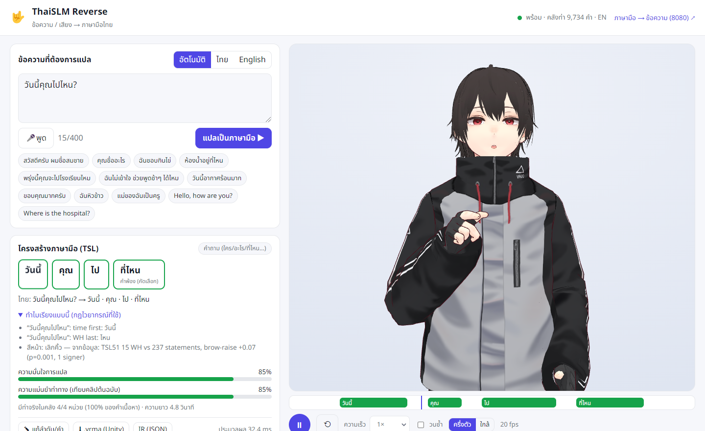
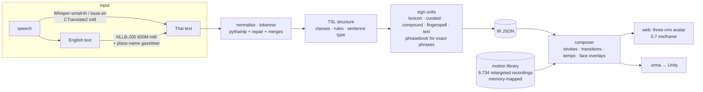
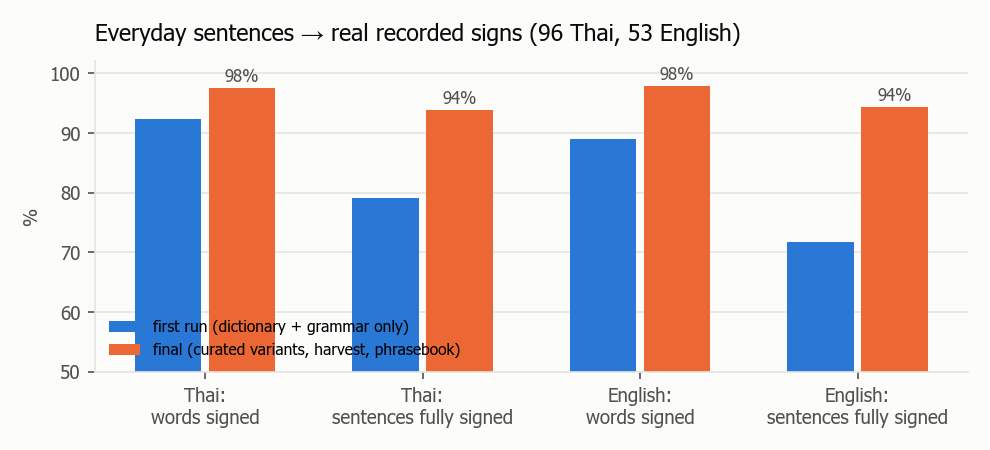
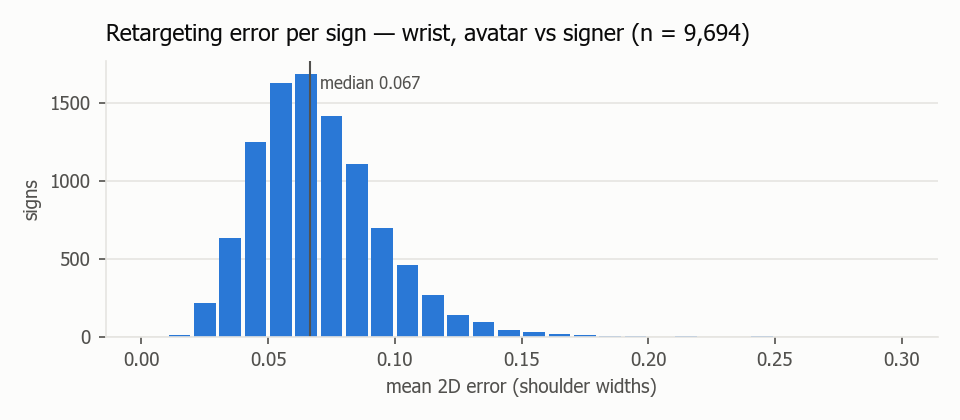
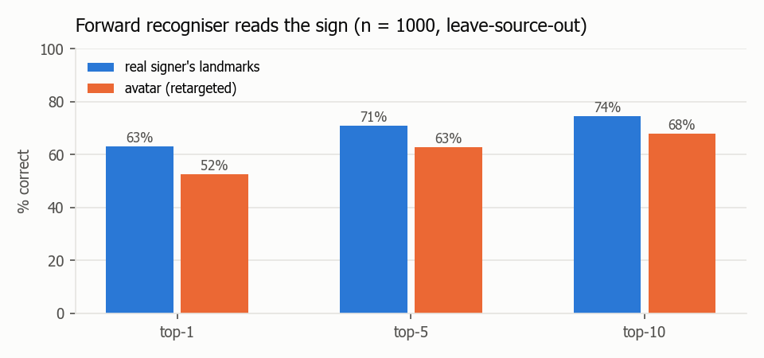
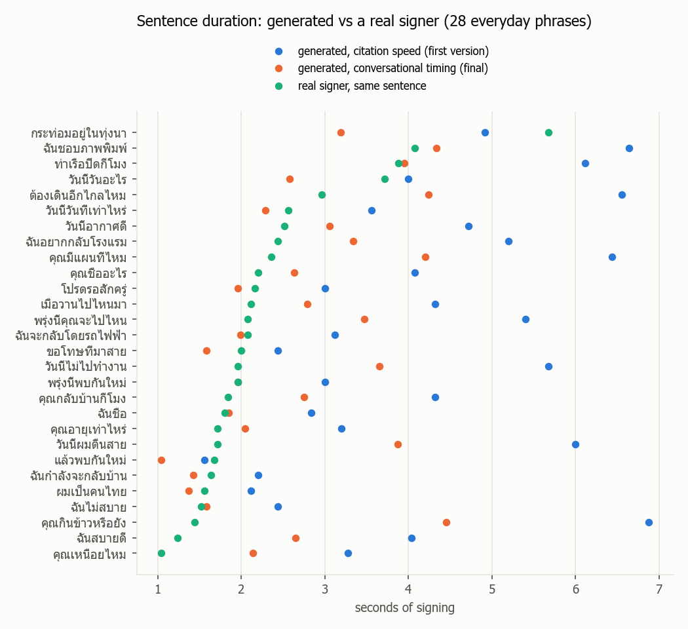
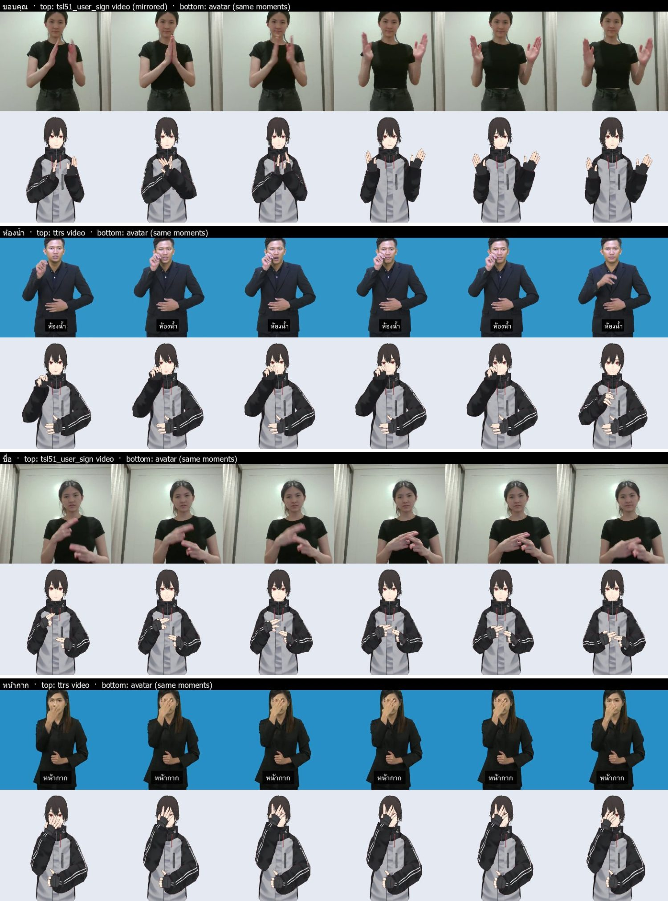
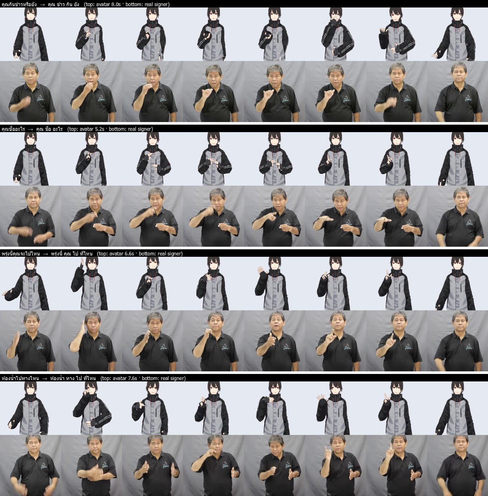
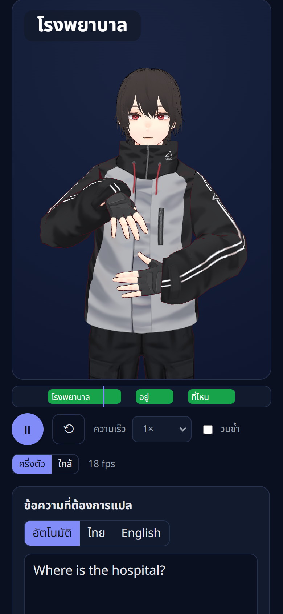

# ThaiSLM Reverse — Result Report v1 (text / speech → Thai Sign Language avatar)

**Scope (reverse_text2sign/prompt/prompt_1.md):** the reverse of the forward ThaiSLM — a person types or says a sentence (Thai or
English) and a 3D avatar signs it in Thai Sign Language (TSL), half-body, on a web page at **port 8081**
(`docker compose up --build` at the repository root also brings up the forward part on 8080). Data from the existing S3 lake
mirror (`cloud_s3/`), noise removed clip by clip; no sign is ever invented; production-grade (fast, small, tested, containerised);
total cloud cost ≤ $5–6. Everything in this report was measured on the deployed stack or with the code in `reverse_text2sign/`.

---

## 0. TL;DR

| question | answer |
|---|---|
| Does it work end to end? | **Yes.** Thai or English text, or speech (Thai / English microphone) → TSL structure → a VRM avatar signs it in the browser at 8081, half-body, with the current sign captioned, a timeline, speed control, an editable gloss list and `.vrma` export for Unity. |
| How is a sign produced? | **Only from recordings.** 9,694 dictionary signs (TTRS, th-sl.com, TSL51, eye-checked YouTube lessons) and 40 recorded everyday phrases were retargeted from real signers' MediaPipe landmarks onto the avatar. A word without a recorded sign is fingerspelled with recorded letters or shown as text — never generated (test-enforced, §4.5). |
| Thai ≠ TSL? | **Handled by an explicit TSL structure stage** (time first · object/topic before subject · head-final verb chain · WH last · negation after the predicate · possessor first · Thai-only words dropped · pronoun forms → pointing signs). TSL51 deaf-expert gloss order: **62/62** (development set — see §4.2 caveat); Thai word order would get 14/62. |
| Everyday sentences covered? | **Thai: 97.6 % of words** become real recorded signs (93.8 % of sentences fully signed, 0 text cards). **English: 97.8 %** (94.3 %), via local NLLB translation. Your example *"วันนี้คุณไปไหน?"* → **วันนี้ · คุณ · ไป · ที่ไหน** (WH-question face). |
| Is the motion faithful? | **Close to the recordings.** Avatar wrist error median **0.067 shoulder widths**, elbow 0.094, fingertips 0.23 palm lengths. The forward ThaiSLM recogniser (trained on real signers, source clip removed from its bank) names the **avatar's** sign top-1 **52.5 %** vs **63.0 %** for the real signer's own landmarks (n = 1,000) → the avatar keeps **83 %** of the recognisable signal. |
| Continuous signing? | Clips are cut to their strokes and joined by minimum-jerk transitions; the **tempo is grounded in 28 everyday phrases recorded by a real signer**: our first, citation-speed sentences were 2× too slow (median 4.1 s vs 2.0 s); final 2.6 s. No body-bone pops (≤ 35°/frame, test-enforced), hand contact kept (wai / ขอบคุณ knuckles 1 cm). |
| Non-manual features? | Each sign carries the recorded signer's own face (brows, mouth, blinks → VRoid morphs) and head. Sentence level: WH-questions raise the brows — **measured** on TSL51 (15 WH vs 237 statements, p = 0.001); yes/no questions use the same marker as a flagged **rule** (no data). |
| Fast and small? | Thai text → full motion **59 ms p50 / 102 ms p95** at the API (28 kB gzip per sentence); English **0.50 s / 0.74 s**; Thai speech 1.9 s, English speech 0.7 s. Browser: **0.67 ms JavaScript per frame**, avatar 3.5 MB over the wire (20 MB delivered file), app 195 kB. |
| Speech input accuracy? | English (base.en): **WER 0.5 %**. Thai (Whisper-small-th): **CER 16 %** on synthetic speech — below target; Whisper-medium-th gets 13 % but is 3× slower on CPU (§7.3). |
| Not done / not proven | **Comprehension by Deaf viewers is not measured** — that is the human study (review pack §8). Palm-to-palm contact still crosses slightly (ขอบคุณ); 6 % of everyday sentences (9 of 149) still contain a fingerspelled word; the TSL grammar rules were developed on the only gold data (TSL51), so their accuracy outside it is unknown until expert review. |
| Cost | **$0 cloud.** No GPU job, no GCS object — everything ran on the laptop (CPU; the RTX 2050 only for one encoder comparison). Agent (model) usage is billed separately by Anthropic and is not visible to me. |


*Figure 1 — the production page (8081): input + TSL structure (left), the avatar signing วันนี้ with the current sign captioned (right).*

---

## 1. The 8 considerations of the prompt → what the system does

| # | consideration | design answer | where |
|---|---|---|---|
| 1 | Thai ≠ TSL | a separate TSL-structure stage with explicit, logged rules; the IR shows every move (*"WH last: ไหน"*) | `t2s/text/grammar.py`, IR `clauses[].moves` |
| 2 | dataset / coverage; standard vs context signs; no invented signs | 9.7 k recorded signs + 40 phrases; senses / variants kept (สวัสดี elder vs friend); fallback chain ends in fingerspelling / text | `t2s/data/`, `t2s/text/translate.py` |
| 3 | an Intermediate Representation | Thai → TSL structure → sign units (clip, hand, location, movement, face) → motion timeline; editable and re-renderable (`POST /api/render`) | `t2s/ir.py` |
| 4 | not only hands | per-sign recorded face (brows / eyes / mouth) + head; sentence brow marking | `retarget.py`, `nmm.py` |
| 5 | motion must be correct, smooth transitions | retargeting with body anchors + IK + hinge fingers; contact constraint; de-spike; velocity clamp; data-timed transitions | `t2s/motion/` |
| 6 | continuous signing | stroke cutting, hold reduction, minimum-jerk transitions, clause pauses, conversational tempo from real phrases | `compose.py`, `timing.json` |
| 7 | unknown words / uncertainty | lemma → curated variant → compound → fingerspelling → text; **two separate confidences** (translation, motion) | IR `units[].confidence` |
| 8 | evaluate more than looks | translation (TSL51, everyday coverage), motion (retarget error, recogniser back-translation, renders vs video), system (latency, payload, fps); comprehension = expert pack | §4–§8 |

## 2. Blueprint



**Why this architecture (and not a generative text-to-motion model).** The prompt forbids invented signs and asks for production
quality. A generative model (text → poses, as in Progressive Transformers / SignGen-style VQ-VAE + LLM systems) needs large aligned
corpora and still produces blurred or hallucinated hand shapes; for Thai there is no such corpus (TSL51 has 62 sentences). The
concatenative approach (unit selection → transition smoothing → avatar), also used by recent Libras / BSL production systems,
shows only signs a person actually signed, makes every choice inspectable, runs in milliseconds on a CPU and costs nothing to
train. Its weak points — co-articulation and tempo — were measured and calibrated on real data (§5.4).

**Prior bias (prompt: "must not happen").** No model trained on another sign language enters the motion path (the motion is
copied from Thai signers). Exemplar choice has no source preference: with ≥ 3 signers the DTW **medoid** (the way most signers
sign it) wins; one vote per signer (TSL51's ~10 takes of one person count once). The only pretrained models are for language
(Whisper, NLLB) and their outputs are shown in the IR. An embedding "nearest word" fallback was **evaluated and rejected**: on the
lake's 3,187 labelled synonym pairs the best encoder (bge-m3, AUC 0.80) recalls only 9 % of true synonyms at 90 % precision —
it would mostly show a wrong sign.

**Unity.** Unity is not installed on this machine and installing it needs an account sign-in, so production uses three.js +
three-vrm (no plug-in, 195 kB of code, 0.7 ms/frame). Every sentence can be downloaded as **`.vrma` (VRM Animation)** — UniVRM
(Unity) and three-vrm play it on any VRM avatar for frame-by-frame inspection.

### KPIs defined before building, and where they ended

| level | KPI | target | result |
|---|---|---|---|
| translation | TSL51 gloss order (dev) | ≥ 90 % | **100 %** (62/62) |
| translation | everyday words → recorded signs (TH / EN) | ≥ 95 % | **97.6 % / 97.8 %** |
| translation | everyday sentences fully signed (TH / EN) | ≥ 90 % | **93.8 % / 94.3 %** |
| translation | invented signs | 0 | **0** (test) |
| motion | recogniser top-1, avatar ÷ real signer | ≥ 0.75 | **0.83** |
| motion | wrist retarget error (median) | ≤ 0.10 sw | **0.067** |
| motion | body-bone rotation per frame | < 35° | **met** (test) |
| motion | sentence tempo vs real signer (median) | within 1.5× | **1.29×** (2.6 s vs 2.0 s) |
| system | Thai text → motion p50 | ≤ 100 ms | **59 ms** |
| system | English text → motion p50 | ≤ 1 s | **0.50 s** |
| system | Thai speech CER | ≤ 10 % | **16 % ✗** (§7.3) |
| system | browser cost per frame | ≤ 4 ms | **0.67 ms** |
| comprehension | Deaf viewers understand | (human study) | **not measured — review pack §8** |
| cost | cloud | ≤ $5–6 | **$0** |

---

## 3. Phase 1 — data audit (what is in the lake, what is noise)

### 3.1 Sources and what the reverse direction can use

| source | clips | signers | what it is | usable for avatar motion? |
|---|---|---|---|---|
| TTRS dictionary | 5,043 | 9 | studio, blue screen, small signer, hands rest clasped at the belly, 854×480 | **yes** — official dictionary |
| th-sl.com (NADT) | 7,719 | 9 | studio, grey, tight 600×600, arms hang at rest | **yes** — official dictionary; incl. the full Thai alphabet (consonants, vowels, tone marks) |
| TSL51 researcher | 547 signs + 252 sentences | 1 | home recordings 640×480, 51 words, 62 Thai sentences with deaf-expert gloss order | signs: yes (consensus); sentences: evaluation |
| TSL-ONE-S | 4,148 | 29 | landmarks only, 2D, no face | no (no depth / face) |
| YouTube (v7 harvest) | 561 | 25 channels | lessons, mixed quality | **only eye-checked fill-ins** (§3.4) |
| YouTube (harvest 2026-10-10) | 122 | — | targeted lessons + conversational phrases | eye-checked words + recorded phrases (§3.5) |

The forward project had already extracted every video with MediaPipe Holistic (`data_prep/pose_mp_raw`: pose 33 x/y/z, hands
21×3, face, 52 blendshapes) — the reverse part reuses these, so **no re-extraction and no GPU** were needed.

### 3.2 Quality measured per clip, then looked at

`t2s/data/quality.py` measures, on the cleaned landmarks the avatar would actually play: body framing, dominant-hand tracking where
the hand is up, longest lost-hand gap, hand swaps between arms, wrist / finger **tracking noise** (median residual after a 0.28 s
Savitzky–Golay fit — real fast signing is smooth at that scale, detector flicker is not), hands leaving the picture, zoom, face
visibility, sign span. Several first-draft metrics were wrong and were corrected **by looking at the clips**:

* "active signing" by hand height failed on TTRS (hands rest at the belly) → distance from each clip's own rest position;
* "finger jitter" as frame-to-frame acceleration measured real finger motion → residual after smoothing, run-wise, median;
* "hand swap" flagged palm-to-palm signs (wai) → a duplicate hand must also have the **same chirality** (mirror-image hands are
  real contact);
* face visibility and swaps hard-rejected genuine signs made on the face (หน้ากาก) or with crossing hands (ป้องกัน, มารยาท)
  → soft rules (tier B, then checked in renders).

Thresholds sit at the ~99th percentile of the clean studio dictionaries; contact sheets per failure reason were reviewed by eye
(e.g. th-sl "hand_rate" rejects = motion blur, hands out of frame, a hand on the foot; TTRS "no_signing" = tiny belly-level
signs the activity rule misses — 15 clips, left out).

| source | tier A | tier B | rejected | top reasons |
|---|---|---|---|---|
| TTRS | 4,501 | 378 | 164 | lost-hand gap, low hand tracking, swaps |
| th-sl.com | 7,153 | 356 | 210 | low hand tracking, swaps, hands out of frame |
| TSL51 signs | 490 | 30 | 27 | hand tracking |
| YouTube v7 | 462 | 37 | 62 | hand tracking, gaps |

Cleaning (`t2s/motion/clean.py`) repairs before measuring: duplicate hands dropped, hands re-attached to the right arm, single-frame
finger flicker removed, gaps ≤ 0.32 s interpolated — nothing longer is invented.

### 3.3 Exemplar selection — no source prior

9,694 signs: th-sl 5,507 · TTRS 4,077 · TSL51 23 · YouTube 87. Left-dominant signers (743) are mirrored so every sign is
right-dominant — mixing hands inside a sentence looks wrong. 281 concepts had ≥ 3 signers and were chosen by consensus.

### 3.4 YouTube — "choose carefully"

All 69 YouTube-only candidates were looked at one by one: **43 accepted** (adult signer, clean framing), **26 rejected** — child /
scout learners (17), picture overlays or captions over the signing (9). Decisions with reasons: `t2s/data/youtube_fill.csv`.

### 3.5 Collecting missing words (user-approved harvest)

The gap list came from data (frequent TNC words + the daily vocabulary + the everyday test sentences). TTRS was queried first:
5,045 entries online vs 5,043 held — nothing new. **th-sl.com was not scraped** (its robots.txt reserves rights against AI
agents). YouTube: 209 candidates → 122 downloaded (polite, sequential) → same MediaPipe + QC → 109 passed → **eye check: 45 words,
40 recorded conversational phrases, 24 rejected** (children, lesson sentences, overlays, duplicates; `t2s/data/harvest_decisions.csv`).
Words that exist only as YouTube compounds never hide the dictionary decomposition (กินข้าว stays ข้าว + กิน, as the TSL51
expert signs it).

---

## 4. Phase 2 — the representation (language side)

### 4.1 Pipeline

normalise → pythainlp newmm + a local re-split repair (newmm cut บอกว่า as บอ|กว่า) + merges into dictionary entries →
closed-class roles first (particles, WH, negation, time, pronouns, modals, copula, classifiers…) → the dictionary's own part of
speech → pythainlp tagger as fallback → TSL rules:

| rule | evidence |
|---|---|
| time words first | TSL51 (พรุ่งนี้ …), interpreter practice |
| object / topic before subject, verb last | TSL51 majority (OSV 36 vs SOV 7) and Thai PBS interpreter interview (*"ข้าว … กิน"*) |
| verb chain head-final: Thai V1 V2 O → O V2 V1 (ชอบ เที่ยว กรุงเทพ → กรุงเทพ เที่ยว ชอบ) | TSL51 |
| incorporated objects stay with their verb, not fronted (กินข้าว → ข้าว กิน) | TSL51 |
| linking verbs keep their complement (เกิด หูหนวก, ชื่อ แมว) | TSL51 |
| WH last; negation after the predicate | TSL51, sign-language typology |
| possessor first (แฟนฉัน → ฉัน แฟน) | TSL51 |
| copula / future / politeness words not signed | TSL51 |
| Thai pronoun forms → the pointing sign (ผม/ดิฉัน → ฉัน; ผม = "hair" only before ยาว/สั้น…) | the dictionaries record ผม = hair, มัน = potato, หนู = mouse |

### 4.2 TSL51 (62 Thai sentences with expert gloss order)

| system | exact gloss sequence |
|---|---|
| Thai word order (word-for-word) | 14 / 62 |
| rules without object fronting | 26 / 62 |
| **final rules** | **62 / 62** |

**Caveat:** TSL51 is the only Thai↔TSL parallel data, the rules were written while looking at it, and its 62 sentences come from
~14 templates. It is a development score, not a test: how well the rules generalise must be judged by Deaf experts (§8).

### 4.3 Everyday conversation (user request: "cover Thai and English, e.g. วันนี้คุณไปไหน?")

`tests/conversation.tsv`: 96 Thai and 53 English everyday sentences (greetings, introductions, where/when/what, food, shopping,
help, feelings, family, work, weather, travel). The first run exposed gaps that a dictionary alone cannot close; each was fixed
as a general rule, never per sentence: colloquial forms mapped to recorded signs in one reviewable table (`t2s/text/curated.py`:
ไหน → ที่ไหน, เจอกัน → เจอ, ไปไหนมา → ไป ที่ไหน, หรือยัง → ยัง + question, กี่โมง → เวลา เท่าไร …, each marked `curated`, confidence 0.85),
degree adverbs after the predicate, possessive pronoun signs split, benefactive ให้ / expletive มัน / ใน after location verbs dropped,
a recorded phrasebook for exact matches, a place-name gazetteer before English MT (NLLB wrote "Chiang Mai" as ชิงแมย์).



| | first run | final |
|---|---|---|
| Thai: words → recorded signs | 92.4 % | **97.6 %** |
| Thai: sentences fully signed | 79.2 % | **93.8 %** |
| English: words → recorded signs | 89.0 % | **97.8 %** |
| English: sentences fully signed | 71.7 % | **94.3 %** |

Examples (final): *วันนี้คุณไปไหน* → วันนี้ คุณ ไป ที่ไหน · *ฉันไม่ชอบกินผัก* → ผัก ฉัน กิน ไม่ชอบ · *ช่วยพูดช้าๆหน่อยได้ไหม* → ช้า พูด ช่วย
ได้ (yes/no) · *Hello, how are you?* → สวัสดี คุณ สบายดี (yes/no) · *I want to travel to Chiang Mai.* → เชียงใหม่ ฉัน ไป อยาก. Remaining
fingerspelled words (9 of 389 units): names (สมชาย, จอห์น), ทำ (its only dictionary clip is a truncated file, in S3 too), เสื้อ (only
a child learner's clip exists — rejected), ราคา / ลดราคา, โมง in clock times.

### 4.4 The IR (abridged, for *ผมชื่อจอห์น*)

```json
{"thai": "ผมชื่อจอห์น",
 "clauses": [{"type": "statement", "moves": [], "units": [0, 1, 2]}],
 "units": [
  {"gloss": "ฉัน", "kind": "sign", "match": "pronoun", "source_words": ["ผม"],
   "clip": {"dataset": "tsl51_user_sign", "tier": "A", "n_signers": 3, "consensus": 0.414},
   "manual": {"dominant": "right", "two_handed": false, "location": "chest", "movement": 0.68, "movement_kind": "path"},
   "confidence": {"translation": 0.95, "motion": 0.92}},
  {"gloss": "ชื่อ", "kind": "sign", "match": "lemma", "source_words": ["ชื่อ"],
   "clip": {"dataset": "tsl51_user_sign", "tier": "A", "n_signers": 2, "consensus": null},
   "manual": {"dominant": "right", "two_handed": true, "location": "chest", "movement": 1.11, "movement_kind": "path"},
   "confidence": {"translation": 1.0, "motion": 0.852}},
  {"gloss": "จอห์น", "kind": "fingerspell", "match": "fingerspell", "letters": ["จ จาน", "อ อ่าง", "ห หีบ", "น หนู"],
   "note": "ไม่มีท่าในคลัง — สะกดนิ้ว (no recorded sign — fingerspelled); ไม่มีท่าของเครื่องหมาย อ์ — ข้าม",
   "confidence": {"translation": 0.6, "motion": 0.92}}],
 "confidence": {"translation": 0.6, "motion": 0.852, "coverage": 0.667}}
```
(exact output of `python main.py translate "ผมชื่อจอห์น"`, trimmed to these fields; `consensus` is null when fewer than 3 signers
exist; the ์ mark of จอห์น has no usable recorded clip and is skipped, as the note says)

### 4.5 No invented signs (test-enforced)

`tests/test_language.py::test_no_invented_signs`: for unseen inputs (a name, a long noun phrase, an out-of-domain technical
sentence, a letter string) every `sign` unit is a library recording, every `fingerspell` letter is a recorded letter, everything
else is a `text` card. The translator has no code path that can emit a motion it was not given.

---

## 5. Phase 3–4 — grounding the motion in the data, and the avatar

### 5.1 Retargeting (MediaPipe → VRM, offline, CPU, ≈ 0.1–0.4 s per clip)

* model frame = the VRM 0.x rig (+Y up, faces −Z) so the browser writes quaternions to normalized bones unchanged;
* depth: MediaPipe z rescaled per clip by the factor that makes upper arm / forearm **rigid** (min. coefficient of variation);
* torso / head relative to the clip's own rest frames (camera angle removed), damped;
* wrist target placed relative to the **nearest body anchor** (own shoulder, mouth) and scaled by shoulder width — the VRoid
  head is large and its shoulders narrow, so copying joint angles would miss the chin / chest; kept in front of the torso surface;
* two-bone IK with the signer's own elbow as pole; forearm twist shared with the wrist;
* palm frame from wrist / middle / index / pinky knuckles (axes smoothed over tracked runs — an edge-on palm otherwise flips);
* fingers: proximal swing without twist, intermediate / distal as hinges, flexion unwrapped (a tight curl past 180° stays a curl);
* two-hand contact: when the signer's wrists are close, both avatar wrists keep the signer's relative vector (wai, clapping);
* face: 52 blendshapes relative to the signer's neutral face → VRoid morphs (brows surprised / angry / sorrow, blinks, wide eyes,
  mouth A/I/U/O, smile, frown);
* clean-up: quaternion de-spike, then a velocity clamp (30°/frame ≈ 750°/s) on body / arm / wrist bones.

Two defects were found by the tests and fixed in the library before the final build: 26 % of signs had a wrist / forearm jump
> 30° in one frame (palm-frame flips; up to 85°) and fingers flickered between fully bent and straight (hinge angle wrap-around).

### 5.2 Fidelity — the avatar against the signer



| measure (2D, same normalised frame) | median | p90 |
|---|---|---|
| wrist (shoulder widths) | **0.067** | 0.102 |
| elbow (shoulder widths) | 0.094 | — |
| fingertips relative to the wrist (palm lengths) | 0.232 | 0.379 |

### 5.3 Does the avatar sign look like the sign? (back-translation)

The forward ThaiSLM v8 recogniser (Thai-only landmark encoder) reads landmarks generated from the avatar's skeleton and names the
sign among ~9.8 k concepts; the source clip is removed from its bank, so the avatar must look like **other** signers' versions.



| n = 1,000 | top-1 | top-5 | top-10 |
|---|---|---|---|
| real signer's landmarks (upper bound) | 63.0 % | 70.9 % | 74.5 % |
| **avatar** | **52.5 %** | **62.7 %** | **67.8 %** |

The avatar keeps 83 % of the top-1 signal (median cosine avatar ↔ human embedding 0.84). It is a machine proxy: a Deaf viewer may
weigh hand shape, face and movement differently.

### 5.4 Continuous signing and tempo

Clips are cut to their **stroke** (between the first and last moment the hands are at signing distance, snapped to a hold),
joined by per-bone slerp with a **minimum-jerk** profile (zero velocity at both holds), face morphs cross-faded; rest → first
sign and last sign → rest; a short hold between clauses; held endings inside a sentence capped. Timing evidence:

| measurement | result | used for |
|---|---|---|
| reach (lift) time of 1,965 dictionary clips | **0.44–0.46 s regardless of distance** (0.3–3 shoulder widths) | first transition model |
| TSL51 lab sentences vs the same signer's isolated words | sentences **1.55× slower** (deliberate recording) | rejected as a tempo reference |
| 28 everyday phrases recorded by an adult signer vs our generation of the same Thai sentence | real = **0.58 ×** citation strokes + **0.21 ×** our transitions (NNLS fit) | **final**: strokes ×1.5, transitions ≈ 0.25 s, holds ≤ 0.12 s |



Median sentence: real signer 2.04 s · first version 4.06 s · **final 2.64 s**. Applied a little gentler than measured — an avatar is
read, not overheard; the viewer can change speed (0.5–1.5×).

### 5.5 Comparison with recordings (the prompt's "compare with the video")


*Figure — top of each pair: the dictionary video; bottom: the avatar at the same moments of the sign. ขอบคุณ (wai then opening),
ห้องน้ำ (pinch at the nose, other hand at the belly), ชื่อ (two-handed tap), หน้ากาก (hand over the face, a tier-B sign rescued by
the soft face rule).*


*Figure — top: the avatar generating the sentence from words (phrasebook off); bottom: a real signer's recording of the same
sentence. Word order matches in these examples; the real signer is faster and sometimes uses another variant (อะไร: open palm vs
our consensus index-finger variant).*

Visible limits: at palm-to-palm moments (ขอบคุณ) the avatar's hands still cross diagonally instead of pressing flat; the
anime avatar's large sleeves hide part of the forearm; mouthing follows the dictionary signer, not the sentence.

### 5.6 The avatar on the page

`avatar.vrm` = the delivered VRoid model with textures capped at 2048 px (19.5 → 9.5 MB, 3.5 MB gzip on the wire; same skeleton
and morphs). Half-body camera framing that keeps a 1 m wide signing space visible (0.8 m on phones); the avatar fills the right
2/3 of a desktop screen. Breathing and blinking when idle; the timeline is played at display rate with slerp between the 25 fps
frames. Mobile: the page scrolls to the avatar after translating.



---

## 6. Phase 5 — services (`docker compose up --build` → :8081)

| service | image | role |
|---|---|---|
| `reverse-web` | nginx + built Vite app (49 MB) | the page, `/api` proxy, immutable asset caching, gzip (incl. the VRM) |
| `reverse-api` | python:3.11-slim-bookworm + numpy / scipy / pythainlp / FastAPI (450 MB) | text → IR → motion; memory-mapped library (`models/` mounted read-only); 2 workers; LRU cache |
| `reverse-speech` | CTranslate2 int8 models converted at build time from the official checkpoints (1.6 GB) | `/asr` (Thai, English), `/mt` (EN → TH) |

API: `/api/translate`, `/api/render` (edited IR), `/api/sign/{word}`, `/api/lookup`, `/api/asr`, `/api/export/vrma`,
`/api/rest`, `/api/health`. Wire format: int16 quaternions + uint8 morphs, base64 in JSON, gzip (≈ 28 kB per sentence).
Engineering notes: the CTranslate2 4.5 wheel needs `-bookworm` base images (Debian trixie refuses its executable stack);
the library is written to a new directory and swapped in (Windows cannot overwrite a memory-mapped file while the API runs).

## 7. Phase 6 — system measurements

### 7.1 Latency and size (deployed stack, laptop CPU, quiet machine)

| path | p50 | p95 | response |
|---|---|---|---|
| Thai text → IR + motion (through nginx) | **59 ms** | 102 ms | 28 kB gzip |
| English text → NLLB → IR + motion | **497 ms** | 742 ms | 19 kB |
| Thai speech (≈ 2 s) → text | 1.9 s | 2.1 s | — |
| English speech → text | 0.7 s | — | — |
| browser: JavaScript per frame | **0.67 ms** | — | (GPU excluded) |
| first load | app 195 kB + avatar 3.5 MB | | |

Software-only WebGL (headless, no GPU) renders ~10–25 fps; with any GPU the page is limited by the display rate.

### 7.2 Tests

`python main.py test` — 23 tests (language: TSL51 regression, the conversation examples incl. the user's, pronoun homographs, no
invented signs, separate confidences, phrasebook; motion: finite unit quaternions, rest at both ends, no body-bone pops, no
finger flicker, ordered timings, speed control, `.vrma` validity; API: health, translate + edited re-render, errors, lookup, sign,
VRMA). All pass.

### 7.3 Speech input (synthetic speech: an upper bound, not field accuracy)

| | model | error | exact | latency |
|---|---|---|---|---|
| English (53 sentences, Windows "Zira") | Whisper base.en | **WER 0.5 %** | 52/53 | 0.7 s |
| Thai (96 sentences, VachanaTTS) | Whisper-small-th (deployed) | **CER 16 %** | 64/96 | 1.9 s |
| Thai, same audio, local A/B | Whisper-medium-th | CER 13 % | 71/96 | 6.7 s |

Fixes made: very short replies (ใช่, ได้, ฝนตก) were silenced by the voice-activity filter → retried without it (0 empty results now);
a more sensitive VAD and shorter decoding windows were tried and rejected (CER 17–26 %). Recommendation: switch to
Whisper-medium-th if a GPU or a 6–7 s budget is acceptable (one line in `service/speech/Dockerfile`). Every recognised text is
shown and editable before signing.

---

## 8. What a Deaf reviewer must still judge (comprehension level) — the review pack

Machine proxies cannot prove understanding. Prepared for the experts:

* `result_reporting/review/conversation.csv` — the 149 everyday sentences with our TSL order, fallbacks and confidences (translation level);
* the live page — every sentence can be edited (✎) and re-rendered, and exported as `.vrma` for frame-by-frame review in Unity;
* `result_reporting/review/renders/` — sign sheets (video vs avatar) and sentence sheets (generated vs a real signer);
* items to rate first: object-fronting default (TSL51 vs Thai PBS both support it, but variation exists), the yes/no brow raise
  (a rule without data), the 39 curated variants and 23 fixed expressions in `t2s/text/curated.py`, the consensus choice for multi-variant signs
  (อะไร, สวัสดี).

Suggested protocol: 3 levels per sentence — translation (is this the TSL you would sign?), motion (hand shape / place / movement
correct?), comprehension (watch once without text, write what was signed).

## 9. Cost

| item | used | cost |
|---|---|---|
| GCP Vertex AI / Compute | none (no job submitted) | $0 |
| GCS | no object written | $0 |
| AWS S3 | read only (one `ls` of the lake) | ≈ $0 |
| local | CPU (retargeting 9.7 k clips ≈ 8 min × 3 builds, stroke annotation ≈ 8 min); GPU only for the encoder comparison | electricity |

GPU training was never needed: the motion comes from recordings, the language stage is rules + pretrained translators, and the
heaviest offline step (retargeting) is CPU-parallel. A Spot A100 would not have shortened anything that took longer than minutes.

## 10. Limits and next steps (honest)

1. **Comprehension unmeasured** — run the §8 study with Deaf signers before any public use.
2. **Grammar generalisation unknown** beyond TSL51 — expert review of `review/conversation.csv`; then encode their corrections as rules.
3. **Palm-to-palm contact** still crosses (ขอบคุณ); next: orientation constraint between the two palms during contact frames.
4. **Thai ASR CER 16 %** — Whisper-medium-th (13 %) or a GPU; real microphone tests.
5. **Coverage gaps** — ทำ, เสื้อ, ราคา, ลดราคา, จริง, ทุก: no usable adult recording exists in any source; a short recording session
   with a Deaf signer (≈ 50 everyday words) would close most remaining fingerspelling.
6. **Mouthing / non-manual grammar** — negation head-shake and topic marking are not modelled beyond each clip's own face.
7. **Licensing** — th-sl.com and YouTube material: research use only; a public release needs the rights holders' consent.

## 11. Reproduce

```bash
cd reverse_text2sign
python main.py audit && python main.py select && python main.py library && python main.py lexicon && python main.py timing
python main.py avatar && python main.py test && python main.py eval all
cd .. && docker compose up --build      # → http://localhost:8081
```
File map: `reverse_text2sign/README.md`. Data: `cloud_s3/` (S3 lake mirror; the reverse harvest is in `cloud_s3/agent_data/reverse_harvest/`); derived data in `reverse_text2sign/data/` (git-ignored, rebuilt by the commands above). Expert review pack: `result_reporting/review/`.
