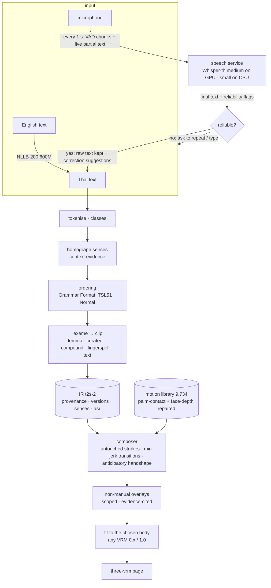
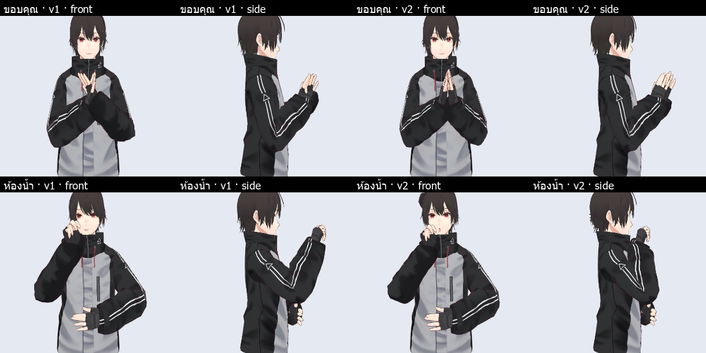
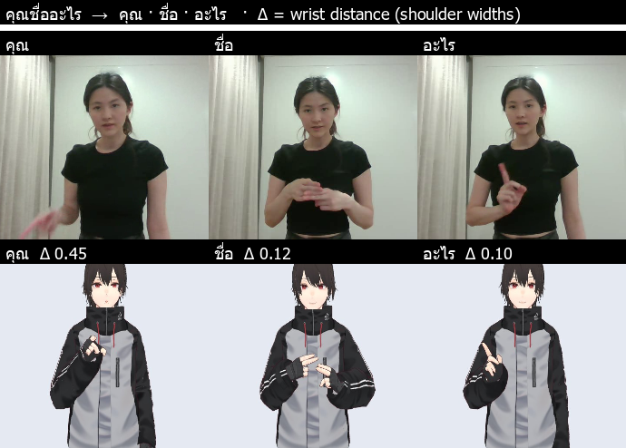
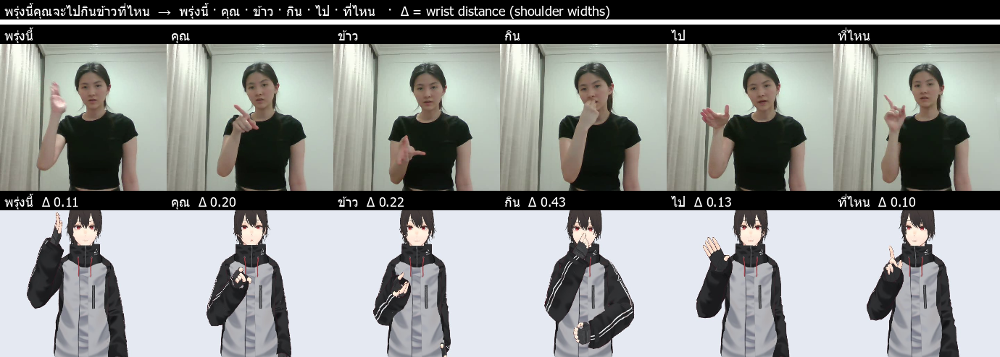
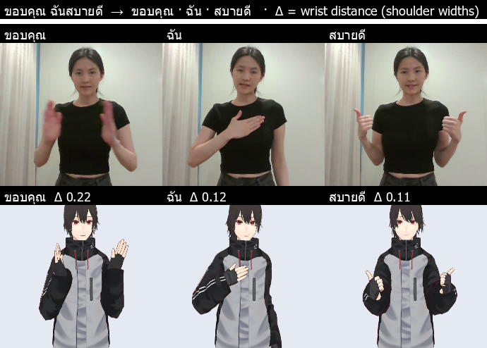
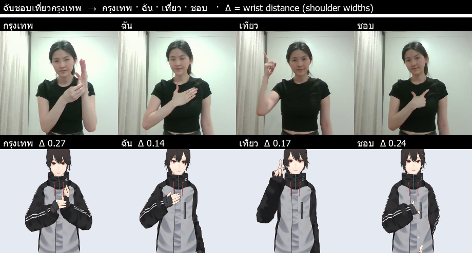
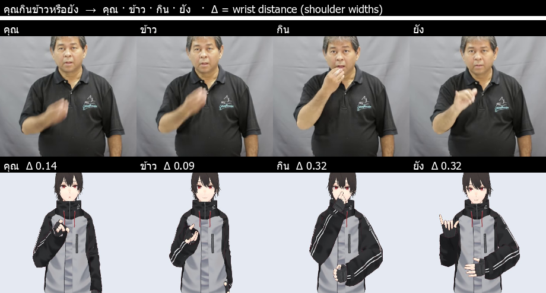
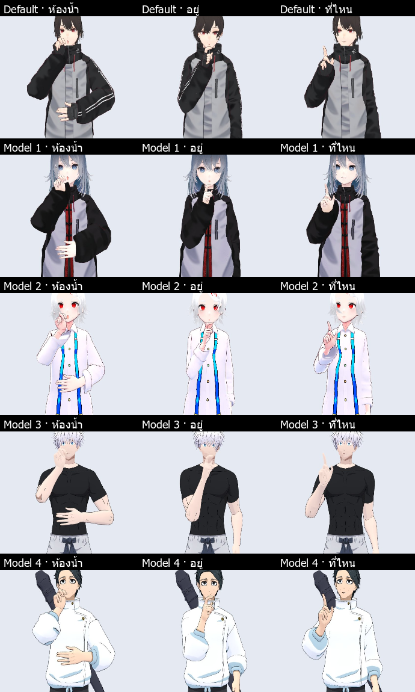

# ThaiSLM Reverse — Result Report v2 (text / speech → Thai Sign Language avatar)

**Scope (reverse_text2sign/prompt/prompt_2.md):** improve v1 (`result_v1.md`) on the seven gaps it reported and under the
six v2 constraints — sign correctness, language–motion separation, data provenance, motion continuity, uncertainty and
reproducibility — measured against v1 **on the same tests**, with held-out data kept apart from development data. Reverse part
only (`reverse_text2sign/`), production stack on **:8081**, cloud cost ≤ $5–6.

---

## 0. TL;DR

| question | answer |
|---|---|
| What changed for the user? | A **Grammar Format** switch (TSL51 rules ↔ Normal Thai order, same signs), **live text while speaking**, a **reliability check** that refuses to sign an invented transcript, **correction suggestions** the person accepts, a **provenance box** (where every sign comes from, its quality, licence and any repair), all **5 characters** working, the wai palms meeting instead of crossing, hands that reach the face. |
| Were there hidden v1 defects? | **Yes, four, found by the v2 tests and fixed:** (1) in the browser the thumb rotations landed on the wrong joints (three-vrm renames VRM 0.x thumbs) — Python metrics never saw it; (2) face-contact signs were ~**14–20 cm in front of the face** (correct only from the front camera); (3) the only recorded **ตา** is *grandfather*, so "my **eye** hurts" signed GRANDFATHER; (4) VRM 1.0 models with rest rotations (gojo, yuta) crashed the rig loader. |
| Language | TSL51 regression **62/62** (unchanged); 148 of 149 everyday sentences identical to v1 (the 149th now correct after a fix). **Frozen held-out set** (85 new sentences, written before any change): sentences passing all checks **82.4 % → 87.1 %** (homographs 64 → 91 %, English 92 → 100 %). |
| Motion | Palm-to-palm contact: palms facing within **8°** (v1: crossed — the tracker merged the two hands); hand-through-hand frames 41 → 27 over 96 sentences; face-located signs now reach the face (ห้องน้ำ: 18.7 cm → ~3 cm in front of the nose). Strokes are provably untouched by the transitions (test). |
| Face / head | Every sentence-level mark is **scoped and cites data**: WH brows from the 2nd sign (TSL51), yes/no head tilt on the last sign (4 recorded phrases, p = 0.03), negation head-shake on the negation sign (109 dictionary clips, 12 signers, p = 6·10⁻¹⁷); **topic marking not added** — the data show none (p = 0.53). |
| Speech | GPU: Whisper-th **medium** (real speech CER **3.8 %** vs 6.1 % small; 0.7 s per short utterance on the RTX 2050). CPU: **small** (medium is 6.9 s — too slow). VAD pause-chunking was **tested and rejected for accuracy** (6.1 → 6.6 % CER on real speech) and is used only for live partial text. Automatic correction **hurt** real speech (7 fixes vs 24 harms) → shipped as suggestions only. |
| Coverage | No clean adult recording of ทำ · เสื้อ · ราคา · ลดราคา · จริง · ทุก · โมง exists in any source I can reach (800+ YouTube results searched; the only เสื้อ lesson is a school student — rejected under the v1 rule). These remain fingerspelled; a 10-word recording list is in §10. |
| Cost | **$0 cloud** (no Vertex job, no GCS object — verified empty after the work). GPU work ran on the local RTX 2050. |

---

## 1. The v2 constraints → what the system does

| # | constraint (prompt v2) | design answer | where |
|---|---|---|---|
| 1 | sign correctness | four motion origins kept apart in the IR: `recorded_clip`, `recorded_phrase`, `composed` (a compound / fixed expression assembled from recorded signs), `fingerspelling`, `text` (nothing signed). Homographs never borrow the other meaning's sign. | `t2s/ir.py`, `t2s/text/senses.py` |
| 2 | language–motion separation | the language stage only asks "is there a recording for this concept"; the motion stage never changes the gloss list. Grammar modes change order only; motion fixes change no translation (148/149 everyday sentences identical to v1). | `t2s/text/` · `t2s/motion/` |
| 3 | data provenance | per sign: dataset, clip, signer, tier, landmark-quality metrics from the audit, retargeting error, repairs applied, licence, source link — in the IR and the page's **provenance box** (bottom left) | `t2s/text/lexemes.py`, UI |
| 4 | motion continuity | strokes are copied untouched (test); transitions are the only synthesised frames; contact constraints only where the evidence says the hands touch | `t2s/motion/compose.py`, `clean.py`, `retarget.py` |
| 5 | uncertainty | ambiguous word → recorded meaning + warning + lower confidence; meaning without a sign → fingerspelling with the reason; unreliable transcript → not signed; every non-manual mark lists its evidence | IR `sense`, `warnings`, `nmm` |
| 6 | reproducibility | v1 kept as a git worktree and run on every new test; held-out language and speech sets frozen before changes; IR carries content hashes of lexicon, motion library, timing, rig and rules | `ir.versions`, §4–§8 |

## 2. Blueprint (v2)



**Why still concatenative, no new model.** The prompt asks to add AI only with a clear role. The two places where a model could
help were tested and the evidence decided: a larger ASR model where a GPU exists (it is better on real speech), and **no** LLM
for TSL ordering (there is no parallel data beyond TSL51 to check its output against; the Grammar Format switch lets experts
compare two transparent orderings instead). GPU training was never needed.

### KPIs (defined from the prompt before the work) and where they ended

| KPI | target | v1 | v2 |
|---|---|---|---|
| regression tests | 100 % of supported cases | 23 tests, 28/29 run today (gojo crash) | **44 / 44** |
| TSL51 gold order (dev) | no regression | 62/62 | **62/62** |
| everyday sentences (149) | no regression | — | **148 identical, 1 corrected** |
| held-out sentences, all checks pass | better than v1 | 82.4 % | **87.1 %** |
| invented / wrong-meaning signs | 0 | ตา (eye) → GRANDFATHER | **0 found** (test) |
| motion validity (NaN, non-unit quaternions, bone length) | 0 | 0 | **0** (test) |
| hand-through-hand frames (96 sentences) | lower | 41 | **27** |
| palm-to-palm contact (ขอบคุณ) | palms facing | crossed | **8°** |
| face contact (ห้องน้ำ nose) | reaches the face | 18.7 cm in front | **≈ 3 cm** |
| Thai speech CER, real speech (FLEURS) | lower | 6.1 % (small) | **3.8 % (GPU) / 6.1 % (CPU)** |
| text → motion latency | no regression | 59 ms p50 | **53 ms p50** |
| reproducibility | versions recorded | — | **IR content hashes** |

---

## 3. Language — TSL structure

### 3.1 What was wrong and what changed

| change | evidence / why | effect |
|---|---|---|
| **Homograph senses** (`senses.py`): ตา (grandfather ↔ eye), มัน (yam ↔ it), กา (crow ↔ kettle), เขา (pronoun ↔ horn). A meaning without a recording is fingerspelled, never replaced by the other meaning's sign; no context cue → recorded meaning with a warning and confidence 0.6 | TTRS / th-sl definitions checked entry by entry: the only ตา clip is *พ่อของแม่ / Grandpa* | "ตาของฉันเจ็บ" no longer signs GRANDFATHER |
| expletive vs pronoun มัน | v1 dropped มัน before any verb ("มันชอบนอน" lost its subject) | dropped only before a state ("มันร้อน") |
| hair vs I (ผม) | "ผมของเธอยาว", "ตัดผม" read as *I* | ผม before ของ / after ตัด·สระ·หวี… = hair |
| name boundary after ชื่อ | "หมอชื่อวิชัยใจดีมาก" spelled the whole tail | the name stops at particles / degree words / known adjectives |
| lexeme layer | concept, sense, variant and clip were one string | `lexeme {concept_id, sense, variant_id, n_variants, variants}`; experts can switch to another recorded variant in the provenance box |

### 3.2 Grammar Format (user-selectable)

`TSL51` = v1's rules (time first · object/topic before subject · head-final verb chain · WH last · negation after the predicate ·
possessor first). `ปกติ (ไทย)` = **the same signs** — same dropped words, same lexical choices, same sentence type and face —
in Thai word order, and without the recorded-phrase shortcut (a recorded phrase is in TSL order). Only the order differs, so
the two can be compared on any sentence; the IR records the mode and the rule version (test: `test_grammar_modes_same_signs`).

Example: *ฉันไม่ชอบกินผัก* → TSL51 **ผัก · ฉัน · กิน · ไม่ชอบ** · Normal **ฉัน · ไม่ชอบ · กิน · ผัก**.

### 3.3 Held-out evaluation (frozen before the changes, `tests/language_heldout.tsv`)

85 sentences (73 Thai, 12 English) never used to develop a rule, by category, each with checks that need no gold gloss
sequence: sentence type, a sign present / absent, position of a sign (TSL51 mode), fingerspelled names. Order checks test that the
declared rules are applied *consistently* to new sentences — not that the rules are right (only Deaf experts can judge that).
Same checker for v1 (git worktree) and v2.

| category (n) | v1 all-pass | v2 all-pass (TSL51) | v2 all-pass (Normal) |
|---|---|---|---|
| WH questions (10) | 100 % | 100 % | 100 % |
| yes/no questions (8) | 87.5 % | 87.5 % | 87.5 % |
| negation (9) | 88.9 % | 88.9 % | 88.9 % |
| time (8) | 87.5 % | 87.5 % | 87.5 % |
| numbers (7) | 85.7 % | 85.7 % | 85.7 % |
| names (6) | 66.7 % | 66.7 % | 66.7 % |
| **homographs (11)** | **63.6 %** | **90.9 %** | 90.9 % |
| long sentences (8) | 62.5 % | 62.5 % | 62.5 % |
| dropped subject / particles (6) | 83.3 % | 83.3 % | 83.3 % |
| **English (12)** | **91.7 %** | **100 %** | 100 % |
| **all (85)** | **82.4 %** (161/178 checks) | **87.1 %** (165/178) | 87.1 % (145/158) |
| words signed by recordings | 96.4 % | 95.8 % | 95.8 % |

Honest notes: (a) coverage is slightly *lower* because "ตา (eye)" is now fingerspelled instead of signed with the wrong sign;
(b) one held-out sentence (h53 "มันชอบนอน") uses the pattern I fixed while testing my own example *มันชอบนอน* — the same
sentence — so 1 of the 4 newly passing items is contaminated; (c) **8 of the 11 remaining failures are the checks being too
literal**, not system errors: the dictionaries hold the compound as one sign (อ่านหนังสือ, ไม่เข้าใจ, อยู่บ้าน, สามสิบ, ฝนตก,
ลูกชาย, ทำอาหาร, ง่วง); (d) the real failures were a name glued to the next adjective (h48) and ผม read as *I* in
"ผมของเธอ" (h50) — both fixed **after** the frozen run (so not counted above) — and a cat named ส้ม signed as ORANGE (h47,
open: a one-word name that is also a dictionary word).

### 3.4 Regression

TSL51 62/62 (development set, as in v1 — not a generalisation test). 149 everyday sentences: 148 identical gloss sequences to
v1; the 149th (*This is delicious* → MT "มันอร่อยมาก") regressed during development (a context cue revived the dropped
expletive as *yam*) and was fixed; coverage TH 97.6 % / EN 97.8 % of words signed, unchanged.

---

## 4. Lexicon, selection and provenance

* **Concept · sense · variant · clip separated** (`lexemes.py`): 9,734 library entries → concept groups; school / regional
  variants (Setsatian, Ratchasuda, "form n") are variants of one concept, parentheses that are not variant tags are senses.
* **Selection order**: meaning (sense, from context) → the concept's default variant (v1's consensus medoid) → its clip;
  other variants are listed, never substituted silently; **no nearest-meaning fallback** (v1 measured: 9 % recall at 90 %
  precision — it would mostly show a wrong sign).
* **Quality as metadata**: per clip the audit's landmark metrics (dominant-hand tracking rate, longest gap, finger / wrist
  jitter, face visibility, span, swaps, zoom) and the retargeting error are in the index and the IR.
* **Provenance box** (page, bottom left) and IR `provenance`: origin, dataset, clip id, signer, tier, quality, fidelity,
  repairs ("palm contact: 13 frames of the hidden hand mirrored", "face depth: hand moved 10.3 cm towards the face"), licence,
  source link; plus the versions behind the sentence.

| dataset | licence recorded in provenance |
|---|---|
| TTRS | TTRS Thai Sign Language dictionary (NECTEC / Ratchasuda) — public dictionary, research use |
| th-sl.com | rights reserved; research use approved by the project owner, not redistributable |
| TSL51 | Hugging Face dataset licence, research use |
| YouTube (agent / harvest / phrases) | publisher's rights, research use only (eye-checked) |

---

## 5. Motion

### 5.1 Two v1 defects that only the v2 tests revealed

1. **Thumbs in the browser.** three-vrm renames VRM 0.x thumbs on load (Proximal→Metacarpal, Intermediate→Proximal); v1 wrote
   its thumb rotations to the names it knew, so the first rotation landed on the second joint and the second was dropped —
   every handshape with a thumb was wrong **on screen** while all Python metrics (which use the correct rig) looked fine. One
   mapping table now serves the rig loader, the browser and the `.vrma` export (`rig.TO_VRM1`).
2. **Hands floating in front of the face** — §5.3.

### 5.2 Palm-to-palm contact (gap [3])

Root cause, found frame by frame on ขอบคุณ: while the palms are pressed together MediaPipe reports **one merged hand twice**
(identical landmarks); the cleaner correctly removed the duplicate, so the left hand vanished exactly during the wai and the
avatar's hand drifted and crossed. v2 reconstructs the hidden hand as the **mirror image** of the tracked one about the midline
between the two pose wrists — **only** when the evidence says the sign is symmetric contact (the pose wrists touch and, in the
frames just before AND after, both hands were tracked as mirror images, shape error < 0.35 palm lengths). On those frames the
palms are constrained to face each other and the wrists keep ≥ 5 cm apart (two hand thicknesses). 239 clips (1,267 frames)
qualified; each says so in its provenance. Result (ขอบคุณ): palm normals **8° apart** (v1: crossed, one usable frame);
properly tracked contact signs are untouched (ไหว้ 13° vs signer 16°, ขอโทษ 39° vs 42°).


*Figure — v1 vs v2, same moment, front and side view: ขอบคุณ (wai) and ห้องน้ำ (pinch at the nose). The side view shows what
the front camera hides.*

### 5.3 Face-contact depth

MediaPipe's pose depth is unreliable; v1 put face-located hands **13–21 cm in front of the face** (ห้องน้ำ's nose pinch 18.7 cm,
หน้ากาก 20 cm, กิน 13 cm) — invisible from the front, wrong in 3D. Across the dictionary, runs of frames in which a hand overlaps
the face sat 7–22 cm in front (median 14 cm): a systematic bias, not real variation. v2 moves each such run in depth by **one
constant** so its closest approach is 3 cm in front of the nose plane, **capped at 15 cm** — a few signs really are made in
front of the face (a pane of glass, a book) and must not be pulled onto it; monocular landmarks cannot tell them apart
(apparent hand size was tested as a depth cue and did not separate them). The recording's own depth motion inside a run is
kept. 5,111 clips have such a run (median shift 14 cm; 2,255 at the cap). The 2D retargeting error barely moves (wrist median
0.067 → 0.070 shoulder widths).

### 5.4 Transitions and co-articulation (gap [6])

The user accepted "correct and smooth". v2 keeps the stroke of every sign **bit-exact** (test `test_strokes_are_not_changed`:
arm and finger rotations of each stroke frame equal the library clip) and changes only transitions: the fingers run on a
compressed clock and reach the next handshape at 75 % of the transition (anticipatory handshape, as fluent signers pre-shape
the hand). Whole-sentence integrity, 96 Thai sentences generated from words (`t2s/eval/motion_quality.py`):

| per 96 sentences (9,069 frames) | v1 | v2 |
|---|---|---|
| hand points inside the torso — stroke / transition frames | 49 / 17 | 51 / 20 |
| hand points inside the head | 0 / 0 | 0 / 0 |
| hands passing through each other — stroke / transition | 37 / 4 | **24 / 3** |
| finger flicker (jump > 25° and back) | 1 | 1 |
| body bone > 35° in one frame | 17 | 17 |
| median transition jerk (m/s³) | 114.6 | 116.1 |
| median sentence length | 3.66 s | 3.70 s |

The 17 fast frames are all **inside recorded strokes** that the tempo model plays 1.5× faster (the library limits 30°/frame;
×1.5 = 45°), e.g. tapping the wrist in เวลา — not tracking flips; transitions have none above 35.5°. Torso "penetrations" are
mostly finger tips touching the chest in contact signs (my torso box is a crude cuboid).

### 5.5 Non-manual features (gap [5]) — measured, scoped, cited

`t2s/eval/nmm_data.py` on the 252 TSL51 sentence takes (one signer, gold order) and the 40 recorded conversational phrases
(several signers); per clip head yaw / pitch from the face landmarks and brow blendshapes relative to the clip's own neutral.

| mark | data | decision |
|---|---|---|
| WH question | brows by fifth of the sentence: WH 0.002 · **0.054 · 0.048 · 0.062 · 0.050** vs statements 0.015 · 0.015 · 0.016 · 0.024 · 0.049 (15 vs 72) | brow raise **from the 2nd sign to the end** — not on the first sign, not over the whole sentence |
| yes/no question | 4 recorded yes/no phrases vs 19 statements: head pitch forward at the end p = 0.03, brows up p = 0.09 | forward tilt + brow raise on the **last sign**; flagged *weak data* |
| negation | TSL51 has **no** negative sentence; dictionary negation signs (109 clips, 12 signers) shake the head **2×** more than other signs (p = 6·10⁻¹⁷), ~5° at ~2.5 Hz, but 61 % only weakly | head-shake on the **negation sign itself**, topped up to ~5° only where the clip's own shake is weaker; no spreading over the predicate (no sentence data) |
| topic (object first) | 165 topic-first vs 72 subject-first sentences: brow on the first sign 0.0136 vs 0.0146, **p = 0.53** | **not applied** — recorded in the IR as "no evidence" |

Face track: mouth channels stay **lexical** (each sign's own mouthing); sentence marks touch only brows (max with the lexical
value) and the head (composed with the lexical rotation), inside their scope. Every applied mark is listed in `ir.nmm` with frames,
scope and evidence, and shown in the page (*"ทำไมเรียงแบบนี้"*).

### 5.6 Machine reading of the avatar (forward recogniser, leave-source-out)

The forward ThaiSLM recogniser (Thai-only landmark encoder) names the sign from landmarks generated from the avatar's skeleton,
with the source clip removed from its bank (it must look like *other* people's version of the sign). Same 1,000 clips, v1 and
v2 libraries:

| n = 1,000 | top-1 | top-5 | top-10 |
|---|---|---|---|
| real signer's landmarks (upper bound) | 63.0 % | 70.9 % | 74.5 % |
| avatar, v1 library | 52.5 % | 62.7 % | 67.8 % |
| **avatar, v2 library** | **53.3 %** | **62.9 %** | **68.2 %** |

The contact and depth repairs did not cost recognisability (84.6 % of the human top-1, v1 83.3 %). The recogniser reads a front
view, so it cannot reward the depth fix — the side views of §5.2 show that.

### 5.7 Real signer vs avatar — aligned sign by sign (the 5 requested images)

v1's sheets showed evenly spaced frames, so a column could show the person at one sign and the avatar at another. v2 aligns
them: the avatar signs the sentence **from words** (the recorded phrase is never shown as the avatar) and the real recording is
aligned to it by **dynamic time warping** on what both share (wrists relative to the shoulders, dominant finger tips relative to
the wrist). Each column = the middle of one avatar sign (bottom) and the real frame matched to it (top); Δ = wrist distance at
that moment (shoulder widths). Four sentences are TSL51 (the same signer recorded the words in our library and the sentence:
differences show our system, not a variant choice); the fifth is another signer at conversational speed (the hard case).

| # | sentence | glosses (avatar) | mean Δ | avatar / real length |
|---|---|---|---|---|
| 1 | คุณชื่ออะไร | คุณ · ชื่อ · อะไร | 0.22 | 2.7 s / 6.2 s |
| 2 | พรุ่งนี้คุณจะไปกินข้าวที่ไหน | พรุ่งนี้ · คุณ · ข้าว · กิน · ไป · ที่ไหน | 0.20 | 6.5 s / 13.2 s |
| 3 | ขอบคุณ ฉันสบายดี | ขอบคุณ · ฉัน · สบายดี | 0.15 | 4.3 s / 7.2 s |
| 4 | ฉันชอบเที่ยวกรุงเทพ | กรุงเทพ · ฉัน · เที่ยว · ชอบ | 0.21 | 5.5 s / 10.2 s |
| 5 | คุณกินข้าวหรือยัง (other signer) | คุณ · ข้าว · กิน · ยัง | 0.22 | 4.5 s / 1.8 s |







What they show: the gloss order of the TSL51 signer and of our rules agree in all four TSL51 sentences; hand shapes and places
match where the variant is the same (ฉัน, เที่ยว, ชอบ, สบายดี); the largest Δ are a different place (คุณ: the signer points
lower), a different variant (กิน), or timing (the lab recordings are 2× slower than our tempo; the YouTube signer is 2.5× faster).

---

## 6. Characters — every `.vrm` in `vrm/` (gap [7])

v1 handled VRoid exports only. The two new models are **VRM 1.0 exported from Blender**: bones carry rest rotations (v1 refused
them) and there is no `upperChest`. v2: the rig loader composes the full node transforms; absent optional bones are **folded**
(their rotation moves to the children so the bones that exist keep the library's world rotations); thumbs use the VRM 1.0
names; the body fit uses per-region proportions (face anchors scale with head size, torso anchors with shoulder width
sideways — gojo's shoulders are 1.28× the library avatar's). A new file is **checked on arrival** and the result is in
`/api/avatars` and the picker tooltip:

| character | VRM | absent bones | face channels (direct / via whole-face expression / not shown) | placement error, copy → fit (cm) | licence (from the file) |
|---|---|---|---|---|---|
| Default (AvatarSample_C) | 0.x | — | 12 / 0 / 0 | library avatar (identity) | allow |
| Model 1 | 0.x | — | 12 / 0 / 0 | 3.2 → 0.8 | allow |
| Model 2 | 0.x | — | 12 / 0 / 0 | 4.3 → 1.7 | **commercial: disallow** |
| Model 3 (gojo) | **1.0** | upperChest | 0 / 10 / 2 | 9.0 → 4.2 | personal non-profit |
| Model 4 (yuta) | **1.0** | upperChest | 0 / 10 / 2 | 9.0 → 3.8 | personal non-profit |

Placement error = how far the hand lands from where the library avatar puts it relative to the nearest body part, scaled to the
body (40 everyday sentences); the rest comes from genuinely different proportions (wide shoulders) where "the same place" is not
uniquely defined. Hand orientation is identical (< 0.5°) for all. Tested in pytest for every file in `vrm/`, so any model added
later is covered without code changes.

Picker thumbnails: VRoid files embed one; the two Blender VRM 1.0 files do not. A character without one gets a head-and-shoulders
image rendered once by the browser in the background and stored by the API in the avatar cache (`POST /api/avatars/{id}/thumbnail`,
never overwriting an existing thumbnail), so every later visitor sees it immediately.


*Figure — all five characters signing ห้องน้ำอยู่ที่ไหน at the same moments.*

---

## 7. Speech input (gap [2])

### 7.1 Test audio — same for every configuration, development and test kept apart

| set | what | role |
|---|---|---|
| dev | v1's 96 everyday sentences, VachanaTTS female voice | tuning |
| test-A | the 73 held-out Thai sentences, VachanaTTS **male** voice | test |
| test-B | 20 long utterances (3–5 test-A clips with natural pauses, median 8 s) | test (chunking) |
| FLEURS | 100 utterances of Google FLEURS Thai — **real human speech**, long read sentences | test (real speech) |

### 7.2 Model × device (local, $0; same audio)

| CER / latency | small · CPU | small · GPU | medium · CPU | medium · GPU |
|---|---|---|---|---|
| dev (TTS female) | 16 % (v1) | 20.5 % | — | 15.0 % |
| test-A (held-out, male) | 2.5 % | 2.5 % | **0.9 %** | 1.4 % |
| test-B (long) | 1.2 % | 1.0 % | 1.2 % | 1.2 % |
| **FLEURS (real speech)** | — | **6.1 %** | — | **3.8 %** |
| latency, short utterance (p50) | 2.4 s | 0.36 s | **6.9 s** | **0.71 s** |
| latency, 8 s utterance (p50) | 3.3 s | 1.0 s | 9.7 s | 1.8 s |
| **VAD pause-chunking** (FLEURS) | — | 6.6 % (worse) | — | 4.9 % (worse) |

Decisions: **GPU → medium, CPU → small** (automatic, `SPEECH_DEVICE=auto`); bigger is not always better — on CPU medium costs
2.9× the latency for ~1.5 points. **Chunking at pauses makes real speech worse** (the model loses the sentence context) — it is
kept only for the live partial text; the final text re-decodes the whole utterance when it is ≤ 12 s.

Where measured: the GPU columns ran on the local RTX 2050 **outside Docker** (CTranslate2 4.5 with CUDA 12 / cuDNN 9). The
deployed stack on this laptop runs the CPU path. The GPU container variant (`service/speech/compose.gpu.yml`, build arg
`WITH_CUDA=1`) is provided but **was not built or run here** (it downloads ~2 GB of CUDA libraries and needs Docker GPU support)
— treat it as untested until it is run once.

### 7.3 Why v1 measured 16 %: invented greetings, and the reliability check

Almost all of dev's errors are **0.2–0.5 s clips** for which the Thai fine-tuned Whisper invents "สวัสดีครับ สวัสดีครับ" or
"ขอบคุณที่ติดตาม" (subtitle phrases from its training videos). Padding with silence did not help (0/23 fixed). v2 does not
sign such text: a transcript is flagged when it is physically impossible (> 25 characters per second of speech), repeats
itself inside a short utterance, is a stock subtitle phrase on < 1.2 s of speech, empty, or has very low recogniser
confidence. Offline on GPU runs it caught 10 of 23 catastrophic dev transcripts with 1 false alarm, and **0 false alarms** on
test-A / test-B. The page then says *"ระบบไม่แน่ใจ…"* with the reasons and offers *พูดใหม่* / *ใช้ข้อความนี้*.
Latency guard: such hallucinations took 30–45 s on the CPU (all temperature fallbacks) and blocked the queue — generation is now
capped by the audio length.

### 7.4 Context-aware correction — evaluated, shipped as suggestions

`t2s/text/asr_correct.py` changes a span only with all four kinds of evidence: it **sounds** the same (Thai soundex) **and** reads
almost the same (≤ 30 % characters), the replacement is a **signable** word, the Thai National Corpus bigrams make the sentence
≥ 50× more likely, and (when available) the recogniser was unsure. Thresholds set on dev only.

| set | CER before → after | fixed | harmed |
|---|---|---|---|
| dev | 20.5 → 20.3 % | 2 | 0 |
| test-A (held-out) | 2.47 → 2.47 % | 0 | 0 |
| test-B (long) | 1.0 → 1.0 % | 0 | 0 |
| **FLEURS (real speech)** | **6.10 → 6.34 %** | 7 | **24** |

On real speech it damaged transliterated names more often than it fixed misspellings, so automatic correction would break the
"only with sufficient evidence" rule. It is shipped as **suggestions** (*"แนะนำแก้: X → Y … [ใช้]"*), applied only by the
person; `T2S_ASR_CORRECT=auto` exists for experiments. The language model is a 5.6 MB array file (58 MB in memory instead of
0.6 GB as Python dicts).

### 7.5 Live recognition through the stack

Measured through nginx → API → speech container (CPU, Whisper-th small, as deployed without a GPU):

| set | CER | exact | wait after speaking (p50 / p95) | wrong transcripts (CER > 0.3) caught by the reliability check | false alarms |
|---|---|---|---|---|---|
| dev (v1's 96) | 16.2 % (v1: 16 %) | 64 / 96 | 1.97 / 2.17 s | **11 of 23** | 1 |
| test-A (held-out) | **2.05 %** | 62 / 73 | 2.09 / 2.48 s | 0 of 0 | 0 |
| test-B, streamed in real time | **0.94 %** | 13 / 20 | 3.14 / 3.81 s (8 s utterances) | 0 of 0 | 0 |

If the person re-types or repeats the flagged dev transcripts, dev CER falls from 16.2 % to 7.4 %. While speaking, the page shows
committed text (closed by a pause) and grey tentative text, updated every second; the final text is a full re-decode for ≤ 12 s
of speech (chunking at pauses was measured worse), so the wait after speaking equals a one-shot request — the gain is that the
person sees and can start checking the text while still speaking (`SPEECH_FULL_FINAL_S` trades accuracy for a shorter final
wait on long utterances).

Two defects of my own were found by this system test and fixed before the numbers above: a too-tight token cap truncated
sentences, and the decoding lost v1's *no timestamps* setting (Whisper then started a second segment and repeated the
sentence) — held-out CER through the stack was 7.3 % until both were fixed; they would not have shown in the offline runs.

Separation of errors (prompt §E): the IR keeps `input.asr = {raw, model, reliable, flags, suggestions, applied, edited}` next to
the text actually translated; the translation confidence never uses the recogniser's confidence.

**End-to-end UI test** (headless Chromium with a WAV file as the microphone, `--use-fake-device-for-media-stream`): partial
requests every second, the final text filled into the box, the reliability box and suggestions rendered, signing started — all
working. Found: the final request waits behind a partial that is still being decoded (one lock per speech container), adding
up to ~3 s on a CPU; a dedicated partial worker or a GPU removes it (next step).

After user testing (2026-10-11): the interim box was unlabelled and once showed an invented "สวัสดีครับ สวัสดีครับ" — the quick
interim decode retried without the voice detector on a silent tail. Interim text now runs only where speech is detected and passes
the same reliability check as the final text (tested: no invented greeting on the short dev clips; real speech still streams in
second by second); the box is labelled *ข้อความชั่วคราวระหว่างพูด (ยังไม่ใช่ผลสุดท้าย)*, and a real-time progress bar (green → indigo) shows
while the final text is recognised: the recogniser cannot report its own progress, so the bar runs on the time this recording
is expected to take, from the latencies measured above (CPU ≈ 1.8 s + 0.16 s per second of audio — 1.97 s measured for 1 s,
3.1 s for 8 s; GPU ≈ 0.45 s + 0.17 s/s), eases to 92 % at that time, creeps if it runs longer and completes when the text
arrives, with the percentage and "elapsed / expected" seconds.

---

## 8. System performance

Deployed stack on the laptop CPU (docker, 2 API workers), sentences the API had not cached:

| path | p50 | p95 | note |
|---|---|---|---|
| Thai text → IR + motion, short sentence (through nginx) | **53 ms** (v1: 59 ms) | 98 ms | language stage 1.0 ms, motion 33 ms; 20 kB gzip per sentence (v1: 28 kB) |
| Thai text → IR + motion, long sentence (8–13 s of signing) | 100 ms | 151 ms | motion 64 ms |
| English text → NLLB → IR + motion | **332 ms** (v1: 497 ms) | 396 ms | MT 278 ms |
| 4 concurrent clients | 89 ms | 305 ms | 23 requests / s |
| 8 concurrent clients | 201 ms | 678 ms | 23 requests / s (CPU-bound, 2 workers) |
| Thai speech → text (CPU, small) | 2.0–2.1 s | 2.5 s | §7.5 |
| Thai speech → text (GPU, medium) | 0.7 s | 1.2 s | local RTX 2050, §7.2 |
| first load | app 203 kB gzip (v1: 195 kB) · avatar 3.5 MB | | other characters: optimised copy on first use |
| memory | API 0.99 GB (2 workers) · speech 1.34 GB · web 11 MB | | the ASR language model was cut from 0.6 GB to 58 MB per worker |
| browser, JavaScript per frame | **0.10 ms** | | v1: 0.67 ms (timeline sample + bone / morph writes; GPU excluded) |

Latency did not regress; English measured faster than in v1 with the same model (cause not isolated). Load first: the
speech container needs ~10 s to load the models; the API ~3 s.

---

## 9. Data collection (gap [4]) and cost

**Coverage.** Targets came from the development sentences and corpus frequency only (not the held-out set): ทำ เสื้อ ราคา ลดราคา
จริง ทุก โมง เรื่อง ทาง เมือง ตาย แดง โรค ข้าง รอบ แทน เหลือ แก้ ชั้น คืน…. Searches: v1's harvest queries for 29 words (4
exact lessons, 3 for words already held), then 4 phrasings × 25 results for the 8 core words (800 results, **1** exact lesson:
เสื้อ, signed by a school student — rejected under v1's *no child learners* rule, listed for expert review), and a channel of
short daily-word clips (47 clips, all already in the dictionaries). TTRS holds เรื่อง only as a school variant and "ทุก" only in
"ทุก ๆ วัน". th-sl.com is not harvested by the agent (robots: no AI agents). **Conclusion: these words need a recording session.**

**Cost.** Cloud **$0**: no Vertex job, no GCS object, no VM — verified after the work: bucket `temp-gpu-bucket-job` empty, 0 custom
jobs in us-central1 / asia-southeast1 / europe-west4, 0 Compute instances. GPU experiments on the local RTX 2050. Downloads: FLEURS
Thai dev (247 MB, free), TNC bigrams via pythainlp (42 MB). Agent usage is billed by Anthropic and is not visible to me.

---

## 10. Limits and next steps (honest)

1. **Comprehension by Deaf viewers is still unmeasured** — every number here is a proxy. The Grammar Format switch, the
   provenance box and the variant selector are built for that review.
2. **Grammar generalisation** is unknown beyond TSL51; the held-out set tests consistency, not correctness.
3. **Recording request (≈ 10 words):** ทำ, เสื้อ, ราคา, ลดราคา, จริง, ทุก, โมง, เรื่อง (main form), ตา (eye), กาน้ำ — with one adult
   Deaf signer, 2–3 takes each; `python main.py harvest`-style QC then `python main.py add-clips` (no full rebuild).
4. **Negation in sentences**: no recorded negative sentence exists; the head-shake is lexical only.
5. **Face depth prior** is a correction of a measured bias, capped; signs truly made in front of the face are moved up to 15 cm.
6. **ASR** on real microphones / accents is unmeasured (FLEURS is read speech); medium needs a GPU for interactive use.
7. Names that are also dictionary words (ส้ม) are signed, not spelled.
8. Licensing: th-sl.com, YouTube and two characters (personal non-profit / no commercial use) — research use only.

## 11. Reproduce

```bash
cd reverse_text2sign
python main.py library && python main.py lexicon && python main.py test           # 44 tests
python main.py eval2 language | motion | nmm | compare | asr                        # §3–§7 (asr / compare need the stack)
cd .. && docker compose up --build                                                   # → http://localhost:8081
```
v1 for comparison: `git worktree add ../v1 dfb7496` and run the same evaluators against it (this report did exactly that).
File map: `README.md`. Derived data in `data/` (git-ignored).
